<!-- source: DeepWiki mcp.deepwiki.com · repo anthropics/anthropic-sdk-go · page 3.1 Client Configuration · fetched 2026-10-26 -->

# Client Configuration

Relevant source files

The following files were used as context for generating this wiki page:

- [.release-please-manifest.json](.release-please-manifest.json)
- [CHANGELOG.md](CHANGELOG.md)
- [README.md](README.md)
- [client.go](client.go)
- [client_test.go](client_test.go)
- [completion_test.go](completion_test.go)
- [internal/apierror/apierror.go](internal/apierror/apierror.go)
- [internal/apijson/subfield.go](internal/apijson/subfield.go)
- [internal/requestconfig/requestconfig.go](internal/requestconfig/requestconfig.go)
- [internal/version.go](internal/version.go)
- [option/requestoption.go](option/requestoption.go)
- [packages/pagination/pagination.go](packages/pagination/pagination.go)
- [usage_test.go](usage_test.go)

This document covers how to configure the `anthropic.Client` with various options including authentication, base URLs, HTTP client customization, retry behavior, and other request settings. The configuration system uses a functional options pattern that allows flexible client setup for different environments and use cases.

For information about request and response handling mechanics, see [Request and Response Handling](#3.2). For advanced streaming configuration, see [Streaming Responses](#6.1).

## Overview

The Anthropic SDK uses a functional options pattern for client configuration, allowing you to customize authentication, networking, retry behavior, and other settings. Configuration is handled through the `RequestOption` interface and applied at client creation time or per-request.

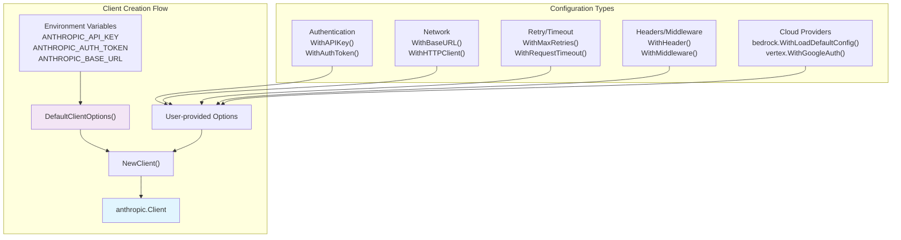

Sources: [client.go:46-57](), [client.go:28-40](), [option/requestoption.go:23]()

## Client Creation and Default Configuration

### Basic Client Creation

The primary method for creating a client is through `NewClient()`, which automatically loads default configuration from environment variables:

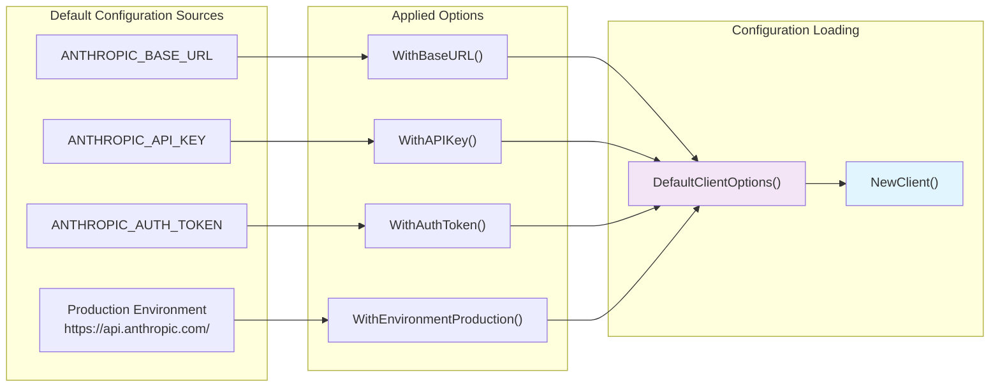

Sources: [client.go:28-40](), [client.go:42-57](), [option/requestoption.go:266-268]()

The `DefaultClientOptions()` function reads configuration in this order:
1. Sets production environment as default base URL
2. Overrides base URL if `ANTHROPIC_BASE_URL` is set
3. Sets API key if `ANTHROPIC_API_KEY` is present
4. Sets auth token if `ANTHROPIC_AUTH_TOKEN` is present

### Client Structure

The `Client` struct contains service instances and holds configuration options that are passed to all requests:

| Field | Type | Purpose |
|-------|------|---------|
| `Options` | `[]option.RequestOption` | Configuration applied to all requests |
| `Completions` | `CompletionService` | Legacy text completions API |
| `Messages` | `MessageService` | Modern messages API |
| `Models` | `ModelService` | Model information API |
| `Beta` | `BetaService` | Beta/experimental features |

The client provides HTTP verb methods (`Get`, `Post`, `Put`, `Patch`, `Delete`) for making custom requests while retaining the configured authentication, base URL, retries, and other options.

Sources: [client.go:17-23](), [client.go:90-126]()

## Authentication Configuration

### API Key Authentication

The primary authentication method uses the `X-Api-Key` header:

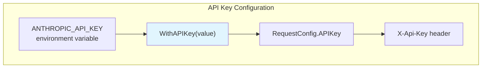

Sources: [option/requestoption.go:270-276](), [client.go:33-35]()

### Bearer Token Authentication

Alternative authentication using the `Authorization` header:

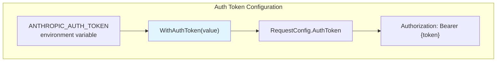

Sources: [option/requestoption.go:278-284](), [client.go:36-38]()

## Network Configuration

### Base URL Configuration

Base URL configuration supports both environment-based and programmatic setup:

| Configuration Method | Function | Purpose |
|---------------------|----------|---------|
| Environment Default | `WithEnvironmentProduction()` | Sets `https://api.anthropic.com/` |
| Environment Variable | `ANTHROPIC_BASE_URL` | Override via environment |
| Programmatic | `WithBaseURL(url)` | Direct URL specification |

Sources: [option/requestoption.go:28-41](), [option/requestoption.go:266-268]()

### HTTP Client Customization

The SDK supports custom HTTP clients for advanced networking requirements:

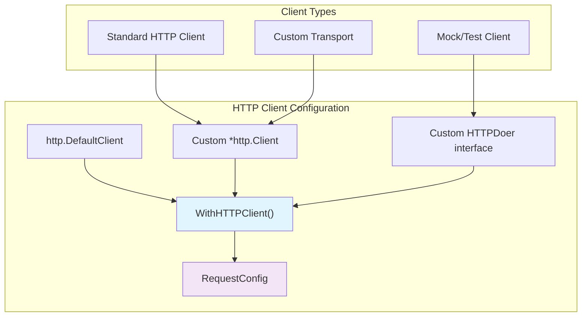

Sources: [option/requestoption.go:48-73](), [internal/requestconfig/requestconfig.go:193-195](), [internal/requestconfig/requestconfig.go:210-211]()

The `WithHTTPClient()` function accepts either an `*http.Client` or any type implementing the `HTTPDoer` interface with a `Do(*http.Request) (*http.Response, error)` method.

## Retry and Timeout Configuration

### Retry Configuration

The SDK implements automatic retry logic with exponential backoff:

| Configuration | Default | Function | Purpose |
|--------------|---------|----------|---------|
| Max Retries | 2 | `WithMaxRetries(n)` | Total retry attempts |
| Retry Conditions | HTTP 408, 409, 429, 5xx | Built-in logic | When to retry |
| Backoff Strategy | Exponential + jitter | `retryDelay()` | Delay between retries |

Sources: [internal/requestconfig/requestconfig.go:165](), [option/requestoption.go:98-106](), [internal/requestconfig/requestconfig.go:356-373]()

### Timeout Configuration

Request timeouts can be configured per-request or globally:

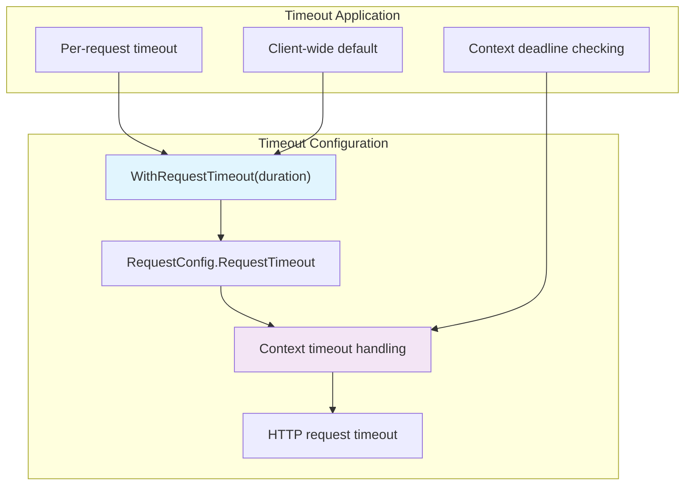

Sources: [option/requestoption.go:254-261](), [internal/requestconfig/requestconfig.go:181-186](), [internal/requestconfig/requestconfig.go:427-435]()

## Header and Middleware Configuration

### Header Management

The SDK provides flexible header manipulation:

| Function | Purpose | Behavior |
|----------|---------|----------|
| `WithHeader(key, value)` | Set header | Overwrites existing values |
| `WithHeaderAdd(key, value)` | Add header | Appends to existing values |
| `WithHeaderDel(key)` | Delete header | Removes all values for key |

Sources: [option/requestoption.go:110-132]()

### Default Headers

The SDK automatically sets several headers on all requests:

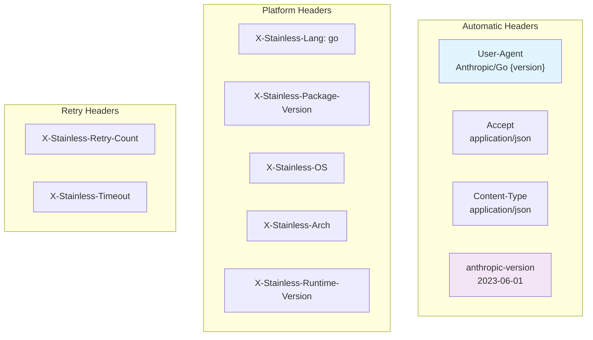

Sources: [README.md:38-66](), [option/requestoption.go:270-276](), [option/requestoption.go:278-284]()

### Middleware Support

The SDK supports HTTP middleware for request/response interception:

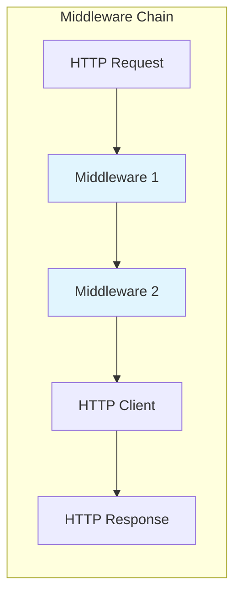

Sources: [option/requestoption.go:75-91](), [internal/requestconfig/requestconfig.go:225-237]()

Middleware functions have the signature `func(*http.Request, MiddlewareNext) (*http.Response, error)` and are applied in the order they're registered.

## Cloud Provider Configuration

### Amazon Bedrock Integration

The SDK supports Amazon Bedrock through special middleware configuration:

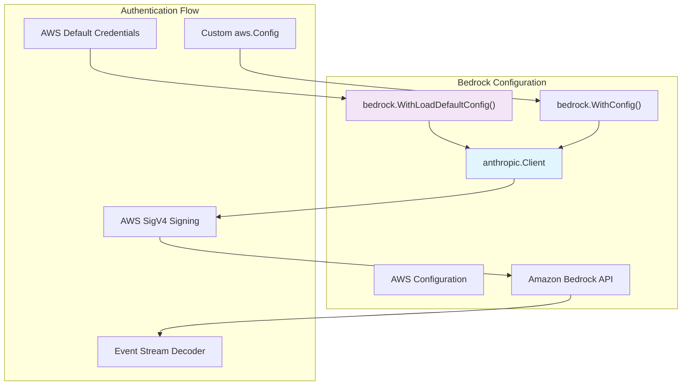

Sources: [README.md:808-834]()

### Google Vertex AI Integration

The SDK supports Google Vertex AI through authentication middleware:

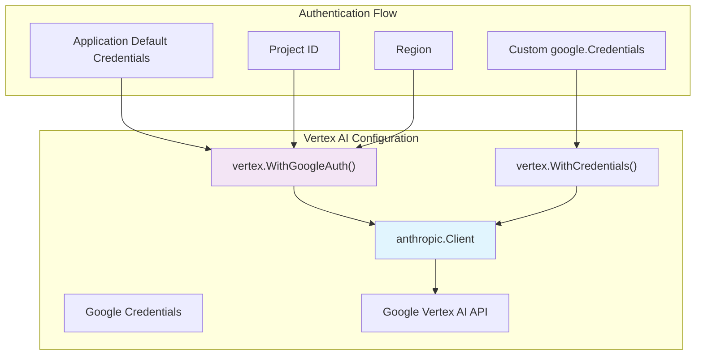

Sources: [README.md:836-862]()

## Request-Level Configuration

### JSON Body Manipulation

For dynamic request body modification, the SDK provides JSON manipulation options:

| Function | Purpose |
|----------|---------|
| `WithJSONSet(key, value)` | Set JSON field using sjson syntax |
| `WithJSONDel(key)` | Delete JSON field |

Sources: [option/requestoption.go:170-212]()

### Query Parameter Management

URL query parameters can be manipulated similarly to headers:

| Function | Purpose |
|----------|---------|
| `WithQuery(key, value)` | Set query parameter |
| `WithQueryAdd(key, value)` | Add query parameter |
| `WithQueryDel(key)` | Delete query parameter |

Sources: [option/requestoption.go:136-164]()

### Response Handling Options

The SDK provides options for custom response handling:

| Function | Purpose |
|----------|---------|
| `WithResponseBodyInto(dst)` | Custom deserialization target |
| `WithResponseInto(dst)` | Access to raw `*http.Response` |
| `WithRequestBody(contentType, body)` | Custom request body |

Sources: [option/requestoption.go:216-249]()

## Configuration Lifecycle

### Request Configuration Flow

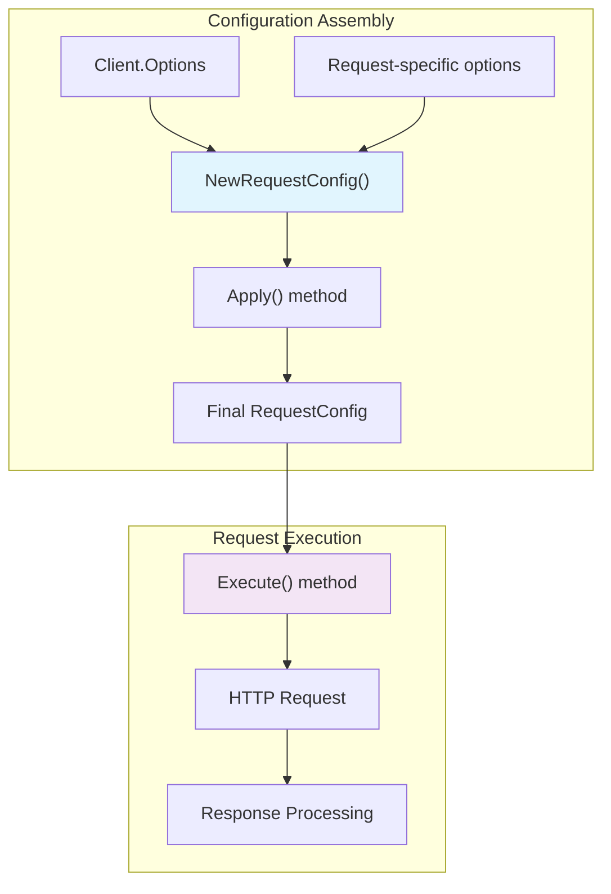

Sources: [internal/requestconfig/requestconfig.go:90-189](), [internal/requestconfig/requestconfig.go:588-596](), [internal/requestconfig/requestconfig.go:375-551]()

The configuration system merges client-level options with request-specific options, with request options taking precedence. This allows for flexible override behavior while maintaining consistent defaults across all API calls.

---

