<!-- source: DeepWiki mcp.deepwiki.com · repo anthropics/anthropic-sdk-go · page 3.2 Request and Response Handling · fetched 2026-10-26 -->

# Request and Response Handling

<details>
<summary>Relevant source files</summary>

The following files were used as context for generating this wiki page:

- [.release-please-manifest.json](.release-please-manifest.json)
- [CHANGELOG.md](CHANGELOG.md)
- [README.md](README.md)
- [client.go](client.go)
- [client_test.go](client_test.go)
- [completion_test.go](completion_test.go)
- [internal/apierror/apierror.go](internal/apierror/apierror.go)
- [internal/apijson/subfield.go](internal/apijson/subfield.go)
- [internal/requestconfig/requestconfig.go](internal/requestconfig/requestconfig.go)
- [internal/version.go](internal/version.go)
- [option/requestoption.go](option/requestoption.go)
- [packages/pagination/pagination.go](packages/pagination/pagination.go)
- [usage_test.go](usage_test.go)

</details>


This page documents the request execution pipeline in the Anthropic Go SDK, covering how requests are prepared, executed, retried on failure, and how responses are processed. This includes the mechanics of HTTP execution, retry logic with exponential backoff, timeout management, and response deserialization.

For information about configuring the client with API keys, base URLs, and retry settings, see [Client Configuration](#3.1). For details on how request parameters are serialized, see [Parameter Encoding](#3.3). For error types and debugging methods, see [Error Handling](#3.4).

## Request Lifecycle Overview

The SDK processes requests through a multi-stage pipeline that handles serialization, middleware application, HTTP execution, retry logic, and response deserialization.

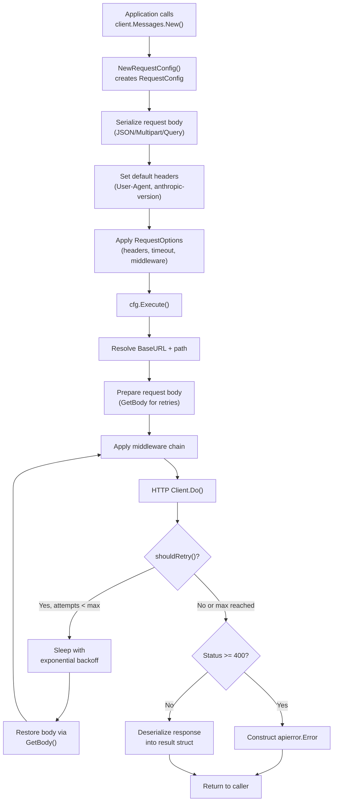

**Sources:** [internal/requestconfig/requestconfig.go:90-191](), [internal/requestconfig/requestconfig.go:377-558]()

## RequestConfig Structure

The `RequestConfig` struct represents all state for a single request, including HTTP details, retry settings, and deserialization targets.

| Field | Type | Purpose |
|-------|------|---------|
| `Request` | `*http.Request` | The HTTP request to execute |
| `Context` | `context.Context` | Context for cancellation/timeouts |
| `BaseURL` | `*url.URL` | Base URL for the API |
| `HTTPClient` | `*http.Client` | HTTP client for execution |
| `CustomHTTPDoer` | `HTTPDoer` | Alternative HTTP executor |
| `Middlewares` | `[]middleware` | Middleware chain to apply |
| `MaxRetries` | `int` | Maximum retry attempts (default: 2) |
| `RequestTimeout` | `time.Duration` | Per-request timeout |
| `Body` | `io.Reader` | Request body reader |
| `ResponseBodyInto` | `any` | Deserialization target |
| `ResponseInto` | `**http.Response` | Raw response target |
| `APIKey` | `string` | API key for authentication |
| `AuthToken` | `string` | Auth token for authentication |

**Sources:** [internal/requestconfig/requestconfig.go:199-225]()

## Request Preparation

The `NewRequestConfig` function constructs a `RequestConfig` from method, URL, body, and options. It automatically detects serialization format based on the body type.

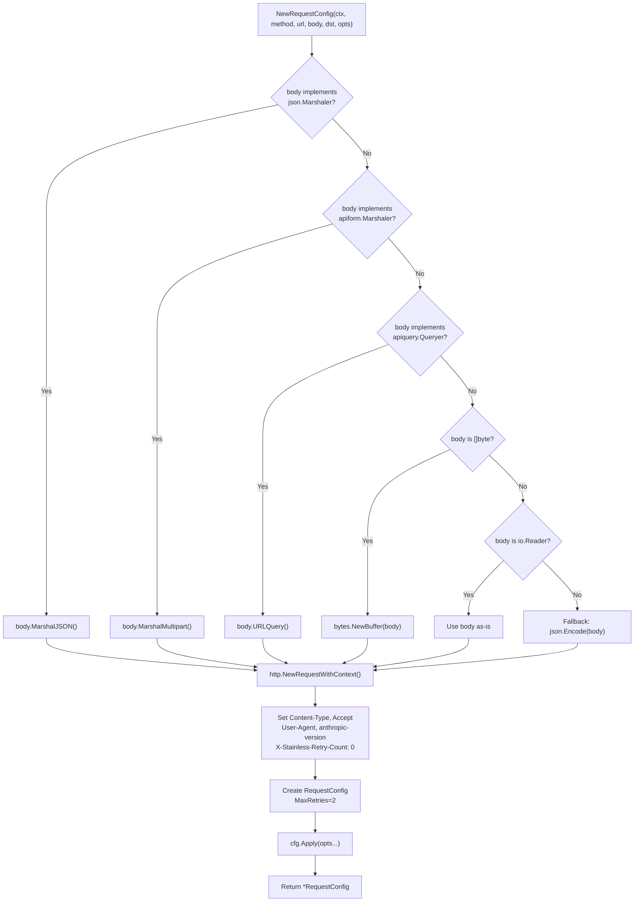

### Default Headers

The SDK sets several headers automatically:

- `User-Agent`: `"Anthropic/Go {version}"` - Identifies the SDK version
- `anthropic-version`: `"2023-06-01"` - API version
- `Accept`: `"application/json"` - Expected response format
- `Content-Type`: Set based on body serialization (JSON or multipart)
- `X-Stainless-Retry-Count`: `"0"` - Tracks retry attempts
- `X-Stainless-Timeout`: `"0"` - Placeholder for timeout tracking
- Platform headers: `X-Stainless-Lang`, `X-Stainless-OS`, `X-Stainless-Arch`, `X-Stainless-Runtime`

**Sources:** [internal/requestconfig/requestconfig.go:27-78](), [internal/requestconfig/requestconfig.go:90-191]()

## Request Execution Pipeline

The `Execute` method orchestrates the entire request lifecycle, including middleware application, HTTP execution, and retry logic.

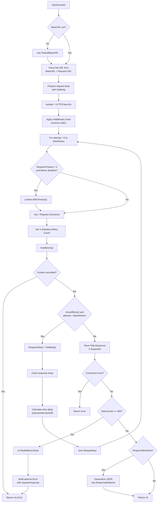

**Sources:** [internal/requestconfig/requestconfig.go:377-558]()

## Middleware Chain Application

Middlewares are applied in reverse order, creating a nested chain where each middleware calls the next.

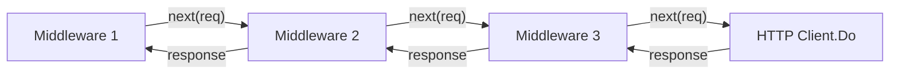

The `applyMiddleware` function wraps each middleware:

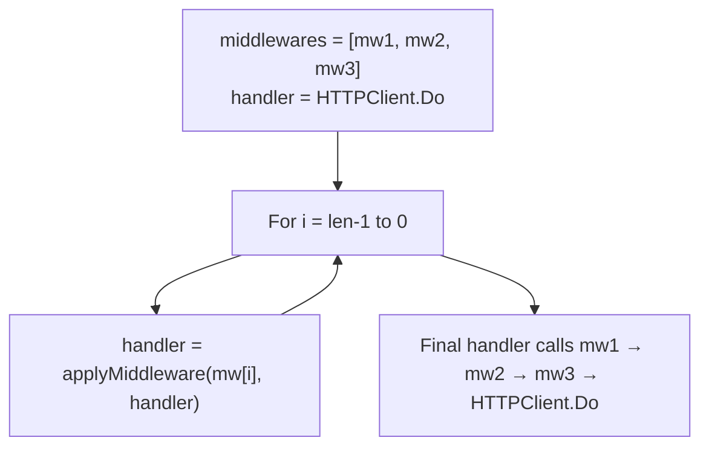

**Sources:** [internal/requestconfig/requestconfig.go:235-239](), [internal/requestconfig/requestconfig.go:418-420]()

## Retry Mechanism

The SDK automatically retries certain failed requests with exponential backoff and jitter.

### Retry Decision Logic

The `shouldRetry` function determines if a request should be retried:

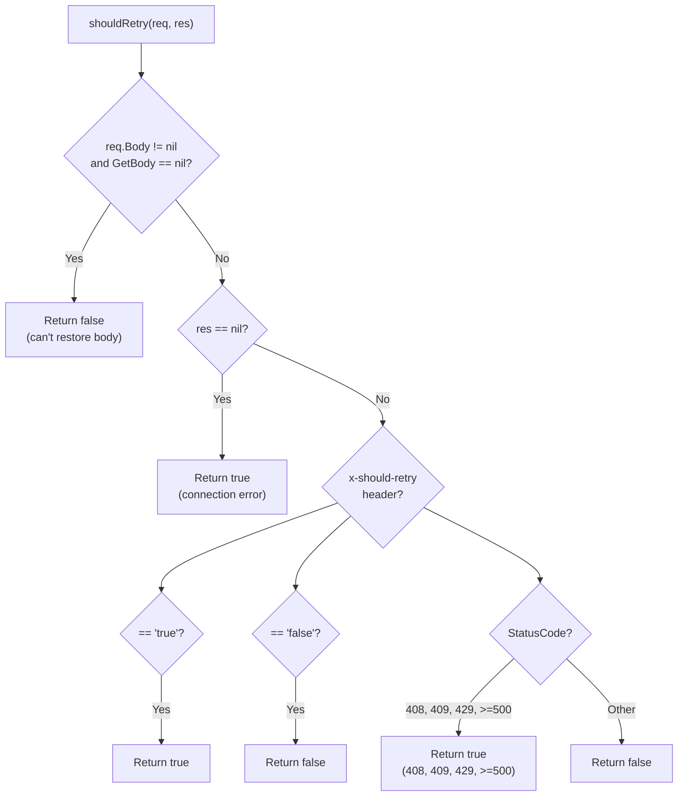

**Retryable Status Codes:**
- `408 Request Timeout`
- `409 Conflict`
- `429 Too Many Requests`
- `500+` (all server errors)

**Sources:** [internal/requestconfig/requestconfig.go:241-266]()

### Retry Delay Calculation

The `retryDelay` function calculates how long to wait before retrying:

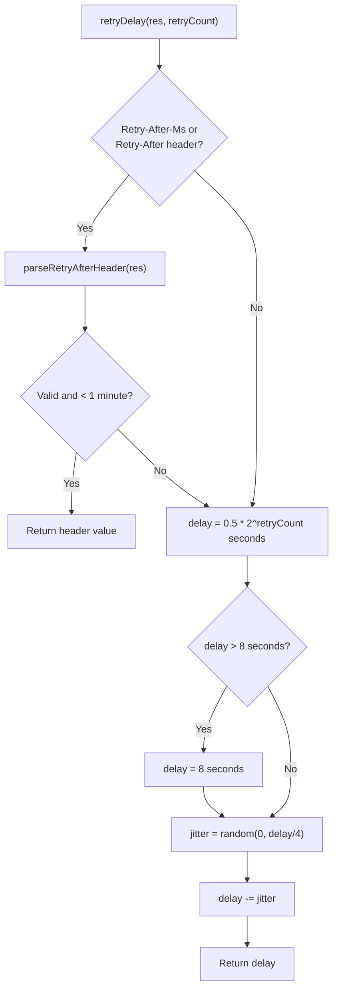

**Exponential Backoff Formula:**
- Base delay: `0.5 * 2^retryCount` seconds
- Maximum delay: 8 seconds
- Jitter: Random reduction of 0-25% of delay

**Headers Parsed (in order of preference):**
1. `Retry-After-Ms` - Milliseconds (numeric)
2. `Retry-After` - Seconds (numeric) or HTTP date

**Sources:** [internal/requestconfig/requestconfig.go:268-321](), [internal/requestconfig/requestconfig.go:358-375]()

### Body Restoration

For retries to work, the request body must be restorable via `GetBody`:

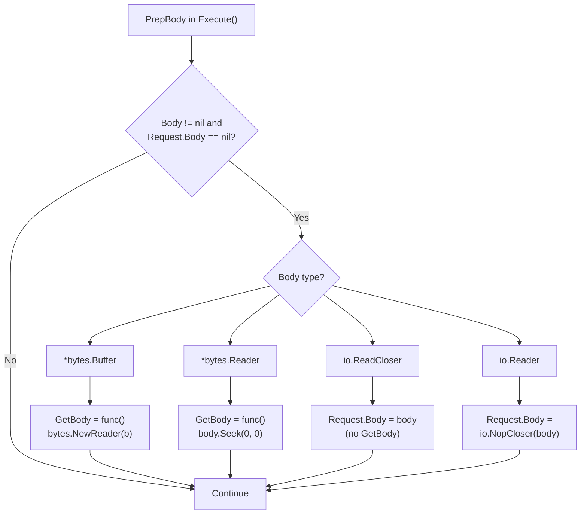

If `GetBody` is not set and `Body` is not nil, retries are disabled for that request.

**Sources:** [internal/requestconfig/requestconfig.go:391-412](), [internal/requestconfig/requestconfig.go:453-463]()

## Response Processing

After successful HTTP execution, the SDK processes the response based on status code and content type.

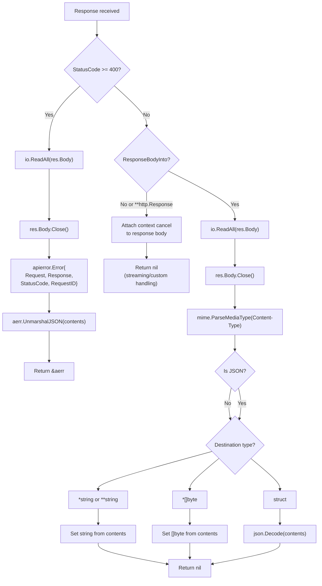

### Content Type Handling

The SDK handles different content types appropriately:

| Content-Type | Destination Type | Behavior |
|--------------|------------------|----------|
| `application/json` | `struct` | JSON decode into struct |
| `application/json` | `*[]byte` | Raw bytes |
| `application/json` | `*string` | JSON string |
| Other | `*string` or `**string` | Plain text string |
| Other | `*[]byte` | Raw bytes |
| Other | `struct` | Error: expected string/bytes |

**Sources:** [internal/requestconfig/requestconfig.go:489-556]()

### API Error Construction

When status code is >= 400, the SDK constructs an `apierror.Error`:

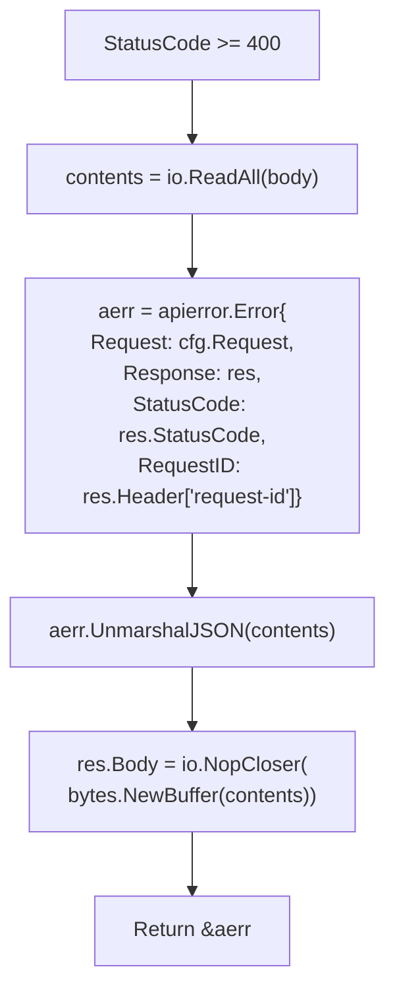

The error contains the full request and response for debugging. The `Error()` method formats it as:

```
{METHOD} "{URL}": {STATUS} {STATUS_TEXT} (Request-ID: {ID}) {JSON_BODY}
```

**Sources:** [internal/requestconfig/requestconfig.go:489-507](), [internal/apierror/apierror.go:35-44]()

## Timeout Management

The SDK supports two types of timeouts that work together:

### Context Timeout

The context timeout spans all retry attempts:

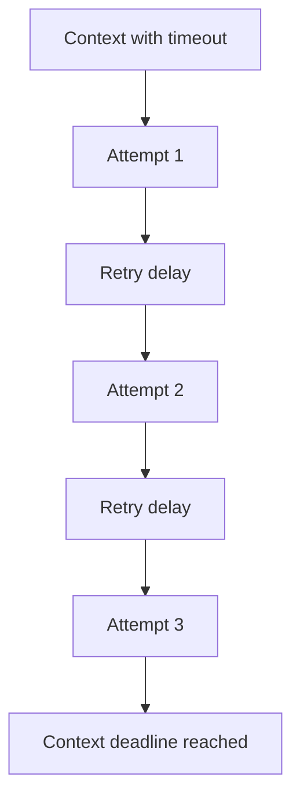

**Sources:** [client_test.go:286-332]()

### Per-Request Timeout

The `RequestTimeout` applies to each individual attempt:

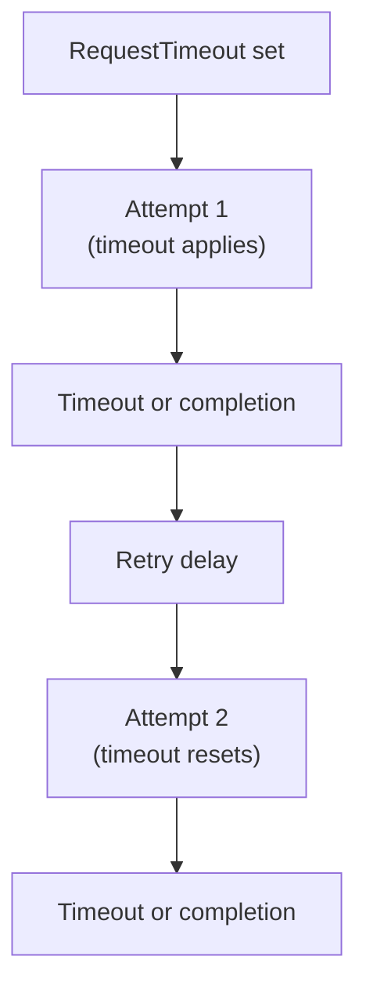

The per-request timeout is enforced by creating a context with timeout for each attempt:

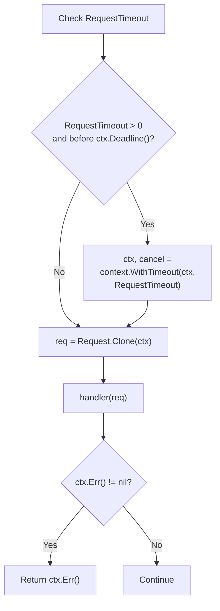

**Sources:** [internal/requestconfig/requestconfig.go:429-437](), [option/requestoption.go:252-262]()

### Timeout Header Tracking

The SDK sets `X-Stainless-Timeout` header to track the configured timeout:

```mermaid
graph TB
    Start["Apply options"]
    CheckHeader{"X-Stainless-Timeout<br/>still '0'?"}
    CheckTimeout{"RequestTimeout == 0?"}
    DeleteHeader["Delete header"]
    SetHeader["Set header to<br/>timeout seconds"]
    Continue["Continue"]
    
    Start --> CheckHeader
    CheckHeader -->|Yes| CheckTimeout
    CheckHeader -->|No (user modified)| Continue
    CheckTimeout -->|Yes| DeleteHeader
    CheckTimeout -->|No| SetHeader
    DeleteHeader --> Continue
    SetHeader --> Continue
```

**Sources:** [internal/requestconfig/requestconfig.go:182-188]()

### Streaming Response Timeout

For streaming responses, the timeout is attached to the response body via `bodyWithTimeout`:

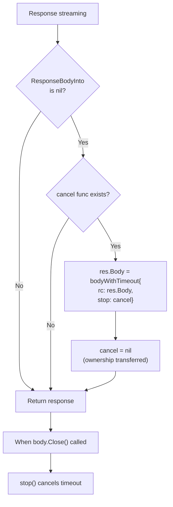

The `bodyWithTimeout` wrapper ensures the timeout context is cancelled when the body is closed, preventing resource leaks.

**Sources:** [internal/requestconfig/requestconfig.go:334-356](), [internal/requestconfig/requestconfig.go:509-518]()

## Retry Count Header

The SDK tracks retry attempts via the `X-Stainless-Retry-Count` header:

```mermaid
graph TB
    Start["Start execution"]
    CheckDefault{"Header is '0'<br/>(default)?"}
    SetFlag["shouldSendRetryCount = true"]
    NoFlag["shouldSendRetryCount = false"]
    Loop["For each attempt"]
    CheckFlag{"shouldSendRetryCount?"}
    SetHeader["Set X-Stainless-Retry-Count<br/>to attempt number"]
    Skip["Don't modify header"]
    Execute["Execute request"]
    
    Start --> CheckDefault
    CheckDefault -->|Yes| SetFlag
    CheckDefault -->|No (user modified)| NoFlag
    SetFlag --> Loop
    NoFlag --> Loop
    Loop --> CheckFlag
    CheckFlag -->|Yes| SetHeader
    CheckFlag -->|No| Skip
    SetHeader --> Execute
    Skip --> Execute
```

This allows users to:
- Track retries in logs by inspecting the header
- Disable retry tracking by deleting the header
- Override retry count by setting a custom value

**Sources:** [internal/requestconfig/requestconfig.go:423-442](), [client_test.go:104-143](), [client_test.go:145-184]()

## Client Execution Methods

The `Client` provides convenience methods that wrap `Execute`:

| Method | HTTP Method | Usage |
|--------|-------------|-------|
| `Execute` | Any | `client.Execute(ctx, "POST", "/path", params, &result, opts...)` |
| `Get` | GET | `client.Get(ctx, "/path", params, &result, opts...)` |
| `Post` | POST | `client.Post(ctx, "/path", params, &result, opts...)` |
| `Put` | PUT | `client.Put(ctx, "/path", params, &result, opts...)` |
| `Patch` | PATCH | `client.Patch(ctx, "/path", params, &result, opts...)` |
| `Delete` | DELETE | `client.Delete(ctx, "/path", params, &result, opts...)` |

All methods:
- Accept a context for cancellation/timeout
- Merge client-level and request-level options
- Support custom request params and response types
- Return errors for failures

**Sources:** [client.go:94-130]()

## Response Body Access Patterns

The SDK supports multiple patterns for accessing response data:

### Automatic Deserialization

```go
var message anthropic.Message
err := client.Messages.New(ctx, params)
// message is populated with deserialized response
```

### Raw HTTP Response

```go
var resp *http.Response
_, err := client.Messages.New(ctx, params, 
    option.WithResponseInto(&resp))
// resp contains the full *http.Response
```

### Raw Response Body

```go
var body []byte
err := client.Get(ctx, "/path", nil, &body)
// body contains raw response bytes
```

### Streaming

```go
stream := client.Messages.NewStreaming(ctx, params)
for stream.Next() {
    event := stream.Current()
    // Process streaming events
}
```

**Sources:** [README.md:762-793](), [internal/requestconfig/requestconfig.go:479-481](), [internal/requestconfig/requestconfig.go:509-519]()

---

**Sources:** [internal/requestconfig/requestconfig.go:1-637](), [option/requestoption.go:1-286](), [client.go:1-158](), [internal/apierror/apierror.go:1-58](), [client_test.go:1-457]()

---

