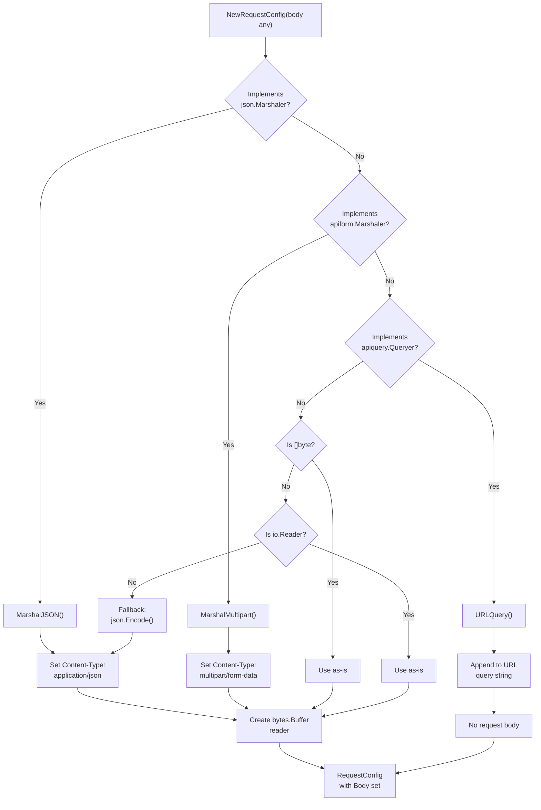
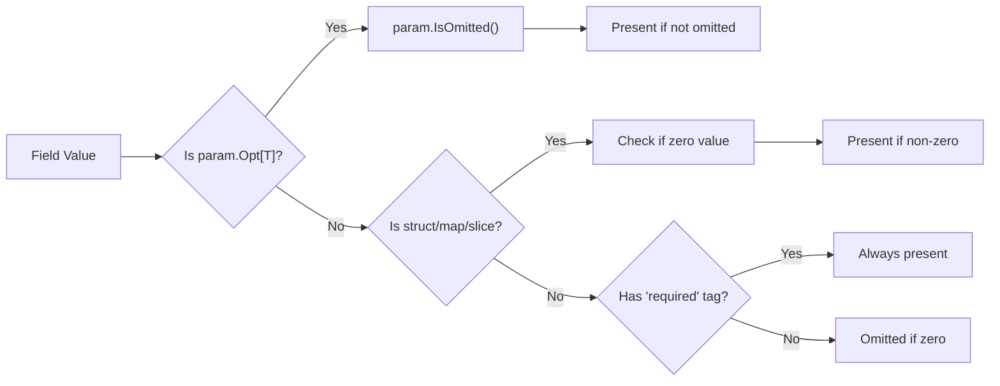
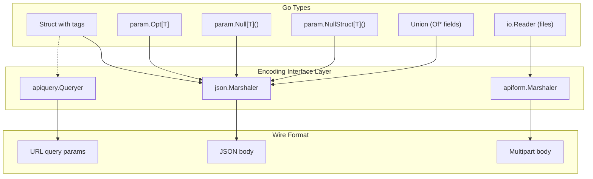

<!-- source: DeepWiki mcp.deepwiki.com · repo anthropics/anthropic-sdk-go · page 3.3 Parameter Encoding · fetched 2026-10-26 -->

# Parameter Encoding

<details>
<summary>Relevant source files</summary>

The following files were used as context for generating this wiki page:

- [.release-please-manifest.json](.release-please-manifest.json)
- [CHANGELOG.md](CHANGELOG.md)
- [README.md](README.md)
- [client.go](client.go)
- [internal/apierror/apierror.go](internal/apierror/apierror.go)
- [internal/apijson/subfield.go](internal/apijson/subfield.go)
- [internal/requestconfig/requestconfig.go](internal/requestconfig/requestconfig.go)
- [internal/version.go](internal/version.go)
- [option/requestoption.go](option/requestoption.go)
- [packages/pagination/pagination.go](packages/pagination/pagination.go)

</details>


This document describes how request parameters are serialized when making API calls with the Anthropic Go SDK. Parameter encoding determines how Go structs and values are converted into HTTP request bodies, query strings, and multipart form data.

For information about request execution and retry logic, see [Request and Response Handling](#3.2). For details on error handling, see [Error Handling](#3.4).

## Overview

The SDK supports three primary encoding strategies, selected automatically based on the parameter type:

| Encoding Strategy | Content-Type | Use Case | Interface |
|------------------|--------------|----------|-----------|
| JSON | `application/json` | Default for most API requests | `json.Marshaler` |
| Multipart | `multipart/form-data` | File uploads and mixed content | `apiform.Marshaler` |
| Query String | N/A (URL parameters) | GET requests, pagination | `apiquery.Queryer` |

The encoding strategy is determined during request construction in [internal/requestconfig/requestconfig.go:90-191]().

**Sources:** [internal/requestconfig/requestconfig.go:90-191](), [README.md:370-429]()

## Encoding Pipeline



**Encoding Decision Tree**

The encoding strategy is selected by checking interfaces in order: `json.Marshaler`, `apiform.Marshaler`, `apiquery.Queryer`, then falling back to standard JSON encoding.

**Sources:** [internal/requestconfig/requestconfig.go:90-146]()

## JSON Encoding

JSON is the default encoding strategy for request bodies. The SDK uses Go 1.24+ `encoding/json` with `omitzero` semantics.

### Field Serialization Rules

**Required Fields:**

Required primitive fields use the `json:"...,required"` tag and are always serialized, even when they contain zero values:

```go
type MessageNewParams struct {
    MaxTokens int64  `json:"max_tokens,required"`
    Model     Model  `json:"model,required"`
}
```

**Optional Fields:**

Optional primitive types are wrapped in `param.Opt[T]` and use the `json:"...,omitzero"` tag:

```go
type ExampleParams struct {
    ID   string            `json:"id,required"`
    Name param.Opt[string] `json:"name,omitzero"`
}
```

Zero values of `param.Opt[T]`, maps, slices, structs, and string enums are omitted from serialization.

### Nullable Values

To send explicit `null` values instead of omitting fields:

- **Primitives:** Use `param.Null[T]()`
- **Structs:** Use `param.NullStruct[T]()`

Example from [README.md:400-409]():

```go
p.Name = param.Null[string]()        // Serializes as 'null'
p.Point = param.NullStruct[Point]()  // Serializes as 'null'

param.IsNull(p.Name)   // true
param.IsNull(p.Point)  // true
```

### HTML Escaping

By default, the JSON encoder escapes HTML characters. The fallback encoder at [internal/requestconfig/requestconfig.go:138-145]() uses:

```go
enc := json.NewEncoder(buf)
enc.SetEscapeHTML(true)
```

**Sources:** [README.md:370-409](), [internal/requestconfig/requestconfig.go:96-102](), [internal/requestconfig/requestconfig.go:138-145]()

## Multipart Encoding

Multipart encoding is used for file uploads and requests with mixed content types. Parameters implementing `apiform.Marshaler` are automatically encoded as `multipart/form-data`.

### Multipart Serialization

The encoding is handled at [internal/requestconfig/requestconfig.go:104-115]():

```go
if body, ok := body.(apiform.Marshaler); ok {
    var (
        content []byte
        err     error
    )
    content, contentType, err = body.MarshalMultipart()
    if err != nil {
        return nil, err
    }
    reader = bytes.NewBuffer(content)
    hasSerializationFunc = true
}
```

The `MarshalMultipart()` method returns:
- `[]byte`: The encoded multipart body
- `string`: The full `Content-Type` header (including boundary)
- `error`: Any encoding error

### File Uploads

File upload parameters accept `io.Reader` types. The SDK provides a helper for setting filename and content-type:

```go
// From README.md:710-723
file, err := os.Open("/path/to/file.json")
anthropic.BetaFileUploadParams{
    File: anthropic.File(file, "custom-name.json", "application/json"),
}

// Or from a string
anthropic.BetaFileUploadParams{
    File: anthropic.File(strings.NewReader("contents"), "name.json", "application/json"),
}
```

Files without custom names use "anonymous_file" and "application/octet-stream" as defaults.

**Sources:** [README.md:702-728](), [internal/requestconfig/requestconfig.go:104-115]()

## Query String Encoding

Query string encoding appends parameters to the URL. Parameters implementing `apiquery.Queryer` are serialized as query strings.

### Query Serialization

The encoding is handled at [internal/requestconfig/requestconfig.go:116-126]():

```go
if body, ok := body.(apiquery.Queryer); ok {
    hasSerializationFunc = true
    q, err := body.URLQuery()
    if err != nil {
        return nil, err
    }
    params := q.Encode()
    if params != "" {
        u = u + "?" + params
    }
}
```

The `URLQuery()` method returns `url.Values` which are then encoded using standard Go URL encoding.

### Runtime Query Manipulation

Query parameters can be added, modified, or deleted at request time using options from [option/requestoption.go:137-165]():

```go
// Set (overwrites existing)
option.WithQuery("limit", "20")

// Add (appends to existing)
option.WithQueryAdd("filter", "active")

// Delete
option.WithQueryDel("sort")
```

**Sources:** [internal/requestconfig/requestconfig.go:116-126](), [option/requestoption.go:137-165]()

## Union Types

Union types represent parameters that can be one of several variants. In request parameters, unions use a struct with "Of" prefixed fields.

### Union Parameter Structure

From [README.md:431-459]():

```go
type AnimalUnionParam struct {
    OfCat *Cat `json:",omitzero,inline"`
    OfDog *Dog `json:",omitzero,inline"`
}
```

**Rules:**
- Only one "Of" field can be non-zero
- Non-zero field is serialized (others omitted)
- Use `param.IsOmitted()` to check presence

### Accessing Union Properties

Unions provide getter methods for nested properties:

```go
animal := AnimalUnionParam{
    OfCat: &Cat{
        Name: "Whiskers",
        Owner: PersonParam{
            Address: AddressParam{Street: "3333 Coyote Hill Rd"},
        },
    },
}

// Mutating nested fields
if address := animal.GetOwner().GetAddress(); address != nil {
    address.ZipCode = 94304
}
```

**Sources:** [README.md:431-459]()

## Extra Fields and Overrides

The SDK provides escape hatches for sending non-conforming or undocumented parameters.

### SetExtraFields

From [README.md:411-429]():

```go
p.SetExtraFields(map[string]any{
    "x": 0.01,  // Override field type
})
```

**Warning:** Only use `SetExtraFields` with trusted data for security reasons.

### Override Entire Struct

To replace a parameter struct completely:

```go
custom := param.Override[anthropic.FooParams](12)  // Send number instead of object
```

### Runtime JSON Manipulation

The `option.WithJSONSet()` and `option.WithJSONDel()` options use [sjson](https://github.com/tidwall/sjson) syntax at [option/requestoption.go:171-213]():

```go
option.WithJSONSet("data.last_name", "Doe")    // Set nested field
option.WithJSONSet("some.json.path", map[string]string{"my": "object"})
option.WithJSONDel("optional_field")            // Remove field
```

These options modify the serialized JSON body after struct marshaling.

**Sources:** [README.md:411-429](), [option/requestoption.go:171-213]()

## Custom Request Bodies

For complete control over serialization, bypass parameter structs entirely using [option/requestoption.go:236-250]():

```go
option.WithRequestBody("application/json", body)
```

The `body` parameter accepts:
- `io.Reader`: Stream the content
- `[]byte`: Send raw bytes

This sets the `Content-Type` header and replaces the request body, bypassing all automatic encoding logic.

**Sources:** [option/requestoption.go:236-250]()

## Field Presence Detection



**Field Presence Rules**

The `param.IsOmitted(any)` function from [README.md:384]() can confirm the presence of any `omitzero` field.

**Sources:** [README.md:370-398]()

## Encoding Type Mapping



**Type to Encoding Mapping**

Different Go types implement different marshaler interfaces to control their wire format representation.

**Sources:** [internal/requestconfig/requestconfig.go:90-146](), [README.md:370-459]()

## Implementation Reference

The core encoding logic resides in:

| Component | Path | Purpose |
|-----------|------|---------|
| Request Config | [internal/requestconfig/requestconfig.go:90-191]() | Main encoding dispatcher |
| JSON Tags | README.md examples | Field-level serialization control |
| Options | [option/requestoption.go]() | Runtime parameter manipulation |
| Form Encoding | `internal/apiform` | Multipart marshaling |
| Query Encoding | `internal/apiquery` | URL query marshaling |

The encoding pipeline at [internal/requestconfig/requestconfig.go:136-145]() provides the fallback JSON encoder:

```go
if body != nil && !hasSerializationFunc {
    buf := new(bytes.Buffer)
    enc := json.NewEncoder(buf)
    enc.SetEscapeHTML(true)
    if err := enc.Encode(body); err != nil {
        return nil, err
    }
    reader = buf
}
```

After encoding, the body is set in the request at [internal/requestconfig/requestconfig.go:391-412]().

**Sources:** [internal/requestconfig/requestconfig.go:90-191](), [internal/requestconfig/requestconfig.go:391-412]()

---

