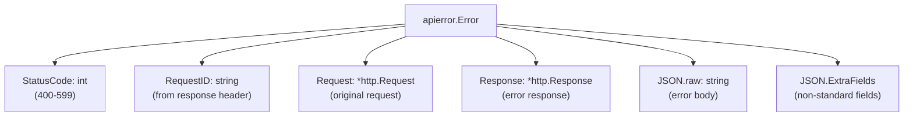
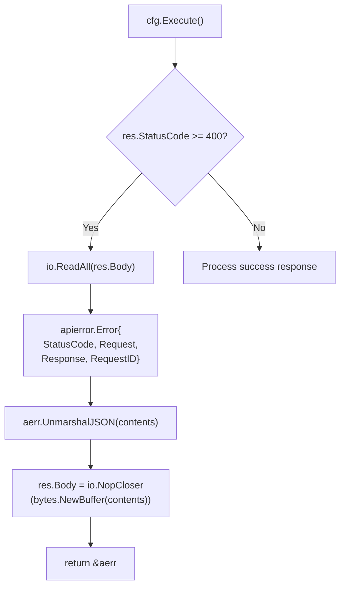
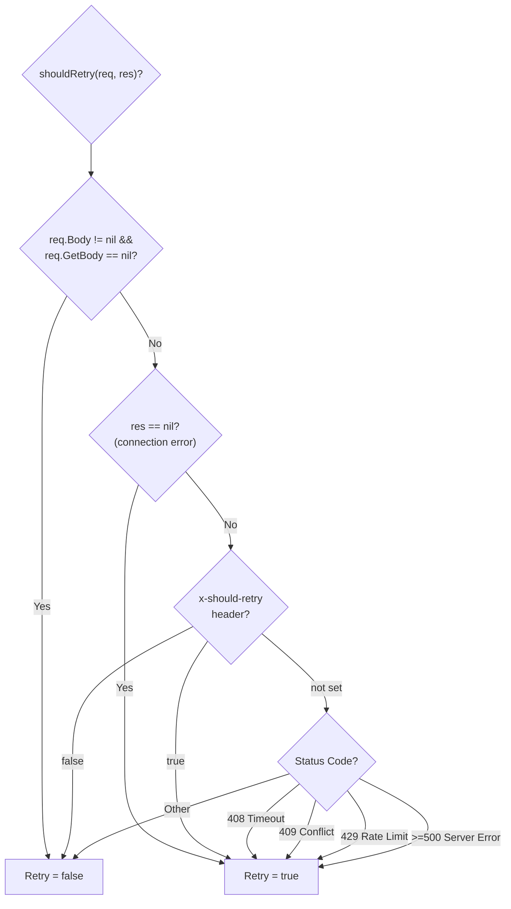
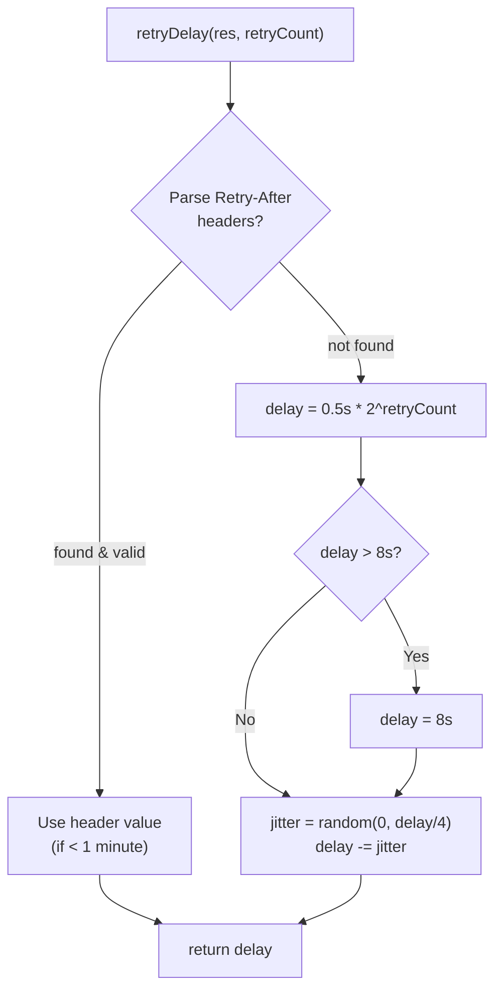
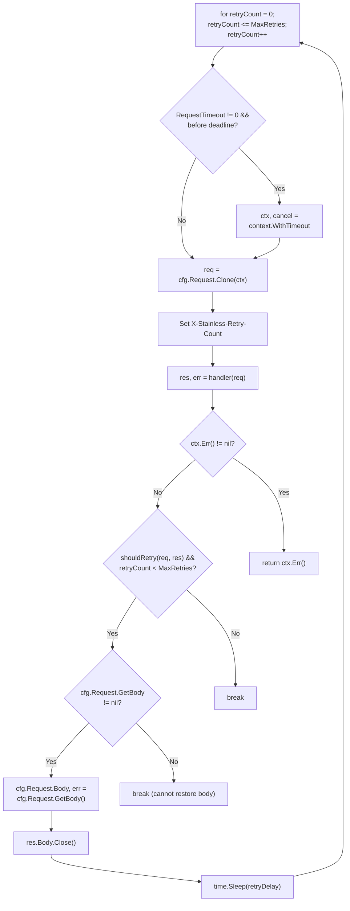
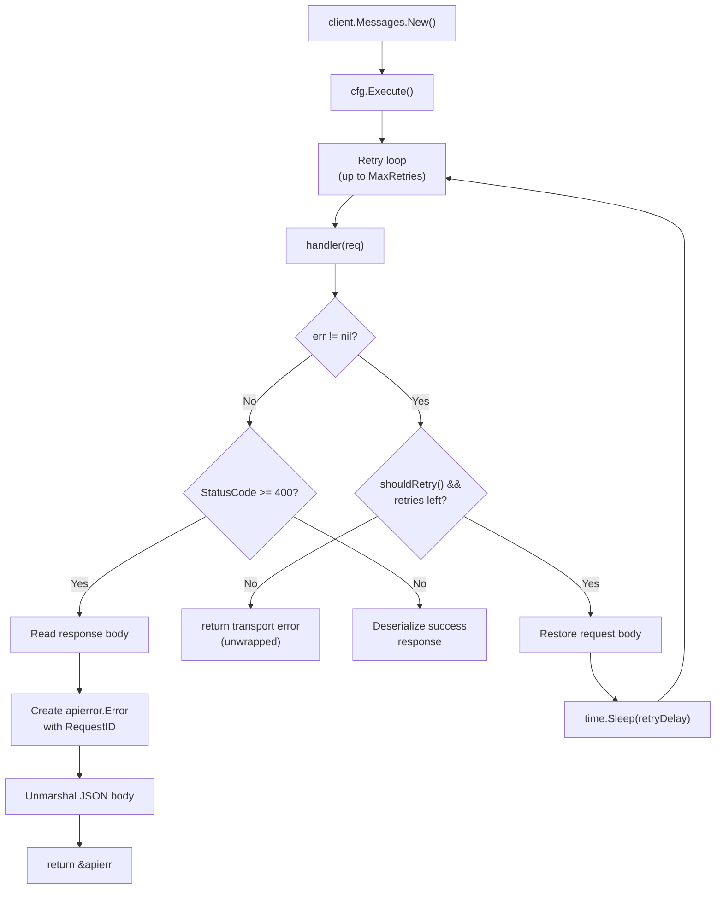

<!-- source: DeepWiki mcp.deepwiki.com · repo anthropics/anthropic-sdk-go · page 3.4 Error Handling · fetched 2026-10-26 -->

# Error Handling

<details>
<summary>Relevant source files</summary>

The following files were used as context for generating this wiki page:

- [.release-please-manifest.json](.release-please-manifest.json)
- [CHANGELOG.md](CHANGELOG.md)
- [README.md](README.md)
- [api.md](api.md)
- [client.go](client.go)
- [internal/apierror/apierror.go](internal/apierror/apierror.go)
- [internal/apijson/subfield.go](internal/apijson/subfield.go)
- [internal/requestconfig/requestconfig.go](internal/requestconfig/requestconfig.go)
- [internal/version.go](internal/version.go)
- [option/requestoption.go](option/requestoption.go)
- [packages/pagination/pagination.go](packages/pagination/pagination.go)
- [shared/constant/constants.go](shared/constant/constants.go)

</details>


This document describes how the Anthropic Go SDK handles errors from API requests, including error types, retry logic, error inspection capabilities, and best practices for handling failures. For information about request execution and response handling, see [Request and Response Handling](#3.2). For retry configuration options, see [Client Configuration](#3.1).

## Error Types

The SDK distinguishes between two categories of errors:

**API Errors** (`*anthropic.Error`) - Errors returned by the Anthropic API with HTTP status codes >= 400. These are wrapped in a structured error type that includes request context, response details, and the error body.

**Transport Errors** - Network failures, timeouts, and other transport-level errors (e.g., `*url.Error`, `*net.OpError`). These are returned unwrapped as-is from the underlying HTTP client.

The primary error type is defined in [internal/apierror/apierror.go:14-27]():

```go
type Error struct {
    JSON struct {
        ExtraFields map[string]respjson.Field
        raw         string
    }
    StatusCode int
    Request    *http.Request
    Response   *http.Response
    RequestID  string
}
```

| Field | Type | Description |
|-------|------|-------------|
| `StatusCode` | `int` | HTTP status code from the response |
| `Request` | `*http.Request` | The original HTTP request that failed |
| `Response` | `*http.Response` | The HTTP response containing the error |
| `RequestID` | `string` | Unique identifier from `request-id` header for troubleshooting with Anthropic support |
| `JSON` | struct | Contains raw JSON body and extra fields not defined in the struct |

Sources: [internal/apierror/apierror.go:14-27]()

## Error Response Format

### API Error Structure



**API Error Structure**

Sources: [internal/apierror/apierror.go:14-27]()

### Error Detection and Creation

The error detection logic is implemented in [internal/requestconfig/requestconfig.go:489-507]():



**Error Creation Flow in requestconfig.Execute()**

The error creation process:
1. Check if status code >= 400
2. Read response body contents
3. Construct `apierror.Error` with StatusCode, Request, Response, and RequestID (from `request-id` header)
4. Unmarshal JSON body into the error struct
5. Re-populate response body for debugging utilities
6. Return the error

Sources: [internal/requestconfig/requestconfig.go:489-507]()

## Retry Logic

The SDK automatically retries certain types of errors using exponential backoff with jitter. Retry behavior is configured via `MaxRetries` (default: 2).

### Retry Decision

The retry decision logic is in [internal/requestconfig/requestconfig.go:241-266]():



**Retry Decision Tree**

Retryable conditions:
- Connection errors (no response received)
- HTTP 408 Request Timeout
- HTTP 409 Conflict
- HTTP 429 Too Many Requests
- HTTP 5xx Server Errors

Non-retryable conditions:
- Request body cannot be restored (`GetBody == nil` and `Body != nil`)
- Header `x-should-retry: false` is set
- 4xx errors (except 408, 409, 429)

Sources: [internal/requestconfig/requestconfig.go:241-266]()

### Retry Delay Calculation

The delay between retries uses exponential backoff with jitter, implemented in [internal/requestconfig/requestconfig.go:358-375]():



**Retry Delay Calculation**

The delay calculation:
1. Check for `Retry-After-Ms` or `Retry-After` headers
2. If present and reasonable (< 1 minute), use that value
3. Otherwise, use exponential backoff: `0.5 * 2^retryCount` seconds
4. Cap maximum delay at 8 seconds
5. Subtract random jitter (0 to 25% of delay)

Sources: [internal/requestconfig/requestconfig.go:268-321](), [internal/requestconfig/requestconfig.go:358-375]()

### Retry Loop Implementation

The retry loop is executed in [internal/requestconfig/requestconfig.go:427-471]():



**Retry Loop Execution Flow**

Key aspects:
- Applies per-request timeout if configured
- Sends retry count in `X-Stainless-Retry-Count` header
- Restores request body via `GetBody()` before retrying
- Closes response body before next attempt
- Respects context cancellation

Sources: [internal/requestconfig/requestconfig.go:427-471]()

## Error Inspection and Debugging

### Type Assertion Pattern

The recommended pattern for handling API errors is using `errors.As` as shown in [README.md:634-656]():

```go
_, err := client.Messages.New(context.TODO(), anthropic.MessageNewParams{
    // ... params ...
})
if err != nil {
    var apierr *anthropic.Error
    if errors.As(err, &apierr) {
        println("Request ID:", apierr.RequestID)
        println(string(apierr.DumpRequest(true)))
        println(string(apierr.DumpResponse(true)))
    }
    panic(err.Error())
}
```

### Error Methods

The `apierror.Error` type provides several methods for debugging:

| Method | Signature | Purpose |
|--------|-----------|---------|
| `Error()` | `func (r *Error) Error() string` | Returns formatted error message with status, URL, request ID, and JSON body |
| `DumpRequest(body bool)` | `func (r *Error) DumpRequest(body bool) []byte` | Returns HTTP request dump (uses `httputil.DumpRequestOut`) |
| `DumpResponse(body bool)` | `func (r *Error) DumpResponse(body bool) []byte` | Returns HTTP response dump (uses `httputil.DumpResponse`) |
| `RawJSON()` | `func (r Error) RawJSON() string` | Returns raw JSON response body |

Sources: [internal/apierror/apierror.go:35-57]()

### Error Message Format

The `Error()` method constructs a message in this format (from [internal/apierror/apierror.go:35-44]()):

```
<METHOD> "<URL>": <STATUS_CODE> <STATUS_TEXT> (Request-ID: <REQUEST_ID>) <JSON_BODY>
```

Example:
```
POST "https://api.anthropic.com/v1/messages": 400 Bad Request (Request-ID: req_xxx) {"type":"error","error":{"type":"invalid_request_error","message":"..."}}
```

Sources: [internal/apierror/apierror.go:35-44]()

## Error Handling Flow



**Complete Error Handling Flow**

Sources: [internal/requestconfig/requestconfig.go:377-558]()

## Configuration Options

### Max Retries

Configure the maximum number of retry attempts using `option.WithMaxRetries()` from [option/requestoption.go:99-107]():

```go
// Configure at client level (default: 2)
client := anthropic.NewClient(
    option.WithMaxRetries(0), // disable retries
)

// Override per-request
client.Messages.New(
    context.TODO(),
    params,
    option.WithMaxRetries(5), // up to 5 retries
)
```

Sources: [option/requestoption.go:99-107](), [README.md:729-760]()

### Request Timeout

Set per-retry timeout using `option.WithRequestTimeout()` from [option/requestoption.go:255-262]():

```go
// Set timeout for each retry attempt (not total time)
client.Messages.New(
    ctx,
    params,
    option.WithRequestTimeout(20*time.Second),
)
```

Note: This sets the timeout per retry attempt. For total request timeout including all retries, use context timeout:

```go
ctx, cancel := context.WithTimeout(context.Background(), 5*time.Minute)
defer cancel()
client.Messages.New(ctx, params)
```

Sources: [option/requestoption.go:255-262](), [README.md:661-689]()

## HTTP Error Status Codes

The SDK handles various HTTP status codes, which can be inspected via `apierr.StatusCode`:

| Status Code | Retry? | Description |
|-------------|--------|-------------|
| 400 Bad Request | No | Invalid request parameters |
| 401 Unauthorized | No | Invalid or missing API key |
| 403 Forbidden | No | Permission denied |
| 404 Not Found | No | Resource not found |
| 408 Request Timeout | Yes | Request timed out |
| 409 Conflict | Yes | Resource conflict |
| 429 Too Many Requests | Yes | Rate limit exceeded |
| 500 Internal Server Error | Yes | Server error |
| 502 Bad Gateway | Yes | Gateway error |
| 503 Service Unavailable | Yes | Service temporarily unavailable |
| 504 Gateway Timeout | Yes | Gateway timeout |

Sources: [internal/requestconfig/requestconfig.go:262-266]()

## Best Practices

### 1. Always Check for Errors

```go
message, err := client.Messages.New(ctx, params)
if err != nil {
    // Handle error
    return err
}
```

### 2. Use Type Assertion for API Errors

```go
var apierr *anthropic.Error
if errors.As(err, &apierr) {
    // API error with structured data
    log.Printf("API error (Status %d, Request-ID: %s): %s",
        apierr.StatusCode,
        apierr.RequestID,
        apierr.RawJSON())
} else {
    // Transport or other error
    log.Printf("Transport error: %v", err)
}
```

### 3. Log Request IDs for Support

The `RequestID` field is essential for troubleshooting with Anthropic support:

```go
if errors.As(err, &apierr) {
    log.Printf("Request failed with ID: %s", apierr.RequestID)
}
```

### 4. Use Debug Dumps Judiciously

The `DumpRequest()` and `DumpResponse()` methods are helpful for debugging but may log sensitive data:

```go
if errors.As(err, &apierr) {
    // Only dump in development/debug mode
    if debugMode {
        log.Println(string(apierr.DumpRequest(true)))
        log.Println(string(apierr.DumpResponse(true)))
    }
}
```

### 5. Set Appropriate Timeouts

Balance request timeout vs. total timeout:

```go
// Total timeout across all retries
ctx, cancel := context.WithTimeout(context.Background(), 5*time.Minute)
defer cancel()

// Per-retry timeout
client.Messages.New(
    ctx,
    params,
    option.WithRequestTimeout(20*time.Second), // each attempt
)
```

### 6. Handle Context Cancellation

The SDK respects context cancellation and will return `ctx.Err()`:

```go
ctx, cancel := context.WithTimeout(context.Background(), 10*time.Second)
defer cancel()

_, err := client.Messages.New(ctx, params)
if err != nil {
    if errors.Is(err, context.DeadlineExceeded) {
        // Handle timeout specifically
    } else if errors.Is(err, context.Canceled) {
        // Handle cancellation
    }
}
```

Sources: [internal/requestconfig/requestconfig.go:445-447]()

### 7. Configure Retries Based on Use Case

- **Interactive applications**: Lower retries (0-1) for faster failures
- **Background jobs**: Higher retries (3-5) for resilience
- **Critical operations**: Consider implementing your own retry logic with exponential backoff

```go
// Interactive: fail fast
client := anthropic.NewClient(option.WithMaxRetries(0))

// Background: resilient
client := anthropic.NewClient(option.WithMaxRetries(5))
```

Sources: [option/requestoption.go:99-107](), [internal/requestconfig/requestconfig.go:167]()

---

