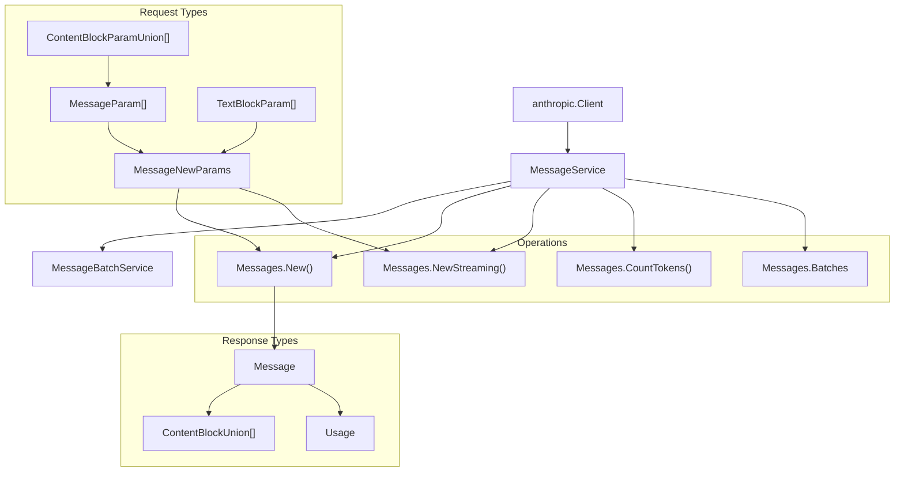
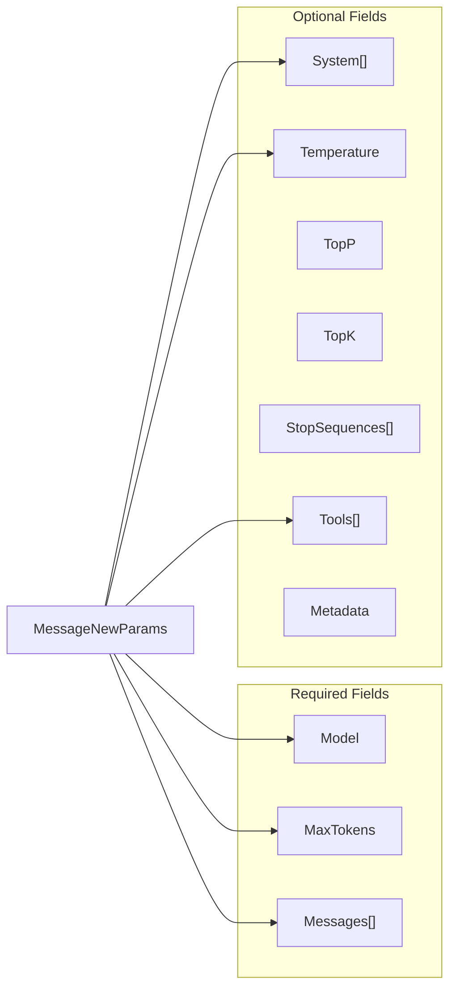
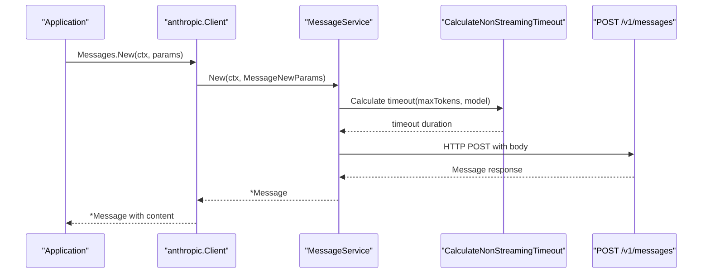
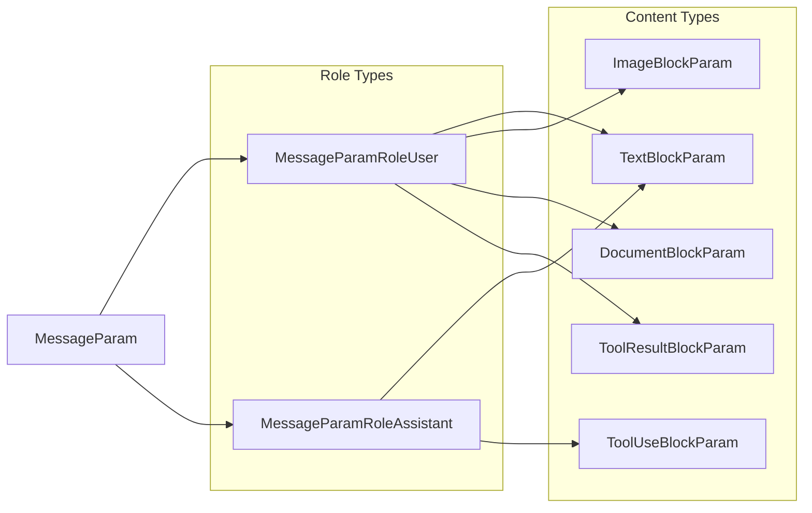
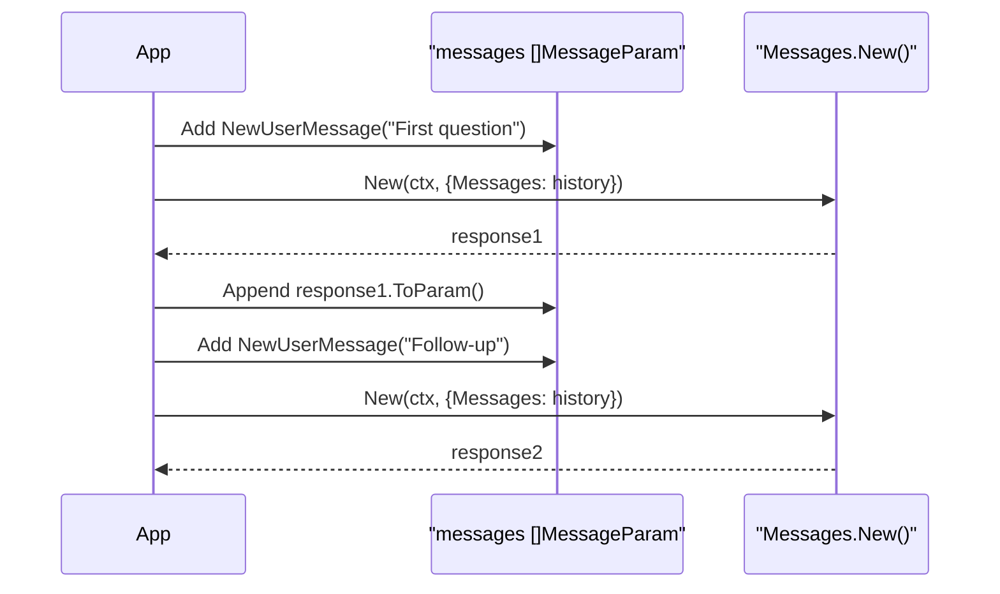
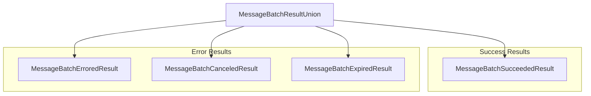
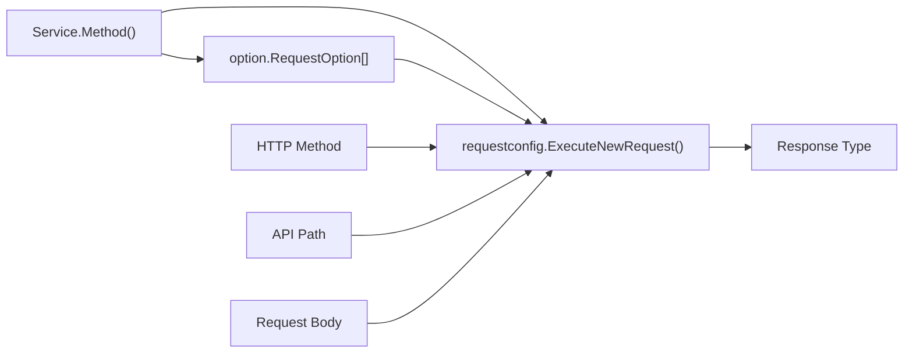

<!-- source: DeepWiki mcp.deepwiki.com · repo anthropics/anthropic-sdk-go · page 4 Messages API · fetched 2026-10-26 -->

# Messages API

<details>
<summary>Relevant source files</summary>

The following files were used as context for generating this wiki page:

- [.release-please-manifest.json](.release-please-manifest.json)
- [CHANGELOG.md](CHANGELOG.md)
- [README.md](README.md)
- [internal/version.go](internal/version.go)
- [message.go](message.go)

</details>


The Messages API is the primary interface for conversational interactions with Claude models. It provides a structured way to send input messages and receive AI-generated responses. The API supports single queries, multi-turn conversations, system prompts, streaming responses, and asynchronous batch processing.

For detailed information on specific aspects of the Messages API:
- See page 4.1 for the `MessageService` interface and methods
- See page 4.2 for content block types and handling
- See page 4.3 for streaming message responses
- See page 4.4 for batch processing of messages

## Messages API Architecture

The Messages API is organized into several components that work together to provide flexible conversational capabilities:



**Sources:** [message.go:24-43](), [README.md:42-68]()

## Basic Message Creation

The fundamental operation is creating a single message by sending a request to the `/v1/messages` endpoint. This is accessed through the `Messages.New()` method.

### Message Request Structure



**Sources:** [message.go:55-68](), [README.md:57-68]()

## Message Lifecycle

A typical message interaction follows this flow:

### Request Processing



**Sources:** [message.go:55-68]()

### Response Structure

The `Message` response contains several key components:

| Field | Type | Description |
|-------|------|-------------|
| `ID` | `string` | Unique identifier for the message |
| `Type` | `string` | Always "message" |
| `Role` | `MessageRole` | Always "assistant" for responses |
| `Content` | `[]ContentBlockUnion` | Array of content blocks (text, images, tool use, etc.) |
| `Model` | `string` | The model that generated the response |
| `StopReason` | `MessageStopReason` | Reason the model stopped generating |
| `Usage` | `Usage` | Token usage information |

**Sources:** [message.go:1400-1500]()

## Message Parameters

The `MessageParam` type represents a single message in the conversation history. Each message has a role (user or assistant) and content.

### Message Roles



**Sources:** [message.go:1500-1600](), [README.md:76-103]()

### Helper Constructors

The SDK provides convenient constructors for creating messages:

- `NewUserMessage(content...)` - Creates a user message with the given content blocks
- `NewAssistantMessage(content...)` - Creates an assistant message with the given content blocks
- `NewTextBlock(text)` - Creates a text content block

**Sources:** [README.md:60-62](), [README.md:77]()

## System Prompts

System prompts provide instructions that guide the model's behavior throughout the conversation. They are set at the request level via the `System` field in `MessageNewParams`.

### System Prompt Structure

System prompts are provided as an array of `TextBlockParam`:

```go
System: []anthropic.TextBlockParam{
    {Text: "Be very serious at all times."},
}
```

The system prompt remains consistent across all turns in a multi-turn conversation within the same request.

**Sources:** [README.md:108-120]()

## Multi-turn Conversations

The Messages API is stateless, meaning conversation history must be explicitly included in each request. To continue a conversation:

1. Maintain a message history array
2. Append the model's response to the history using `Message.ToParam()`
3. Add the new user message
4. Send the updated history in the next request

### Conversation Pattern



**Sources:** [README.md:76-103]()

## Token Counting

The `CountTokens()` method provides token count estimates for messages before sending them to the API. This is useful for:

- Validating requests are within model limits
- Estimating API costs
- Optimizing prompt engineering

The method uses the same parameters as `New()` but returns a `MessageTokensCount` response containing token usage information.

**Sources:** [message.go:93-105]()

## Model Selection

Messages are sent to specific Claude models by setting the `Model` field in `MessageNewParams`. The SDK provides constants for available models:

- `ModelClaudeSonnet4_5_20250929` - Claude Sonnet 4.5 (latest)
- `ModelClaudeSonnet4_20250514` - Claude Sonnet 4
- `ModelClaudeOpus4_6_20250217` - Claude Opus 4.6
- And other model versions

**Sources:** [README.md:62]()

## Timeout Handling

For non-streaming requests, the SDK automatically calculates appropriate timeouts based on the `MaxTokens` parameter and the selected model. This prevents premature timeouts for large responses.

The timeout calculation is performed by `CalculateNonStreamingTimeout()` which considers:
- The maximum number of tokens requested
- Model-specific generation speeds
- Network overhead

Applications can override this with custom timeout settings using `option.WithRequestTimeout()`.

**Sources:** [message.go:58-64](), [README.md:666-689]()

## Message Batch Service

The `MessageBatchService` provides asynchronous batch processing capabilities for handling multiple message requests efficiently.

### Batch Operations

| Method | HTTP Endpoint | Purpose | Return Type |
|--------|---------------|---------|-------------|
| `New()` | `POST /v1/messages/batches` | Create new batch | `*MessageBatch` |
| `Get()` | `GET /v1/messages/batches/{id}` | Retrieve batch status | `*MessageBatch` |
| `List()` | `GET /v1/messages/batches` | List batches with pagination | `pagination.Page[MessageBatch]` |
| `Delete()` | `DELETE /v1/messages/batches/{id}` | Delete batch | `*DeletedMessageBatch` |
| `Cancel()` | `POST /v1/messages/batches/{id}/cancel` | Cancel batch | `*MessageBatch` |
| `Results()` | `GET /v1/messages/batches/{id}/results` | Get batch results | `*MessageBatchIndividualResponse` |

### Batch Result Types

The batch service handles multiple result types through union types:



**Sources:** [api.md:107-128]()

## Model Service

The `ModelService` provides access to model information and capabilities, allowing applications to query available models and their specifications.

### Model Operations

| Method | HTTP Endpoint | Purpose | Return Type |
|--------|---------------|---------|-------------|
| `Get()` | `GET /v1/models/{model_id}` | Get specific model info | `*ModelInfo` |
| `List()` | `GET /v1/models` | List available models | `pagination.Page[ModelInfo]` |

### Model Information Structure

The service returns comprehensive model metadata through the `ModelInfo` type, enabling applications to make informed decisions about model selection and usage.

**Sources:** [api.md:130-140]()

## Completion Service (Legacy)

The `CompletionService` provides backward compatibility with the legacy completion API. This service is maintained for existing integrations but new applications should use the `MessageService` instead.

**Note:** This service is deprecated in favor of the Messages API for new implementations.

## Request Configuration Pattern

All core services follow a consistent pattern for request configuration and execution:



This pattern ensures consistent behavior across all services for authentication, retries, timeouts, and error handling.

**Sources:** [message.go:64](), [message.go:98-99]()

---

