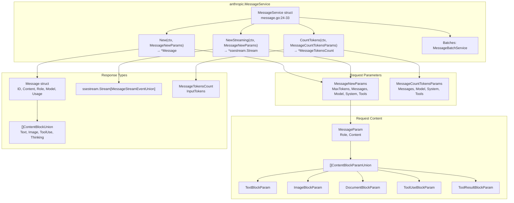
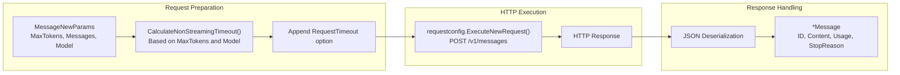
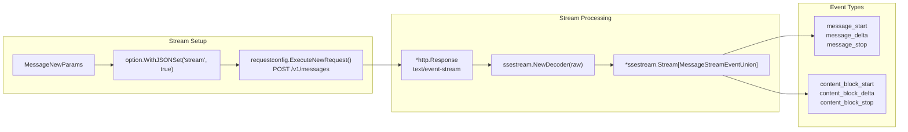
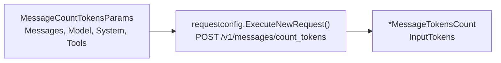
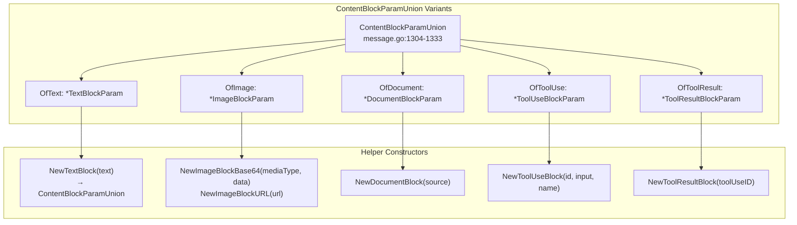
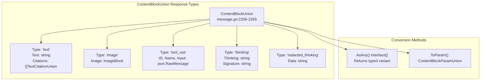
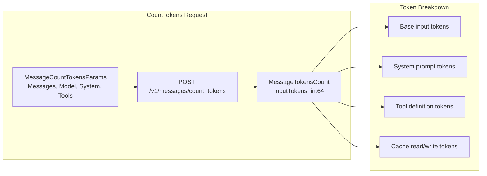
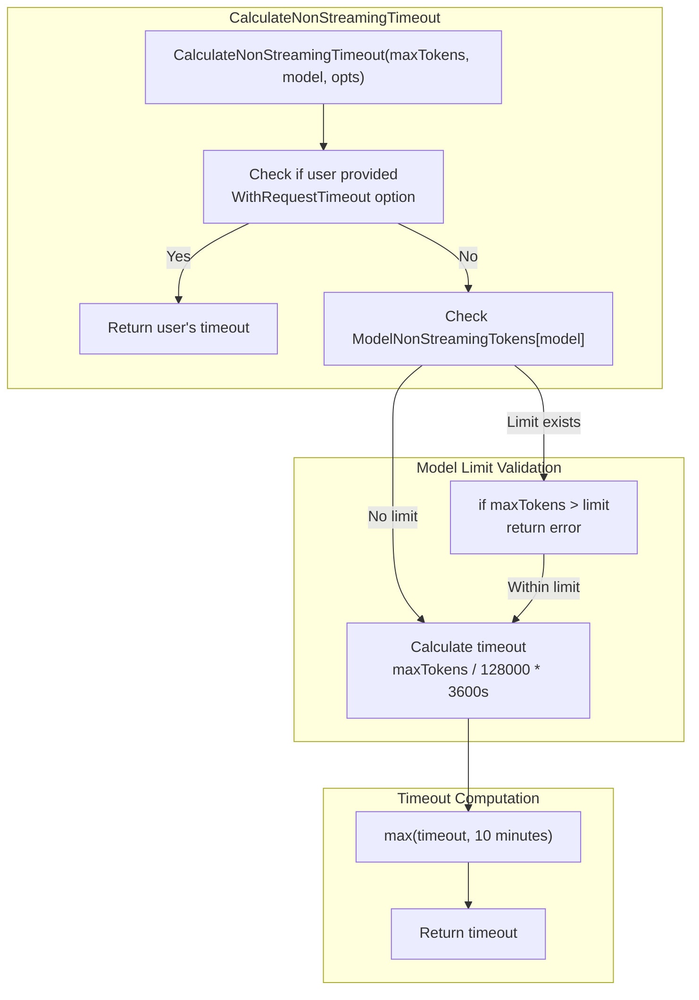
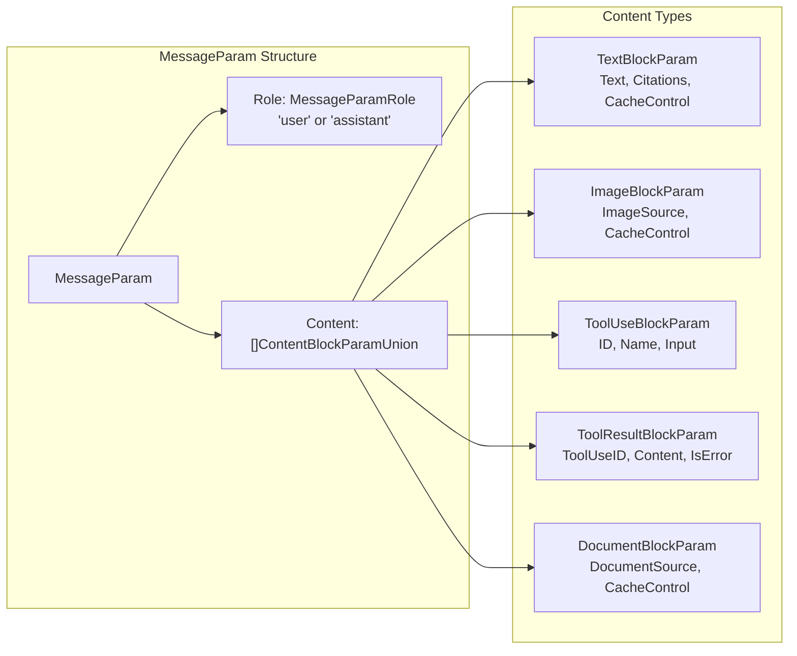

<!-- source: DeepWiki mcp.deepwiki.com · repo anthropics/anthropic-sdk-go · page 4.1 Messages Service · fetched 2026-10-26 -->

# Messages Service

<details>
<summary>Relevant source files</summary>

The following files were used as context for generating this wiki page:

- [.release-please-manifest.json](.release-please-manifest.json)
- [CHANGELOG.md](CHANGELOG.md)
- [README.md](README.md)
- [internal/version.go](internal/version.go)
- [message.go](message.go)
- [message_test.go](message_test.go)

</details>


## Purpose and Scope

The Messages Service provides the core functionality for creating conversational messages with Claude models through the Messages API. This service implements synchronous message creation, streaming message generation, token counting, and supports various content types including text, images, documents, and tool interactions.

This document covers the stable Messages API located at `/v1/messages`. For experimental features, see [Beta Messages Service](#6.1). For batch processing, see [Message Batches Service](#4.4).

## Service Architecture

The `MessageService` struct provides methods for creating messages and accessing the batch processing sub-service:



**Sources:** [message.go:24-33](), [message.go:55-69](), [message.go:81-91](), [message.go:100-105]()

## Core Methods

### New() - Synchronous Message Creation

The `New()` method sends a structured list of input messages to Claude and receives a complete response. It executes a POST request to `/v1/messages` with automatic timeout management.



The method automatically calculates an appropriate timeout based on `MaxTokens` and `Model` to prevent long-running requests from timing out. For models with known token generation limits, the method validates that `MaxTokens` does not exceed the limit and returns an error if it does.

**Sources:** [message.go:55-69](), [message.go:60-64]()

### NewStreaming() - Real-Time Streaming

The `NewStreaming()` method enables Server-Sent Events (SSE) streaming for real-time message generation. It sets `stream: true` in the request body and returns a stream of events.



**Sources:** [message.go:81-91](), [message.go:87-88]()

### CountTokens() - Token Estimation

The `CountTokens()` method counts the number of input tokens in a message without creating it. This is useful for cost estimation and determining if a message fits within model limits.



**Sources:** [message.go:100-105]()

## Content Blocks

Content blocks represent the different types of content that can appear in messages. The SDK uses a discriminated union pattern with `ContentBlockParamUnion` for requests and `ContentBlockUnion` for responses.

### ContentBlockParamUnion - Request Content



Only one variant field can be non-zero. Use `param.IsOmitted()` to check which variant is set.

**Sources:** [message.go:1304-1333](), [message.go:1828-1854]()

### ContentBlockUnion - Response Content



**Sources:** [message.go:2200-2265](), [message.go:2276-2293]()

### Helper Functions

The SDK provides helper functions to construct content blocks:

| Function | Signature | Description |
|----------|-----------|-------------|
| `NewTextBlock` | `(text string)` | Creates a text content block |
| `NewImageBlockBase64` | `(mediaType, data string)` | Creates an image block from base64 data |
| `NewImageBlockURL` | `(url string)` | Creates an image block from URL |
| `NewDocumentBlock` | `(source DocumentSourceParamUnion)` | Creates a document block |
| `NewToolUseBlock` | `(id string, input interface{}, name string)` | Creates a tool use block |
| `NewToolResultBlock` | `(toolUseID string)` | Creates a tool result block |
| `NewUserMessage` | `(content ...ContentBlockParamUnion)` | Creates a user message |
| `NewAssistantMessage` | `(content ...ContentBlockParamUnion)` | Creates an assistant message |

**Sources:** [message.go:1828-1854](), [message.go:1856-1883]()

## Token Counting

The `CountTokens()` method provides token count estimation without creating a message. This is useful for:
- Cost estimation before making requests
- Determining if a message fits within model context limits
- Planning conversation history truncation strategies

### MessageCountTokensParams

Similar to `MessageNewParams`, but does not include output-related fields like `MaxTokens` or `Temperature`:



**Sources:** [message.go:100-105](), [message.go:2297-2323](), [message_test.go:134-238]()

### Usage Example

```go
count, err := client.Messages.CountTokens(context.TODO(), anthropic.MessageCountTokensParams{
    Messages: []anthropic.MessageParam{{
        Content: []anthropic.ContentBlockParamUnion{{
            OfText: &anthropic.TextBlockParam{Text: "What is a quaternion?"},
        }},
        Role: anthropic.MessageParamRoleUser,
    }},
    Model: anthropic.ModelClaudeOpus4_6,
})

fmt.Printf("Input tokens: %d\n", count.InputTokens)
```

**Sources:** [message_test.go:146-169]()

## Timeout Management

The `New()` method implements automatic timeout calculation to prevent long-running requests from timing out while providing reasonable limits:



### Model-Specific Limits

Some Claude models have specific token limits for non-streaming requests, stored in `constant.ModelNonStreamingTokens`:

| Model | Non-Streaming Token Limit |
|-------|--------------------------|
| `claude-opus-4-20250514` | 8,192 |
| `claude-opus-4@20250514` (Vertex) | 8,192 |
| `anthropic.claude-opus-4-20250514-v1:0` (Bedrock) | 8,192 |

If `MaxTokens` exceeds the model's limit, the method returns an error recommending streaming instead.

**Sources:** [message.go:60-64](), [timeout.go:1-85](), [message_test.go:405-459](), [message_test.go:461-543]()

## Message Parameters

### MessageNewParams Structure

The `MessageNewParams` struct configures message creation requests. Required fields are marked with the `json:"...,required"` tag, while optional fields use `json:"...,omitzero"`.

| Field | Type | Required | Description |
|-------|------|----------|-------------|
| `MaxTokens` | `int64` | Yes | Maximum tokens to generate in the response |
| `Messages` | `[]MessageParam` | Yes | Conversation history with alternating user/assistant roles |
| `Model` | `Model` | Yes | Claude model identifier (e.g., `ModelClaudeOpus4_6`) |
| `System` | `[]TextBlockParam` | No | System prompt instructions |
| `Tools` | `[]ToolUnionParam` | No | Available tools for the model to use |
| `ToolChoice` | `ToolChoiceUnionParam` | No | Tool selection strategy (auto, any, specific tool) |
| `Temperature` | `param.Opt[float64]` | No | Sampling temperature (0.0-1.0) |
| `TopP` | `param.Opt[float64]` | No | Nucleus sampling threshold |
| `TopK` | `param.Opt[int64]` | No | Top-k sampling limit |
| `TopLogprobs` | `param.Opt[int64]` | No | Number of log probabilities to return |
| `StopSequences` | `[]string` | No | Custom stop sequences |
| `Metadata` | `MetadataParam` | No | Request metadata (e.g., `UserID`) |
| `ServiceTier` | `ServiceTier` | No | Service tier selection |
| `Thinking` | `ThinkingConfigParamUnion` | No | Extended thinking configuration |
| `OutputConfig` | `OutputConfigParam` | No | Output format and effort configuration |
| `CacheControl` | `CacheControlEphemeralParam` | No | Prompt caching configuration |

**Sources:** [message.go:1142-1292](), [message_test.go:31-124]()

### MessageParam - Conversation Messages

Each message in the conversation is represented by a `MessageParam` with a role and content:



Messages must alternate between `user` and `assistant` roles, starting with a `user` message.

**Sources:** [message.go:1294-1302](), [README.md:76-103]()

### System Prompts

System prompts provide instructions that apply to the entire conversation. They are specified as an array of `TextBlockParam` and can include cache control breakpoints:

```go
system := []anthropic.TextBlockParam{{
    Text: "You are a helpful assistant that answers questions about physics.",
    CacheControl: anthropic.NewCacheControlEphemeralParam(),
}}
```

**Sources:** [message.go:1184-1186](), [README.md:110-119](), [message_test.go:72-86]()

## Advanced Features

### Cache Control

Prompt caching reduces costs and latency by reusing previously processed content. Apply cache breakpoints to system prompts, tools, or conversation history:

```go
params := anthropic.MessageNewParams{
    Model: anthropic.ModelClaudeOpus4_6,
    MaxTokens: 1024,
    System: []anthropic.TextBlockParam{{
        Text: "You are an expert in physics and mathematics.",
        CacheControl: anthropic.CacheControlEphemeralParam{
            Type: constant.Ephemeral,
            TTL: anthropic.CacheControlEphemeralTTLTTL5m, // 5 minutes
        },
    }},
    Messages: messages,
}
```

The `CacheControlEphemeralParam` struct supports two TTL values:
- `CacheControlEphemeralTTLTTL5m`: 5 minute cache
- `CacheControlEphemeralTTLTTL1h`: 1 hour cache

**Sources:** [message.go:469-499](), [message_test.go:37-39](), [message_test.go:54-56]()

### Citations

Text blocks can include citations that reference source documents:

```go
textBlock := anthropic.TextBlockParam{
    Text: "The speed of light is approximately 299,792,458 m/s.",
    Citations: []anthropic.TextCitationParamUnion{{
        OfCharLocation: &anthropic.CitationCharLocationParam{
            CitedText: "299,792,458 m/s",
            DocumentIndex: 0,
            DocumentTitle: anthropic.String("Physics Constants"),
            StartCharIndex: 100,
            EndCharIndex: 115,
        },
    }},
}
```

Citation types include character-based, page-based, and content block-based locations.

**Sources:** [message.go:536-583](), [message_test.go:40-48]()

### Metadata

Request metadata helps track usage and associate requests with user IDs:

```go
params.Metadata = anthropic.MetadataParam{
    UserID: anthropic.String("user-12345"),
}
```

**Sources:** [message.go:1887-1893](), [message_test.go:59-61]()

## Usage Examples

### Basic Message Creation

```go
message, err := client.Messages.New(context.TODO(), anthropic.MessageNewParams{
    MaxTokens: 1024,
    Messages: []anthropic.MessageParam{{
        Content: []anthropic.ContentBlockParamUnion{{
            OfText: &anthropic.TextBlockParam{Text: "What is a quaternion?"},
        }},
        Role: anthropic.MessageParamRoleUser,
    }},
    Model: anthropic.ModelClaude3_7SonnetLatest,
})
```

**Sources:** [README.md:53-66]()

### Streaming Messages

```go
stream := client.Messages.NewStreaming(context.TODO(), anthropic.MessageNewParams{
    Model:     anthropic.ModelClaude3_7SonnetLatest,
    MaxTokens: 1024,
    Messages: []anthropic.MessageParam{
        anthropic.NewUserMessage(anthropic.NewTextBlock(content)),
    },
})

for stream.Next() {
    event := stream.Current()
    message.Accumulate(event)
}
```

**Sources:** [README.md:128-157]()

### Token Counting

```go
count, err := client.Messages.CountTokens(context.TODO(), anthropic.MessageCountTokensParams{
    Messages: messages,
    Model: anthropic.ModelClaude3_7SonnetLatest,
})
```

**Sources:** [message.go:96-101](), [message_test.go:106-170]()

---

