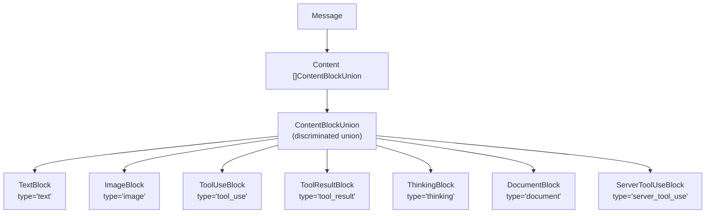
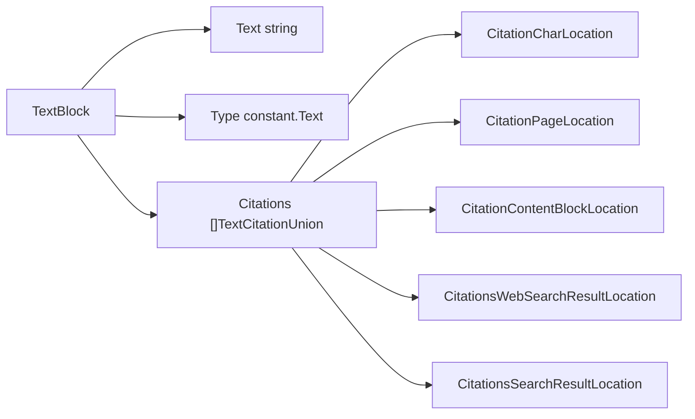
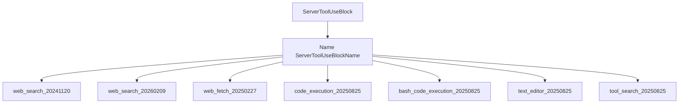
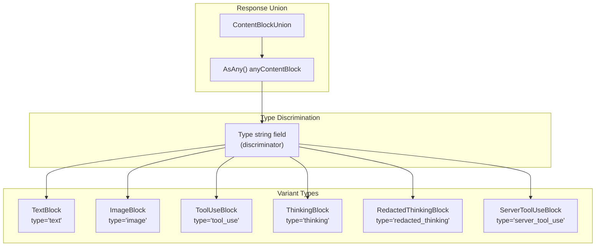
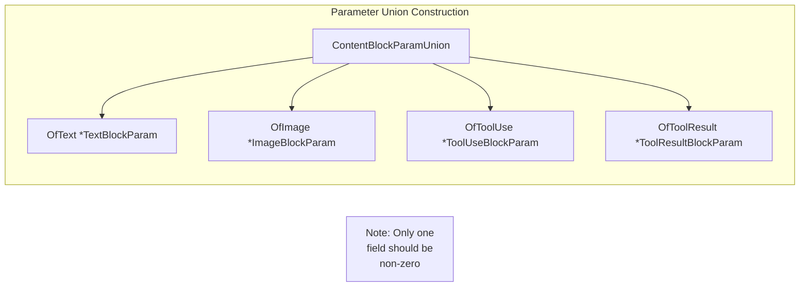
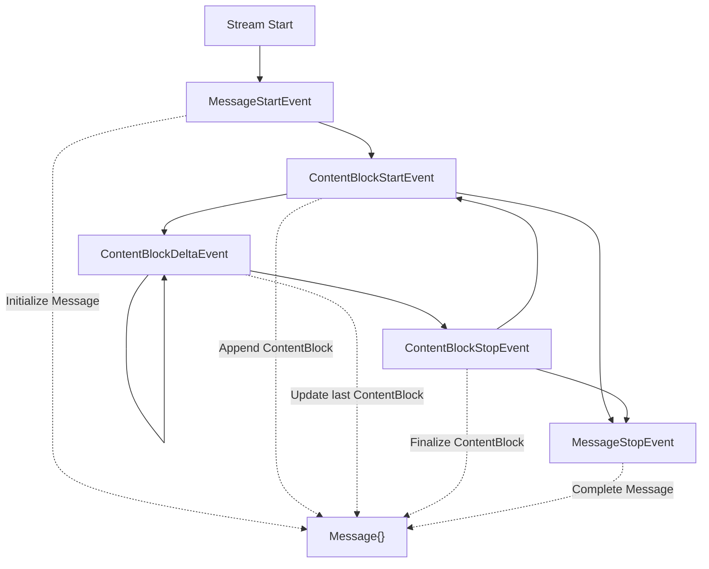

<!-- source: DeepWiki mcp.deepwiki.com · repo anthropics/anthropic-sdk-go · page 4.2 Content Blocks · fetched 2026-10-26 -->

# Content Blocks

<details>
<summary>Relevant source files</summary>

The following files were used as context for generating this wiki page:

- [aliases.go](aliases.go)
- [betamessage.go](betamessage.go)
- [betamessageutil.go](betamessageutil.go)
- [message.go](message.go)
- [messageutil.go](messageutil.go)

</details>


## Purpose and Scope

This page documents the content block system used in the Anthropic Go SDK's Messages API. Content blocks are the fundamental building blocks of messages, enabling heterogeneous content within a single message including text, images, documents, tool interactions, and model reasoning.

For information about the Messages API as a whole, see [Messages Service](#4.1). For tool-specific details, see [Tool Calling](#5). For streaming and accumulation patterns, see [Streaming Messages](#4.3).

## Overview

Content blocks represent individual pieces of content within a message. Each message contains an array of content blocks that can be of different types, allowing a single message to contain mixed content such as text alongside images, or tool results alongside thinking.

The SDK represents content blocks using a **discriminated union pattern**:
- **Response types** (`ContentBlockUnion`, `BetaContentBlockUnion`) represent content blocks received from the API
- **Parameter types** (`ContentBlockParamUnion`, `BetaContentBlockParamUnion`) represent content blocks sent to the API

All content blocks have a `Type` field that identifies their specific variant, enabling type-safe pattern matching and conversion.



**Sources:** [message.go:4453-4463](), [message.go:4483-4491]()

## Basic Content Blocks

### TextBlock

`TextBlock` represents plain text content in a message. It is the most common content block type and can include citations for source attribution.

**Key fields:**
- `Text` (string): The text content
- `Type` (constant.Text): Always "text"
- `Citations` ([]TextCitationUnion): Optional source citations

**Parameter type:** `TextBlockParam`



**Sources:** [message.go:5733-5751](), [message.go:5753-5769](), [messageutil.go:201-217]()

### ImageBlock

`ImageBlock` represents image content, supporting multiple source types including base64-encoded data, URLs, and file references.

**Key fields:**
- `Source` (ImageBlockSourceUnion): The image source (discriminated union)
- `Type` (constant.Image): Always "image"

**Source variants:**
- `Base64ImageSource`: Inline base64-encoded image with media type
- `URLImageSource`: Image loaded from URL
- `FileImageSource`: Image from uploaded file (beta)

**Parameter type:** `ImageBlockParam`

**Sources:** [message.go:5322-5334](), [message.go:5336-5352]()

### DocumentBlock

`DocumentBlock` represents document content such as PDFs or plain text files, used for providing context to the model.

**Key fields:**
- `Source` (DocumentBlockSourceUnion): The document source (discriminated union)
- `Type` (constant.Document): Always "document"
- `Context` (string): Optional context about the document
- `Title` (string): Optional document title
- `Citations` (CitationsConfig): Citation configuration

**Source variants:**
- `Base64PDFSource`: Inline base64-encoded PDF
- `PlainTextSource`: Plain text document
- `ContentBlockSource`: Document built from content blocks
- `URLPDFSource`: PDF loaded from URL
- `FileDocumentSource`: Document from uploaded file (beta)

**Parameter type:** `DocumentBlockParam`, `Base64PDFBlockParam`

**Sources:** [message.go:4851-4873](), [message.go:4875-4892]()

## Tool-Related Content Blocks

### ToolUseBlock

`ToolUseBlock` represents the model's request to use a tool. It appears in assistant messages when the model decides to call a tool.

**Key fields:**
- `ID` (string): Unique identifier for this tool use
- `Name` (string): The tool name to execute
- `Input` (json.RawMessage): Tool input as JSON
- `Type` (constant.ToolUse): Always "tool_use"
- `Caller` (ToolUseBlockCallerUnion): Optional caller context (beta)

**Parameter type:** `ToolUseBlockParam`

**Conversion:** The `ToParam()` method creates `ToolUseBlockParam` from `ToolUseBlock`.

**Sources:** [message.go:6584-6603](), [message.go:6605-6623](), [messageutil.go:144-151]()

### ToolResultBlock

`ToolResultBlock` represents the result of a tool execution, sent back to the model in user messages.

**Key fields:**
- `ToolUseID` (string): ID of the corresponding `ToolUseBlock`
- `Content` ([]ToolResultBlockContentUnion): Result content (array of mixed content blocks)
- `Type` (constant.ToolResult): Always "tool_result"
- `IsError` (bool): Whether the result represents an error

**Content can include:**
- Text blocks
- Image blocks
- Document blocks
- Search result blocks
- Tool reference blocks

**Parameter type:** `ToolResultBlockParam`

**Sources:** [message.go:6659-6680](), [message.go:6682-6707]()

### ServerToolUseBlock

`ServerToolUseBlock` represents a server-side tool execution request. These are tools executed by Anthropic's servers rather than the client.

**Key fields:**
- `ID` (string): Unique identifier
- `Name` (ServerToolUseBlockName): Server tool name (e.g., "web_search_20241120", "code_execution_20250825")
- `Input` (json.RawMessage): Tool input
- `Type` (constant.ServerToolUse): Always "server_tool_use"

**Parameter type:** `ServerToolUseBlockParam`



**Sources:** [message.go:6111-6129](), [message.go:6131-6151](), [messageutil.go:227-234]()

## Server Tool Result Content Blocks

Server-side tools return specialized result blocks that encapsulate their execution outcomes.

### WebSearchToolResultBlock

Contains web search results from the `web_search` server tool.

**Key fields:**
- `ToolUseID` (string): ID of the corresponding tool use
- `Content` (WebSearchToolResultBlockContentUnion): Array of search results or error
- `Type` (constant.WebSearchToolResult): Always "web_search_tool_result"

**Content variants:**
- Array of `WebSearchResultBlock` containing search results
- `WebSearchToolRequestError` indicating search failure

**Sources:** [message.go:7192-7209](), [message.go:7211-7236](), [messageutil.go:236-242]()

### WebFetchToolResultBlock

Contains content fetched from a URL by the `web_fetch` server tool.

**Key fields:**
- `ToolUseID` (string): ID of the corresponding tool use
- `Content` (WebFetchToolResultBlockContentUnion): Fetched content or error
- `Type` (constant.WebFetchToolResult): Always "web_fetch_tool_result"

**Sources:** [message.go:7326-7342](), [message.go:7344-7365](), [messageutil.go:300-305]()

### CodeExecutionToolResultBlock

Contains the results of Python code execution.

**Key fields:**
- `ToolUseID` (string): ID of the corresponding tool use
- `Content` (CodeExecutionToolResultBlockContentUnion): Execution result or error
- `Type` (constant.CodeExecutionToolResult): Always "code_execution_tool_result"

**Content structure (success):**
- `ReturnCode` (int64): Process exit code
- `Stdout` (string): Standard output
- `Stderr` (string): Standard error
- `Content` ([]CodeExecutionOutputBlock): Output file references

**Content structure (error):**
- `ErrorCode` (CodeExecutionToolResultErrorCode): Error type

**Sources:** [message.go:3843-3860](), [message.go:3862-3886](), [messageutil.go:345-364]()

### BashCodeExecutionToolResultBlock

Contains the results of bash command execution.

**Structure:** Similar to `CodeExecutionToolResultBlock` but specific to bash commands.

**Key fields:**
- `ToolUseID` (string): ID of the corresponding tool use
- `Content` (BashCodeExecutionToolResultBlockContentUnion): Result or error
- `Type` (constant.BashCodeExecutionToolResult): Always "bash_code_execution_tool_result"

**Sources:** [message.go:260-278](), [message.go:325-343](), [messageutil.go:314-336]()

### TextEditorCodeExecutionToolResultBlock

Contains the results of text file editing operations.

**Key fields:**
- `ToolUseID` (string): ID of the corresponding tool use
- `Content` (TextEditorCodeExecutionToolResultBlockContentUnion): Edit result or error
- `Type` (constant.TextEditorCodeExecutionToolResult): Always "text_editor_code_execution_tool_result"

**Sources:** [message.go:6485-6502](), [message.go:6504-6529](), [messageutil.go:373-386]()

### ToolSearchToolResultBlock

Contains tool discovery results from the `tool_search` server tool.

**Key fields:**
- `ToolUseID` (string): ID of the corresponding tool use
- `Content` (ToolSearchToolResultBlockContentUnion): Search results or error
- `Type` (constant.ToolSearchToolResult): Always "tool_search_tool_result"

**Content structure (success):**
- `ToolReferences` ([]ToolReferenceBlock): Array of discovered tools

**Sources:** [message.go:6711-6728](), [message.go:6730-6755](), [messageutil.go:388-406]()

## Thinking and Reasoning Blocks

### ThinkingBlock

`ThinkingBlock` contains the model's reasoning process, visible when extended thinking features are enabled.

**Key fields:**
- `Thinking` (string): The reasoning text
- `Signature` (string): Cryptographic signature verifying authenticity
- `Type` (constant.Thinking): Always "thinking"

**Parameter type:** `ThinkingBlockParam`

**Conversion:** The `ToParam()` method preserves thinking content and signature.

**Sources:** [message.go:6419-6435](), [message.go:6437-6455](), [messageutil.go:219-225]()

### RedactedThinkingBlock

`RedactedThinkingBlock` represents thinking content that has been redacted (hidden from the user).

**Key fields:**
- `Data` (string): Redacted/encrypted thinking data
- `Type` (constant.RedactedThinking): Always "redacted_thinking"

**Parameter type:** `RedactedThinkingBlockParam`

**Sources:** [message.go:6010-6025](), [message.go:6027-6043](), [messageutil.go:137-142]()

## Beta-Only Content Blocks

### CompactionBlock (Beta)

`BetaCompactionBlock` represents context that has been automatically compressed by the context management system.

**Key fields:**
- `Content` (BetaCompactionBlockContentUnion): Compacted content (string or structured)
- `Type` (constant.Compaction): Always "compaction"

**Parameter type:** `BetaCompactionBlockParam`

**Sources:** [betamessage.go:3615-3630](), [betamessage.go:3632-3647](), [betamessageutil.go:454-459]()

### MCPToolUseBlock (Beta)

`BetaMCPToolUseBlock` represents a tool execution request routed through the Model Context Protocol (MCP).

**Key fields:**
- `ID` (string): Unique identifier
- `Name` (string): Tool name
- `ServerName` (string): MCP server name
- `Input` (json.RawMessage): Tool input
- `Type` (constant.MCPToolUse): Always "mcp_tool_use"

**Parameter type:** `BetaMCPToolUseBlockParam`

**Sources:** [betamessage.go:7077-7096](), [betamessage.go:7098-7119](), [betamessageutil.go:313-321]()

### MCPToolResultBlock (Beta)

`BetaMCPToolResultBlock` represents the result from an MCP tool execution.

**Key fields:**
- `ToolUseID` (string): ID of the corresponding tool use
- `Content` (BetaMCPToolResultBlockContentUnion): Result content (string or structured)
- `Type` (constant.MCPToolResult): Always "mcp_tool_result"

**Parameter type:** `BetaRequestMCPToolResultBlockParam`

**Sources:** [betamessage.go:7123-7140](), [betamessage.go:7142-7167](), [betamessageutil.go:354-366]()

### ContainerUploadBlock

`ContainerUploadBlock` represents a file uploaded to a code execution container.

**Key fields:**
- `FileID` (string): The uploaded file's identifier
- `Type` (constant.ContainerUpload): Always "container_upload"

**Parameter type:** `ContainerUploadBlockParam`

**Sources:** [message.go:3956-3970](), [message.go:3972-3986](), [messageutil.go:307-312]()

## Content Block Union Types

### Response Unions

The SDK uses discriminated unions to represent content blocks in API responses:

**`ContentBlockUnion`** (stable API)
- Used in `Message.Content` field
- Contains all possible response content block types
- Use `AsAny()` to switch on the variant type

**`BetaContentBlockUnion`** (beta API)
- Used in `BetaMessage.Content` field
- Contains additional beta-specific content blocks
- Use `AsAny()` to switch on the variant type



**Example usage:**
```go
switch block := contentBlock.AsAny().(type) {
case anthropic.TextBlock:
    fmt.Println(block.Text)
case anthropic.ToolUseBlock:
    fmt.Printf("Tool: %s, ID: %s\n", block.Name, block.ID)
case anthropic.ThinkingBlock:
    fmt.Println("Thinking:", block.Thinking)
}
```

**Sources:** [message.go:4483-4541](), [message.go:4543-4563]()

### Parameter Unions

Parameter unions represent content blocks in API requests:

**`ContentBlockParamUnion`** (stable API)
- Used in `MessageParam.Content` field
- Constructed using variant fields (e.g., `OfText`, `OfToolUse`)
- Only one variant field should be non-zero

**`BetaContentBlockParamUnion`** (beta API)
- Used in `BetaMessageParam.Content` field
- Contains additional beta-specific content blocks



**Example usage:**
```go
// Text block
textParam := ContentBlockParamUnion{
    OfText: &TextBlockParam{
        Text: "Hello",
        Type: "text",
    },
}

// Tool result block
toolResultParam := ContentBlockParamUnion{
    OfToolResult: &ToolResultBlockParam{
        ToolUseID: "tool_123",
        Content: []ToolResultBlockContentUnion{...},
        Type: "tool_result",
    },
}
```

**Sources:** [message.go:4565-4619](), [message.go:4621-4709]()

## Converting Content Blocks: ToParam Methods

The SDK provides `ToParam()` methods to convert response content blocks into parameter types that can be sent back to the API. This is commonly used in multi-turn conversations and tool execution loops.

### Pattern

Each content block type implements a `ToParam()` method:

```go
func (r TextBlock) ToParam() TextBlockParam
func (r ToolUseBlock) ToParam() ToolUseBlockParam
func (r ThinkingBlock) ToParam() ThinkingBlockParam
// ... etc
```

The union type also provides conversion:

```go
func (r ContentBlockUnion) ToParam() ContentBlockParamUnion
```

### Common Use Cases

**1. Echo back assistant messages:**
```go
message, _ := client.Messages.New(ctx, params)

// Convert message to param for conversation history
messageParam := message.ToParam()
```

**2. Convert tool use to tool result:**
```go
// Receive tool use from model
for _, block := range message.Content {
    if toolUse, ok := block.AsAny().(anthropic.ToolUseBlock); ok {
        // Execute tool...
        result := executeMyTool(toolUse)
        
        // Create tool result param
        toolResultParam := ContentBlockParamUnion{
            OfToolResult: &ToolResultBlockParam{
                ToolUseID: toolUse.ID,
                Content: []ToolResultBlockContentUnion{...},
                Type: "tool_result",
            },
        }
    }
}
```

### Implementation Details

The `ToParam()` methods handle:
- **Type preservation:** The `Type` field is copied to maintain the discriminator
- **Optional fields:** Using `param.Opt` for nullable/optional fields
- **Nested structures:** Citations, tool results, etc. are recursively converted
- **JSON preservation:** Some methods use `param.Override()` to preserve raw JSON

**Sources:** [messageutil.go:93-106](), [messageutil.go:107-135](), [messageutil.go:201-217]()

## Content Block Accumulation

When streaming messages, content blocks are built incrementally from delta events. The `Message.Accumulate()` method handles this reconstruction.

### Accumulation Process



### Event Handling

The accumulation process handles different delta types:

**`TextDelta`:** Appends to `ContentBlock.Text`
**`InputJSONDelta`:** Appends to `ContentBlock.Input` (for tool use blocks)
**`ThinkingDelta`:** Appends to `ContentBlock.Thinking`
**`SignatureDelta`:** Appends to `ContentBlock.Signature`
**`CitationsDelta`:** Appends citation to `ContentBlock.Citations` array

### Example

```go
message := anthropic.Message{}
stream := client.Messages.NewStreaming(ctx, params)

for stream.Next() {
    event := stream.Current()
    err := message.Accumulate(event)
    if err != nil {
        return err
    }
}

// message now contains complete content blocks
for _, block := range message.Content {
    switch b := block.AsAny().(type) {
    case anthropic.TextBlock:
        fmt.Println("Final text:", b.Text)
    case anthropic.ToolUseBlock:
        fmt.Println("Tool:", b.Name, "Input:", string(b.Input))
    }
}
```

**Sources:** [messageutil.go:20-89](), [betamessageutil.go:20-93]()

## Content Block Type Reference

### Stable API Content Blocks

| Type | Constant | Purpose | Key Fields |
|------|----------|---------|-----------|
| `TextBlock` | `"text"` | Plain text content | `Text`, `Citations` |
| `ImageBlock` | `"image"` | Image content | `Source` (union) |
| `DocumentBlock` | `"document"` | Document content | `Source` (union), `Title`, `Context` |
| `ToolUseBlock` | `"tool_use"` | Tool execution request | `ID`, `Name`, `Input` |
| `ToolResultBlock` | `"tool_result"` | Tool execution result | `ToolUseID`, `Content`, `IsError` |
| `ThinkingBlock` | `"thinking"` | Model reasoning | `Thinking`, `Signature` |
| `RedactedThinkingBlock` | `"redacted_thinking"` | Redacted reasoning | `Data` |
| `ServerToolUseBlock` | `"server_tool_use"` | Server-side tool request | `Name`, `Input` |
| `WebSearchToolResultBlock` | `"web_search_tool_result"` | Web search results | `Content` (results or error) |
| `WebFetchToolResultBlock` | `"web_fetch_tool_result"` | Web fetch results | `Content` |
| `CodeExecutionToolResultBlock` | `"code_execution_tool_result"` | Code execution results | `Content` (result or error) |
| `BashCodeExecutionToolResultBlock` | `"bash_code_execution_tool_result"` | Bash execution results | `Content` (result or error) |
| `TextEditorCodeExecutionToolResultBlock` | `"text_editor_code_execution_tool_result"` | File edit results | `Content` (result or error) |
| `ToolSearchToolResultBlock` | `"tool_search_tool_result"` | Tool discovery results | `Content` (tools or error) |
| `ContainerUploadBlock` | `"container_upload"` | Uploaded file reference | `FileID` |

### Beta-Only Content Blocks

| Type | Constant | Purpose | Key Fields |
|------|----------|---------|-----------|
| `BetaCompactionBlock` | `"compaction"` | Compressed context | `Content` (string or structured) |
| `BetaMCPToolUseBlock` | `"mcp_tool_use"` | MCP tool request | `ID`, `Name`, `ServerName`, `Input` |
| `BetaMCPToolResultBlock` | `"mcp_tool_result"` | MCP tool result | `ToolUseID`, `Content` |

**Sources:** [message.go:1-100](), [betamessage.go:1-100]()

---

