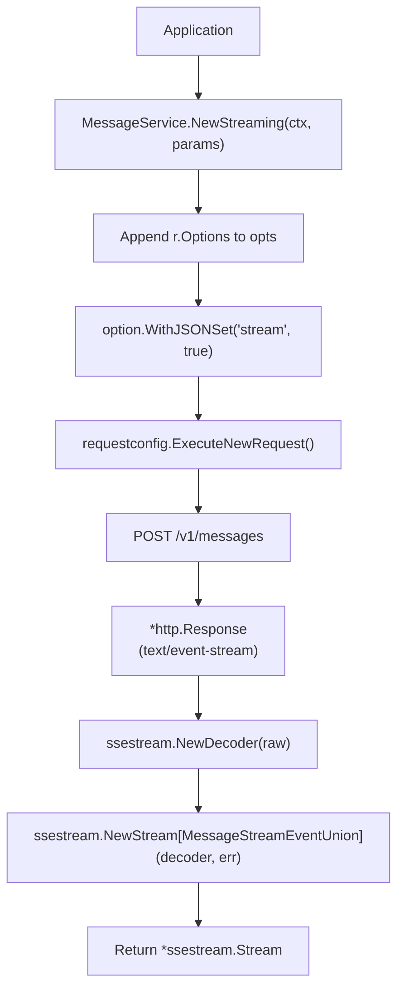
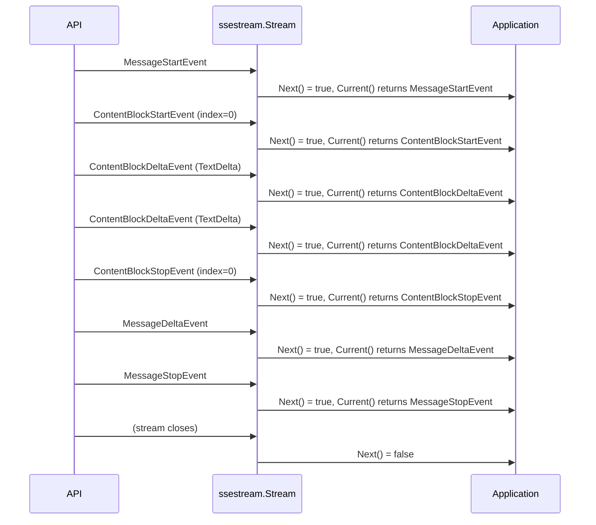
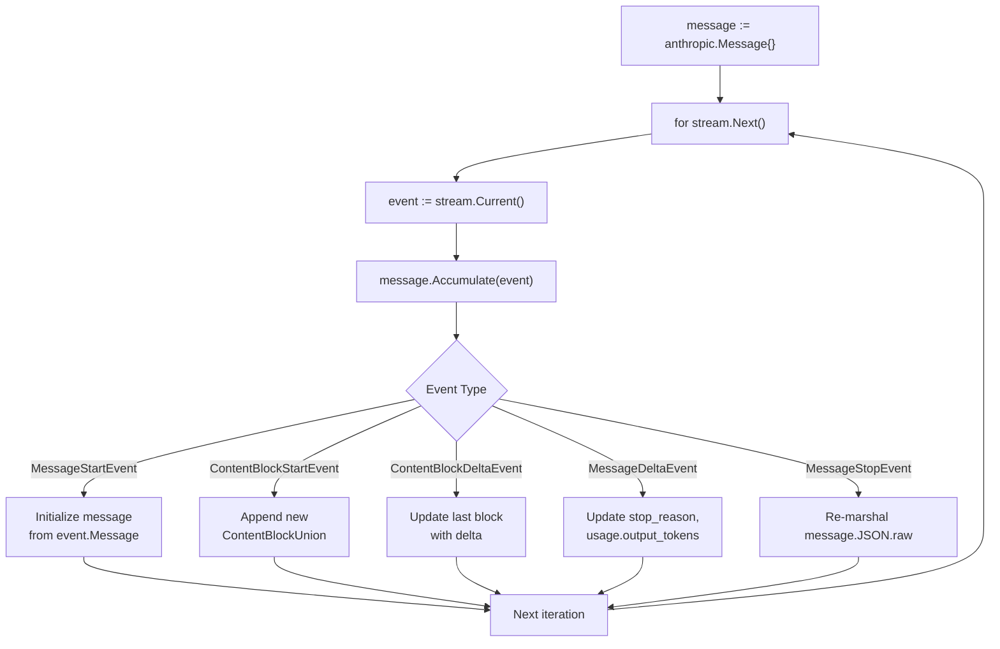

<!-- source: DeepWiki mcp.deepwiki.com · repo anthropics/anthropic-sdk-go · page 4.3 Streaming Messages · fetched 2026-10-26 -->

# Streaming Messages

<details>
<summary>Relevant source files</summary>

The following files were used as context for generating this wiki page:

- [.release-please-manifest.json](.release-please-manifest.json)
- [CHANGELOG.md](CHANGELOG.md)
- [README.md](README.md)
- [aliases.go](aliases.go)
- [betamessageutil.go](betamessageutil.go)
- [internal/version.go](internal/version.go)
- [message.go](message.go)
- [message_test.go](message_test.go)
- [messageutil.go](messageutil.go)

</details>


The streaming messages API enables real-time processing of Claude's responses as they are generated. Instead of waiting for a complete message, streaming delivers incremental events containing text deltas, tool uses, and metadata as they become available. This is critical for building responsive user interfaces and handling long-running responses.

Streaming is implemented through the `MessageService.NewStreaming()` method, which returns a `ssestream.Stream[MessageStreamEventUnion]` that processes Server-Sent Events (SSE) from the API.

For non-streaming message creation, see [Messages Service](#4.1). For asynchronous batch processing, see [Message Batches Service](#4.4).

## Creating a Streaming Request

The `NewStreaming()` method on `MessageService` initiates a streaming message request. It accepts the same `MessageNewParams` as the non-streaming `New()` method but automatically sets the `stream` parameter to `true` in the request body.

**Message Streaming Request Flow**


Sources: [message.go:81-91](), [README.md:126-158]()

The method signature is:

```go
func (r *MessageService) NewStreaming(
    ctx context.Context, 
    body MessageNewParams, 
    opts ...option.RequestOption
) *ssestream.Stream[MessageStreamEventUnion]
```

Sources: [message.go:81-91]()

## Stream Iteration

The returned `ssestream.Stream[MessageStreamEventUnion]` provides an iterator-style interface for processing events:

| Method | Return Type | Description |
|--------|-------------|-------------|
| `Next()` | `bool` | Advances to next event. Returns `true` if event is available, `false` if stream ended or error occurred |
| `Current()` | `MessageStreamEventUnion` | Returns the current event. Only valid after `Next()` returns `true` |
| `Err()` | `error` | Returns any error that occurred during streaming. Check after iteration completes |
| `Close()` | `error` | Closes the underlying HTTP connection. Should be called when done or on error |

**Typical iteration pattern:**

```go
stream := client.Messages.NewStreaming(ctx, params)
defer stream.Close()

for stream.Next() {
    event := stream.Current()
    // Process event
}

if err := stream.Err(); err != nil {
    // Handle error
}
```

Sources: [packages/ssestream/ssestream.go:147-198](), [README.md:138-157]()

## Event Types

Stream events are represented by the discriminated union `MessageStreamEventUnion`. Each event type indicates a different stage of message generation.

### Core Event Types

| Event Type | When Emitted | Key Fields |
|------------|--------------|------------|
| `MessageStartEvent` | When message generation begins | `message.id`, `message.role`, `message.model`, `message.usage` |
| `ContentBlockStartEvent` | When a content block begins | `index`, `content_block.type` (text, tool_use, thinking, etc.) |
| `ContentBlockDeltaEvent` | Incremental content within a block | `index`, `delta` (TextDelta, InputJSONDelta, ThinkingDelta, etc.) |
| `ContentBlockStopEvent` | When a content block completes | `index` |
| `MessageDeltaEvent` | Message-level updates during generation | `delta.stop_reason`, `delta.stop_sequence`, `usage.output_tokens` |
| `MessageStopEvent` | When message generation completes | (no additional fields) |

**Event Sequence Diagram**


Sources: [message.go:3800-4069](), [README.md:145-151]()

### Delta Types

The `ContentBlockDeltaEvent` contains a `delta` field which is itself a discriminated union with several variants:

| Delta Type | Purpose | Fields |
|------------|---------|--------|
| `TextDelta` | Incremental text content | `text` (string) |
| `InputJSONDelta` | Incremental tool input JSON | `partial_json` (string) |
| `ThinkingDelta` | Incremental thinking content | `thinking` (string) |
| `SignatureDelta` | Thinking signature | `signature` (string) |
| `CitationsDelta` | Citation information | `citation` (TextCitationUnion) |

Sources: [message.go:4189-4321]()

### Processing Events with Type Switching

Use the `AsAny()` method to type-switch on event variants:

```go
for stream.Next() {
    event := stream.Current()
    
    switch e := event.AsAny().(type) {
    case anthropic.MessageStartEvent:
        fmt.Printf("Message ID: %s\n", e.Message.ID)
    
    case anthropic.ContentBlockDeltaEvent:
        switch delta := e.Delta.AsAny().(type) {
        case anthropic.TextDelta:
            fmt.Print(delta.Text)
        case anthropic.InputJSONDelta:
            // Accumulate JSON
        }
    
    case anthropic.MessageStopEvent:
        fmt.Println("\nMessage complete")
    }
}
```

Sources: [README.md:145-152]()

## Message Accumulation Pattern

The SDK provides a convenient `Accumulate()` method on the `Message` type that builds a complete message incrementally from stream events. This is the recommended approach for most applications.

**Accumulation Flow**


Sources: [messageutil.go:20-89]()

### Accumulate Method

The `Accumulate()` method signature:

```go
func (acc *Message) Accumulate(event MessageStreamEventUnion) error
```

It handles each event type by:

1. **MessageStartEvent**: Initializes the message with metadata (id, role, model, usage)
2. **ContentBlockStartEvent**: Appends a new content block to `message.Content`
3. **ContentBlockDeltaEvent**: Updates the last content block based on delta type:
   - `TextDelta`: Appends text to `content_block.Text`
   - `InputJSONDelta`: Appends JSON to `content_block.Input`
   - `ThinkingDelta`: Appends to `content_block.Thinking`
   - `SignatureDelta`: Appends to `content_block.Signature`
   - `CitationsDelta`: Appends citation to `content_block.Citations`
4. **ContentBlockStopEvent**: Re-marshals the content block's JSON
5. **MessageDeltaEvent**: Updates `stop_reason`, `stop_sequence`, and output token usage
6. **MessageStopEvent**: Re-marshals the complete message's JSON

Sources: [messageutil.go:20-89]()

### Usage Example

```go
stream := client.Messages.NewStreaming(context.TODO(), anthropic.MessageNewParams{
    Model:     anthropic.ModelClaudeSonnet4_5_20250929,
    MaxTokens: 1024,
    Messages: []anthropic.MessageParam{
        anthropic.NewUserMessage(anthropic.NewTextBlock("What is a quaternion?")),
    },
})

message := anthropic.Message{}
for stream.Next() {
    event := stream.Current()
    err := message.Accumulate(event)
    if err != nil {
        panic(err)
    }
    
    // Optional: print deltas as they arrive
    switch eventVariant := event.AsAny().(type) {
    case anthropic.ContentBlockDeltaEvent:
        switch deltaVariant := eventVariant.Delta.AsAny().(type) {
        case anthropic.TextDelta:
            print(deltaVariant.Text)
        }
    }
}

if stream.Err() != nil {
    panic(stream.Err())
}

// Use the complete message
fmt.Printf("\nFinal message content: %+v\n", message.Content)
```

Sources: [README.md:137-158](), [message_test.go:240-403]()

## Error Handling

### Checking for Errors

Always check `stream.Err()` after iteration completes, as errors during streaming will cause `Next()` to return `false`:

```go
stream := client.Messages.NewStreaming(ctx, params)
for stream.Next() {
    event := stream.Current()
    // Process event
}

if err := stream.Err(); err != nil {
    // Handle streaming error
    var apierr *anthropic.Error
    if errors.As(err, &apierr) {
        fmt.Printf("API Error: %s\n", apierr.Error())
    }
}
```

Sources: [packages/ssestream/ssestream.go:183-190]()

### Accumulation Errors

The `Accumulate()` method can return errors if events are malformed or arrive in unexpected order:

```go
for stream.Next() {
    event := stream.Current()
    if err := message.Accumulate(event); err != nil {
        // Handle accumulation error
        // Common causes: citation unmarshal error, unexpected event order
        return fmt.Errorf("accumulation failed: %w", err)
    }
}
```

Sources: [messageutil.go:20-89](), [message_test.go:381-389]()

### Resource Cleanup

Always close streams to prevent connection leaks, especially when exiting early:

```go
stream := client.Messages.NewStreaming(ctx, params)
defer stream.Close()  // Ensures cleanup even on panic or early return
```

Sources: [packages/ssestream/ssestream.go:192-198]()

## Usage Examples

### Basic Streaming Pattern

The most common pattern processes events in a loop, handling different event types through type switching.

```go
stream := client.Messages.NewStreaming(ctx, params)
for stream.Next() {
    event := stream.Current()
    switch eventVariant := event.AsAny().(type) {
    case anthropic.ContentBlockDeltaEvent:
        // Handle content delta
    case anthropic.MessageStopEvent:
        // Handle completion
    }
}
```

Sources: [examples/message-streaming/main.go:16-45]()

### Message Accumulation

Advanced usage involves accumulating streaming events into complete messages using the `Accumulate()` method.

```go
message := anthropic.BetaMessage{}
for stream.Next() {
    event := stream.Current()
    err := message.Accumulate(event)
    if err != nil {
        // Handle accumulation error
    }
}
```

Sources: [examples/message-mcp-streaming/main.go:36-43]()

### Beta Feature Streaming

Beta features like MCP (Model Context Protocol) use the same streaming infrastructure with enhanced event types.

Sources: [examples/message-mcp-streaming/main.go:26-34]()

---

