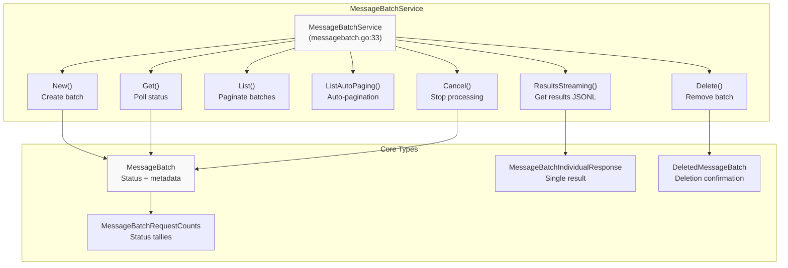
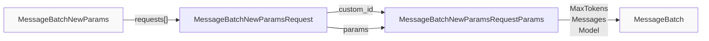
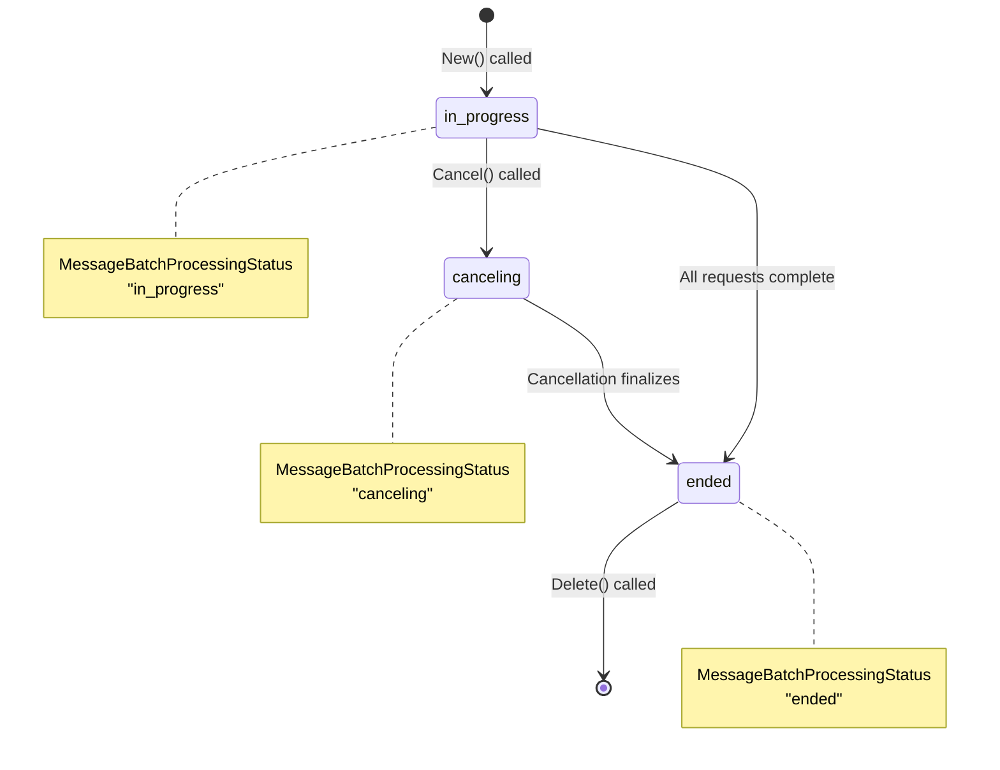
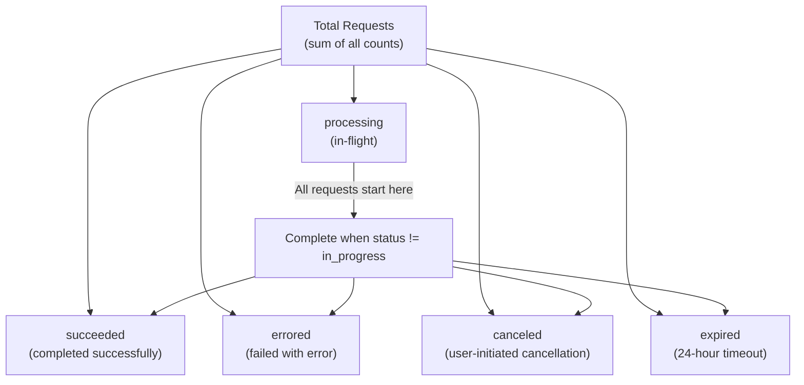
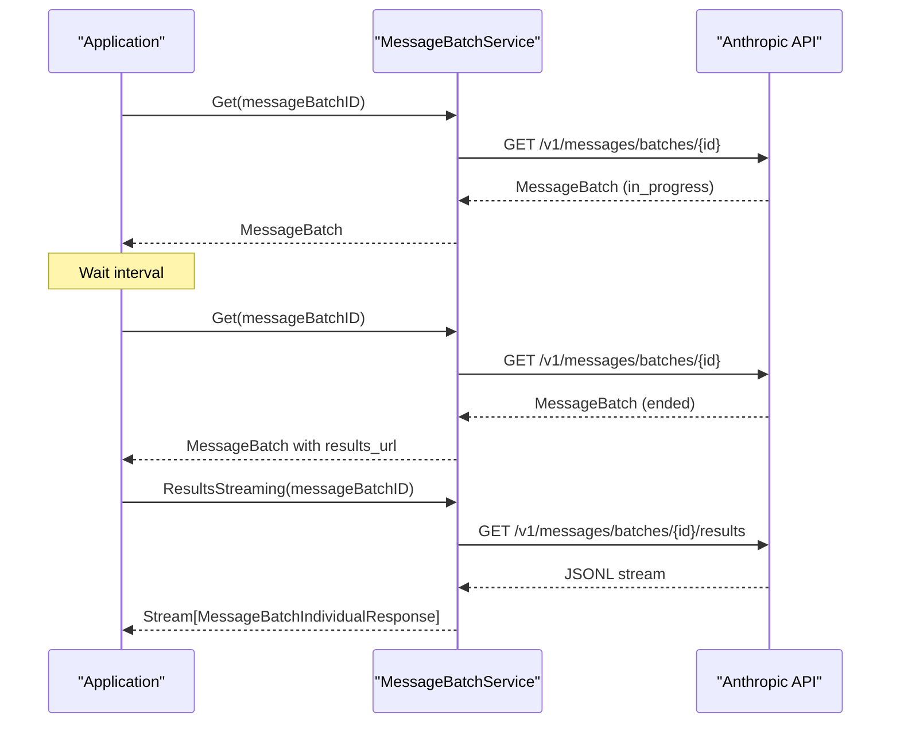
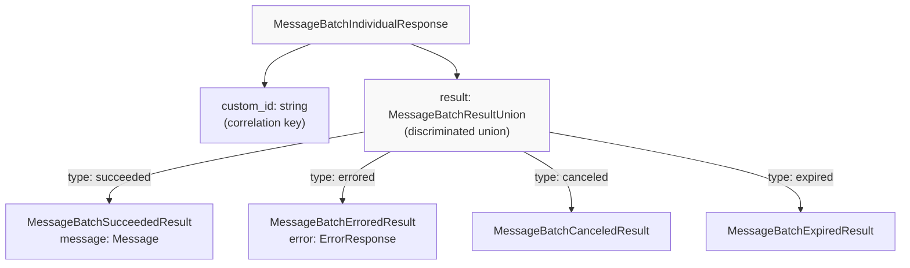
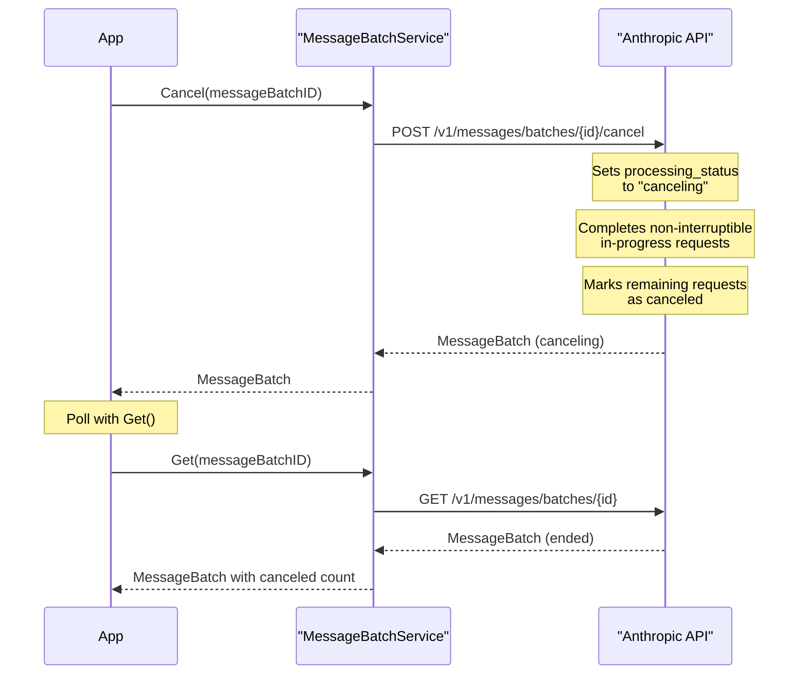
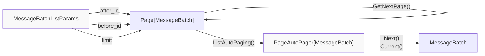
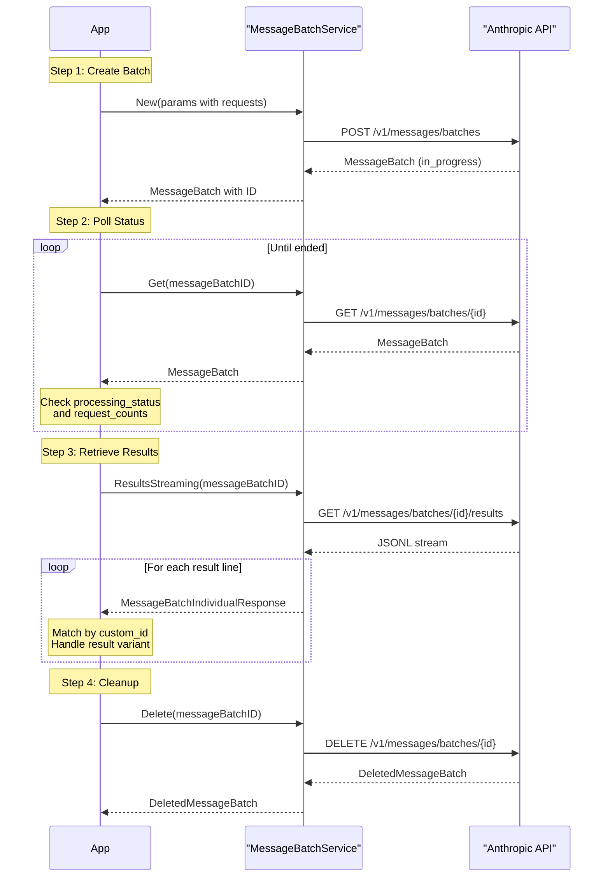

<!-- source: DeepWiki mcp.deepwiki.com · repo anthropics/anthropic-sdk-go · page 4.4 Message Batches Service · fetched 2026-10-26 -->

# Message Batches Service

<details>
<summary>Relevant source files</summary>

The following files were used as context for generating this wiki page:

- [.release-please-manifest.json](.release-please-manifest.json)
- [CHANGELOG.md](CHANGELOG.md)
- [README.md](README.md)
- [internal/version.go](internal/version.go)
- [messagebatch.go](messagebatch.go)

</details>


## Purpose and Scope

This page documents the Message Batches API, which provides asynchronous batch processing for multiple Messages API requests. The service allows you to submit multiple message creation requests at once and retrieve results later, making it ideal for high-volume processing scenarios where immediate responses are not required.

For synchronous message creation, see [Messages Service](#4.1). For beta-specific batch features including context management and iteration tracking, see [Beta Message Batches Service](#6.2).

Sources: [messagebatch.go:27-44](), [README.md:589-623]()

## Overview

The Message Batches service processes multiple message requests asynchronously with a 24-hour processing window. Batches begin processing immediately upon creation and track detailed status information for each request. Results are provided as a JSONL stream once processing completes.

Key characteristics:
- **Asynchronous**: Submit requests and retrieve results later
- **Bulk processing**: Process multiple messages in a single batch
- **Status tracking**: Monitor progress with granular request counts
- **Result correlation**: Match results to requests using custom IDs
- **24-hour lifecycle**: Batches expire 24 hours after creation

Sources: [messagebatch.go:46-58](), [README.md:589-604]()

## Service Structure



Sources: [messagebatch.go:27-172]()

## Creating a Message Batch

### Basic Creation

Create a batch by submitting an array of request objects. Each request contains a unique `custom_id` for result correlation and message creation parameters identical to the standard Messages API.



**Method**: `MessageBatchService.New(ctx, params)` returns `*MessageBatch`

Sources: [messagebatch.go:46-58](), [messagebatch.go:490-503]()

### Request Structure

Each request in the batch consists of:

| Field | Type | Description |
|-------|------|-------------|
| `custom_id` | string | Unique identifier for matching results to requests (required) |
| `params` | MessageBatchNewParamsRequestParams | Standard Messages API parameters (required) |

The `params` field accepts all standard message creation parameters:
- **Required**: `max_tokens`, `messages`, `model`
- **Optional**: `temperature`, `top_p`, `top_k`, `stop_sequences`, `system`, `tools`, `tool_choice`, `thinking`, `output_config`, `metadata`, `stream`, `container`, `inference_geo`, `service_tier`, `cache_control`

Sources: [messagebatch.go:506-527](), [messagebatch.go:534-787]()

### Example Pattern

```go
batch, err := client.Messages.Batches.New(ctx, anthropic.MessageBatchNewParams{
    Requests: []anthropic.MessageBatchNewParamsRequest{
        {
            CustomID: "request-1",
            Params: anthropic.MessageBatchNewParamsRequestParams{
                Model:     anthropic.ModelClaudeSonnet4_5_20250929,
                MaxTokens: 1024,
                Messages: []anthropic.MessageParam{
                    anthropic.NewUserMessage(anthropic.NewTextBlock("Hello")),
                },
            },
        },
        // Additional requests...
    },
})
```

Sources: [messagebatch.go:46-58](), [README.md:593-604]()

## Batch Lifecycle

### Processing States



**Processing Status Enum**: `MessageBatchProcessingStatus` (string)
- `"in_progress"`: Batch is actively processing requests
- `"canceling"`: Cancellation initiated, finalizing in-progress work
- `"ended"`: Processing complete (all requests resolved)

Sources: [messagebatch.go:262-269]()

### MessageBatch Structure

The `MessageBatch` type tracks comprehensive batch state:

| Field | Type | Description |
|-------|------|-------------|
| `id` | string | Unique batch identifier |
| `processing_status` | MessageBatchProcessingStatus | Current processing state |
| `request_counts` | MessageBatchRequestCounts | Request status tallies |
| `created_at` | time.Time | Batch creation timestamp |
| `expires_at` | time.Time | Expiration timestamp (24 hours from creation) |
| `ended_at` | time.Time | Processing completion timestamp (if ended) |
| `cancel_initiated_at` | time.Time | Cancellation initiation timestamp (if canceled) |
| `archived_at` | time.Time | Archive timestamp (results unavailable after this) |
| `results_url` | string | URL to JSONL results file (available when ended) |
| `type` | string | Object type constant: `"message_batch"` |

Sources: [messagebatch.go:196-260]()

### Request Counts

The `MessageBatchRequestCounts` structure provides granular tracking:



All counters except `processing` remain zero until the batch enters `ended` status. The `processing` count represents all requests while status is `in_progress`.

Sources: [messagebatch.go:350-385]()

## Status Polling

### Get Method

The `Get` method is idempotent and designed for polling:

**Method**: `MessageBatchService.Get(ctx, messageBatchID)` returns `*MessageBatch`

Use this to:
- Monitor processing progress via `request_counts`
- Check if processing has completed (`processing_status == "ended"`)
- Obtain the `results_url` when available

Sources: [messagebatch.go:61-76]()

### Polling Pattern



Sources: [messagebatch.go:61-76](), [messagebatch.go:150-172]()

## Retrieving Results

### Results Streaming

Once a batch reaches `ended` status, retrieve results via the streaming endpoint:

**Method**: `MessageBatchService.ResultsStreaming(ctx, messageBatchID)` returns `*jsonl.Stream[MessageBatchIndividualResponse]`

The method returns a JSONL stream where each line represents one request's result. Results are **not guaranteed** to be in request order—use `custom_id` for correlation.

Sources: [messagebatch.go:150-172]()

### Result Streaming Pattern

```go
stream := client.Messages.Batches.ResultsStreaming(ctx, batch.ID)

for stream.Next() {
    result := stream.Current()
    
    // Match to original request
    fmt.Printf("Result for request %s\n", result.CustomID)
    
    // Handle result variant
    switch variant := result.Result.AsAny().(type) {
    case anthropic.MessageBatchSucceededResult:
        message := variant.Message
        // Process successful message
    case anthropic.MessageBatchErroredResult:
        errorResp := variant.Error
        // Handle error
    case anthropic.MessageBatchCanceledResult:
        // Handle cancellation
    case anthropic.MessageBatchExpiredResult:
        // Handle expiration
    }
}

if err := stream.Err(); err != nil {
    // Handle stream error
}
```

Sources: [messagebatch.go:158-172](), [README.md:593-604]()

### Individual Response Structure



Sources: [messagebatch.go:321-348](), [messagebatch.go:387-471]()

## Result Types

### Result Union

The `MessageBatchResultUnion` is a discriminated union with four variants:

| Type Discriminator | Struct | Fields |
|-------------------|--------|--------|
| `"succeeded"` | MessageBatchSucceededResult | `message: Message` |
| `"errored"` | MessageBatchErroredResult | `error: ErrorResponse` |
| `"canceled"` | MessageBatchCanceledResult | (empty) |
| `"expired"` | MessageBatchExpiredResult | (empty) |

Sources: [messagebatch.go:387-471]()

### Type Switching

Use the `AsAny()` method to obtain a type-safe variant:

```go
switch variant := result.Result.AsAny().(type) {
case anthropic.MessageBatchSucceededResult:
    // variant.Message contains the completed Message
    // Same structure as synchronous Messages API
case anthropic.MessageBatchErroredResult:
    // variant.Error contains ErrorResponse with details
case anthropic.MessageBatchCanceledResult:
    // Request was canceled
case anthropic.MessageBatchExpiredResult:
    // Request expired after 24 hours
}
```

Or use specific casting methods:
- `result.Result.AsSucceeded()` → `MessageBatchSucceededResult`
- `result.Result.AsErrored()` → `MessageBatchErroredResult`
- `result.Result.AsCanceled()` → `MessageBatchCanceledResult`
- `result.Result.AsExpired()` → `MessageBatchExpiredResult`

Sources: [messagebatch.go:409-463]()

### Succeeded Result

Contains the complete `Message` object identical to synchronous API responses:

```go
succeeded := result.Result.AsSucceeded()
message := succeeded.Message

// Access content blocks
for _, block := range message.Content {
    switch b := block.AsAny().(type) {
    case anthropic.TextBlock:
        fmt.Println(b.Text)
    case anthropic.ToolUseBlock:
        // Handle tool use
    }
}

// Access usage
fmt.Printf("Input tokens: %d\n", message.Usage.InputTokens)
fmt.Printf("Output tokens: %d\n", message.Usage.OutputTokens)
```

Sources: [messagebatch.go:472-488]()

### Errored Result

Contains a `shared.ErrorResponse` with error details:

```go
errored := result.Result.AsErrored()
errorResp := errored.Error

fmt.Printf("Error type: %s\n", errorResp.Type)
fmt.Printf("Error message: %s\n", errorResp.Message)
```

Sources: [messagebatch.go:287-303]()

## Managing Batches

### Canceling a Batch



**Method**: `MessageBatchService.Cancel(ctx, messageBatchID)` returns `*MessageBatch`

**Behavior**:
- Only available while `processing_status` is `"in_progress"`
- Transitions batch to `"canceling"` state
- Non-interruptible in-progress requests may complete
- Eventually transitions to `"ended"` state
- Check `request_counts.canceled` to see how many requests were canceled

Sources: [messagebatch.go:127-148]()

### Deleting a Batch

**Method**: `MessageBatchService.Delete(ctx, messageBatchID)` returns `*DeletedMessageBatch`

**Restrictions**:
- Only available after batch has reached `"ended"` status
- Cannot delete a batch that is still `"in_progress"` or `"canceling"`
- To delete an active batch, first cancel it and wait for `"ended"` status

**Response**: Returns `DeletedMessageBatch` with:
- `id`: The deleted batch ID
- `type`: Constant `"message_batch_deleted"`

Sources: [messagebatch.go:109-125](), [messagebatch.go:174-194]()

## Pagination

### Listing Batches



### Manual Pagination

**Method**: `MessageBatchService.List(ctx, params)` returns `*pagination.Page[MessageBatch]`

```go
page, err := client.Messages.Batches.List(ctx, anthropic.MessageBatchListParams{
    Limit: anthropic.Int(20),
})

for page != nil {
    for _, batch := range page.Data {
        fmt.Printf("Batch %s: %s\n", batch.ID, batch.ProcessingStatus)
    }
    page, err = page.GetNextPage()
}
```

Sources: [messagebatch.go:78-98](), [README.md:607-622]()

### Auto-Pagination

**Method**: `MessageBatchService.ListAutoPaging(ctx, params)` returns `*pagination.PageAutoPager[MessageBatch]`

```go
iter := client.Messages.Batches.ListAutoPaging(ctx, anthropic.MessageBatchListParams{
    Limit: anthropic.Int(20),
})

// Automatically fetches pages as needed
for iter.Next() {
    batch := iter.Current()
    fmt.Printf("Batch %s: %s\n", batch.ID, batch.ProcessingStatus)
}

if err := iter.Err(); err != nil {
    // Handle error
}
```

Sources: [messagebatch.go:100-107](), [README.md:593-604]()

### List Parameters

| Parameter | Type | Description |
|-----------|------|-------------|
| `after_id` | string (optional) | Cursor for pagination, returns items after this ID |
| `before_id` | string (optional) | Cursor for pagination, returns items before this ID |
| `limit` | int64 (optional) | Items per page (1-1000, default 20) |

Batches are returned with most recently created first.

Sources: [messagebatch.go:796-816]()

## Complete Workflow Example



Sources: [messagebatch.go:27-172](), [README.md:589-623]()

---

