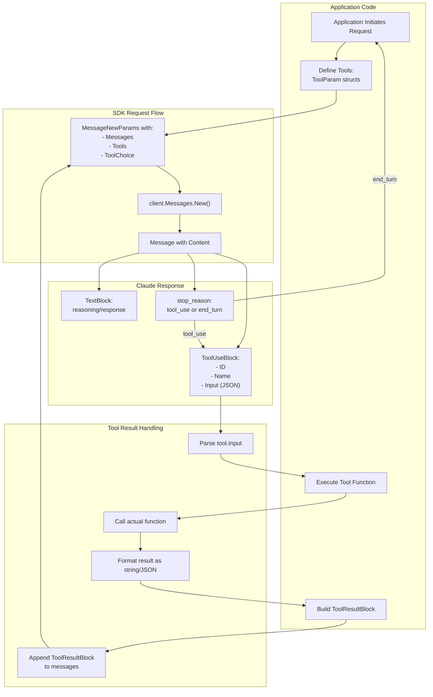
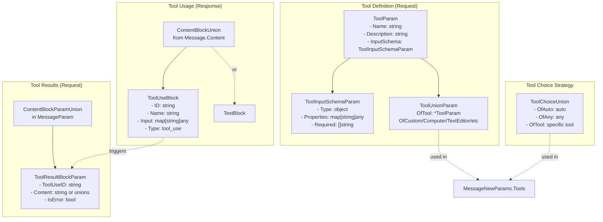
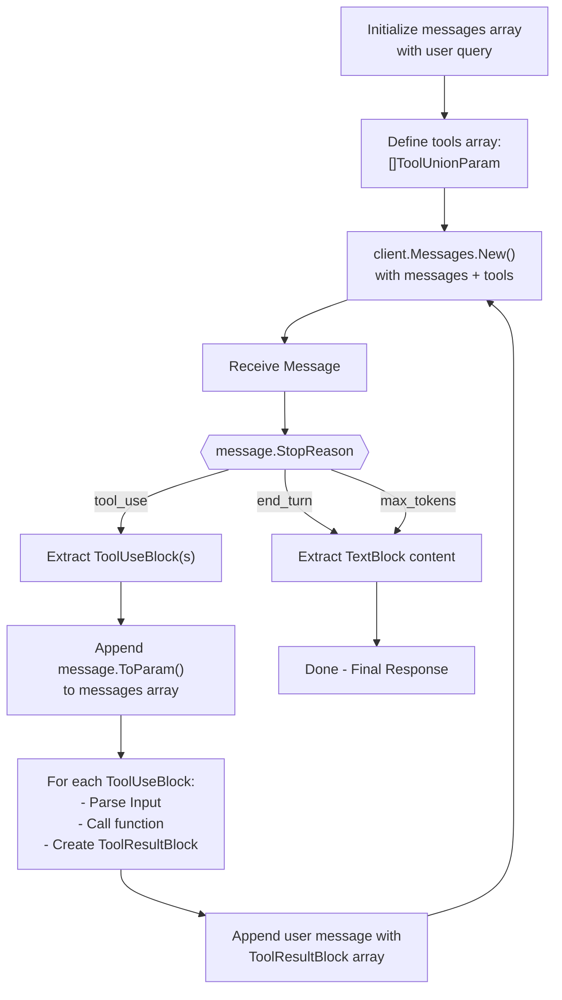
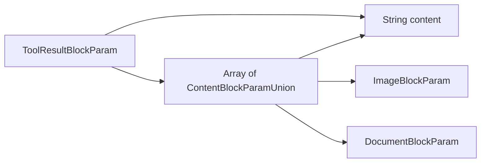
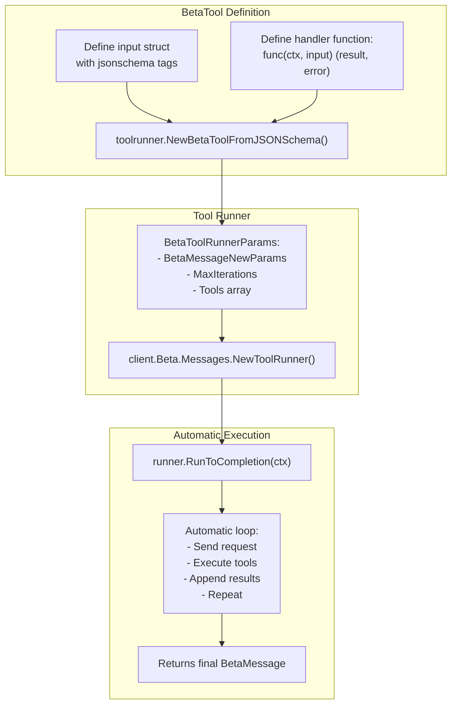
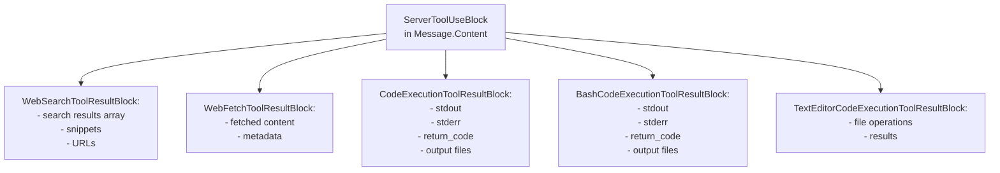
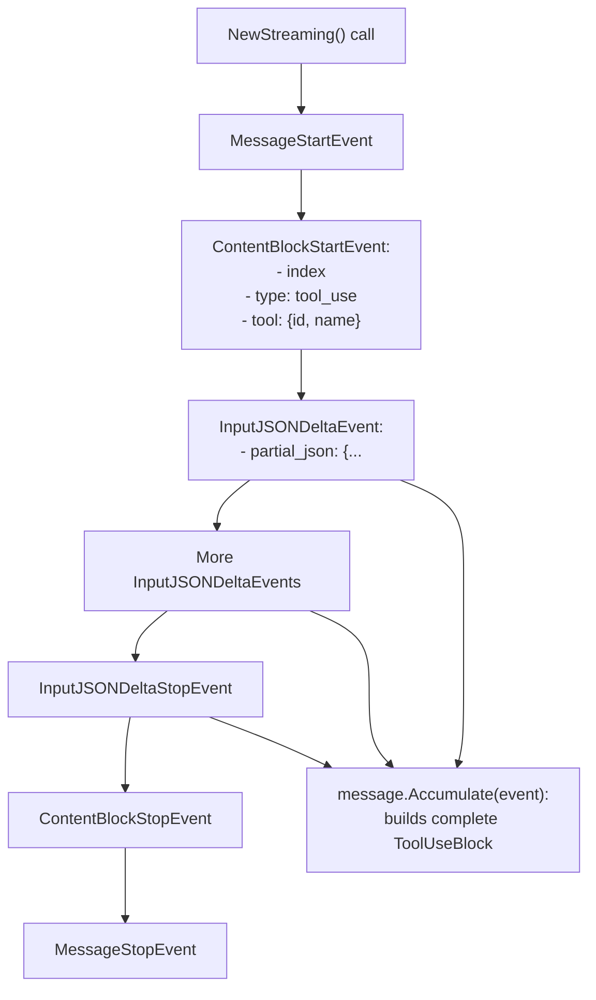

<!-- source: DeepWiki mcp.deepwiki.com · repo anthropics/anthropic-sdk-go · page 5 Tool Calling · fetched 2026-10-26 -->

# Tool Calling

<details>
<summary>Relevant source files</summary>

The following files were used as context for generating this wiki page:

- [.release-please-manifest.json](.release-please-manifest.json)
- [CHANGELOG.md](CHANGELOG.md)
- [README.md](README.md)
- [internal/version.go](internal/version.go)
- [message.go](message.go)

</details>


Tool calling enables Claude to interact with external systems and execute functions during conversations. This system allows you to extend Claude's capabilities beyond text generation by providing it with custom tools (functions it can request to call) and built-in server-side tools (like web search, code execution, and file operations). For details on defining tool schemas and configurations, see [Tool Definitions](#5.1). For implementing tool execution loops and automatic tool runners, see [Tool Execution Loop](#5.2). For documentation on built-in server-side tools, see [Built-in Tools](#5.3).

The tool calling system supports:
- **Custom client-side tools**: Functions you define and execute in your application
- **Built-in server-side tools**: Tools executed by Anthropic's infrastructure (web search, code execution, bash, text editor, etc.)
- **Tool choice strategies**: Control which tools Claude can use (auto, any, specific tool)
- **Multi-turn conversations**: Iterative tool use with results fed back to Claude
- **Automatic execution**: Helper utilities that run tool loops automatically

## Tool Calling Architecture

The tool calling system follows a request-response cycle where Claude decides which tools to use, your application executes them, and results are returned to continue the conversation.



**Tool Calling Lifecycle with Code Entities**

Sources: [README.md:163-303](), [message.go:1-100]()

## Core Tool Data Structures

The SDK represents tools and their usage through several key types organized as unions and content blocks.

| Type | Purpose | Location |
|------|---------|----------|
| `ToolParam` | Define a custom tool with schema, description, configuration | [message.go]() |
| `ToolUnionParam` | Union wrapper for tool definitions (custom or built-in) | [message.go]() |
| `ToolUseBlock` | Claude's request to use a tool (in response content) | [message.go]() |
| `ToolResultBlock` | Your tool execution results (in user message) | [message.go]() |
| `ToolChoiceUnion` | Strategy for which tools Claude should use | [message.go]() |
| `ToolInputSchemaParam` | JSON schema defining tool input parameters | [message.go]() |



**Tool Type System**

Sources: [message.go:1300-1500](), [README.md:188-199]()

## Basic Tool Calling Example

The SDK provides helper functions to create tool definitions and process tool use. Here's the essential pattern:

### Defining Tools

Tools are defined using `ToolParam` with a JSON schema describing their inputs:

```go
// From README example
toolParams := []anthropic.ToolParam{
    {
        Name:        "get_coordinates",
        Description: anthropic.String("Accepts a place as an address, returns lat/long"),
        InputSchema: GetCoordinatesInputSchema,
    },
}

// Convert to union format
tools := make([]anthropic.ToolUnionParam, len(toolParams))
for i, toolParam := range toolParams {
    tools[i] = anthropic.ToolUnionParam{OfTool: &toolParam}
}
```

The input schema can be generated from Go structs using JSON schema reflection (see example at [README.md:266-296]()).

Sources: [README.md:188-199]()

### Processing Tool Use

When Claude requests tool use, the response contains `ToolUseBlock` entries:

```go
// From README example pattern
for _, block := range message.Content {
    switch block := block.AsAny().(type) {
    case anthropic.TextBlock:
        println(block.Text)
    case anthropic.ToolUseBlock:
        // Tool use requested
        println(block.Name + ": " + string(inputJSON))
    }
}
```

Tool execution happens by:
1. Parsing `block.Input` (raw JSON)
2. Calling your function
3. Creating a `ToolResultBlock` with the output
4. Appending to messages and making another request

Sources: [README.md:213-258]()

### The Tool Execution Loop

A complete tool calling flow requires iteration until Claude produces a final response:



**Multi-turn Tool Execution Flow**

Sources: [README.md:200-263]()

## Tool Choice Strategies

The `ToolChoice` parameter controls which tools Claude can use in a request:

| Strategy | Type | Behavior |
|----------|------|----------|
| Auto | `ToolChoiceAutoParam` | Claude decides whether to use any tool |
| Any | `ToolChoiceAnyParam` | Claude must use at least one tool |
| Specific Tool | `ToolChoiceToolParam` | Claude must use the specified tool |

```go
// Auto - Claude decides
ToolChoice: anthropic.ToolChoiceUnion{
    OfAuto: &anthropic.ToolChoiceAutoParam{
        Type: "auto",
    },
}

// Any - Must use some tool
ToolChoice: anthropic.ToolChoiceUnion{
    OfAny: &anthropic.ToolChoiceAnyParam{
        Type: "any",
    },
}

// Specific - Must use "get_weather"
ToolChoice: anthropic.ToolChoiceUnion{
    OfTool: &anthropic.ToolChoiceToolParam{
        Type: "tool",
        Name: "get_weather",
    },
}
```

Sources: [message.go:1400-1550]()

## Tool Result Types

Tool results can contain various content types beyond simple text:



**Tool Result Content Options**

Creating tool results:

```go
// Simple text result
anthropic.NewToolResultBlock(toolUseID, resultString, false)

// With error flag
anthropic.NewToolResultBlock(toolUseID, errorMessage, true)

// Complex content with multiple blocks
anthropic.ToolResultBlockParam{
    ToolUseID: toolUseID,
    Content: []anthropic.ToolResultBlockParamContentUnion{
        {OfText: &anthropic.TextBlockParam{Text: "Result text"}},
        {OfImage: &anthropic.ImageBlockParam{...}},
    },
    IsError: false,
}
```

Sources: [message.go:1600-1800]()

## Automatic Tool Runner

The SDK provides `toolrunner` package for automatic tool execution loops, eliminating manual iteration:



**Automatic Tool Runner Flow**

Example from README:

```go
// Define tool with automatic schema generation
weatherTool, err := toolrunner.NewBetaToolFromJSONSchema(
    "get_weather",
    "Get weather for a city",
    func(ctx context.Context, input GetWeatherInput) (anthropic.BetaToolResultBlockParamContentUnion, error) {
        return anthropic.BetaToolResultBlockParamContentUnion{
            OfText: &anthropic.BetaTextBlockParam{
                Text: fmt.Sprintf("The weather in %s is sunny, 72°F", input.City),
            },
        }, nil
    },
)

// Create runner with automatic execution
runner := client.Beta.Messages.NewToolRunner(
    []anthropic.BetaTool{weatherTool},
    anthropic.BetaToolRunnerParams{
        BetaMessageNewParams: anthropic.BetaMessageNewParams{
            Model:     anthropic.ModelClaudeSonnet4_20250514,
            MaxTokens: 1024,
            Messages: []anthropic.BetaMessageParam{
                anthropic.NewBetaUserMessage(anthropic.NewBetaTextBlock("What's the weather in Paris?")),
            },
        },
        MaxIterations: 5,
    },
)

// Run until completion - handles all tool calling automatically
message, err := runner.RunToCompletion(context.Background())
```

Sources: [README.md:308-364]()

## Built-in Server-Side Tools

The SDK supports server-side tools executed by Anthropic's infrastructure. These require beta API versions and specific tool union types:

| Tool Type | Union Field | Purpose |
|-----------|-------------|---------|
| Web Search | `OfBashTool_20250220` | Search the web for information |
| Web Fetch | `OfWebFetchTool_20250910` | Fetch content from URLs |
| Code Execution | `OfCodeExecutionTool_20250826` | Execute Python code |
| Bash Execution | `OfBashTool_20250220` | Execute bash commands |
| Text Editor | `OfTextEditorTool_20250728` | File editing operations |
| Tool Search | `OfToolSearchTool_20250425` | Search available tools |

Server-side tools return specialized result blocks:



**Server-Side Tool Result Types**

These tools are defined in the `ToolUnionParam` structure and their results appear automatically in Claude's responses. For detailed documentation on each built-in tool, see [Built-in Tools](#5.3).

Sources: [message.go:180-468](), [message.go:950-1010](), [CHANGELOG.md:224-304]()

## Tool Caching

Tools can be cached to reduce latency and cost in repeated conversations. Use `CacheControl` on tool definitions:

```go
toolParam := anthropic.ToolParam{
    Name:        "expensive_tool",
    Description: anthropic.String("A complex tool"),
    InputSchema: schema,
    CacheControl: NewCacheControlEphemeralParam(),  // Cache for 5m or 1h
}
```

When tools are cached, subsequent requests with the same tools avoid re-processing. See [message.go:469-514]() for cache control configuration.

Sources: [message.go:469-514]()

## Error Handling in Tool Results

Tool execution can fail. Indicate errors using the `IsError` flag:

```go
// Execution succeeded
anthropic.NewToolResultBlock(toolUseID, result, false)

// Execution failed
anthropic.NewToolResultBlock(toolUseID, "Tool execution failed: " + err.Error(), true)
```

For built-in tools, error results use specialized error types:

```go
// Code execution error
CodeExecutionToolResultError{
    ErrorCode: CodeExecutionToolResultErrorCodeUnavailable,
    Type:      constant.CodeExecutionToolResultError,
}

// Bash execution error  
BashCodeExecutionToolResultError{
    ErrorCode: BashCodeExecutionToolResultErrorCodeExecutionTimeExceeded,
    Type:      constant.BashCodeExecutionToolResultError,
}
```

Error codes include: `invalid_tool_input`, `unavailable`, `too_many_requests`, `execution_time_exceeded`, `output_file_too_large`.

Sources: [message.go:420-467]()

## Streaming with Tool Use

Tool calling works with streaming responses. Tool use blocks arrive incrementally:



**Streaming Tool Use Events**

Use `Message.Accumulate()` to build complete tool use blocks from delta events:

```go
stream := client.Messages.NewStreaming(ctx, params)
message := anthropic.Message{}

for stream.Next() {
    event := stream.Current()
    err := message.Accumulate(event)
    // message.Content will contain complete ToolUseBlock when finished
}
```

Sources: [README.md:126-158](), [message.go:80-91]()

## Tool Definition Best Practices

For reliable tool calling:

1. **Precise descriptions**: Claude uses descriptions to decide when to call tools
2. **Strict schemas**: Use `required` fields and clear types in `InputSchema`
3. **Example values**: Provide example inputs in tool descriptions
4. **Error handling**: Always handle tool execution failures gracefully
5. **Validation**: Validate tool inputs before execution
6. **Deterministic outputs**: Tools should return consistent results for same inputs

```go
// Good tool definition
ToolParam{
    Name: "get_weather",
    Description: anthropic.String(
        "Get current weather for a city. " +
        "Returns temperature in Fahrenheit and conditions. " +
        "Example: get_weather({\"city\": \"San Francisco\"})",
    ),
    InputSchema: ToolInputSchemaParam{
        Type: "object",
        Properties: map[string]any{
            "city": map[string]any{
                "type":        "string",
                "description": "City name, e.g. 'San Francisco'",
            },
        },
        Required: []string{"city"},
    },
}
```

Sources: [README.md:188-199](), [README.md:321-324]()

---

