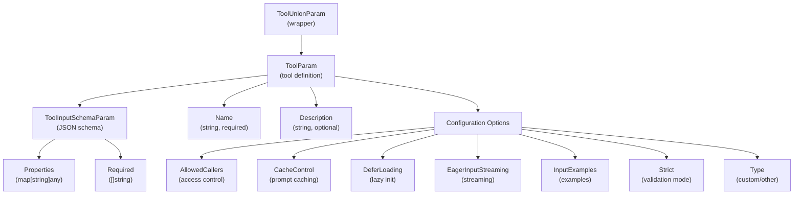
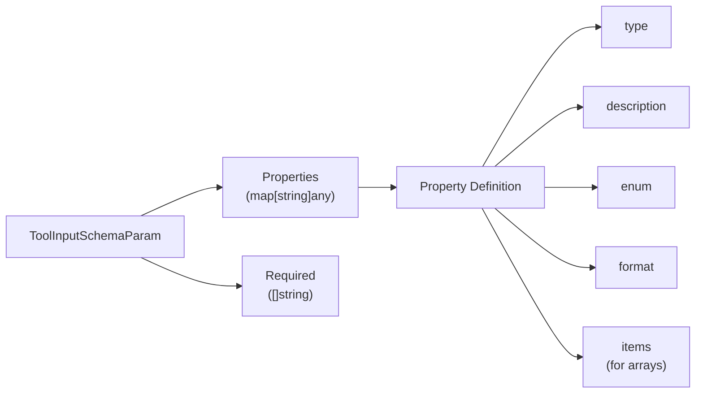
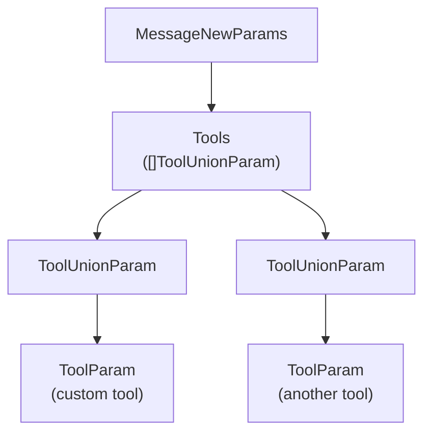

<!-- source: DeepWiki mcp.deepwiki.com · repo anthropics/anthropic-sdk-go · page 5.1 Tool Definitions · fetched 2026-10-26 -->

# Tool Definitions

<details>
<summary>Relevant source files</summary>

The following files were used as context for generating this wiki page:

- [.release-please-manifest.json](.release-please-manifest.json)
- [CHANGELOG.md](CHANGELOG.md)
- [README.md](README.md)
- [internal/version.go](internal/version.go)
- [message.go](message.go)
- [message_test.go](message_test.go)

</details>


This page documents how to define custom tools for Claude to use in the Anthropic Go SDK. Tools extend Claude's capabilities by allowing it to request execution of functions with structured inputs. For information about executing tools and managing the conversation loop, see [Tool Execution Loop](#5.2). For built-in server-side tools, see [Built-in Tools](#5.3).

## Overview

Tool definitions specify the interface between Claude and external functions. Each tool has a name, description, input schema, and optional configuration parameters that control caching, access control, and execution behavior.

## Tool Definition Structure

Tools are defined using the `ToolParam` struct and wrapped in `ToolUnionParam` for use in message requests:



**Sources:** [message.go:188-194](), [message_test.go:98-121]()

### Basic Tool Definition

A minimal tool definition requires a name and input schema:

```go
tool := anthropic.ToolParam{
    Name: "get_weather",
    InputSchema: anthropic.ToolInputSchemaParam{
        Properties: map[string]any{
            "location": map[string]any{
                "type": "string",
                "description": "City name",
            },
        },
        Required: []string{"location"},
    },
}
```

**Sources:** [README.md:188-194]()

### Complete Tool Definition

A fully configured tool with all optional parameters:

```go
tool := anthropic.ToolParam{
    Name: "get_weather",
    Description: anthropic.String("Get current weather for a location"),
    InputSchema: anthropic.ToolInputSchemaParam{
        Properties: map[string]any{
            "location": map[string]any{
                "type": "string",
                "description": "City name",
            },
            "unit": map[string]any{
                "type": "string",
                "enum": []string{"celsius", "fahrenheit"},
            },
        },
        Required: []string{"location"},
    },
    AllowedCallers: []string{"direct"},
    CacheControl: anthropic.NewCacheControlEphemeralParam(),
    DeferLoading: anthropic.Bool(true),
    EagerInputStreaming: anthropic.Bool(true),
    InputExamples: []map[string]any{{
        "location": "San Francisco",
        "unit": "celsius",
    }},
    Strict: anthropic.Bool(true),
    Type: anthropic.ToolTypeCustom,
}
```

**Sources:** [message_test.go:99-121]()

## Input Schema Definition

The `ToolInputSchemaParam` defines the structure and validation rules for tool inputs using JSON Schema format.



**Sources:** [message_test.go:100-106]()

### Schema Properties

Each property in the schema is defined as a `map[string]any` with JSON Schema keywords:

| Keyword | Type | Purpose |
|---------|------|---------|
| `type` | string | Data type: "string", "number", "integer", "boolean", "array", "object" |
| `description` | string | Human-readable description for the model |
| `enum` | []string | List of allowed values |
| `format` | string | Format hint (e.g., "date", "email", "uri") |
| `items` | map[string]any | Schema for array elements |
| `properties` | map[string]any | Nested object properties |
| `required` | []string | Required nested properties |

**Sources:** [message_test.go:101-105]()

### Schema Generation from Go Types

The SDK does not include built-in schema generation, but the README demonstrates using the `invopop/jsonschema` package for automatic schema generation from Go structs:

```go
import "github.com/invopop/jsonschema"

type GetWeatherInput struct {
    Location string `json:"location" jsonschema:"required,description=City name"`
    Unit     string `json:"unit" jsonschema:"enum=celsius|fahrenheit"`
}

func GenerateSchema[T any]() anthropic.ToolInputSchemaParam {
    reflector := jsonschema.Reflector{
        AllowAdditionalProperties: false,
        DoNotReference:            true,
    }
    var v T
    schema := reflector.Reflect(v)
    
    return anthropic.ToolInputSchemaParam{
        Properties: schema.Properties,
        Required: schema.Required,
    }
}

inputSchema := GenerateSchema[GetWeatherInput]()
```

**Sources:** [README.md:266-296]()

## Tool Configuration Options

### Allowed Callers

The `AllowedCallers` field restricts which entities can invoke the tool:

```go
AllowedCallers: []string{"direct"}  // Only direct invocations allowed
```

Possible values include `"direct"` for user-initiated calls and potentially other identifiers for server-side tool access control.

**Sources:** [message_test.go:108]()

### Cache Control

Cache control enables prompt caching for the tool definition to reduce latency and costs:

```go
CacheControl: anthropic.NewCacheControlEphemeralParam()
```

This creates an ephemeral cache with default TTL. You can also specify TTL explicitly:

```go
CacheControl: anthropic.CacheControlEphemeralParam{
    Type: "ephemeral",
    TTL: anthropic.CacheControlEphemeralTTLTTL1h,  // 1 hour
}
```

**Sources:** [message.go:469-499](), [message_test.go:109-111]()

### Defer Loading

The `DeferLoading` option delays tool initialization until first use:

```go
DeferLoading: anthropic.Bool(true)
```

This can improve initial response times when defining many tools.

**Sources:** [message_test.go:112]()

### Eager Input Streaming

The `EagerInputStreaming` option enables streaming of tool inputs as they're generated:

```go
EagerInputStreaming: anthropic.Bool(true)
```

This allows processing partial tool inputs before the complete input is generated.

**Sources:** [message_test.go:114]()

### Input Examples

The `InputExamples` field provides example inputs to guide Claude's usage:

```go
InputExamples: []map[string]any{{
    "location": "San Francisco",
    "unit": "celsius",
}},
```

Multiple examples can be provided to demonstrate different usage patterns.

**Sources:** [message_test.go:115-117]()

### Strict Mode

The `Strict` option enables strict validation of tool inputs:

```go
Strict: anthropic.Bool(true)
```

When enabled, inputs are validated against the schema before execution.

**Sources:** [message_test.go:118]()

### Tool Type

The `Type` field specifies the tool category:

```go
Type: anthropic.ToolTypeCustom
```

Standard types include `ToolTypeCustom` for user-defined tools.

**Sources:** [message_test.go:119]()

## Passing Tools to Messages

Tools are passed to the Messages API through the `Tools` parameter in `MessageNewParams`:



**Sources:** [message_test.go:98-121](), [README.md:188-199]()

### Wrapping Tools in ToolUnionParam

Each `ToolParam` must be wrapped in a `ToolUnionParam` union:

```go
tools := []anthropic.ToolUnionParam{
    {OfTool: &anthropic.ToolParam{
        Name: "get_weather",
        InputSchema: anthropic.ToolInputSchemaParam{
            Properties: map[string]any{
                "location": map[string]any{"type": "string"},
            },
            Required: []string{"location"},
        },
    }},
    {OfTool: &anthropic.ToolParam{
        Name: "get_coordinates",
        InputSchema: anthropic.ToolInputSchemaParam{
            Properties: map[string]any{
                "address": map[string]any{"type": "string"},
            },
            Required: []string{"address"},
        },
    }},
}
```

**Sources:** [README.md:195-198]()

### Using Tools in Message Requests

Tools are provided when creating messages:

```go
message, err := client.Messages.New(context.TODO(), anthropic.MessageNewParams{
    Model:     anthropic.ModelClaudeSonnet4_5_20250929,
    MaxTokens: 1024,
    Messages: []anthropic.MessageParam{
        anthropic.NewUserMessage(anthropic.NewTextBlock("What's the weather?")),
    },
    Tools: tools,
})
```

**Sources:** [README.md:201-206]()

## Tool Choice Configuration

While tool definitions specify what tools are available, the `ToolChoice` parameter (covered in detail in [Tool Execution Loop](#5.2)) controls how Claude selects which tools to use:

```go
ToolChoice: anthropic.ToolChoiceUnionParam{
    OfAuto: &anthropic.ToolChoiceAutoParam{
        DisableParallelToolUse: anthropic.Bool(true),
    },
}
```

**Sources:** [message_test.go:93-97]()

## Tool Types and Built-in Tools

The SDK supports both custom tools defined by users and built-in server-side tools. Built-in tools like `web_search`, `web_fetch`, and `code_execution` are documented in [Built-in Tools](#5.3).

Custom tools are identified by `Type: anthropic.ToolTypeCustom`, while built-in tools have specific type identifiers.

**Sources:** [message_test.go:119]()

## Token Counting with Tools

Tools are included in token counting when using the `Messages.CountTokens` endpoint:

```go
count, err := client.Messages.CountTokens(context.TODO(), anthropic.MessageCountTokensParams{
    Model: anthropic.ModelClaudeSonnet4_5_20250929,
    Messages: messages,
    Tools: tools,  // Tools included in count
})
```

**Sources:** [message.go:93-105]()

---

