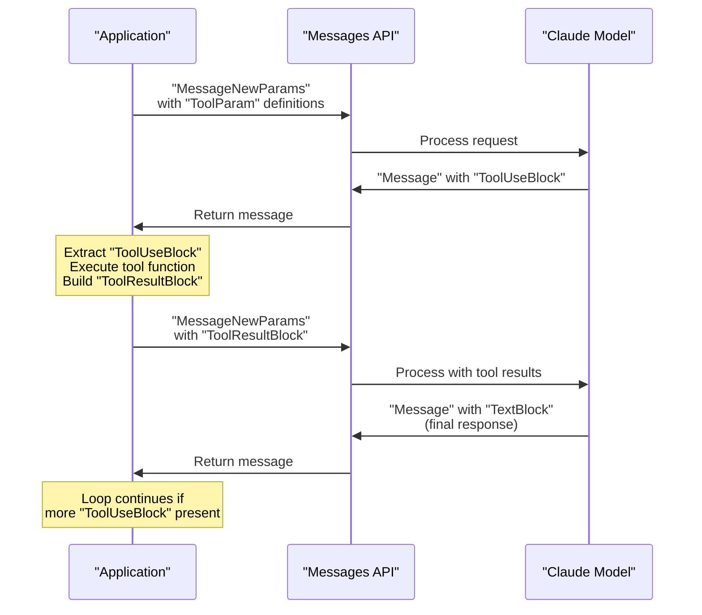
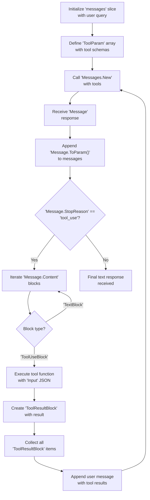
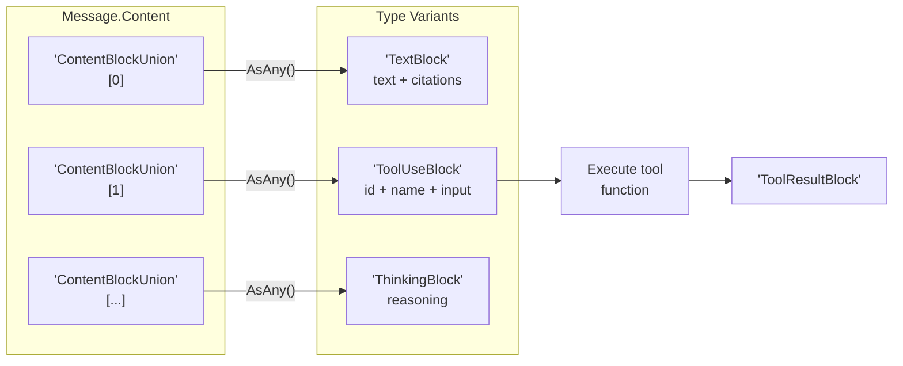
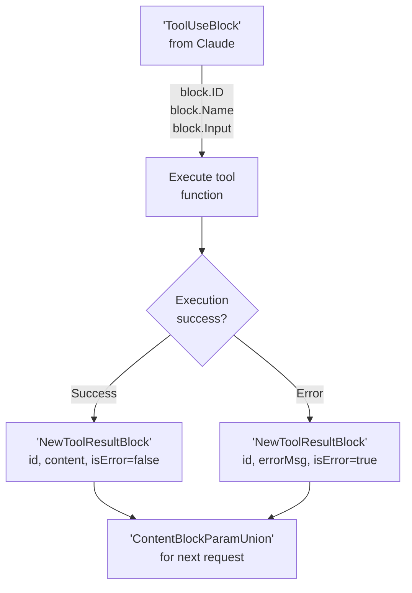
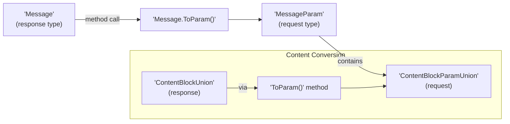
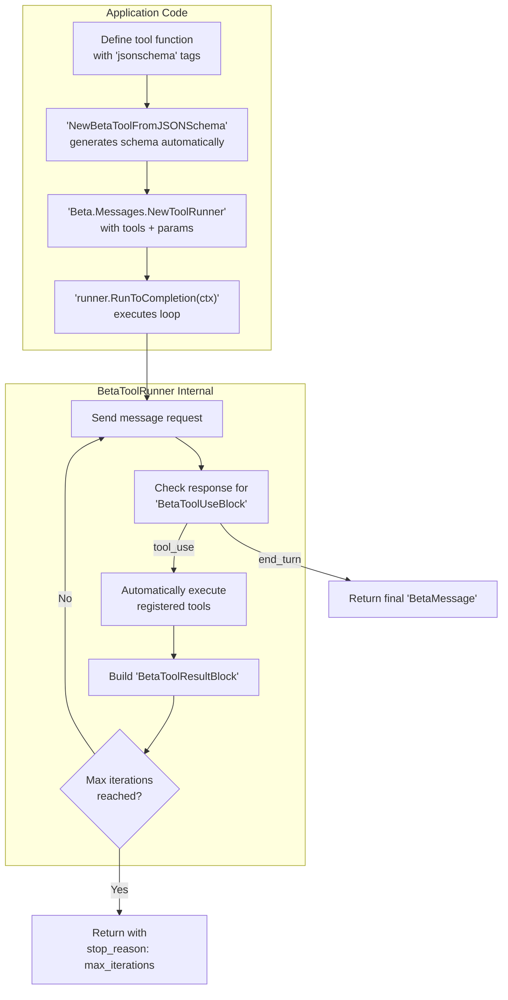
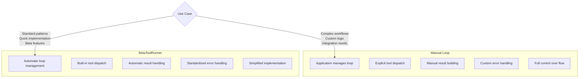
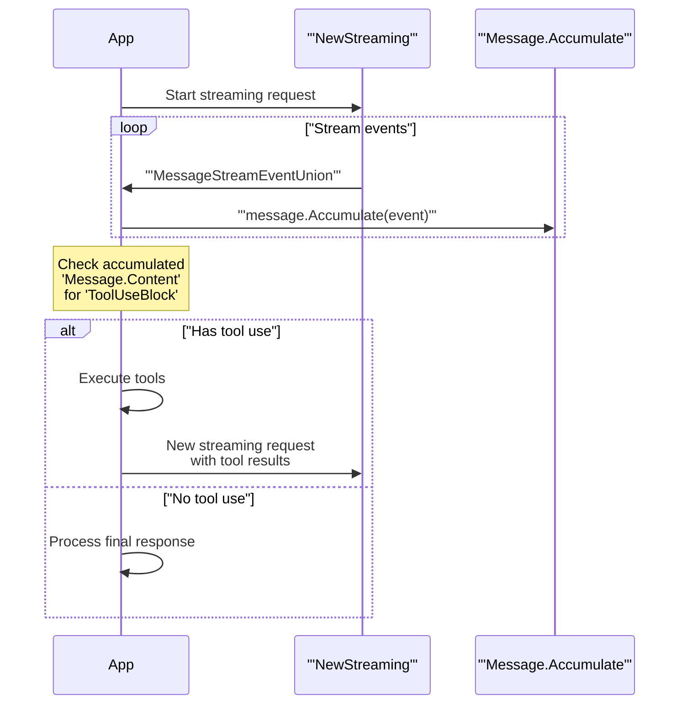

<!-- source: DeepWiki mcp.deepwiki.com · repo anthropics/anthropic-sdk-go · page 5.2 Tool Execution Loop · fetched 2026-10-26 -->

# Tool Execution Loop

<details>
<summary>Relevant source files</summary>

The following files were used as context for generating this wiki page:

- [.release-please-manifest.json](.release-please-manifest.json)
- [CHANGELOG.md](CHANGELOG.md)
- [README.md](README.md)
- [aliases.go](aliases.go)
- [betamessageutil.go](betamessageutil.go)
- [internal/version.go](internal/version.go)
- [message.go](message.go)
- [messageutil.go](messageutil.go)

</details>


This page explains the multi-turn conversation pattern for executing tools with Claude. It covers manually implementing tool execution loops, handling tool results, and using the automatic tool runner for simplified workflows.

For information about defining tools with schemas and configurations, see [Tool Definitions](#5.1). For details about server-side built-in tools like web search and code execution, see [Built-in Tools](#5.3).

## Purpose and Scope

The tool execution loop enables Claude to interact with external functions and services through a request-response pattern. When Claude determines it needs to use a tool, it responds with a `ToolUseBlock` containing the tool name and input. Your application executes the tool and returns results in a `ToolResultBlock`, which Claude uses to continue the conversation and provide a final response.

This page focuses on:
- The multi-turn conversation pattern for tool execution
- Manual implementation of tool execution loops
- Converting message responses to request parameters
- Automatic tool runners in the beta API
- Handling different tool result types

## Multi-Turn Tool Execution Pattern



**Tool Execution Flow**

Sources: [README.md:163-303]()

The tool execution loop follows this pattern:

1. **Send request with tools**: Include tool definitions in `MessageNewParams.Tools`
2. **Check for tool use**: Inspect `Message.Content` for `ToolUseBlock` items
3. **Execute tools**: Call the corresponding functions with the provided input
4. **Build tool results**: Create `ToolResultBlock` items with execution results
5. **Continue conversation**: Send a new message with tool results as user content
6. **Repeat or finish**: Claude either uses more tools or provides a final text response

## Manual Tool Execution Loop

The manual approach gives you full control over tool execution and allows integration with any function or service.

### Basic Loop Structure



**Manual Tool Execution Loop Flow**

Sources: [README.md:166-264]()

### Code Implementation Pattern

The manual loop implementation follows this structure from the README example:

**1. Initialize conversation and define tools** [README.md:178-198]()

```go
messages := []anthropic.MessageParam{
    anthropic.NewUserMessage(anthropic.NewTextBlock("Where is San Francisco?")),
}

toolParams := []anthropic.ToolParam{
    {
        Name:        "get_coordinates",
        Description: anthropic.String("Accepts a place as an address..."),
        InputSchema: GetCoordinatesInputSchema,
    },
}
```

**2. Main execution loop** [README.md:200-263]()

The loop continues until no tool use blocks are present:

```go
for {
    message, err := client.Messages.New(context.TODO(), anthropic.MessageNewParams{
        Model:     anthropic.ModelClaudeSonnet4_5_20250929,
        MaxTokens: 1024,
        Messages:  messages,
        Tools:     tools,
    })
    
    // Append assistant response to conversation
    messages = append(messages, message.ToParam())
    
    // Collect tool results
    toolResults := []anthropic.ContentBlockParamUnion{}
    
    // Process each content block
    for _, block := range message.Content {
        switch variant := block.AsAny().(type) {
        case anthropic.ToolUseBlock:
            // Execute tool and build result
            result := executeTool(variant)
            toolResults = append(toolResults, result)
        }
    }
    
    // Exit if no tools were used
    if len(toolResults) == 0 {
        break
    }
    
    // Append tool results as user message
    messages = append(messages, anthropic.NewUserMessage(toolResults...))
}
```

### Content Block Handling



**Content Block Type Discrimination**

Sources: [message.go:1-100](), [messageutil.go:103-217]()

Each `ContentBlockUnion` can be one of several variants. Use the `AsAny()` method to determine the actual type:

- **`TextBlock`**: Regular text response with optional citations
- **`ToolUseBlock`**: Tool invocation request from Claude
- **`ThinkingBlock`**: Claude's reasoning (if extended thinking is enabled)
- **`ServerToolUseBlock`**: Server-side tool execution request

The `ToolUseBlock` contains:
- **`ID`**: Unique identifier for correlating results
- **`Name`**: Tool name matching your definition
- **`Input`**: JSON object with tool parameters

## Tool Result Construction

### Building Tool Results



**Tool Result Block Construction**

Sources: [README.md:234-256](), [message.go:1-100]()

Create tool results using the constructor:

```go
// Success result
result := anthropic.NewToolResultBlock(
    toolUseBlock.ID,     // from ToolUseBlock
    resultJSON,          // stringified JSON
    false,               // isError
)

// Error result
errorResult := anthropic.NewToolResultBlock(
    toolUseBlock.ID,
    "Error: tool execution failed",
    true,  // isError
)
```

### Tool Result Block Types

Different tool types produce specialized result blocks:

| Result Block Type | Purpose | Sources |
|-------------------|---------|---------|
| `ToolResultBlock` | Generic tool execution results | [message.go:1-100]() |
| `WebSearchToolResultBlock` | Web search results with encrypted content | [message.go:1-100]() |
| `WebFetchToolResultBlock` | Web page fetch results | [message.go:1-100]() |
| `CodeExecutionToolResultBlock` | Code execution with stdout/stderr/files | [message.go:1-100]() |
| `BashCodeExecutionToolResultBlock` | Bash command execution results | [message.go:1-100]() |
| `TextEditorCodeExecutionToolResultBlock` | Text editor operations | [message.go:1-100]() |
| `ToolSearchToolResultBlock` | Tool discovery results | [message.go:1-100]() |

Sources: [message.go:1-500](), [messageutil.go:270-413]()

### Converting Response Messages to Request Parameters



**Response to Request Parameter Conversion**

Sources: [messageutil.go:93-217]()

The `Message.ToParam()` method [messageutil.go:93-101]() converts a response message to a request parameter suitable for the next API call:

```go
message, err := client.Messages.New(ctx, params)
// ... handle error

// Convert response to param for next request
messages = append(messages, message.ToParam())
```

This conversion:
1. Transforms `Message` → `MessageParam`
2. Converts `ContentBlockUnion` → `ContentBlockParamUnion` for each content block
3. Preserves all tool use blocks, text blocks, and thinking blocks
4. Maintains message role (assistant)

The `ContentBlockUnion.ToParam()` method [messageutil.go:103-105]() delegates to type-specific converters:
- `TextBlock.ToParam()` [messageutil.go:201-217]()
- `ToolUseBlock.ToParam()` [messageutil.go:144-151]()
- `ThinkingBlock.ToParam()` [messageutil.go:219-225]()

## Automatic Tool Runner (Beta)

The beta API provides `BetaToolRunner` which automates the entire tool execution loop.

### Tool Runner Architecture



**Automatic Tool Runner Flow**

Sources: [README.md:306-367]()

### Usage Example

The tool runner simplifies implementation significantly [README.md:310-367]():

```go
// 1. Define tool with automatic schema generation
type GetWeatherInput struct {
    City string `json:"city" jsonschema:"required,description=The city name"`
}

weatherTool, err := toolrunner.NewBetaToolFromJSONSchema(
    "get_weather",
    "Get weather for a city",
    func(ctx context.Context, input GetWeatherInput) (anthropic.BetaToolResultBlockParamContentUnion, error) {
        return anthropic.BetaToolResultBlockParamContentUnion{
            OfText: &anthropic.BetaTextBlockParam{
                Text: fmt.Sprintf("The weather in %s is sunny, 72°F", input.City),
            },
        }, nil
    },
)

// 2. Create runner with tools and parameters
runner := client.Beta.Messages.NewToolRunner(
    []anthropic.BetaTool{weatherTool},
    anthropic.BetaToolRunnerParams{
        BetaMessageNewParams: anthropic.BetaMessageNewParams{
            Model:     anthropic.ModelClaudeSonnet4_20250514,
            MaxTokens: 1024,
            Messages: []anthropic.BetaMessageParam{
                anthropic.NewBetaUserMessage(anthropic.NewBetaTextBlock("What's the weather in Paris?")),
            },
        },
        MaxIterations: 5,
    },
)

// 3. Run to completion
message, err := runner.RunToCompletion(context.Background())
```

### Tool Runner Configuration

| Parameter | Purpose | Notes |
|-----------|---------|-------|
| `BetaTool` array | Tool definitions with execution functions | Generated from struct with `jsonschema` tags |
| `BetaMessageNewParams` | Initial message parameters | Same as manual API calls |
| `MaxIterations` | Maximum tool execution rounds | Prevents infinite loops |

Sources: [README.md:346-356]()

### Tool Runner vs Manual Loop



**Choosing Between Manual and Automatic Approaches**

**Manual Loop** [README.md:166-264]():
- Full control over execution flow
- Custom tool dispatching logic
- Integration with complex systems
- Works with stable Messages API

**Automatic Tool Runner** [README.md:306-367]():
- Simplified implementation
- Automatic schema generation from Go structs
- Built-in iteration management
- Requires Beta Messages API
- Best for standard tool execution patterns

## Streaming with Tools

Tool execution is also supported in streaming mode, though the pattern differs slightly.

### Streaming Tool Execution Pattern



**Streaming Tool Execution Flow**

Sources: [README.md:123-158](), [messageutil.go:20-89]()

In streaming mode:
1. Use `Messages.NewStreaming()` instead of `New()`
2. Accumulate events into a `Message` using `message.Accumulate(event)`
3. After stream completes, check for `ToolUseBlock` in accumulated message
4. Execute tools and start a new streaming request with results

The `Accumulate` method [messageutil.go:20-89]() builds up the message progressively:
- **`MessageStartEvent`**: Initializes the message
- **`ContentBlockStartEvent`**: Adds new content blocks
- **`ContentBlockDeltaEvent`**: Appends deltas (text, tool input JSON, thinking)
- **`ContentBlockStopEvent`**: Finalizes content block
- **`MessageStopEvent`**: Finalizes message

## Best Practices

### Error Handling in Tools

Always handle tool execution errors gracefully:

```go
for _, block := range message.Content {
    if toolUse, ok := block.AsAny().(anthropic.ToolUseBlock); ok {
        result, err := executeTool(toolUse.Name, toolUse.Input)
        if err != nil {
            // Return error as tool result
            toolResults = append(toolResults, 
                anthropic.NewToolResultBlock(
                    toolUse.ID,
                    fmt.Sprintf("Error: %v", err),
                    true,  // isError flag
                ))
        } else {
            toolResults = append(toolResults,
                anthropic.NewToolResultBlock(toolUse.ID, result, false))
        }
    }
}
```

### Iteration Limits

Always implement a maximum iteration limit to prevent infinite loops:

```go
const maxIterations = 10
for i := 0; i < maxIterations; i++ {
    message, err := client.Messages.New(ctx, params)
    // ... handle tool execution
    
    if len(toolResults) == 0 {
        break  // No more tools to execute
    }
}
```

### Tool Result Size

Be mindful of result sizes. Large tool outputs should be summarized:

```go
if len(result) > 5000 {
    result = result[:5000] + "... (truncated)"
}
```

### Conversation History Management

Keep conversation history manageable:
- Remove old tool use/result pairs after they're no longer needed
- Use context management features in beta API (see [Context Management](#6.4))
- Consider summarizing long conversations

Sources: [README.md:163-367](), [message.go:1-100](), [messageutil.go:1-414](), [betamessageutil.go:1-460]()

---

