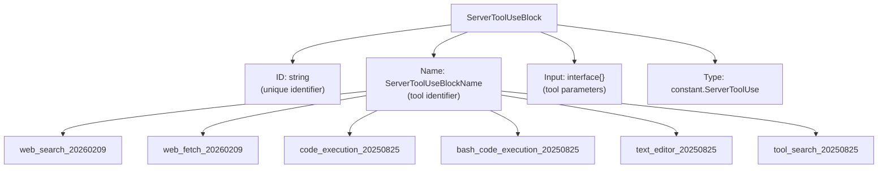
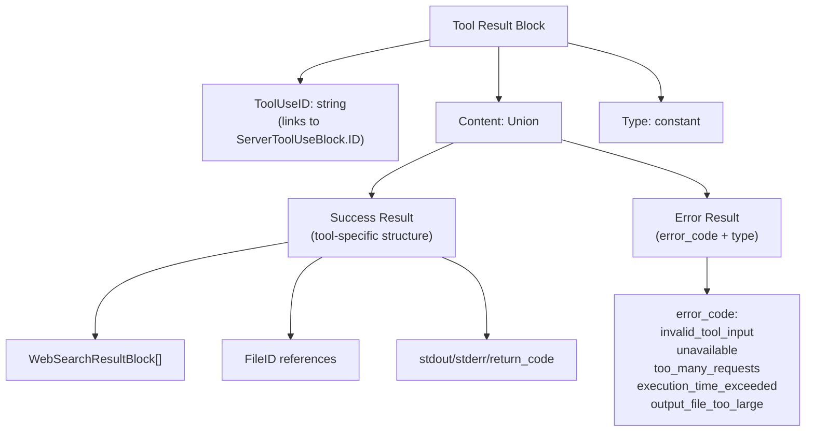
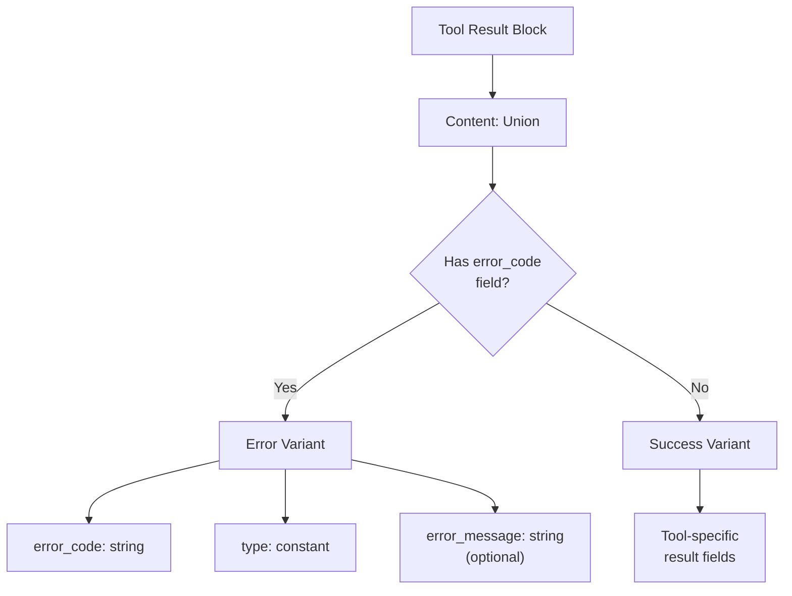

<!-- source: DeepWiki mcp.deepwiki.com · repo anthropics/anthropic-sdk-go · page 5.3 Built-in Tools · fetched 2026-10-26 -->

# Built-in Tools

<details>
<summary>Relevant source files</summary>

The following files were used as context for generating this wiki page:

- [aliases.go](aliases.go)
- [betamessage.go](betamessage.go)
- [betamessageutil.go](betamessageutil.go)
- [message.go](message.go)
- [messageutil.go](messageutil.go)

</details>


This document covers the server-side tools that Claude can use automatically without requiring client-side implementation. These tools are executed by Anthropic's infrastructure and include capabilities like web search, code execution, file operations, and tool discovery.

For information about defining custom tools that execute client-side, see [Tool Definitions](#5.1). For the overall tool execution loop and handling tool results, see [Tool Execution Loop](#5.2).

---

## Overview

Built-in tools are server-side capabilities that Claude can invoke during message generation. Unlike custom tools (which require the client to execute and return results), built-in tools are executed automatically by Anthropic's infrastructure. The model requests tool use through `ServerToolUseBlock` content blocks, and results are returned in specialized tool result blocks.

**Key Characteristics:**
- Executed server-side by Anthropic infrastructure
- No client-side implementation required
- Results automatically included in message responses
- Support both streaming and non-streaming modes
- Each tool has specific error codes and result formats

**Available Built-in Tools:**
| Tool Name | Purpose | Result Type |
|-----------|---------|-------------|
| `web_search_20260209` | Perform web searches | `WebSearchToolResultBlock` |
| `web_fetch_20260209` | Fetch web page content | `WebFetchToolResultBlock` |
| `code_execution_20250825` | Execute Python code | `CodeExecutionToolResultBlock` |
| `bash_code_execution_20250825` | Execute bash commands | `BashCodeExecutionToolResultBlock` |
| `text_editor_20250825` | File editing operations | `TextEditorCodeExecutionToolResultBlock` |
| `tool_search_20250825` | Search available tools | `ToolSearchToolResultBlock` |

Sources: [message.go:8746-8768](), [message.go:8770-8800]()

---

## Server Tool Use Block

When Claude decides to use a built-in tool, it generates a `ServerToolUseBlock` in the message content. This block identifies the tool, provides input parameters, and includes metadata for tracking execution.

### Structure



### Type Definition

The `ServerToolUseBlock` type represents a server-side tool invocation:

```go
type ServerToolUseBlock struct {
    ID    string                  `json:"id,required"`
    Input interface{}             `json:"input,required"`
    Name  ServerToolUseBlockName  `json:"name,required"`
    Type  constant.ServerToolUse  `json:"type,required"`
}
```

**Fields:**
- `ID`: Unique identifier for this tool use (referenced by result blocks)
- `Name`: Tool identifier constant (e.g., `web_search_20260209`)
- `Input`: Tool-specific input parameters (unmarshaled as JSON)
- `Type`: Always `"server_tool_use"`

The `ServerToolUseBlockName` enum defines valid tool identifiers:

```go
const (
    ServerToolUseBlockNameBashCodeExecution20250825 = "bash_code_execution_20250825"
    ServerToolUseBlockNameCodeExecution20250825     = "code_execution_20250825"
    ServerToolUseBlockNameTextEditor20250825        = "text_editor_20250825"
    ServerToolUseBlockNameToolSearch20250825        = "tool_search_20250825"
    ServerToolUseBlockNameWebFetch20260209          = "web_fetch_20260209"
    ServerToolUseBlockNameWebSearch20260209         = "web_search_20260209"
)
```

Sources: [message.go:8746-8768](), [message.go:8770-8800]()

---

## Tool Result Block Types

Each built-in tool returns results in a specific content block type. All result blocks follow a common pattern:

1. Link back to the tool use via `ToolUseID`
2. Contain a union of success result or error
3. Include a type discriminator constant

The content field is a discriminated union that unmarshals to either a success result structure or an error structure based on the presence of an `error_code` field.



Sources: [message.go:11618-11641](), [message.go:11454-11477]()

---

## Web Search Tool

The web search tool (`web_search_20260209`) performs internet searches and returns structured results with URLs, titles, and encrypted content.

### Result Structure

**Success Response:**
```go
type WebSearchToolResultBlock struct {
    Content   WebSearchToolResultBlockContentUnion `json:"content,required"`
    ToolUseID string                               `json:"tool_use_id,required"`
    Type      constant.WebSearchToolResult         `json:"type,required"`
}

type WebSearchResultBlock struct {
    EncryptedContent string                    `json:"encrypted_content,required"`
    Title            string                    `json:"title,required"`
    Type             constant.SearchResult     `json:"type,required"`
    URL              string                    `json:"url,required"`
    PageAge          string                    `json:"page_age,nullable"`
}
```

The `Content` union contains either:
- **Success**: Array of `WebSearchResultBlock` (search results)
- **Error**: `WebSearchToolRequestError` with error code

**Search Result Fields:**
- `EncryptedContent`: Encrypted page content (decrypted by model)
- `Title`: Page title
- `URL`: Source URL
- `PageAge`: Optional age indicator (e.g., "2 days ago")

### Error Codes

```go
const (
    WebSearchToolResultErrorCodeInvalidToolInput  = "invalid_tool_input"
    WebSearchToolResultErrorCodeUnavailable       = "unavailable"
    WebSearchToolResultErrorCodeMaxUsesExceeded   = "max_uses_exceeded"
    WebSearchToolResultErrorCodeTooManyRequests   = "too_many_requests"
    WebSearchToolResultErrorCodeQueryTooLong      = "query_too_long"
    WebSearchToolResultErrorCodeRequestTooLarge   = "request_too_large"
)
```

### Input Parameters

The web search tool accepts parameters including:
- `query`: Search query string
- `user_location`: Geographic location for localized results (optional)
- `safe_search`: Filter explicit content (optional)

```go
type UserLocationParam struct {
    City        param.Opt[string] `json:"city,omitzero"`
    Country     string            `json:"country,required"`
    StateRegion param.Opt[string] `json:"state_region,omitzero"`
    Type        constant.Location `json:"type,required"`
}
```

Sources: [message.go:11618-11706](), [message.go:11924-11955](), [message.go:12013-12037]()

---

## Web Fetch Tool

The web fetch tool (`web_fetch_20260209`) retrieves and processes web page content, making it available to the model.

### Result Structure

```go
type WebFetchToolResultBlock struct {
    Content   WebFetchToolResultBlockContentUnion `json:"content,required"`
    ToolUseID string                              `json:"tool_use_id,required"`
    Type      constant.WebFetchToolResult         `json:"type,required"`
}
```

The `Content` union contains either:
- **Success**: `WebFetchResultBlock` with fetched content
- **Error**: `WebFetchToolResultError` with error code

**Success Result:**
```go
type WebFetchResultBlock struct {
    Document struct {
        Context param.Opt[string] `json:"context,omitzero"`
        Source  WebFetchResultBlockDocumentSourceUnion `json:"source,omitzero,required"`
        Title   param.Opt[string] `json:"title,omitzero"`
        Type    constant.Document `json:"type,required"`
    }
    LastModified string                   `json:"last_modified"`
    Type         constant.WebFetchResult  `json:"type,required"`
    URL          string                   `json:"url,required"`
}
```

The document source can be:
- **Base64PDFSource**: PDF content encoded in base64
- **PlainTextSource**: Plain text content
- **ContentBlockSource**: Structured content blocks

### Error Codes

```go
const (
    WebFetchToolResultErrorCodeInvalidToolInput     = "invalid_tool_input"
    WebFetchToolResultErrorCodeUnavailable          = "unavailable"
    WebFetchToolResultErrorCodeMaxUsesExceeded      = "max_uses_exceeded"
    WebFetchToolResultErrorCodeTooManyRequests      = "too_many_requests"
    WebFetchToolResultErrorCodeFetchFailed          = "fetch_failed"
    WebFetchToolResultErrorCodeProcessingFailed     = "processing_failed"
    WebFetchToolResultErrorCodeResponseTooLarge     = "response_too_large"
    WebFetchToolResultErrorCodeUnsupportedMediaType = "unsupported_media_type"
)
```

Sources: [message.go:11454-11477](), [message.go:11479-11548](), [message.go:11550-11584]()

---

## Code Execution Tool

The code execution tool (`code_execution_20250825`) runs Python code in a sandboxed environment and returns execution results.

### Result Structure

```go
type CodeExecutionToolResultBlock struct {
    Content   CodeExecutionToolResultBlockContentUnion `json:"content,required"`
    ToolUseID string                                   `json:"tool_use_id,required"`
    Type      constant.CodeExecutionToolResult         `json:"type,required"`
}
```

**Success Response:**
```go
type CodeExecutionResultBlock struct {
    Content    []CodeExecutionOutputBlock    `json:"content,required"`
    ReturnCode int64                         `json:"return_code,required"`
    Stderr     string                        `json:"stderr,required"`
    Stdout     string                        `json:"stdout,required"`
    Type       constant.CodeExecutionResult  `json:"type,required"`
}

type CodeExecutionOutputBlock struct {
    FileID string                        `json:"file_id,required"`
    Type   constant.CodeExecutionOutput  `json:"type,required"`
}
```

**Result Fields:**
- `ReturnCode`: Exit code (0 for success)
- `Stdout`: Standard output captured
- `Stderr`: Standard error captured
- `Content`: Array of file outputs (images, plots, etc.)

Each `CodeExecutionOutputBlock` references a file by ID that can be retrieved separately.

### Error Codes

```go
const (
    CodeExecutionToolResultErrorCodeInvalidToolInput      = "invalid_tool_input"
    CodeExecutionToolResultErrorCodeUnavailable           = "unavailable"
    CodeExecutionToolResultErrorCodeTooManyRequests       = "too_many_requests"
    CodeExecutionToolResultErrorCodeExecutionTimeExceeded = "execution_time_exceeded"
    CodeExecutionToolResultErrorCodeOutputFileTooLarge    = "output_file_too_large"
)
```

### Execution Environment

Code executes in a sandboxed Python environment with:
- Standard library access
- Common scientific packages (numpy, pandas, matplotlib, etc.)
- File system isolation
- Time and memory limits
- Output capture for stdout/stderr

Sources: [message.go:3329-3456](), [message.go:3219-3241](), [message.go:3151-3174]()

---

## Bash Code Execution Tool

The bash code execution tool (`bash_code_execution_20250825`) executes bash commands in a sandboxed shell environment.

### Result Structure

```go
type BashCodeExecutionToolResultBlock struct {
    Content   BashCodeExecutionToolResultBlockContentUnion `json:"content,required"`
    ToolUseID string                                       `json:"tool_use_id,required"`
    Type      constant.BashCodeExecutionToolResult         `json:"type,required"`
}
```

**Success Response:**
```go
type BashCodeExecutionResultBlock struct {
    Content    []BashCodeExecutionOutputBlock   `json:"content,required"`
    ReturnCode int64                            `json:"return_code,required"`
    Stderr     string                           `json:"stderr,required"`
    Stdout     string                           `json:"stdout,required"`
    Type       constant.BashCodeExecutionResult `json:"type,required"`
}

type BashCodeExecutionOutputBlock struct {
    FileID string                           `json:"file_id,required"`
    Type   constant.BashCodeExecutionOutput `json:"type,required"`
}
```

**Result Fields:**
- `ReturnCode`: Command exit code
- `Stdout`: Standard output from command
- `Stderr`: Standard error from command  
- `Content`: Array of file outputs created by commands

### Error Codes

```go
const (
    BashCodeExecutionToolResultErrorCodeInvalidToolInput      = "invalid_tool_input"
    BashCodeExecutionToolResultErrorCodeUnavailable           = "unavailable"
    BashCodeExecutionToolResultErrorCodeTooManyRequests       = "too_many_requests"
    BashCodeExecutionToolResultErrorCodeExecutionTimeExceeded = "execution_time_exceeded"
    BashCodeExecutionToolResultErrorCodeOutputFileTooLarge    = "output_file_too_large"
)
```

### Use Cases

Bash execution supports:
- File system operations (ls, cat, grep, etc.)
- Text processing (awk, sed, cut, etc.)
- Script execution
- Environment inspection
- Command chaining with pipes

Sources: [message.go:260-467](), [message.go:181-214](), [message.go:216-238]()

---

## Text Editor Code Execution Tool

The text editor tool (`text_editor_20250825`) provides file editing capabilities including viewing, creating, modifying, and deleting files.

### Result Structure

```go
type TextEditorCodeExecutionToolResultBlock struct {
    Content   TextEditorCodeExecutionToolResultBlockContentUnion `json:"content,required"`
    ToolUseID string                                             `json:"tool_use_id,required"`
    Type      constant.TextEditorCodeExecutionToolResult         `json:"type,required"`
}
```

**Success Response:**
The content union for text editor operations is more complex, containing various operation-specific result types:

```go
type TextEditorCodeExecutionResultBlockContentUnion struct {
    // Various operation results
    OfTextEditorListDirectoryResultBlock
    OfTextEditorOpenFileResultBlock
    OfTextEditorCreateNewFileResultBlock
    OfTextEditorWriteToFileResultBlock
    OfTextEditorReplaceInFileResultBlock
    OfTextEditorDeleteFileResultBlock
    // ... additional operations
}
```

### Supported Operations

The text editor supports multiple file operations:

| Operation | Purpose | Result Type |
|-----------|---------|-------------|
| `list_directory` | List directory contents | `TextEditorListDirectoryResultBlock` |
| `open_file` | View file contents | `TextEditorOpenFileResultBlock` |
| `create_new_file` | Create new file | `TextEditorCreateNewFileResultBlock` |
| `write_to_file` | Write/append content | `TextEditorWriteToFileResultBlock` |
| `replace_in_file` | Find and replace text | `TextEditorReplaceInFileResultBlock` |
| `delete_file` | Delete file | `TextEditorDeleteFileResultBlock` |

### Error Codes

```go
const (
    TextEditorCodeExecutionToolResultErrorCodeInvalidToolInput      = "invalid_tool_input"
    TextEditorCodeExecutionToolResultErrorCodeUnavailable           = "unavailable"
    TextEditorCodeExecutionToolResultErrorCodeTooManyRequests       = "too_many_requests"
    TextEditorCodeExecutionToolResultErrorCodeExecutionTimeExceeded = "execution_time_exceeded"
    TextEditorCodeExecutionToolResultErrorCodeOutputFileTooLarge    = "output_file_too_large"
)
```

Error responses may also include an `ErrorMessage` field with additional details about the failure.

Sources: [message.go:10431-10558](), [message.go:10369-10392]()

---

## Tool Search Tool

The tool search tool (`tool_search_20250825`) enables Claude to discover available tools by searching through tool definitions.

### Result Structure

```go
type ToolSearchToolResultBlock struct {
    Content   ToolSearchToolResultBlockContentUnion `json:"content,required"`
    ToolUseID string                                `json:"tool_use_id,required"`
    Type      constant.ToolSearchToolResult         `json:"type,required"`
}
```

**Success Response:**
```go
type ToolSearchToolSearchResultBlock struct {
    ToolReferences []ToolReferenceBlock            `json:"tool_references,required"`
    Type           constant.ToolSearchToolResult   `json:"type,required"`
}

type ToolReferenceBlock struct {
    ToolName string                  `json:"tool_name,required"`
    Type     constant.ToolReference  `json:"type,required"`
}
```

The result contains an array of `ToolReferenceBlock` objects, each identifying a tool by name that matches the search criteria.

### Error Codes

```go
const (
    ToolSearchToolResultErrorCodeInvalidToolInput  = "invalid_tool_input"
    ToolSearchToolResultErrorCodeUnavailable       = "unavailable"
    ToolSearchToolResultErrorCodeTooManyRequests   = "too_many_requests"
)
```

### Use Case

Tool search is useful when:
- The model needs to discover what tools are available
- Selecting appropriate tools from a large set
- Building tool-using agents that adapt to available capabilities
- Implementing tool discovery in multi-step workflows

The model can search by keywords, categories, or capabilities to find relevant tools for the current task.

Sources: [message.go:10887-11013](), [message.go:10825-10847](), [message.go:10849-10871]()

---

## Error Handling

All built-in tools follow a consistent error handling pattern using discriminated unions. Errors are represented by an `error_code` field that determines the specific error type.

### Common Error Pattern



### Error Code Categories

Error codes fall into several categories:

**Input Validation:**
- `invalid_tool_input`: Malformed or invalid tool parameters

**Availability:**
- `unavailable`: Tool temporarily unavailable
- `too_many_requests`: Rate limit exceeded
- `max_uses_exceeded`: Usage quota exceeded

**Execution Limits:**
- `execution_time_exceeded`: Operation timed out
- `output_file_too_large`: Generated file exceeds size limit

**Tool-Specific:**
- `query_too_long`: Search query exceeds length limit
- `request_too_large`: Request payload too large
- `fetch_failed`: Web fetch operation failed
- `processing_failed`: Content processing failed
- `response_too_large`: Response exceeds size limit
- `unsupported_media_type`: Content type not supported

### Checking for Errors

When processing tool results, check for errors by examining the content union:

```go
// Example: Checking bash execution result
result := bashResultBlock.Content
if result.JSON.ErrorCode.Valid() {
    // Error case
    errorCode := result.ErrorCode
    // Handle error based on code
} else {
    // Success case
    returnCode := result.ReturnCode
    stdout := result.Stdout
    stderr := result.Stderr
    // Process successful result
}
```

The `JSON.ErrorCode.Valid()` method checks if the error code field was present in the response, indicating an error condition.

### Converting to Parameters

All tool result blocks can be converted to parameter types for inclusion in subsequent requests using the `ToParam()` method. This is useful when:
- Forwarding tool results in multi-turn conversations
- Implementing custom tool result processing
- Building tool execution wrappers

Example conversions are implemented in [messageutil.go:236-413]() and [betamessageutil.go:288-459]().

Sources: [message.go:420-467](), [message.go:3385-3427](), [message.go:11479-11548]()

---

## Beta Tool Features

Beta versions of built-in tools offer additional capabilities and may have different result structures. Access beta tool features using the `BetaMessageService` with appropriate beta headers.

### Beta-Specific Types

The beta API includes additional tool types:

**MCP (Model Context Protocol) Tools:**
```go
type BetaMCPToolUseBlock struct {
    ID         string                `json:"id,required"`
    Input      interface{}           `json:"input,required"`
    Name       string                `json:"name,required"`
    ServerName string                `json:"server_name,required"`
    Type       constant.MCPToolUse   `json:"type,required"`
}
```

MCP tools integrate with external tool providers via the Model Context Protocol, allowing dynamic tool registration and execution.

**Container Upload:**
```go
type BetaContainerUploadBlock struct {
    FileID string                    `json:"file_id,required"`
    Type   constant.ContainerUpload  `json:"type,required"`
}
```

Container uploads represent files uploaded to execution environments for use by code execution tools.

### Beta Tool Result Handling

Beta tool results follow the same pattern as stable tools but may include additional fields or more detailed error information. The `Accumulate()` method for beta messages handles all tool result types during streaming:

```go
func (acc *BetaMessage) Accumulate(event BetaRawMessageStreamEventUnion) error
```

Sources: [betamessage.go:4891-4912](), [betamessage.go:2086-2108](), [betamessageutil.go:20-93]()

---

