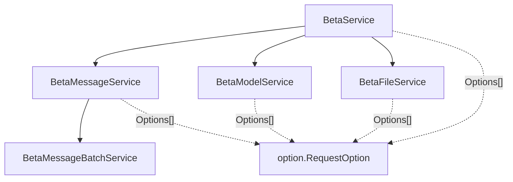
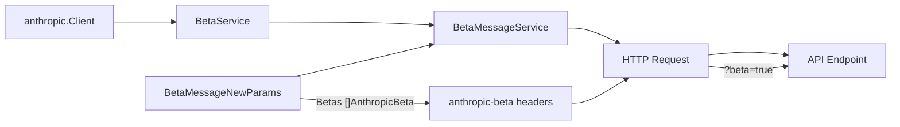
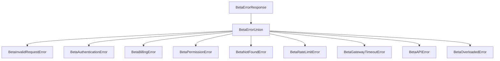
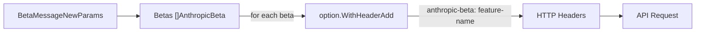

<!-- source: DeepWiki mcp.deepwiki.com · repo anthropics/anthropic-sdk-go · page 6 Beta Services · fetched 2026-10-26 -->

# Beta Services

<details>
<summary>Relevant source files</summary>

The following files were used as context for generating this wiki page:

- [beta.go](beta.go)
- [betamessage.go](betamessage.go)
- [betamessagebatch.go](betamessagebatch.go)

</details>


This document covers the experimental and preview features available through the SDK's beta services system. Beta services provide access to cutting-edge capabilities that are still in development or testing phases before being promoted to the main API.

For detailed information about specific beta services, see [Beta Message Service](#5.1), [Beta Message Batch Service](#5.2), and [Beta File Service](#5.3). For stable API services, see [Core Services](#4).

## Architecture Overview

The beta services system is organized around the central `BetaService` struct, which coordinates access to experimental features across multiple service domains.

**Beta Service Structure**


Sources: [beta.go:14-37]()

The `BetaService` acts as a container for all beta-related functionality, with each sub-service handling specific experimental capabilities. All services inherit request options from their parent, allowing for consistent configuration across the beta system.

## Beta Feature Flags

Beta features are enabled through specific feature flags that must be included in API requests. These flags are defined as constants and represent different experimental capabilities.

| Feature Flag | Purpose | Introduced |
|-------------|---------|------------|
| `AnthropicBetaMessageBatches2024_09_24` | Batch message processing | 2024-09-24 |
| `AnthropicBetaPromptCaching2024_07_31` | Prompt caching system | 2024-07-31 |
| `AnthropicBetaComputerUse2024_10_22` | Computer use tools | 2024-10-22 |
| `AnthropicBetaComputerUse2025_01_24` | Updated computer use | 2025-01-24 |
| `AnthropicBetaPDFs2024_09_25` | PDF document support | 2024-09-25 |
| `AnthropicBetaTokenCounting2024_11_01` | Token counting API | 2024-11-01 |
| `AnthropicBetaTokenEfficientTools2025_02_19` | Efficient tool calling | 2025-02-19 |
| `AnthropicBetaOutput128k2025_02_19` | Extended output limits | 2025-02-19 |
| `AnthropicBetaFilesAPI2025_04_14` | File management API | 2025-04-14 |
| `AnthropicBetaMCPClient2025_04_04` | Model Context Protocol | 2025-04-04 |
| `AnthropicBetaDevFullThinking2025_05_14` | Full thinking mode | 2025-05-14 |
| `AnthropicBetaInterleavedThinking2025_05_14` | Interleaved thinking | 2025-05-14 |
| `AnthropicBetaCodeExecution2025_05_22` | Code execution tools | 2025-05-22 |
| `AnthropicBetaExtendedCacheTTL2025_04_11` | Extended cache TTL | 2025-04-11 |

Sources: [beta.go:39-56]()

## Service Integration

**Beta Service Request Flow**


Sources: [betamessage.go:52-69](), [betamessage.go:85-93]()

Beta services integrate with the main SDK through specialized parameter structures that include beta feature flags. When making requests, these flags are automatically converted to appropriate HTTP headers and query parameters.

## Error Handling

Beta services use a comprehensive error handling system that covers the full spectrum of potential API errors.

**Beta Error Types**


Sources: [beta.go:112-184](), [beta.go:240-256]()

The error system provides type-safe error handling with specific error types for different failure scenarios. The `BetaErrorUnion` uses discriminated unions to ensure proper error categorization and handling.

## Service Initialization

Beta services are initialized through the `NewBetaService` function, which creates the service hierarchy and applies configuration options.

```go
// From beta.go:27-37
func NewBetaService(opts ...option.RequestOption) (r BetaService) {
    r = BetaService{}
    r.Options = opts
    r.Models = NewBetaModelService(opts...)
    r.Messages = NewBetaMessageService(opts...)
    r.Files = NewBetaFileService(opts...)
    return
}
```

Sources: [beta.go:27-37]()

The initialization pattern ensures that all beta services receive the same configuration options, maintaining consistency across the experimental API surface.

## Beta Feature Usage

Beta features are accessed by including the appropriate feature flags in request parameters. The SDK automatically handles the conversion of these flags to the required HTTP headers.

**Feature Flag Processing**


Sources: [betamessage.go:53-55](), [betamessage.go:85-87]()

The system iterates through all specified beta features and adds the appropriate headers to enable those features for the specific request.

## Advanced Beta Features

Beta services provide access to cutting-edge capabilities not available in the stable API:

- **Enhanced Content Types**: Support for documents, images, thinking blocks, and specialized content
- **Advanced Tool Integration**: Code execution, web search, and MCP tool support  
- **Caching Systems**: Prompt caching with configurable TTL values
- **Citation Systems**: Automatic citation generation for content sources
- **Container Management**: Code execution environment management

These features are implemented through specialized parameter types and content block structures that extend the base SDK functionality.

Sources: [betamessage.go:1103-1462](), [betamessage.go:1467-1985]()

---

