<!-- source: DeepWiki mcp.deepwiki.com · repo anthropics/anthropic-sdk-go · page 6.1 Beta Messages Service · fetched 2026-10-26 -->

# Beta Messages Service

<details>
<summary>Relevant source files</summary>

The following files were used as context for generating this wiki page:

- [.release-please-manifest.json](.release-please-manifest.json)
- [CHANGELOG.md](CHANGELOG.md)
- [README.md](README.md)
- [betamessage.go](betamessage.go)
- [betamessage_test.go](betamessage_test.go)
- [betamessagebatch_test.go](betamessagebatch_test.go)
- [internal/version.go](internal/version.go)

</details>


## Purpose and Scope

The Beta Messages Service provides experimental features for the Messages API that extend beyond the stable API. This service includes advanced capabilities such as extended thinking, context management, Model Context Protocol (MCP) integration, container-based execution, and specialized content blocks. Beta features may change or be promoted to stable in future releases.

For stable message functionality, see [Messages Service](#4.1). For context management details, see [Context Management](#6.4). For MCP integration, see [Model Context Protocol (MCP)](#6.5). For beta batch processing, see [Beta Message Batches Service](#6.2).

---

## Beta Service Architecture

The `BetaMessageService` is accessed through `client.Beta.Messages` and provides the same core methods as the stable service (`New`, `NewStreaming`, `CountTokens`) but with extended parameter types and response structures.

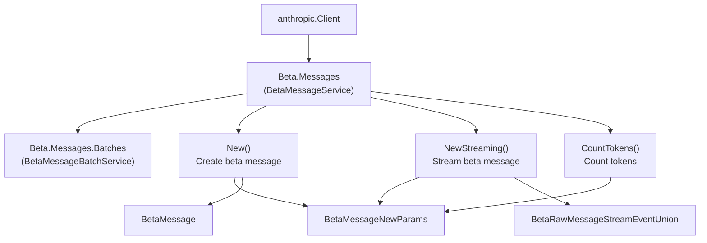

**Sources:** [betamessage.go:23-113]()

---

## Beta vs Stable Messages

### Key Differences

The `BetaMessage` type extends the stable `Message` with additional fields and capabilities:

| Feature | Stable Message | Beta Message |
|---------|---------------|--------------|
| Content blocks | Text, Image, Tool Use, Tool Result | + Thinking, Redacted Thinking, Compaction, Server Tool Use, MCP Tool Use, Search Result, Container Upload |
| Context management | None | Automatic conversation optimization |
| Usage tracking | Basic tokens | + Iterations, per-iteration tracking |
| Tool configuration | Basic schema | + Allowed callers, defer loading, eager streaming |
| Containers | Not supported | Container execution with skills |
| MCP | Not supported | MCP server integration |
| Output control | Basic format | + Effort levels |
| Citations | Basic | Enhanced with multiple location types |

### Beta Message Structure

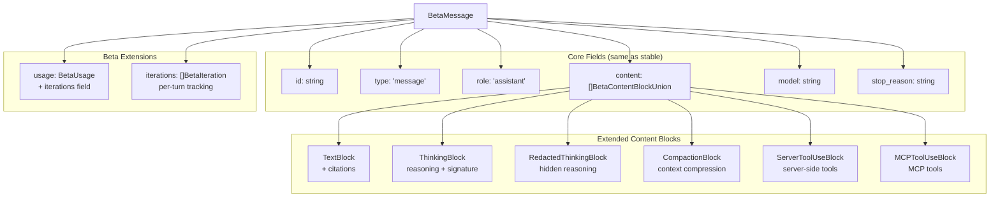

**Sources:** [betamessage.go:754-1155](), [betamessage_test.go:323-498]()

---

## Extended Content Blocks

Beta messages support additional content block types beyond the stable API:

### Thinking Blocks

Thinking blocks expose the model's reasoning process before producing a final answer. Each thinking block contains the reasoning text and an optional cryptographic signature.

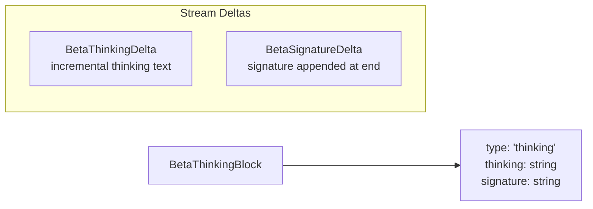

**Type:** `BetaThinkingBlock` [betamessage.go:10562-10581]()

**Fields:**
- `type`: Always `"thinking"`
- `thinking`: The reasoning text produced by the model
- `signature`: Optional cryptographic signature verifying the thinking content

**Accumulation Example:** [betamessage_test.go:407-422]()

### Redacted Thinking Blocks

When thinking is disabled or hidden, redacted thinking blocks indicate that reasoning occurred but was not exposed.

**Type:** `BetaRedactedThinkingBlock` [betamessage.go:10583-10600]()

**Fields:**
- `type`: Always `"redacted_thinking"`
- `data`: Placeholder string (e.g., "Redacted")

**Accumulation Example:** [betamessage_test.go:423-433]()

### Compaction Blocks

Compaction blocks represent automatically compressed conversation history, used when context management is enabled.

**Type:** `BetaCompactionBlock` [betamessage.go:3252-3274]()

**Fields:**
- `type`: Always `"compaction"`
- `content`: Summarized conversation content (string or array of content blocks)

**Accumulation Example:** [betamessage_test.go:434-445]()

### Server Tool Use Blocks

Server tool use blocks represent tool calls executed on the server side (e.g., web search, code execution) rather than requiring client-side execution.

**Type:** `BetaServerToolUseBlock` [betamessage.go:9922-9953]()

**Fields:**
- `type`: Always `"server_tool_use"`
- `id`: Unique identifier for the tool use
- `name`: Name of the server-side tool
- `input`: Tool input parameters
- `caller`: Execution context (direct or nested within code execution)

**Server-side Tools:**
- `web_search`: Web search queries
- `web_fetch`: Fetch web page content
- `bash_20250825`: Bash command execution
- `code_execution_20250825`: Code execution
- `text_editor_20250728`: File editing operations
- `tool_search`: Search for available tools

**Accumulation Example:** [betamessage_test.go:393-406]()

### MCP Tool Use Blocks

MCP tool use blocks represent tool calls to external MCP (Model Context Protocol) servers.

**Type:** `BetaMCPToolUseBlock` [betamessage.go:7311-7342]()

**Fields:**
- `type`: Always `"mcp_tool_use"`
- `id`: Unique identifier
- `mcp_server`: Name of the MCP server
- `name`: Tool name within the MCP server
- `input`: Tool input parameters

**Sources:** [betamessage.go:3252-3274](), [betamessage.go:7311-7342](), [betamessage.go:9922-9953](), [betamessage.go:10562-10600]()

---

## Context Management Configuration

Beta messages support automatic context management to optimize conversation history. The `ContextManagementConfig` parameter enables automatic clearing and compaction of context.

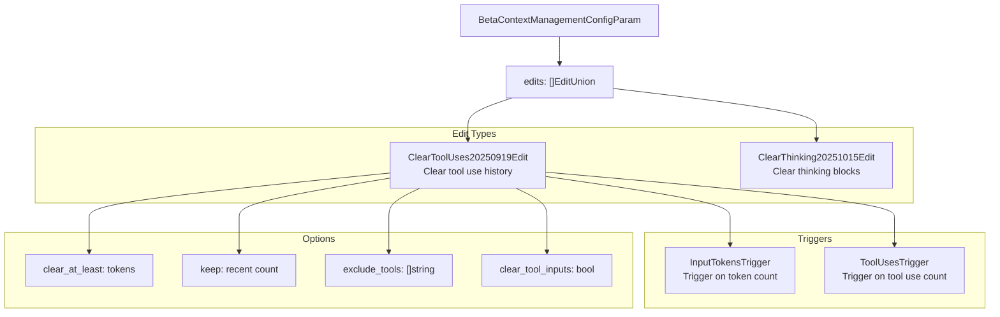

**Parameter Type:** `BetaContextManagementConfigParam` [betamessage.go:3586-3595]()

**Edit Types:**

1. **ClearToolUses20250919Edit** [betamessage.go:2663-2743]()
   - Removes tool use blocks and their results from conversation history
   - Configurable trigger conditions (input tokens or tool use count)
   - Can exclude specific tools from clearing
   - Option to clear tool inputs while preserving structure

2. **ClearThinking20251015Edit** [betamessage.go:2493-2540]()
   - Removes thinking blocks from conversation history
   - Configurable trigger conditions
   - Can keep most recent N thinking blocks

For detailed context management strategies, see [Context Management](#6.4).

**Sources:** [betamessage.go:2493-2743](), [betamessage.go:3586-3595]()

---

## Advanced Tool Configuration

Beta tools support additional configuration beyond the stable API:

### Tool Parameter Extensions

```mermaid
graph TB
    BetaToolParam["BetaToolParam"]
    
    subgraph "Base Fields (stable)"
        Name["name: string"]
        Description["description: string"]
        InputSchema["input_schema: JSON Schema"]
    end
    
    subgraph "Beta Extensions"
        AllowedCallers["allowed_callers: []string<br/>Execution context whitelist"]
        DeferLoading["defer_loading: bool<br/>Lazy load tool definition"]
        EagerInputStreaming["eager_input_streaming: bool<br/>Stream inputs as received"]
        InputExamples["input_examples: []map[string]any<br/>Example inputs"]
        Strict["strict: bool<br/>Strict schema validation"]
        CacheControl["cache_control: CacheControlEphemeral<br/>Cache tool definition"]
    end
    
    BetaToolParam --> Name
    BetaToolParam --> Description
    BetaToolParam --> InputSchema
    BetaToolParam --> AllowedCallers
    BetaToolParam --> DeferLoading
    BetaToolParam --> EagerInputStreaming
    BetaToolParam --> InputExamples
    BetaToolParam --> Strict
    BetaToolParam --> CacheControl
```

**Type:** `BetaToolParam` [betamessage.go:11309-11362]()

### Allowed Callers

Restricts which execution contexts can call a tool. Possible values:
- `"direct"`: Direct model invocation
- `"code_execution_20250825"`: Can be called from within code execution tools

**Field:** `allowed_callers` [betamessage.go:11320]()

### Defer Loading

When true, the tool definition is not loaded into context until first use, saving initial token usage.

**Field:** `defer_loading` [betamessage.go:11334]()

### Eager Input Streaming

When true, tool inputs are streamed to the client as they are generated, before the full input is complete.

**Field:** `eager_input_streaming` [betamessage.go:11341]()

### Input Examples

Provides example inputs to help the model understand proper tool usage.

**Field:** `input_examples` [betamessage.go:11343-11346]()

**Sources:** [betamessage.go:11309-11362]()

---

## Container and Skills System

Beta messages support container-based execution with specific skills. Containers provide isolated execution environments with predefined capabilities.

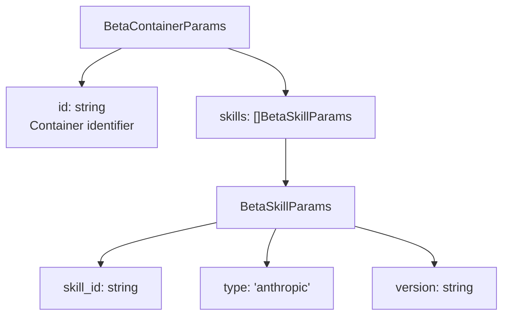

**Container Parameter:** `BetaContainerParams` [betamessage.go:3304-3313]()

**Skill Parameter:** `BetaSkillParams` [betamessage.go:10119-10134]()

**Usage Example:** [betamessage_test.go:57-64]()

**Sources:** [betamessage.go:3304-3313](), [betamessage.go:10119-10134]()

---

## MCP Integration

Beta messages integrate with Model Context Protocol (MCP) servers to access external tools and resources. MCP servers are specified in the request and provide additional tool capabilities.

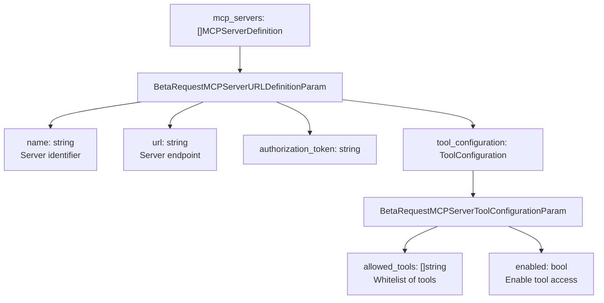

**MCP Server Parameter:** `BetaRequestMCPServerURLDefinitionParam` [betamessage.go:9012-9050]()

**Tool Configuration:** `BetaRequestMCPServerToolConfigurationParam` [betamessage.go:9052-9063]()

**Usage Example:** [betamessage_test.go:88-96]()

For complete MCP integration details, see [Model Context Protocol (MCP)](#6.5).

**Sources:** [betamessage.go:9012-9063](), [betamessage_test.go:88-96]()

---

## Output Configuration

Beta messages support advanced output control through the `OutputConfig` parameter, including effort levels and structured output formats.

### Output Config Structure

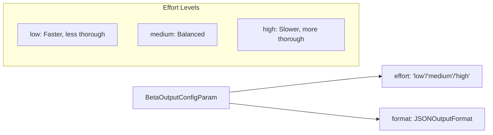

**Type:** `BetaOutputConfigParam` [betamessage.go:8542-8558]()

**Effort Levels:** [betamessage.go:8560-8575]()
- `low`: Faster generation with reduced reasoning
- `medium`: Balanced performance (default)
- `high`: More thorough reasoning, slower generation

**Format:** Structured output using JSON schemas, see [README.md:89-103]() for examples.

**Usage Example:** [betamessage_test.go:100-108]()

**Sources:** [betamessage.go:8542-8575](), [betamessage_test.go:100-108]()

---

## Beta Headers and Versioning

Beta features are gated by version-specific headers. The SDK automatically manages these headers based on the `Betas` parameter.

### Beta Header Flow

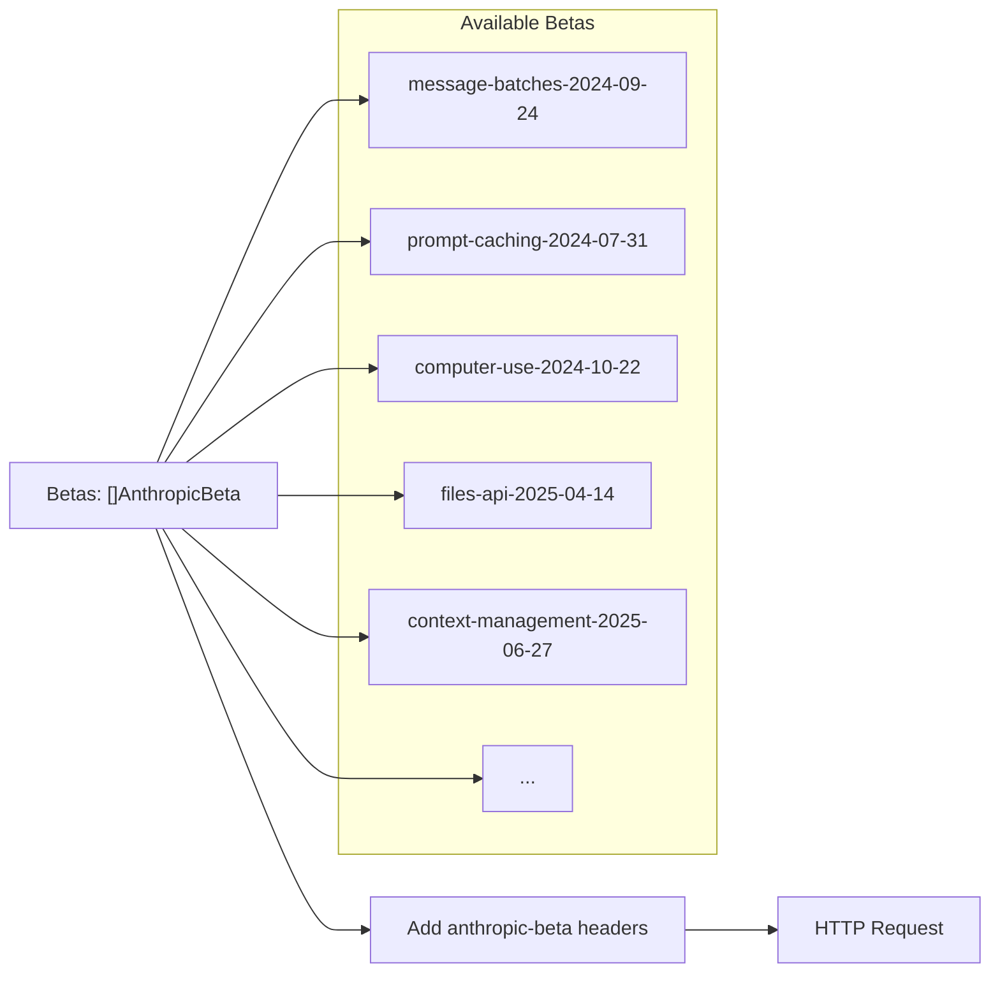

**Beta Parameter:** [betamessage.go:17128-17147]()

**Header Addition Logic:** [betamessage.go:54-57]()

The SDK automatically converts the `Betas` array into appropriate `anthropic-beta` HTTP headers for the request.

**Usage Example:**
```go
params := anthropic.BetaMessageNewParams{
    // ... other params
    Betas: []anthropic.AnthropicBeta{
        anthropic.AnthropicBetaMessageBatches2024_09_24,
        anthropic.AnthropicBetaContextManagement2025_06_27,
    },
}
```

**Sources:** [betamessage.go:54-57](), [betamessage.go:17128-17147]()

---

## Creating Beta Messages

### Basic Beta Message Creation

The `New` method creates a beta message with the same signature as the stable API but accepts `BetaMessageNewParams`.

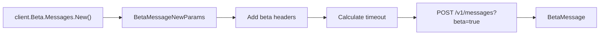

**Method Signature:** [betamessage.go:54-71]()

**Key Parameters:**

| Parameter | Type | Description |
|-----------|------|-------------|
| `max_tokens` | `int64` | Maximum tokens to generate (required) |
| `messages` | `[]BetaMessageParam` | Conversation history (required) |
| `model` | `string` | Model identifier (required) |
| `system` | `[]BetaTextBlockParam` | System prompts |
| `tools` | `[]BetaToolUnionParam` | Tool definitions |
| `context_management` | `BetaContextManagementConfigParam` | Context optimization config |
| `mcp_servers` | `[]BetaRequestMCPServerURLDefinitionParam` | MCP server definitions |
| `output_config` | `BetaOutputConfigParam` | Output control settings |
| `thinking` | `BetaThinkingConfigParamUnion` | Thinking configuration |
| `container` | Container params | Container execution settings |
| `betas` | `[]AnthropicBeta` | Beta features to enable |

**Timeout Calculation:** Non-streaming beta messages automatically calculate appropriate timeouts based on `max_tokens` [betamessage.go:62-66]().

**Complete Usage Example:** [betamessage_test.go:30-169]()

**Sources:** [betamessage.go:54-71](), [betamessage_test.go:30-169]()

---

## Streaming Beta Messages

### Streaming Architecture

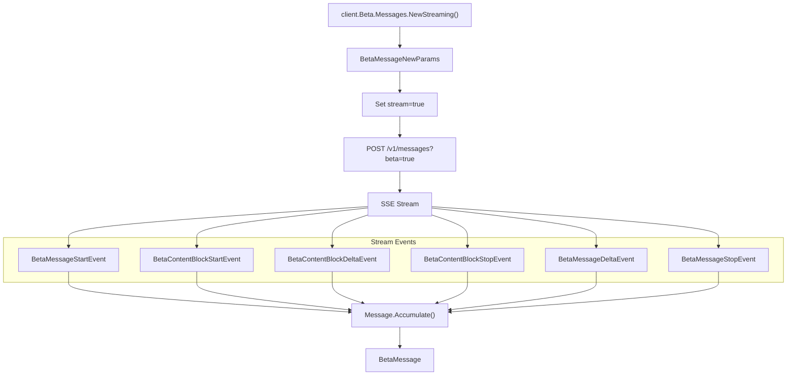

**Method Signature:** [betamessage.go:83-96]()

**Stream Event Type:** `BetaRawMessageStreamEventUnion` [betamessage.go:9134-9283]()

### Message Accumulation

The `Accumulate` method on `BetaMessage` processes stream events to build the complete message incrementally.

**Accumulate Method:** [betamessage.go:1157-1454]()

**Accumulation Logic:**

1. **MessageStartEvent**: Initializes message metadata [betamessage.go:1167-1183]()
2. **ContentBlockStartEvent**: Adds new content block [betamessage.go:1185-1204]()
3. **ContentBlockDeltaEvent**: Appends to existing block [betamessage.go:1206-1359]()
   - Text deltas: Append to `text` field
   - Input JSON deltas: Append to `input` field
   - Thinking deltas: Append to `thinking` field
   - Signature deltas: Append to `signature` field
   - Citations deltas: Add to `citations` array
   - Compaction deltas: Append to `content` field
4. **ContentBlockStopEvent**: Finalizes block [betamessage.go:1361-1368]()
5. **MessageDeltaEvent**: Updates message-level fields [betamessage.go:1370-1411]()
6. **MessageStopEvent**: Completes accumulation [betamessage.go:1413-1425]()

### Streaming Example with Accumulation

**Comprehensive Test:** [betamessage_test.go:323-498]()

The test demonstrates accumulation for various content block types:
- Text blocks [betamessage_test.go:336-347]()
- Text blocks with citations [betamessage_test.go:348-367]()
- Tool use blocks [betamessage_test.go:368-380]()
- Server tool use blocks [betamessage_test.go:393-406]()
- Thinking blocks [betamessage_test.go:407-422]()
- Redacted thinking blocks [betamessage_test.go:423-433]()
- Compaction blocks [betamessage_test.go:434-445]()
- Multiple content blocks [betamessage_test.go:446-473]()

**Sources:** [betamessage.go:83-96](), [betamessage.go:1157-1454](), [betamessage_test.go:323-498]()

---

## Token Counting

The `CountTokens` method counts tokens for a beta message request without actually creating the message.

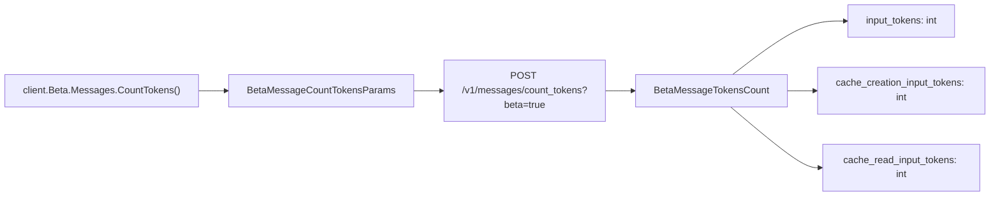

**Method Signature:** [betamessage.go:105-113]()

**Response Type:** `BetaMessageTokensCount` [betamessage.go:7752-7775]()

**Usage Example:** [betamessage_test.go:192-313]()

Token counting includes:
- Base input tokens
- Cache creation tokens (if using prompt caching)
- Cache read tokens (if cache hits occur)

**Sources:** [betamessage.go:105-113](), [betamessage.go:7752-7775](), [betamessage_test.go:192-313]()

---

## Usage Tracking and Iterations

Beta messages provide enhanced usage tracking with per-iteration metrics when using features like thinking or tool use.

### Usage Structure

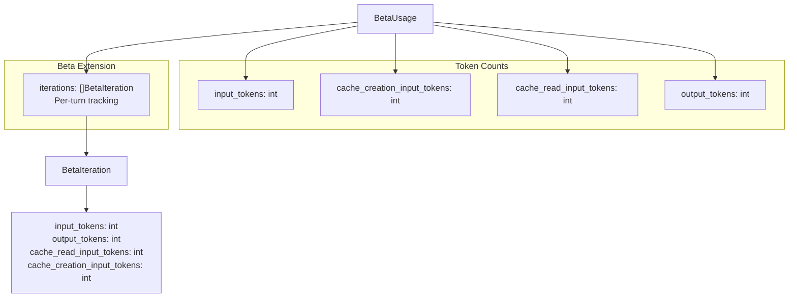

**Usage Type:** `BetaUsage` [betamessage.go:11982-12019]()

**Iteration Type:** `BetaIteration` [betamessage.go:6758-6791]()

Iterations track token usage for each thinking turn or tool use round-trip, allowing you to understand costs at a granular level.

**Sources:** [betamessage.go:6758-6791](), [betamessage.go:11982-12019]()

---

## Service Initialization

The `BetaMessageService` is not instantiated directly. It is accessed through the client's `Beta.Messages` field.

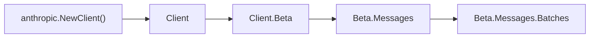

**Service Struct:** [betamessage.go:23-32]()

**Constructor:** [betamessage.go:37-42]()

The service is initialized with request options that are applied to all requests made through it. These options can be overridden on a per-request basis.

**Sources:** [betamessage.go:23-42]()

---

