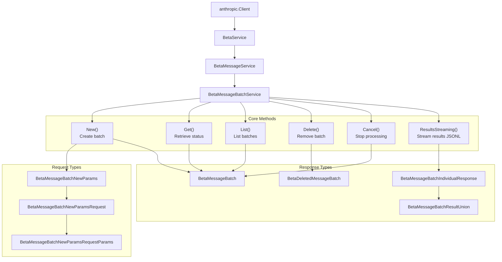
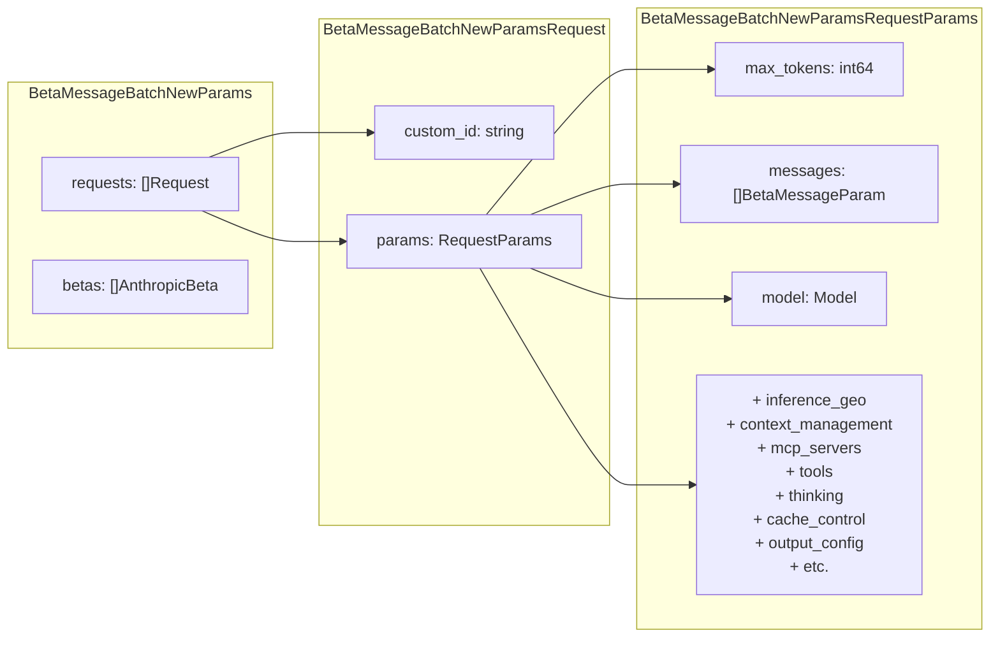
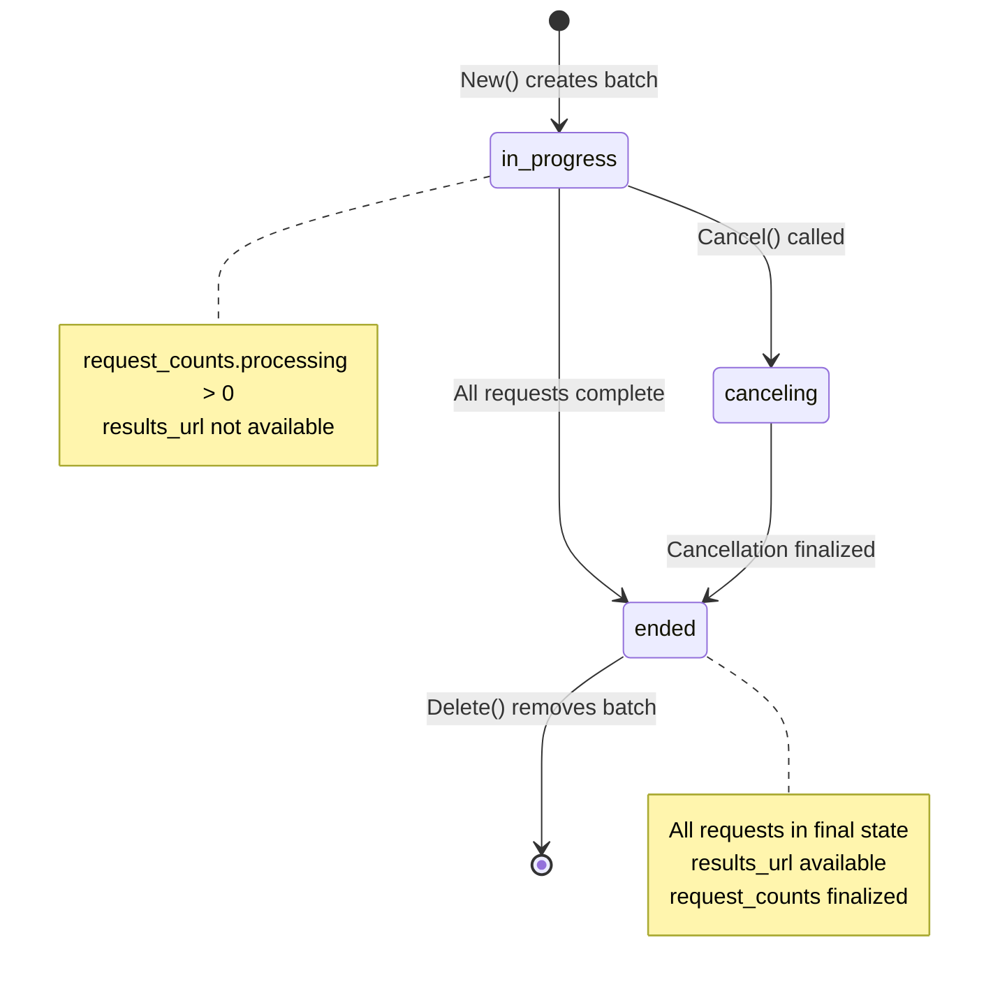
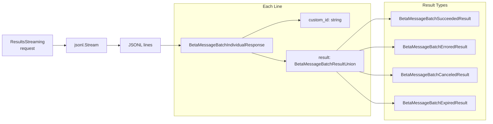
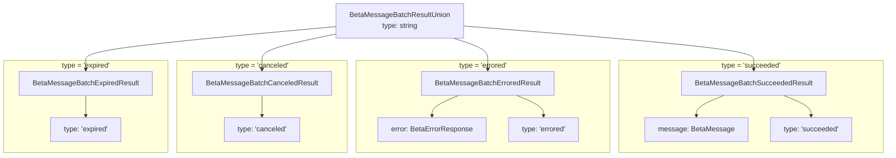

<!-- source: DeepWiki mcp.deepwiki.com · repo anthropics/anthropic-sdk-go · page 6.2 Beta Message Batches Service · fetched 2026-10-26 -->

# Beta Message Batches Service

<details>
<summary>Relevant source files</summary>

The following files were used as context for generating this wiki page:

- [beta.go](beta.go)
- [betamessage_test.go](betamessage_test.go)
- [betamessagebatch.go](betamessagebatch.go)
- [betamessagebatch_test.go](betamessagebatch_test.go)

</details>


## Purpose and Scope

The Beta Message Batches Service provides asynchronous batch processing capabilities for Claude message creation requests. This service allows submitting multiple message requests at once, which are processed in the background and can take up to 24 hours to complete. This is particularly useful for high-volume scenarios where immediate responses are not required.

This page covers the beta implementation of batch processing. For the stable batch processing API, see [Message Batches Service](#4.4). For beta-specific message features like context management and iterations tracking, see [Beta Messages Service](#6.1).

Sources: [betamessagebatch.go:26-43](), [betamessagebatch.go:45-52]()

## Service Architecture

The `BetaMessageBatchService` is accessed through the client's beta messages interface and provides methods for the complete batch lifecycle.



**Service Access Path**

The service is accessed via: `client.Beta.Messages.Batches`

Sources: [betamessagebatch.go:26-43](), [beta.go:14-39]()

## Creating Message Batches

### Batch Creation Request Structure

Batches are created by submitting an array of individual message requests, each with a unique `custom_id` for result correlation.

| Parameter | Type | Required | Description |
|-----------|------|----------|-------------|
| `requests` | `[]BetaMessageBatchNewParamsRequest` | Yes | Array of message creation requests |
| `betas` | `[]AnthropicBeta` | No | Beta version headers |

Each request in the array contains:

| Field | Type | Required | Description |
|-------|------|----------|-------------|
| `custom_id` | `string` | Yes | Developer-provided unique identifier for matching results to requests |
| `params` | `BetaMessageBatchNewParamsRequestParams` | Yes | Standard message creation parameters |



The `params` field accepts all standard beta message creation parameters including context management, MCP servers, tools, thinking configuration, and other beta features.

Sources: [betamessagebatch.go:511-549](), [betamessagebatch.go:557-831]()

### New Method

The `New` method creates and immediately begins processing a message batch.

**Signature:**
```go
func (r *BetaMessageBatchService) New(ctx context.Context, params BetaMessageBatchNewParams, opts ...option.RequestOption) (res *BetaMessageBatch, err error)
```

**HTTP Details:**
- Method: `POST`
- Path: `v1/messages/batches?beta=true`
- Header: `anthropic-beta: message-batches-2024-09-24`

The method automatically adds the required beta header and processes additional beta headers from the `Betas` parameter.

Sources: [betamessagebatch.go:45-62]()

## Batch Lifecycle Management

### Batch Object Structure

The `BetaMessageBatch` object represents the state and metadata of a batch.

| Field | Type | Description |
|-------|------|-------------|
| `id` | `string` | Unique batch identifier |
| `created_at` | `time.Time` | Batch creation timestamp (RFC 3339) |
| `expires_at` | `time.Time` | Expiration timestamp (24 hours after creation) |
| `processing_status` | `BetaMessageBatchProcessingStatus` | Current status: `in_progress`, `canceling`, or `ended` |
| `request_counts` | `BetaMessageBatchRequestCounts` | Tallies by status |
| `results_url` | `string` | JSONL file URL (available when processing ends) |
| `ended_at` | `time.Time` | Processing completion timestamp |
| `cancel_initiated_at` | `time.Time` | Cancellation initiation timestamp (if applicable) |
| `archived_at` | `time.Time` | Archive timestamp when results become unavailable |
| `type` | `constant.MessageBatch` | Always `"message_batch"` |



Sources: [betamessagebatch.go:217-281](), [betamessagebatch.go:283-290]()

### Request Counts Tracking

The `BetaMessageBatchRequestCounts` structure tracks the status of all requests in a batch.

| Field | Type | Description |
|-------|------|-------------|
| `processing` | `int64` | Requests currently being processed |
| `succeeded` | `int64` | Successfully completed requests (zero until batch ends) |
| `errored` | `int64` | Requests that encountered errors (zero until batch ends) |
| `canceled` | `int64` | Canceled requests (zero until batch ends) |
| `expired` | `int64` | Expired requests (zero until batch ends) |

The sum of all counts always equals the total number of requests in the batch. Requests remain in `processing` status until the entire batch completes.

Sources: [betamessagebatch.go:371-406]()

### Get Method (Polling)

The `Get` method is idempotent and designed for polling batch status.

**Signature:**
```go
func (r *BetaMessageBatchService) Get(ctx context.Context, messageBatchID string, query BetaMessageBatchGetParams, opts ...option.RequestOption) (res *BetaMessageBatch, err error)
```

**HTTP Details:**
- Method: `GET`
- Path: `v1/messages/batches/{message_batch_id}?beta=true`

**Polling Pattern:**
1. Call `Get` periodically to check `processing_status`
2. When status is `ended`, access results via `results_url` or `ResultsStreaming`
3. Check `request_counts` to see final tallies

Sources: [betamessagebatch.go:64-83]()

### List Method

The `List` method retrieves all batches in a workspace, ordered by creation time (most recent first).

**Signature:**
```go
func (r *BetaMessageBatchService) List(ctx context.Context, params BetaMessageBatchListParams, opts ...option.RequestOption) (res *pagination.Page[BetaMessageBatch], err error)
```

**Parameters:**

| Field | Type | Description |
|-------|------|-------------|
| `after_id` | `param.Opt[string]` | Cursor for pagination (returns page after this ID) |
| `before_id` | `param.Opt[string]` | Cursor for pagination (returns page before this ID) |
| `limit` | `param.Opt[int64]` | Items per page (default: 20, range: 1-1000) |
| `betas` | `[]AnthropicBeta` | Beta version headers |

The method returns a `pagination.Page[BetaMessageBatch]` supporting manual and automatic pagination.

**Auto-Paging:**
```go
func (r *BetaMessageBatchService) ListAutoPaging(ctx context.Context, params BetaMessageBatchListParams, opts ...option.RequestOption) *pagination.PageAutoPager[BetaMessageBatch]
```

This method returns an auto-pager that automatically fetches subsequent pages.

Sources: [betamessagebatch.go:85-117](), [betamessagebatch.go:873-896]()

### Cancel Method

Cancels a batch before processing ends. Cancellation may not affect non-interruptible requests.

**Signature:**
```go
func (r *BetaMessageBatchService) Cancel(ctx context.Context, messageBatchID string, body BetaMessageBatchCancelParams, opts ...option.RequestOption) (res *BetaMessageBatch, err error)
```

**HTTP Details:**
- Method: `POST`
- Path: `v1/messages/batches/{message_batch_id}/cancel?beta=true`

**Behavior:**
1. Batch enters `canceling` state
2. System may complete non-interruptible in-progress requests
3. Batch eventually transitions to `ended` state
4. Check `request_counts.canceled` to see which requests were canceled

Sources: [betamessagebatch.go:141-166]()

### Delete Method

Deletes a completed batch. Only batches with `processing_status` of `ended` can be deleted.

**Signature:**
```go
func (r *BetaMessageBatchService) Delete(ctx context.Context, messageBatchID string, body BetaMessageBatchDeleteParams, opts ...option.RequestOption) (res *BetaDeletedMessageBatch, err error)
```

**HTTP Details:**
- Method: `DELETE`
- Path: `v1/messages/batches/{message_batch_id}?beta=true`

**Response:** Returns `BetaDeletedMessageBatch` with:
- `id`: The deleted batch ID
- `type`: Always `"message_batch_deleted"`

To delete an in-progress batch, you must first cancel it using `Cancel`.

Sources: [betamessagebatch.go:119-139](), [betamessagebatch.go:195-209]()

## Retrieving Results

### Results Streaming

The `ResultsStreaming` method streams batch results as JSONL (JSON Lines format), where each line is a separate JSON object representing one request's result.

**Signature:**
```go
func (r *BetaMessageBatchService) ResultsStreaming(ctx context.Context, messageBatchID string, query BetaMessageBatchResultsParams, opts ...option.RequestOption) (stream *jsonl.Stream[BetaMessageBatchIndividualResponse])
```

**HTTP Details:**
- Method: `GET`
- Path: `v1/messages/batches/{message_batch_id}/results?beta=true`
- Header: `Accept: application/x-jsonl`

**Key Points:**
- Only available when `processing_status` is `ended`
- Results are not guaranteed to be in the same order as requests
- Use `custom_id` to match results to original requests
- Returns a `jsonl.Stream` for streaming consumption



Sources: [betamessagebatch.go:168-193]()

### Individual Response Structure

Each line in the JSONL output is a `BetaMessageBatchIndividualResponse`:

| Field | Type | Description |
|-------|------|-------------|
| `custom_id` | `string` | The developer-provided identifier from the request |
| `result` | `BetaMessageBatchResultUnion` | Discriminated union containing the outcome |

Sources: [betamessagebatch.go:342-369]()

## Result Types

### Result Union Discriminator

The `BetaMessageBatchResultUnion` is a discriminated union with four possible variants, distinguished by the `type` field.



Sources: [betamessagebatch.go:408-491]()

### Succeeded Result

Contains a successful message response.

**Type:** `BetaMessageBatchSucceededResult`

| Field | Type | Description |
|-------|------|-------------|
| `message` | `BetaMessage` | The complete message response with beta features |
| `type` | `constant.Succeeded` | Value: `"succeeded"` |

The `message` field contains a full `BetaMessage` object with all beta capabilities including context management, iterations tracking, and extended content blocks.

Sources: [betamessagebatch.go:493-509]()

### Errored Result

Contains error details when request processing failed.

**Type:** `BetaMessageBatchErroredResult`

| Field | Type | Description |
|-------|------|-------------|
| `error` | `BetaErrorResponse` | Full error response with error union and request ID |
| `type` | `constant.Errored` | Value: `"errored"` |

The `error` field contains a `BetaErrorResponse` with:
- `error`: A `BetaErrorUnion` discriminated union of various error types
- `request_id`: The request ID for debugging
- `type`: Always `"error"`

Sources: [betamessagebatch.go:308-324]()

### Canceled Result

Indicates the request was canceled before completion.

**Type:** `BetaMessageBatchCanceledResult`

| Field | Type | Description |
|-------|------|-------------|
| `type` | `constant.Canceled` | Value: `"canceled"` |

This result has no additional fields beyond the discriminator.

Sources: [betamessagebatch.go:292-306]()

### Expired Result

Indicates the request expired before processing.

**Type:** `BetaMessageBatchExpiredResult`

| Field | Type | Description |
|-------|------|-------------|
| `type` | `constant.Expired` | Value: `"expired"` |

This result has no additional fields beyond the discriminator. Requests expire if the batch expires (24 hours after creation) before they could be processed.

Sources: [betamessagebatch.go:326-340]()

### Using the Result Union

The union provides an `AsAny()` method for type-safe variant switching:

```go
switch variant := result.Result.AsAny().(type) {
case anthropic.BetaMessageBatchSucceededResult:
    // Access variant.Message
case anthropic.BetaMessageBatchErroredResult:
    // Access variant.Error
case anthropic.BetaMessageBatchCanceledResult:
    // Handle cancellation
case anthropic.BetaMessageBatchExpiredResult:
    // Handle expiration
default:
    // Handle unknown variant
}
```

Individual `As*` methods are also available:
- `AsSucceeded()` → `BetaMessageBatchSucceededResult`
- `AsErrored()` → `BetaMessageBatchErroredResult`
- `AsCanceled()` → `BetaMessageBatchCanceledResult`
- `AsExpired()` → `BetaMessageBatchExpiredResult`

Sources: [betamessagebatch.go:442-484]()

## Beta-Specific Features

### Beta Message Parameters

The batch request parameters support all beta message features available in `BetaMessageBatchNewParamsRequestParams`:

| Feature | Type | Description |
|---------|------|-------------|
| `context_management` | `BetaContextManagementConfigParam` | Automatic conversation history optimization |
| `mcp_servers` | `[]BetaRequestMCPServerURLDefinitionParam` | Model Context Protocol server configurations |
| `thinking` | `BetaThinkingConfigParamUnion` | Extended thinking configuration |
| `cache_control` | `BetaCacheControlEphemeralParam` | Top-level cache control |
| `output_config` | `BetaOutputConfigParam` | Output format and effort configuration |
| `container` | `BetaMessageBatchNewParamsRequestParamsContainerUnion` | Container with skills for reuse |
| `inference_geo` | `param.Opt[string]` | Geographic region for inference |
| `speed` | `string` | Inference speed mode (`"standard"` or `"fast"`) |

These parameters are documented in detail in [Beta Messages Service](#6.1) and [Context Management](#6.4).

Sources: [betamessagebatch.go:641-822]()

### Beta Version Header

The service automatically includes the `message-batches-2024-09-24` beta header. Additional beta features can be enabled by passing beta identifiers in the `Betas` parameter:

```go
params := anthropic.BetaMessageBatchNewParams{
    Requests: requests,
    Betas: []anthropic.AnthropicBeta{
        anthropic.AnthropicBetaContextManagement2025_06_27,
        anthropic.AnthropicBetaMCPClient2025_11_20,
    },
}
```

The method processes these and adds corresponding headers to the request.

Sources: [betamessagebatch.go:54-58](), [betamessagebatch.go:516-517](), [beta.go:41-64]()

## Comparison with Stable Batches

The beta batch service differs from the stable batch service in several ways:

| Aspect | Beta (6.2) | Stable (4.4) |
|--------|------------|--------------|
| Message Type | `BetaMessage` with iterations, context management | Standard `Message` |
| Request Parameters | Full beta parameter support | Standard parameters only |
| Result Message | `BetaMessage` in succeeded results | Standard `Message` |
| Service Path | `client.Beta.Messages.Batches` | `client.Messages.Batches` |
| Beta Headers | `message-batches-2024-09-24` + custom | `message-batches-2024-09-24` only |
| URL Path | `v1/messages/batches?beta=true` | `v1/messages/batches` |

The beta implementation provides access to experimental features that may eventually be promoted to the stable API or changed based on feedback.

Sources: [betamessagebatch.go:26-43](), [betamessagebatch.go:53-62]()

---

