<!-- source: DeepWiki mcp.deepwiki.com · repo anthropics/anthropic-sdk-go · page 6.3 Beta Files Service · fetched 2026-10-26 -->

# Beta Files Service

Relevant source files

The following files were used as context for generating this wiki page:

- [api.md](api.md)
- [beta.go](beta.go)
- [betamessagebatch.go](betamessagebatch.go)
- [shared/constant/constants.go](shared/constant/constants.go)

The Beta Files Service provides file management capabilities for the Anthropic API, allowing you to upload and manage files that can be referenced in subsequent message requests. This service is part of the experimental beta features and enables efficient handling of documents and images by uploading them once and referencing them multiple times, rather than encoding them in every request.

For information about using files within message content blocks, see [Content Blocks](#4.2). For the beta Messages service that consumes these files, see [Beta Messages Service](#6.1).

---

## Purpose and Scope

The Beta Files Service allows applications to:
- Upload files to Anthropic's servers for later use
- Retrieve metadata about uploaded files
- Delete files when no longer needed
- Reference uploaded files in message requests using file IDs instead of embedding base64-encoded content

This service is particularly useful for:
- Large documents (PDFs, text files) that would be cumbersome to encode in every request
- Images used repeatedly across multiple conversations
- Applications that need to manage conversation context with file attachments

**Sources:** [beta.go:1-39]()

---

## Service Architecture

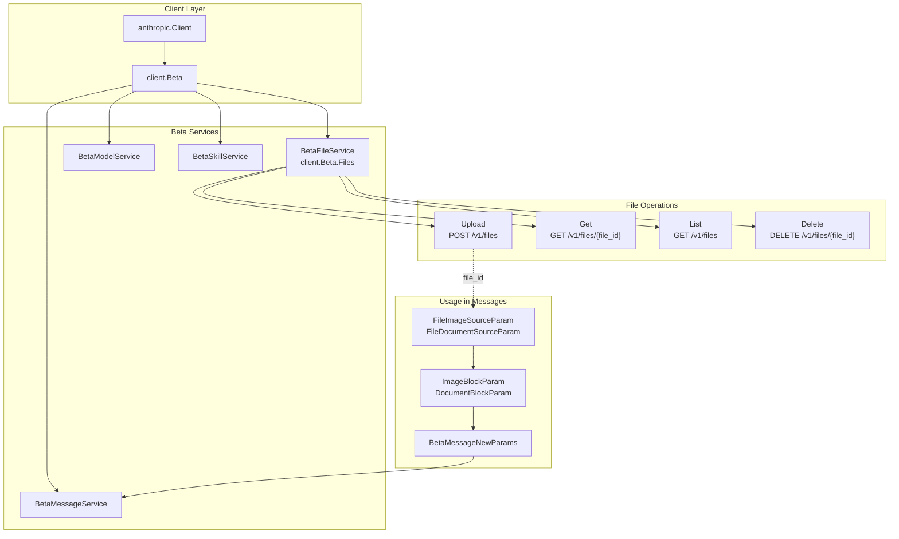

The `BetaFileService` is initialized as part of the `BetaService` structure and provides methods for file lifecycle management. Files uploaded through this service receive a unique file ID that can be referenced in subsequent message requests.

**Sources:** [beta.go:14-39]()

---

## Beta Flag Requirement

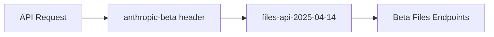

The Files API requires the `files-api-2025-04-14` beta flag to be enabled. This is specified in the `AnthropicBeta` constants and must be included in requests to the Files endpoints.

| Constant | Value | Purpose |
|----------|-------|---------|
| `AnthropicBetaFilesAPI2025_04_14` | `"files-api-2025-04-14"` | Enables the Files API beta feature |

**Sources:** [beta.go:41-64]()

---

## Integration with Content Blocks

The Files Service integrates with the message content block system by providing file references that replace inline base64 encoding:

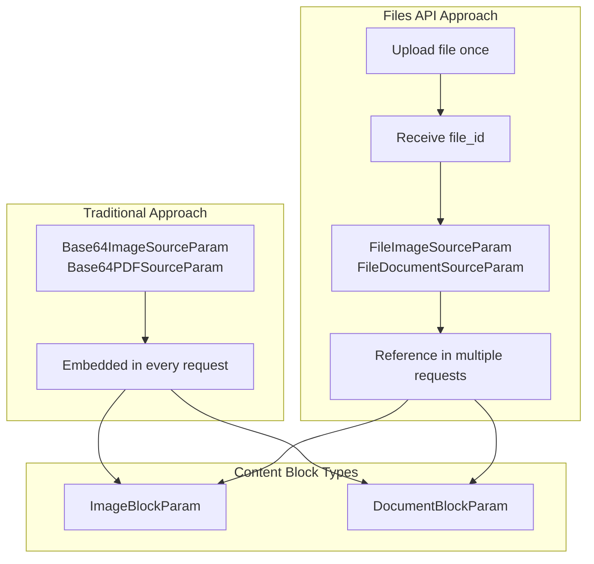

### Content Block Source Types

| Source Type | Use Case | Requires Files API |
|-------------|----------|-------------------|
| `Base64ImageSourceParam` | Inline image encoding | No |
| `Base64PDFSourceParam` | Inline PDF encoding | No |
| `URLImageSourceParam` | Image from external URL | No |
| `URLPDFSourceParam` | PDF from external URL | No |
| `FileImageSourceParam` | Reference uploaded image | Yes |
| `FileDocumentSourceParam` | Reference uploaded document | Yes |

**Sources:** [api.md:18-21](), [api.md:47-49](), [api.md:96-97]()

---

## Service Initialization

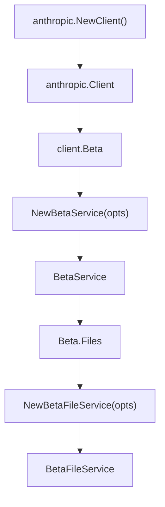

The `BetaFileService` follows the same initialization pattern as other SDK services:

1. Created via `NewBetaFileService(opts...)` with optional request options
2. Accessible through `client.Beta.Files`
3. Inherits client-level configuration (authentication, base URL, timeouts)
4. Supports per-request option overrides

**Sources:** [beta.go:31-39]()

---

## Request Options Pattern

The Files Service follows the standard SDK pattern for request options:

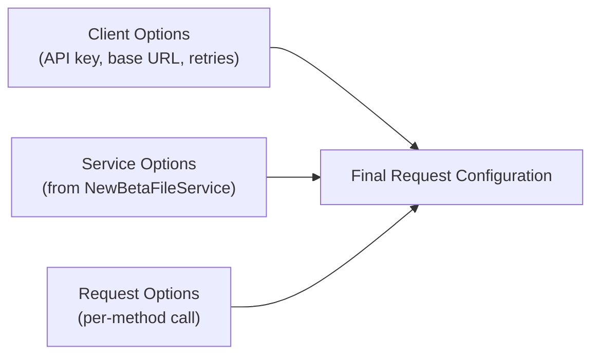

Options are applied in order of precedence:
1. Client-level options (from `anthropic.NewClient`)
2. Service-level options (from `NewBetaFileService`)
3. Request-level options (from individual method calls)

The `BetaFileService` stores its options in the `Options` field and concatenates them with incoming request options using `slices.Concat()`.

**Sources:** [beta.go:20-21](), [beta.go:31-39]()

---

## File Lifecycle Management

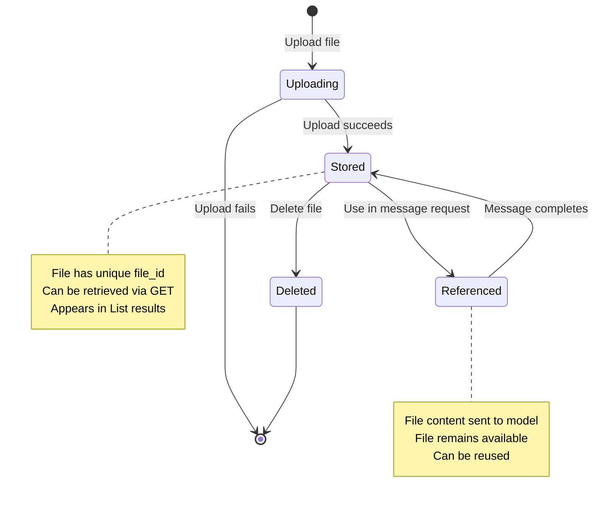

### Typical Workflow

| Step | Action | Endpoint | Result |
|------|--------|----------|--------|
| 1 | Upload file | `POST /v1/files` | Returns file metadata with `file_id` |
| 2 | Create message with file reference | `POST /v1/messages?beta=true` | Model processes file content |
| 3 | Reuse same file in another message | `POST /v1/messages?beta=true` | No re-upload needed |
| 4 | Clean up file | `DELETE /v1/files/{file_id}` | File no longer accessible |

**Sources:** [beta.go:1-39]()

---

## Error Handling

The Files Service uses the standard beta error response structure:

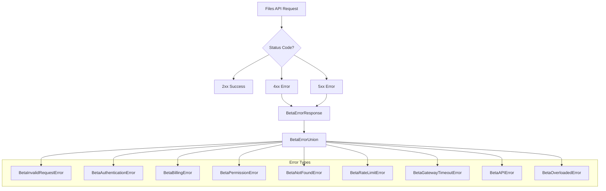

### Common File-Related Errors

| Error Type | Constant | Typical Causes |
|------------|----------|----------------|
| `BetaInvalidRequestError` | `constant.InvalidRequestError` | Invalid file format, file too large |
| `BetaNotFoundError` | `constant.NotFoundError` | File ID doesn't exist or was deleted |
| `BetaPermissionError` | `constant.PermissionError` | Attempting to access another workspace's file |
| `BetaBillingError` | `constant.BillingError` | Storage quota exceeded |
| `BetaRateLimitError` | `constant.RateLimitError` | Too many upload requests |

**Sources:** [beta.go:66-118](), [beta.go:120-374]()

---

## Relationship to Message Batches

Files uploaded through the Files Service can be referenced in message batches, allowing efficient bulk processing with file attachments:

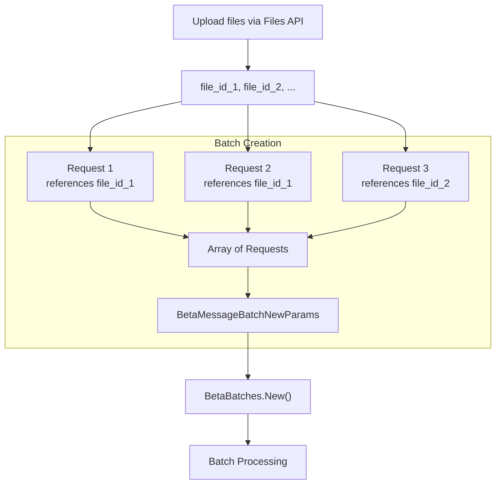

By uploading files once and referencing them across multiple batch requests, you can:
- Reduce payload sizes significantly
- Improve batch processing performance
- Simplify retry logic (file remains available)
- Manage file lifecycle independently of batch lifecycle

**Sources:** [betamessagebatch.go:1-24](), [betamessagebatch.go:511-549]()

---

## Integration with Other Beta Features

The Files Service works in conjunction with other beta features:

| Beta Feature | Constant | Integration with Files |
|--------------|----------|------------------------|
| Message Batches | `AnthropicBetaMessageBatches2024_09_24` | Reference files in batch requests |
| PDFs | `AnthropicBetaPDFs2024_09_25` | Upload PDF files for document understanding |
| MCP Client | `AnthropicBetaMCPClient2025_11_20` | MCP servers may provide tools that work with files |
| Context Management | `AnthropicBetaContextManagement2025_06_27` | Files contribute to context window usage |

Multiple beta flags can be combined in the same request using the `Betas` parameter array.

**Sources:** [beta.go:41-64]()

---

## Service Structure

The `BetaFileService` follows the standard service pattern used throughout the SDK:

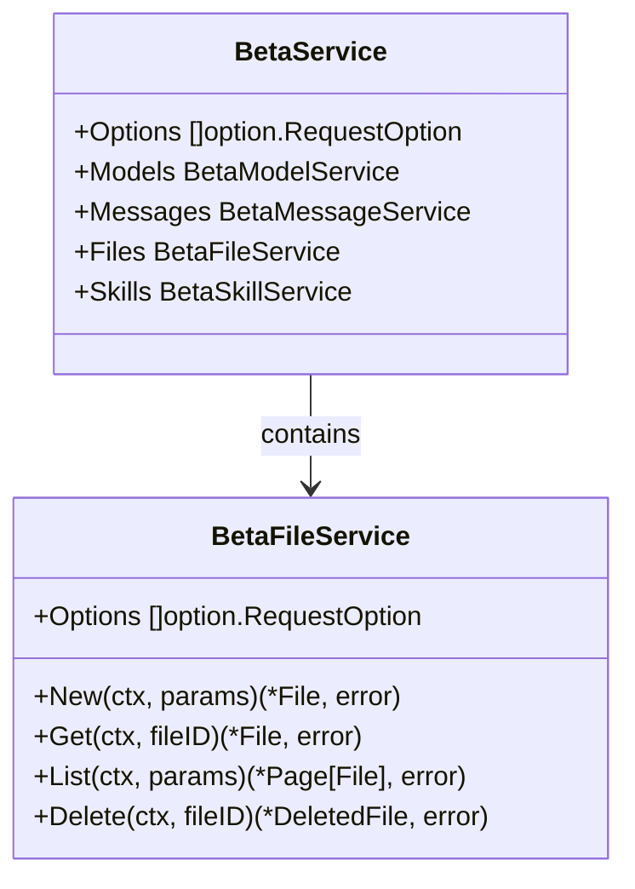

Each method on `BetaFileService`:
- Accepts a `context.Context` for cancellation and deadlines
- Takes typed parameter structs for type safety
- Returns strongly-typed response structs
- Supports variadic `option.RequestOption` for overrides
- Automatically includes the `files-api-2025-04-14` beta header

**Sources:** [beta.go:14-39]()

---

## Comparison with Inline Content

### Inline Base64 Approach

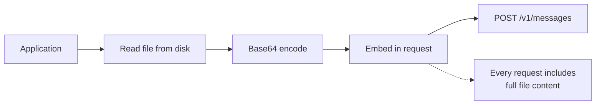

**Characteristics:**
- Simple for one-off requests
- No file management needed
- Large payload sizes
- Repeated encoding overhead
- Content included in every request

### Files API Approach

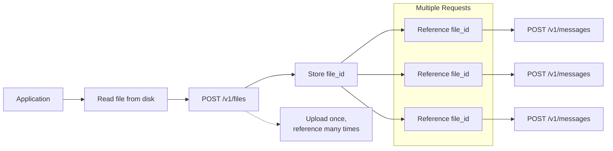

**Characteristics:**
- Efficient for repeated use
- Requires file lifecycle management
- Small payload sizes (just file ID)
- One-time upload cost
- Enables file reuse across conversations

**Sources:** [api.md:18-21](), [api.md:47](), [api.md:96-97]()

---

