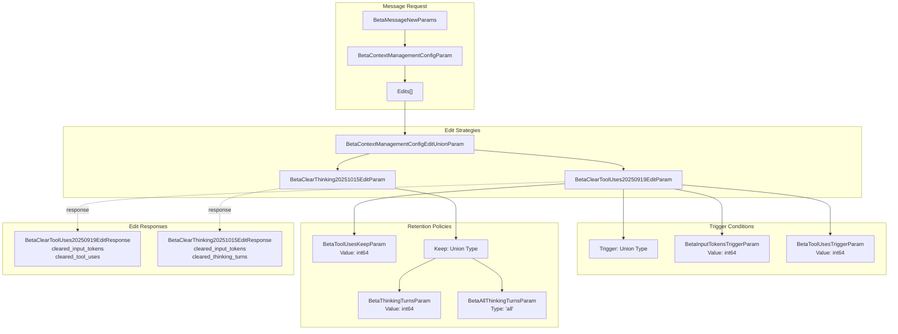
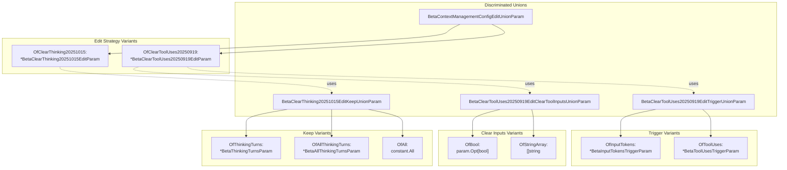

<!-- source: DeepWiki mcp.deepwiki.com · repo anthropics/anthropic-sdk-go · page 6.4 Context Management · fetched 2026-10-26 -->

# Context Management

<details>
<summary>Relevant source files</summary>

The following files were used as context for generating this wiki page:

- [betamessage.go](betamessage.go)
- [betamessage_test.go](betamessage_test.go)
- [betamessagebatch_test.go](betamessagebatch_test.go)

</details>


Context management is a beta feature that automatically optimizes conversation history by removing older content blocks when certain thresholds are reached. This reduces token usage while maintaining conversation coherence, enabling longer multi-turn conversations without manual intervention.

**Note**: Context management is a beta feature available through the Beta Messages Service. For general message creation, see [Messages Service](#4.1). For tool-related features, see [Tool Calling](#5).

## Overview

Context management operates by applying configurable **edits** to the conversation history when specific **triggers** are activated. Each edit strategy removes specific types of content blocks while preserving the most recent interactions according to retention policies.

The system tracks the impact of each edit, reporting how many tokens and content blocks were cleared. This allows applications to monitor context optimization effectiveness.

**Sources**: [betamessage.go:66-86](), [betamessage.go:1328-1445]()

## Configuration Structure

Context management is configured via the `BetaContextManagementConfigParam` type, which contains an array of edit strategies:

```go
type BetaContextManagementConfigParam struct {
    Edits []BetaContextManagementConfigEditUnionParam `json:"edits,omitzero"`
}
```

The `BetaContextManagementConfigEditUnionParam` is a discriminated union supporting multiple edit strategies:
- `BetaClearToolUses20250919EditParam` - Clears tool use and tool result blocks
- `BetaClearThinking20251015EditParam` - Clears thinking blocks

**Sources**: [betamessage.go:374-380]()

## Architecture



**Sources**: [betamessage.go:1328-1353](), [betamessage.go:1240-1256](), [betamessage.go:374-380]()

## Clear Tool Uses Strategy

The `BetaClearToolUses20250919EditParam` strategy removes tool use and tool result blocks from the conversation history. This is useful for conversations with many tool invocations where older tool interactions are no longer relevant.

### Configuration Parameters

| Parameter | Type | Description |
|-----------|------|-------------|
| `Type` | `constant.ClearToolUses20250919` | Fixed discriminator value identifying this strategy |
| `Trigger` | `BetaClearToolUses20250919EditTriggerUnionParam` | Condition that activates clearing |
| `Keep` | `BetaToolUsesKeepParam` | Number of most recent tool uses to retain |
| `ClearAtLeast` | `BetaInputTokensClearAtLeastParam` | Minimum tokens to clear (edit skipped if threshold not met) |
| `ClearToolInputs` | `bool` or `[]string` | Whether to clear all tool inputs or specific ones |
| `ExcludeTools` | `[]string` | Tool names whose uses are preserved from clearing |

### Trigger Types

The trigger determines when the edit strategy activates:

**Input Tokens Trigger** (`BetaInputTokensTriggerParam`):
- Activates when input token count exceeds threshold
- Structure: `{"type": "input_tokens", "value": 1000}`

**Tool Uses Trigger** (`BetaToolUsesTriggerParam`):
- Activates when number of tool uses exceeds threshold
- Structure: `{"type": "tool_uses", "value": 5}`

### Edit Response

When the strategy is applied, a `BetaClearToolUses20250919EditResponse` is returned containing:
- `cleared_input_tokens` (int64) - Number of input tokens removed
- `cleared_tool_uses` (int64) - Number of tool use blocks removed
- `type` - The edit strategy type identifier

**Sources**: [betamessage.go:1328-1353](), [betamessage.go:1380-1423](), [betamessage.go:1425-1445](), [betamessage.go:342-348]()

## Clear Thinking Strategy

The `BetaClearThinking20251015EditParam` strategy removes thinking blocks from assistant turns. Thinking blocks contain the model's reasoning process, which can consume significant tokens but may not be needed for older turns in long conversations.

### Configuration Parameters

| Parameter | Type | Description |
|-----------|------|-------------|
| `Type` | `constant.ClearThinking20251015` | Fixed discriminator value identifying this strategy |
| `Keep` | `BetaClearThinking20251015EditKeepUnionParam` | Retention policy for thinking blocks |

### Retention Policies

The `Keep` parameter is a union type supporting:

**Thinking Turns** (`BetaThinkingTurnsParam`):
- Retains N most recent assistant turns with thinking blocks
- Structure: `{"type": "thinking_turns", "value": 3}`

**All Thinking Turns** (`BetaAllThinkingTurnsParam`):
- Preserves all thinking blocks (no clearing)
- Structure: `{"type": "all"}`

**Constant Value**:
- Can use `constant.All` directly: `constant.ValueOf[constant.All]()`

### Edit Response

When the strategy is applied, a `BetaClearThinking20251015EditResponse` is returned containing:
- `cleared_input_tokens` (int64) - Number of input tokens removed
- `cleared_thinking_turns` (int64) - Number of thinking turns cleared
- `type` - The edit strategy type identifier

**Sources**: [betamessage.go:1240-1256](), [betamessage.go:1258-1303](), [betamessage.go:1305-1326](), [betamessage.go:115-134]()

## Usage Examples

### Basic Tool Use Clearing

Clear tool uses when input tokens exceed 5000, keeping the 3 most recent:

```go
contextManagement := anthropic.BetaContextManagementConfigParam{
    Edits: []anthropic.BetaContextManagementConfigEditUnionParam{{
        OfClearToolUses20250919: &anthropic.BetaClearToolUses20250919EditParam{
            Trigger: anthropic.BetaClearToolUses20250919EditTriggerUnionParam{
                OfInputTokens: &anthropic.BetaInputTokensTriggerParam{
                    Value: 5000,
                },
            },
            Keep: anthropic.BetaToolUsesKeepParam{
                Value: 3,
            },
        },
    }},
}
```

### Selective Tool Clearing

Clear all tool uses except for a specific tool, and require at least 1000 tokens cleared:

```go
contextManagement := anthropic.BetaContextManagementConfigParam{
    Edits: []anthropic.BetaContextManagementConfigEditUnionParam{{
        OfClearToolUses20250919: &anthropic.BetaClearToolUses20250919EditParam{
            Trigger: anthropic.BetaClearToolUses20250919EditTriggerUnionParam{
                OfToolUses: &anthropic.BetaToolUsesTriggerParam{
                    Value: 10,
                },
            },
            ExcludeTools: []string{"get_weather"},
            ClearAtLeast: anthropic.BetaInputTokensClearAtLeastParam{
                Value: 1000,
            },
            Keep: anthropic.BetaToolUsesKeepParam{
                Value: 5,
            },
        },
    }},
}
```

### Clear Thinking Blocks

Remove thinking blocks from all but the most recent 2 assistant turns:

```go
contextManagement := anthropic.BetaContextManagementConfigParam{
    Edits: []anthropic.BetaContextManagementConfigEditUnionParam{{
        OfClearThinking20251015: &anthropic.BetaClearThinking20251015EditParam{
            Keep: anthropic.BetaClearThinking20251015EditKeepUnionParam{
                OfThinkingTurns: &anthropic.BetaThinkingTurnsParam{
                    Value: 2,
                },
            },
        },
    }},
}
```

### Combined Strategies

Apply multiple edit strategies in a single request:

```go
contextManagement := anthropic.BetaContextManagementConfigParam{
    Edits: []anthropic.BetaContextManagementConfigEditUnionParam{
        {
            OfClearToolUses20250919: &anthropic.BetaClearToolUses20250919EditParam{
                Trigger: anthropic.BetaClearToolUses20250919EditTriggerUnionParam{
                    OfInputTokens: &anthropic.BetaInputTokensTriggerParam{
                        Value: 8000,
                    },
                },
                Keep: anthropic.BetaToolUsesKeepParam{
                    Value: 3,
                },
            },
        },
        {
            OfClearThinking20251015: &anthropic.BetaClearThinking20251015EditParam{
                Keep: anthropic.BetaClearThinking20251015EditKeepUnionParam{
                    OfThinkingTurns: &anthropic.BetaThinkingTurnsParam{
                        Value: 1,
                    },
                },
            },
        },
    },
}
```

**Sources**: [betamessage_test.go:66-86](), [betamessage_test.go:217-237]()

## Integration with Messages API

Context management integrates with both regular message creation and token counting:

### Message Creation

Include context management in `BetaMessageNewParams`:

```go
message, err := client.Beta.Messages.New(ctx, anthropic.BetaMessageNewParams{
    Model:     anthropic.ModelClaudeOpus4_6,
    MaxTokens: 1024,
    Messages:  []anthropic.BetaMessageParam{...},
    ContextManagement: anthropic.BetaContextManagementConfigParam{
        Edits: []anthropic.BetaContextManagementConfigEditUnionParam{...},
    },
})
```

### Token Counting

Use context management to preview token impact before message creation:

```go
tokenCount, err := client.Beta.Messages.CountTokens(ctx, anthropic.BetaMessageCountTokensParams{
    Model:    anthropic.ModelClaudeOpus4_6,
    Messages: []anthropic.BetaMessageParam{...},
    ContextManagement: anthropic.BetaContextManagementConfigParam{
        Edits: []anthropic.BetaContextManagementConfigEditUnionParam{...},
    },
})
```

### Batch Processing

Context management is also supported in beta message batches:

```go
batch, err := client.Beta.Messages.Batches.New(ctx, anthropic.BetaMessageBatchNewParams{
    Requests: []anthropic.BetaMessageBatchNewParamsRequest{{
        CustomID: "request-1",
        Params: anthropic.BetaMessageBatchNewParamsRequestParams{
            Model:     anthropic.ModelClaudeOpus4_6,
            MaxTokens: 1024,
            Messages:  []anthropic.BetaMessageParam{...},
            ContextManagement: anthropic.BetaContextManagementConfigParam{
                Edits: []anthropic.BetaContextManagementConfigEditUnionParam{...},
            },
        },
    }},
})
```

**Sources**: [betamessage.go:54-71](), [betamessage.go:105-113](), [betamessagebatch_test.go:68-88]()

## Type System Details



### Union Type Registration

The SDK uses discriminator-based unions for type safety. Each union type is registered with the JSON unmarshaler:

- `BetaContextManagementConfigEditUnionParam` discriminates on `type` field:
  - `"clear_tool_uses_20250919"` → `BetaClearToolUses20250919EditParam`
  - `"clear_thinking_20251015"` → `BetaClearThinking20251015EditParam`

- `BetaClearToolUses20250919EditTriggerUnionParam` discriminates on `type` field:
  - `"input_tokens"` → `BetaInputTokensTriggerParam`
  - `"tool_uses"` → `BetaToolUsesTriggerParam`

### Accessing Union Values

Use the `param.IsOmitted()` function to check which variant is set:

```go
trigger := edit.Trigger
if !param.IsOmitted(trigger.OfInputTokens) {
    value := trigger.OfInputTokens.Value
    // Handle input tokens trigger
} else if !param.IsOmitted(trigger.OfToolUses) {
    value := trigger.OfToolUses.Value
    // Handle tool uses trigger
}
```

### Helper Methods

Union types provide getter methods for safe property access:

```go
// Get trigger value regardless of variant
value := trigger.GetValue()
if value != nil {
    fmt.Printf("Threshold: %d\n", *value)
}

// Get trigger type discriminator
typeStr := trigger.GetType()
if typeStr != nil {
    fmt.Printf("Trigger type: %s\n", *typeStr)
}
```

**Sources**: [betamessage.go:374-380](), [betamessage.go:342-348](), [betamessage.go:1380-1423](), [betamessage.go:1258-1303](), [betamessage.go:1354-1378]()

## Best Practices

### Choosing Trigger Thresholds

**Input Token Triggers**: Use when you want predictable context window management. Set the threshold to leave headroom for new input:
- For 200K context window models, trigger at ~150K tokens
- For 8K context window models, trigger at ~6K tokens

**Tool Use Triggers**: Use when tool invocations dominate token usage. Typical thresholds:
- Trigger after 5-10 tool uses for focused conversations
- Trigger after 20-30 tool uses for exploratory sessions

### Retention Policies

**Keep Parameter**: Balance between context and efficiency:
- Keep 1-2 tool uses for simple workflows
- Keep 3-5 tool uses for complex multi-step workflows
- Keep more if tool results reference each other

**Exclude Tools**: Preserve tools that maintain conversation state:
- File system tools (tool results may reference file IDs)
- Session management tools
- Tools that return persistent identifiers

### Clearing Thresholds

**ClearAtLeast Parameter**: Prevents ineffective edits:
- Set to 500-1000 tokens minimum to justify the processing overhead
- Higher thresholds (2000-5000) ensure significant context reduction
- Omit for aggressive clearing regardless of token count

### Multiple Strategies

When combining strategies:
1. Apply tool clearing first (typically removes more tokens)
2. Apply thinking clearing second (finer-grained optimization)
3. Ensure triggers don't conflict (e.g., both triggering at same threshold)

**Sources**: [betamessage.go:1328-1353](), [betamessage.go:1240-1256]()

---

