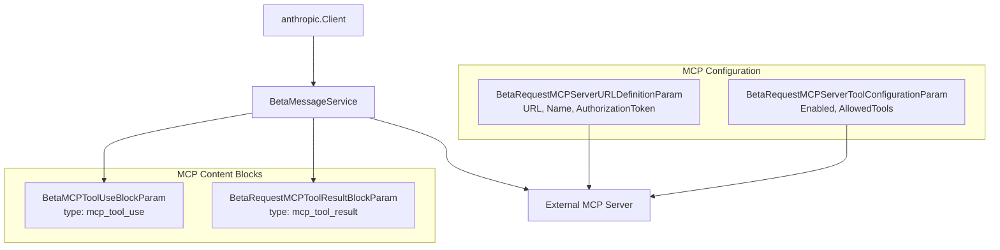
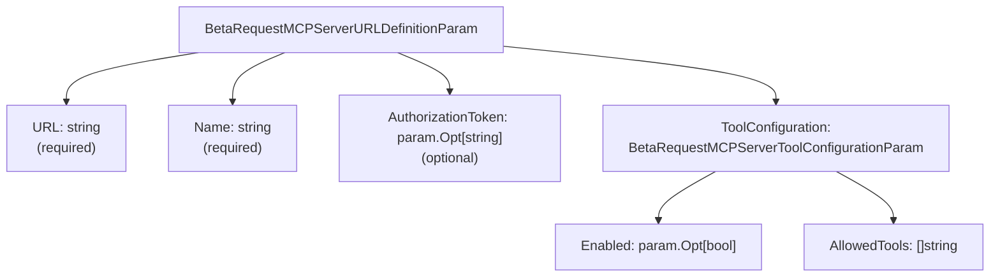
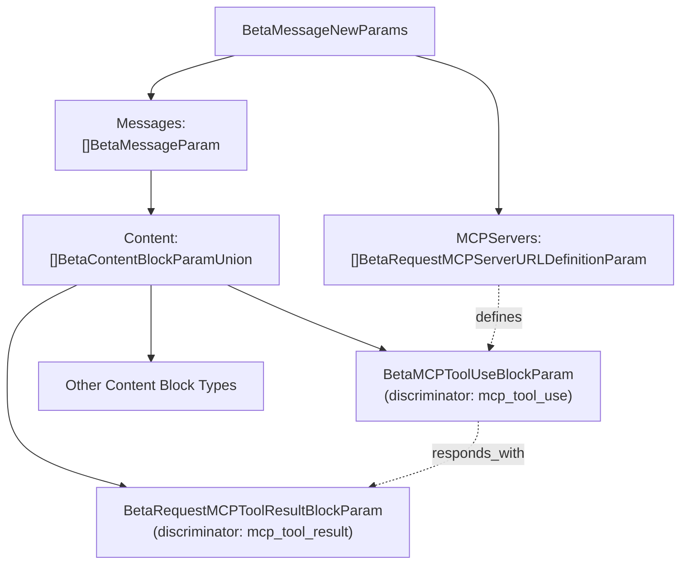
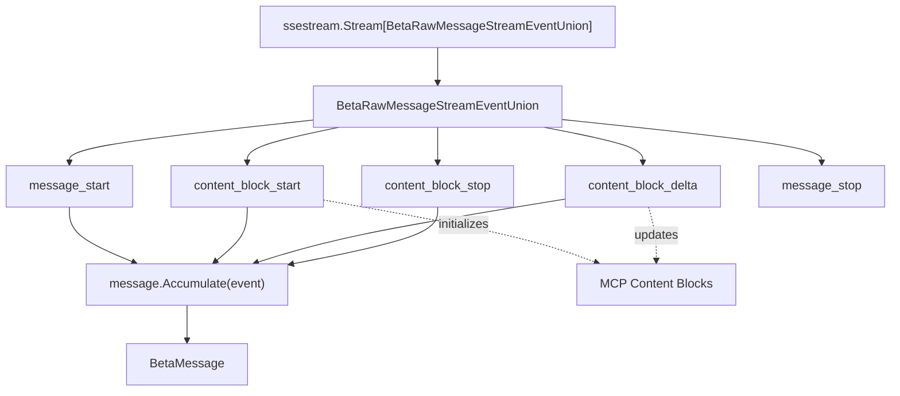
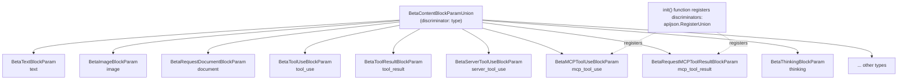

<!-- source: DeepWiki mcp.deepwiki.com · repo anthropics/anthropic-sdk-go · page 6.5 Model Context Protocol (MCP) · fetched 2026-10-26 -->

# Model Context Protocol (MCP)

<details>
<summary>Relevant source files</summary>

The following files were used as context for generating this wiki page:

- [betamessage.go](betamessage.go)
- [betamessage_test.go](betamessage_test.go)
- [betamessagebatch_test.go](betamessagebatch_test.go)

</details>


This document covers the Model Context Protocol (MCP) implementation in the anthropic-sdk-go, which enables integration with external MCP servers for extended tool capabilities. MCP allows Claude to dynamically connect to external services and tools during conversations.

For information about basic tool calling functionality, see [Tool Calling](#6.2). For general Beta API features, see [Beta Message Service](#5.1).

## Overview

The Model Context Protocol (MCP) is implemented as part of the Beta Messages API, providing a standardized way to connect Claude to external tool servers. MCP servers expose tools, resources, and prompts that Claude can use during conversations, extending its capabilities beyond built-in tools.

MCP integration consists of three main components:
1. **Server Configuration**: `BetaRequestMCPServerURLDefinitionParam` defines connection details
2. **Tool Configuration**: `BetaRequestMCPServerToolConfigurationParam` controls tool access
3. **Content Blocks**: `BetaMCPToolUseBlockParam` and `BetaRequestMCPToolResultBlockParam` for tool interactions

### MCP Integration Architecture



**Sources:** [betamessage.go:368-369](), [betamessage_test.go:88-98](), [betamessagebatch_test.go:90-98]()

## MCP Server Configuration

MCP servers are configured using the `BetaRequestMCPServerURLDefinitionParam` type, which defines the server endpoint, authentication, and tool permissions. Multiple MCP servers can be configured simultaneously in a single request.

### Server Definition Structure



The `BetaRequestMCPServerURLDefinitionParam` structure includes:

| Field | Type | Required | Description |
|-------|------|----------|-------------|
| `Name` | `string` | Yes | Identifier for the MCP server |
| `URL` | `string` | Yes | MCP server endpoint URL |
| `AuthorizationToken` | `param.Opt[string]` | No | Bearer token for authentication |
| `ToolConfiguration` | `BetaRequestMCPServerToolConfigurationParam` | No | Controls which tools are accessible |

### Tool Configuration

The `BetaRequestMCPServerToolConfigurationParam` type controls tool access:

| Field | Type | Description |
|-------|------|-------------|
| `Enabled` | `param.Opt[bool]` | Whether to enable tools from this server |
| `AllowedTools` | `[]string` | List of specific tool names to allow access to |

**Sources:** [betamessage_test.go:88-98](), [betamessagebatch_test.go:90-98]()

### Example Configuration

Example MCP server configuration from the test suite:

```go
MCPServers: []anthropic.BetaRequestMCPServerURLDefinitionParam{{
    Name:               "name",
    URL:                "url",
    AuthorizationToken: anthropic.String("authorization_token"),
    ToolConfiguration: anthropic.BetaRequestMCPServerToolConfigurationParam{
        AllowedTools: []string{"string"},
        Enabled:      anthropic.Bool(true),
    },
}}
```

The configuration is passed as part of `BetaMessageNewParams` or `BetaMessageBatchNewParamsRequestParams`:

```go
params := anthropic.BetaMessageNewParams{
    Model:      anthropic.ModelClaudeOpus4_6,
    MaxTokens:  1024,
    Messages:   messages,
    MCPServers: mcpServerConfigs,
}
```

**Sources:** [betamessage_test.go:88-98](), [betamessagebatch_test.go:90-98]()

## Beta Header Requirements

MCP functionality is part of the Beta Messages API and uses the standard beta header mechanism. The `Betas` parameter is passed in message creation parameters:

```go
params := anthropic.BetaMessageNewParams{
    Model:     anthropic.ModelClaudeOpus4_6,
    MaxTokens: 1024,
    Messages:  messages,
    Betas:     []anthropic.AnthropicBeta{anthropic.AnthropicBetaMessageBatches2024_09_24},
}
```

The beta headers are automatically added by the SDK through the `Betas` field on message parameters. Each beta value is converted to an `anthropic-beta` HTTP header.

**Sources:** [betamessage.go:55-57](), [betamessage_test.go:168](), [betamessagebatch_test.go:173]()

## Message Integration

MCP servers are integrated into message requests through the `MCPServers` field in `BetaMessageNewParams` and batch request parameters. The SDK handles the connection to MCP servers and routes tool calls appropriately.

### Integration Flow



The `MCPServers` field accepts an array of server configurations, allowing multiple MCP servers to be active in a single conversation. Each server's tools become available for Claude to use during the conversation.

**Sources:** [betamessage_test.go:88-98](), [betamessage.go:368-369]()

## Streaming with MCP

MCP integrates with the streaming API through `BetaMessageService.NewStreaming()`. MCP tool calls and results are streamed as part of the standard content block events.

### Creating Streaming Requests with MCP

```go
stream := client.Beta.Messages.NewStreaming(ctx, anthropic.BetaMessageNewParams{
    MaxTokens:  1024,
    Messages:   messages,
    MCPServers: mcpServers,
    Model:      anthropic.ModelClaudeOpus4_6,
})
```

The streaming API returns a `*ssestream.Stream[BetaRawMessageStreamEventUnion]` which can be processed event-by-event.

### Event Accumulation

MCP tool use and result blocks are accumulated using the standard `message.Accumulate()` method:



The accumulation pattern automatically handles MCP tool use blocks (type `mcp_tool_use`) and MCP tool result blocks (type `mcp_tool_result`), building them incrementally as deltas arrive.

**Sources:** [betamessage.go:83-96](), [betamessage_test.go:323-498]()

## Content Block Types

MCP introduces two specific content block types for tool interactions, both integrated into the `BetaContentBlockParamUnion` discriminated union system.

### MCP Tool Use Block

The `BetaMCPToolUseBlockParam` type represents MCP tool invocations from Claude. This block is created when Claude decides to call a tool provided by an MCP server.

**Type discriminator:** `"mcp_tool_use"`

### MCP Tool Result Block

The `BetaRequestMCPToolResultBlockParam` type contains the results returned from MCP tool executions. This block is included in user messages as part of the multi-turn tool use pattern.

**Type discriminator:** `"mcp_tool_result"`

### Content Block Union Registration

The MCP content block types are registered in the discriminated union system alongside other content blocks:



The registration occurs in an `init()` function using `apijson.RegisterUnion()`:

```go
apijson.RegisterUnion[BetaContentBlockParamUnion](
    "type",
    // ... other discriminators ...
    apijson.Discriminator[BetaMCPToolUseBlockParam]("mcp_tool_use"),
    apijson.Discriminator[BetaRequestMCPToolResultBlockParam]("mcp_tool_result"),
    // ... more discriminators ...
)
```

**Sources:** [betamessage.go:350-372]()

## Error Handling

MCP operations follow the standard SDK error handling patterns used throughout the Beta Messages API. Errors can occur during:

1. **Server Configuration**: Invalid URLs or authentication failures
2. **Tool Execution**: MCP server errors or tool execution failures
3. **Stream Processing**: Network errors or malformed events

### Standard Error Pattern

All Beta Message service calls return errors that can be checked using standard Go error handling:

```go
message, err := client.Beta.Messages.New(ctx, params)
if err != nil {
    var apierr *anthropic.Error
    if errors.As(err, &apierr) {
        // Handle API error with details
        log.Printf("API error: %v", apierr)
    }
    return err
}
```

### Stream Error Handling

When using streaming with MCP servers, the `Accumulate()` method returns errors that should be checked:

```go
for stream.Next() {
    event := stream.Current()
    err := message.Accumulate(event)
    if err != nil {
        log.Printf("error accumulating event: %v", err)
        continue
    }
}

if err := stream.Err(); err != nil {
    log.Printf("stream error: %v", err)
}
```

**Sources:** [betamessage_test.go:170-176](), [betamessagebatch_test.go:175-181]()

## Usage Example

Complete MCP integration example:

```go
mcpServers := []anthropic.BetaRequestMCPServerURLDefinitionParam{
    {
        URL:                "http://example-server.modelcontextprotocol.io/sse",
        Name:               "example",
        AuthorizationToken: param.NewOpt("YOUR_TOKEN"),
        ToolConfiguration: anthropic.BetaRequestMCPServerToolConfigurationParam{
            Enabled:      anthropic.Bool(true),
            AllowedTools: []string{"echo", "add"},
        },
    },
}
```

**Sources:** [examples/message-mcp-streaming/main.go:14-24]()

---

