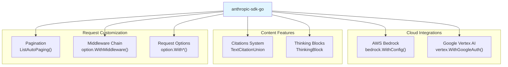

<!-- source: DeepWiki mcp.deepwiki.com · repo anthropics/anthropic-sdk-go · page 7 Advanced Features · fetched 2026-10-26 -->

# Advanced Features

<details>
<summary>Relevant source files</summary>

The following files were used as context for generating this wiki page:

- [.release-please-manifest.json](.release-please-manifest.json)
- [CHANGELOG.md](CHANGELOG.md)
- [README.md](README.md)
- [bedrock/bedrock.go](bedrock/bedrock.go)
- [bedrock/bedrock_test.go](bedrock/bedrock_test.go)
- [examples/bedrock-bearer-token/main.go](examples/bedrock-bearer-token/main.go)
- [internal/version.go](internal/version.go)
- [vertex/vertex.go](vertex/vertex.go)

</details>


This document provides an overview of specialized capabilities in the anthropic-sdk-go library that extend beyond basic message interactions. Each feature is introduced here with details available in dedicated child pages.

## Overview of Advanced Capabilities

The SDK provides several advanced features for sophisticated applications:

**Advanced Features Overview**



Sources: [bedrock/bedrock.go:1-294](), [vertex/vertex.go:1-115](), [README.md:587-623](), [README.md:844-880]()

## Cloud Provider Integrations

The SDK supports using Claude through major cloud providers' AI platforms as alternatives to the direct Anthropic API.

```mermaid
flowchart TD
    "Client" --> "DirectAPI"["Anthropic Direct API"]
    "Client" --> "BedrockPath"["AWS Bedrock Path"]
    "Client" --> "VertexPath"["Google Vertex AI Path"]
    
    subgraph "AWS Integration"
        "BedrockPath" --> "BedrockOption"["bedrock.WithLoadDefaultConfig()"]
        "BedrockOption" --> "AWSConfig"["AWS Credentials & Config"]
    end
    
    subgraph "Google Integration"
        "VertexPath" --> "VertexOption"["vertex.WithGoogleAuth()"]
        "VertexOption" --> "GoogleAuth"["Google Credentials"]
        "VertexOption" --> "VertexParams"["Region & Project ID"]
    end
```

### Amazon Bedrock Integration

To use Claude through Amazon Bedrock:

```go
import (
    "github.com/anthropics/anthropic-sdk-go"
    "github.com/anthropics/anthropic-sdk-go/bedrock"
)

client := anthropic.NewClient(
    bedrock.WithLoadDefaultConfig(context.Background()),
)
```

This configures the client to send requests through Amazon Bedrock using the AWS SDK's default configuration chain. If you already have an AWS config, you can use `bedrock.WithConfig(cfg)` instead.

Sources: [README.md:771-796]()

### Google Vertex AI Integration

To use Claude through Google Vertex AI:

```go
import (
    "github.com/anthropics/anthropic-sdk-go"
    "github.com/anthropics/anthropic-sdk-go/vertex"
)

client := anthropic.NewClient(
    vertex.WithGoogleAuth(context.Background(), "us-central1", "your-project-id"),
)
```

The `vertex.WithGoogleAuth()` function configures the client to use Google's Vertex AI platform with Application Default Credentials. For custom authentication, use `vertex.WithCredentials()` with existing credentials.

Sources: [README.md:798-825]()

---

