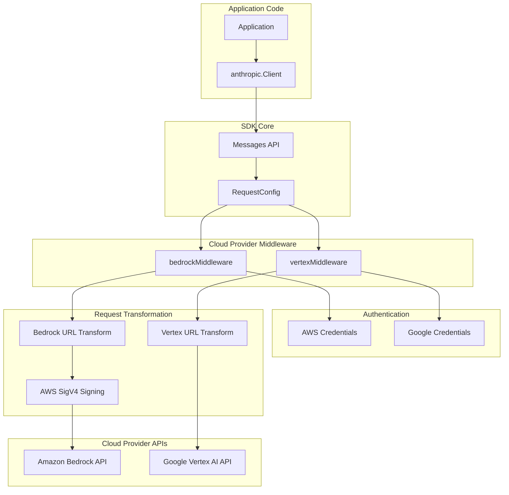
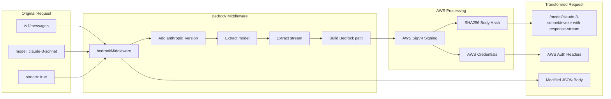
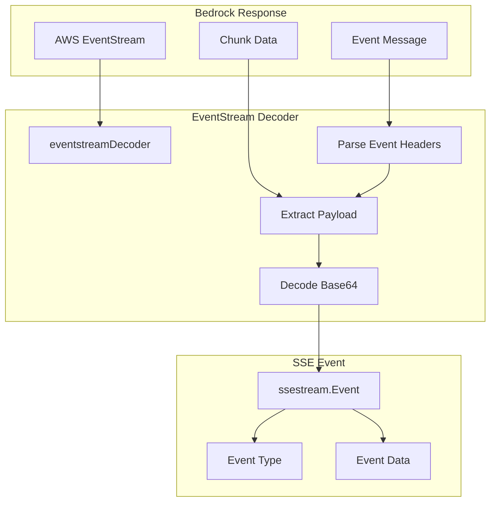
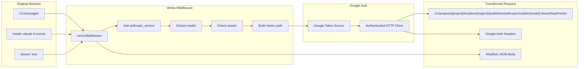
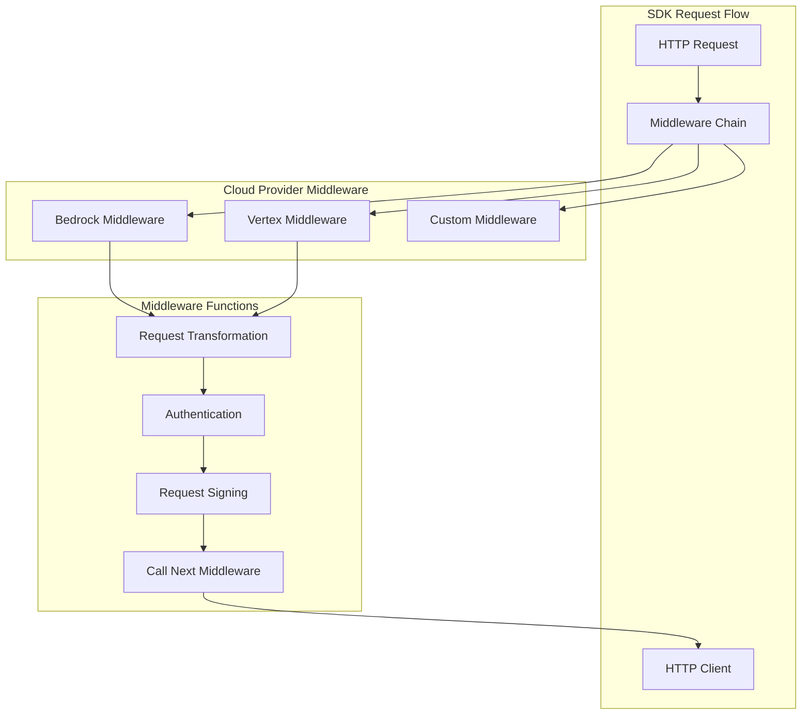

<!-- source: DeepWiki mcp.deepwiki.com · repo anthropics/anthropic-sdk-go · page 7.1 Cloud Provider Integrations · fetched 2026-10-26 -->

# Cloud Provider Integrations

<details>
<summary>Relevant source files</summary>

The following files were used as context for generating this wiki page:

- [.release-please-manifest.json](.release-please-manifest.json)
- [CHANGELOG.md](CHANGELOG.md)
- [README.md](README.md)
- [bedrock/bedrock.go](bedrock/bedrock.go)
- [bedrock/bedrock_test.go](bedrock/bedrock_test.go)
- [examples/bedrock-bearer-token/main.go](examples/bedrock-bearer-token/main.go)
- [internal/version.go](internal/version.go)
- [vertex/vertex.go](vertex/vertex.go)

</details>


This document covers the SDK's support for using Anthropic's Claude models through cloud provider platforms, specifically Amazon Bedrock and Google Vertex AI. These integrations allow you to use the same SDK interface while the underlying requests are automatically transformed and routed to the appropriate cloud provider endpoints.

For information about direct API usage with Anthropic's servers, see the core services documentation in [Core Services](#4). For streaming-specific features, see [Streaming Responses](#6.1).

## Overview

The SDK provides middleware-based integrations that intercept and transform requests to work with cloud provider APIs. This allows you to use the standard `anthropic.Client` interface while automatically handling the platform-specific authentication, request transformation, and response processing required by each cloud provider.

The integrations support:
- **Amazon Bedrock**: AWS-hosted Claude models with SigV4 authentication
- **Google Vertex AI**: Google Cloud-hosted Claude models with Google authentication

## Integration Architecture



Sources: [README.md:808-862](), [vertex/vertex.go:1-115](), [bedrock/bedrock.go:1-246]()

## Amazon Bedrock Integration

### Configuration

The Bedrock integration uses AWS credentials and automatically signs requests using AWS SigV4. You can configure it using either the default AWS configuration or a custom configuration.

```go
// Using default AWS configuration
client := anthropic.NewClient(
    bedrock.WithLoadDefaultConfig(context.Background()),
)

// Using custom AWS configuration
client := anthropic.NewClient(
    bedrock.WithConfig(customAWSConfig),
)
```

### Request Transformation Process



Sources: [bedrock/bedrock.go:191-245](), [README.md:808-834]()

### Implementation Details

The Bedrock middleware performs several key transformations:

1. **Version Addition**: Adds `anthropic_version` field with `DefaultVersion` constant
2. **Model Extraction**: Extracts the model from the request body and removes it
3. **Stream Detection**: Checks for streaming requests and removes the stream field
4. **Path Transformation**: Converts `/v1/messages` to `/model/{model}/invoke` or `/model/{model}/invoke-with-response-stream`
5. **Request Signing**: Signs the request using AWS SigV4 with the provided credentials

| Component | Function | Location |
|-----------|----------|----------|
| `WithLoadDefaultConfig` | Loads default AWS config | [bedrock/bedrock.go:169-175]() |
| `WithConfig` | Uses provided AWS config | [bedrock/bedrock.go:179-189]() |
| `bedrockMiddleware` | Main transformation logic | [bedrock/bedrock.go:191-245]() |
| `DefaultEndpoints` | Supported API endpoints | [bedrock/bedrock.go:30-33]() |

### Event Stream Processing

Bedrock uses AWS EventStream format for streaming responses. The SDK includes a custom decoder that handles this format:



Sources: [bedrock/bedrock.go:35-163]()

## Google Vertex AI Integration

### Configuration

The Vertex AI integration uses Google Cloud authentication and automatically transforms requests to work with Vertex AI endpoints.

```go
// Using Application Default Credentials
client := anthropic.NewClient(
    vertex.WithGoogleAuth(context.Background(), "us-central1", "project-id"),
)

// Using existing Google credentials
client := anthropic.NewClient(
    vertex.WithCredentials(ctx, region, projectID, creds),
)
```

### Request Transformation Process



Sources: [vertex/vertex.go:64-114](), [README.md:836-862]()

### Implementation Details

The Vertex AI middleware performs the following transformations:

1. **Version Addition**: Adds `anthropic_version` field with `DefaultVersion` constant
2. **Model Extraction**: Extracts and removes the model from the request body
3. **Stream Detection**: Determines if the request is streaming
4. **Path Transformation**: Converts to Vertex AI-specific paths with project/location/model information
5. **Authentication**: Uses Google credentials for request authentication

| Component | Function | Location |
|-----------|----------|----------|
| `WithGoogleAuth` | Loads Google Application Default Credentials | [vertex/vertex.go:28-37]() |
| `WithCredentials` | Uses provided Google credentials | [vertex/vertex.go:41-62]() |
| `vertexMiddleware` | Main transformation logic | [vertex/vertex.go:64-114]() |
| `DefaultVersion` | API version constant | [vertex/vertex.go:20]() |

### Regional Endpoints

The Vertex AI integration supports different regional endpoints:

- **Standard regions**: `https://{region}-aiplatform.googleapis.com/`
- **Global region**: `https://aiplatform.googleapis.com/`

The regional endpoint is automatically selected based on the provided region parameter.

## Middleware Registration

Both cloud provider integrations use the SDK's middleware system to intercept and transform requests:



Sources: [bedrock/bedrock.go:191-245](), [vertex/vertex.go:64-114]()

## Error Handling

Both integrations include comprehensive error handling for authentication failures, request transformation errors, and cloud provider-specific errors:

- **Bedrock**: Handles AWS EventStream exceptions and error messages
- **Vertex AI**: Handles Google authentication errors and API failures

The error handling preserves the original SDK error handling patterns while adding cloud provider-specific context.

Sources: [bedrock/bedrock.go:99-146](), [vertex/vertex.go:32-36]()

---

