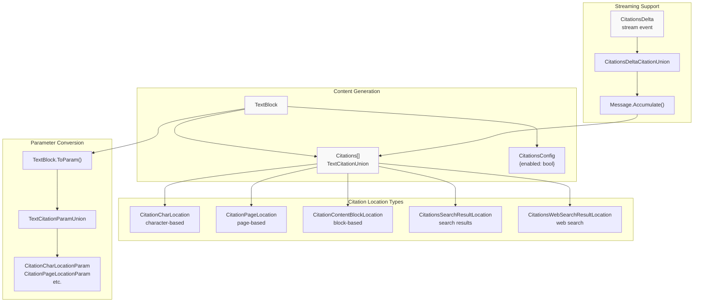
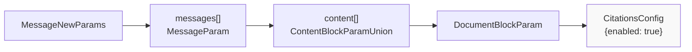
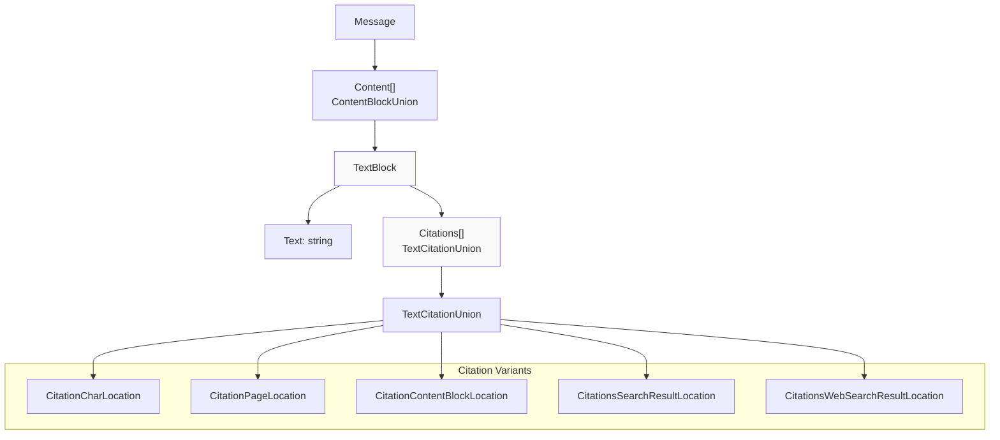
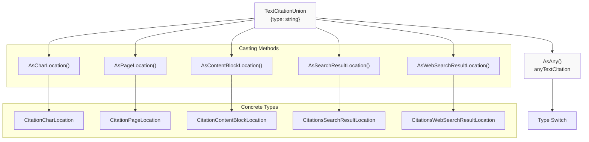
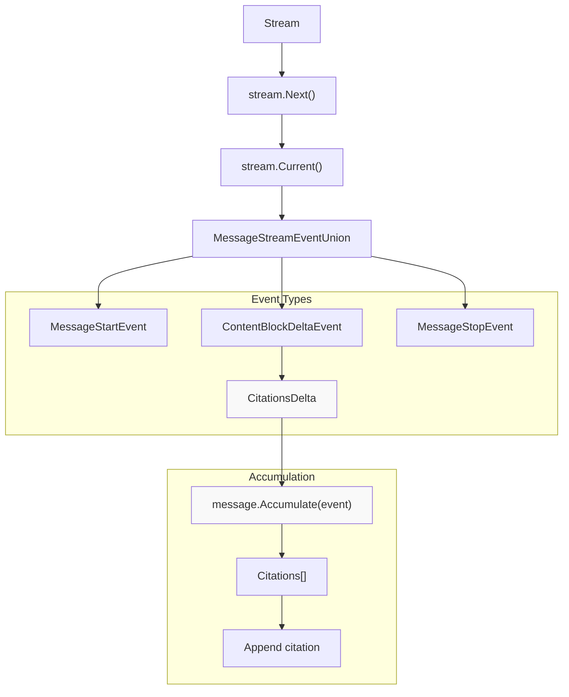
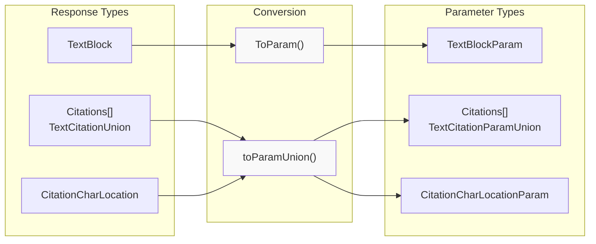

<!-- source: DeepWiki mcp.deepwiki.com · repo anthropics/anthropic-sdk-go · page 7.2 Citations and Sources · fetched 2026-10-26 -->

# Citations and Sources

<details>
<summary>Relevant source files</summary>

The following files were used as context for generating this wiki page:

- [aliases.go](aliases.go)
- [betamessage.go](betamessage.go)
- [betamessageutil.go](betamessageutil.go)
- [message.go](message.go)
- [messageutil.go](messageutil.go)

</details>


This document covers the citation system in the Anthropic Go SDK, which provides source attribution for text content generated by Claude models. Citations allow the model to reference specific locations in documents, web pages, or search results that informed its response.

For information about document handling and file uploads, see [Beta Files Service](#6.3). For information about web search capabilities, see [Built-in Tools](#5.3).

## Purpose and Scope

The citation system enables Claude to provide verifiable references to source material when generating responses. This is particularly useful when working with documents, PDFs, web search results, or other reference materials. Citations specify exact locations (character ranges, page numbers, or content blocks) where information was sourced from.

## Citation Architecture



**Sources:** [message.go:536-943](), [messageutil.go:153-217]()

## Citation Location Types

The SDK supports five distinct citation location strategies, each optimized for different types of source material:

### Character-Based Citations

Character-based citations reference specific character ranges within a document. This is the most precise location type for text documents.

| Field | Type | Description |
|-------|------|-------------|
| `Type` | `constant.CharLocation` | Always `"char_location"` |
| `CitedText` | `string` | The exact text being cited |
| `DocumentIndex` | `int64` | Index of the document in the message |
| `DocumentTitle` | `string` | Title of the source document |
| `FileID` | `string` | Identifier for the source file |
| `StartCharIndex` | `int64` | Starting character position (0-indexed) |
| `EndCharIndex` | `int64` | Ending character position (exclusive) |

**Sources:** [message.go:536-562](), [betamessage.go:821-847]()

### Page-Based Citations

Page-based citations reference page ranges in paginated documents like PDFs.

| Field | Type | Description |
|-------|------|-------------|
| `Type` | `constant.PageLocation` | Always `"page_location"` |
| `CitedText` | `string` | The exact text being cited |
| `DocumentIndex` | `int64` | Index of the document in the message |
| `DocumentTitle` | `string` | Title of the source document |
| `FileID` | `string` | Identifier for the source file |
| `StartPageNumber` | `int64` | Starting page number |
| `EndPageNumber` | `int64` | Ending page number |

**Sources:** [message.go:635-661](), [betamessage.go:936-962]()

### Content Block-Based Citations

Content block citations reference structural elements within a document, such as paragraphs or sections.

| Field | Type | Description |
|-------|------|-------------|
| `Type` | `constant.ContentBlockLocation` | Always `"content_block_location"` |
| `CitedText` | `string` | The exact text being cited |
| `DocumentIndex` | `int64` | Index of the document in the message |
| `DocumentTitle` | `string` | Title of the source document |
| `FileID` | `string` | Identifier for the source file |
| `StartBlockIndex` | `int64` | Starting content block index |
| `EndBlockIndex` | `int64` | Ending content block index |

**Sources:** [message.go:585-611](), [betamessage.go:886-912]()

### Search Result Citations

Search result citations reference content from generic search results (not web-specific).

| Field | Type | Description |
|-------|------|-------------|
| `Type` | `constant.SearchResultLocation` | Always `"search_result_location"` |
| `CitedText` | `string` | The exact text being cited |
| `SearchResultIndex` | `int64` | Index of the search result |
| `Source` | `string` | Source identifier for the result |
| `Title` | `string` | Title of the search result |
| `StartBlockIndex` | `int64` | Starting block within the result |
| `EndBlockIndex` | `int64` | Ending block within the result |

**Sources:** [message.go:901-927]()

### Web Search Result Citations

Web search result citations reference content from web search operations, including encrypted tracking indices.

| Field | Type | Description |
|-------|------|-------------|
| `Type` | `constant.WebSearchResultLocation` | Always `"web_search_result_location"` |
| `CitedText` | `string` | The exact text being cited |
| `EncryptedIndex` | `string` | Encrypted identifier for the search result |
| `Title` | `string` | Title of the web page |
| `URL` | `string` | URL of the web page |

**Sources:** [message.go:929-943]()

## Citation Configuration

Citations must be explicitly enabled using the `CitationsConfig` parameter when creating messages.

### Enabling Citations in Requests



The `CitationsConfig` type controls whether citations are generated:

```go
type CitationsConfig struct {
    Enabled bool `json:"enabled,required"`
}
```

To enable citations, set `Enabled: true` in the configuration attached to document content blocks. The SDK defines both request and response variants:

- `CitationsConfigParam` for requests
- `CitationsConfig` for responses

**Sources:** [message.go:727-754](), [betamessage.go:870-884]()

## Citations in Text Blocks

Citations are attached to `TextBlock` content blocks in message responses. Each text block can contain multiple citations.



The `TextBlock` structure includes a `Citations` field:

```go
type TextBlock struct {
    Type      constant.Text          `json:"type,required"`
    Text      string                 `json:"text,required"`
    Citations []TextCitationUnion    `json:"citations,nullable"`
    // ... other fields
}
```

The `TextCitationUnion` is a discriminated union that can represent any of the five citation location types. Use the `AsAny()` method to determine the variant and cast to the specific type.

**Sources:** [message.go:1-22](), [messageutil.go:201-217]()

## Discriminated Union Pattern

Citations use the discriminated union pattern to represent multiple possible location types through a single interface.



The `TextCitationUnion` type provides two patterns for accessing citation data:

1. **Type switch with `AsAny()`** - Safe pattern that returns the concrete type:

```go
switch citation := citationUnion.AsAny().(type) {
case anthropic.CitationCharLocation:
    // Use citation.StartCharIndex, citation.EndCharIndex, etc.
case anthropic.CitationPageLocation:
    // Use citation.StartPageNumber, citation.EndPageNumber, etc.
case anthropic.CitationContentBlockLocation:
    // Use citation.StartBlockIndex, citation.EndBlockIndex, etc.
case anthropic.CitationsSearchResultLocation:
    // Use citation.SearchResultIndex, etc.
case anthropic.CitationsWebSearchResultLocation:
    // Use citation.EncryptedIndex, citation.URL, etc.
}
```

2. **Direct casting methods** - For when you know the expected type:

```go
charCitation := citationUnion.AsCharLocation()
pageCitation := citationUnion.AsPageLocation()
```

**Sources:** [message.go:774-899]()

## Streaming Citations

When using streaming message creation, citations arrive incrementally as `CitationsDelta` events.



### Citation Delta Events

The `CitationsDelta` event contains a single citation that should be appended to the current text block:

```go
type CitationsDelta struct {
    Citation CitationsDeltaCitationUnion `json:"citation,required"`
    Type     constant.CitationsDelta     `json:"type,required"`
}
```

The `CitationsDeltaCitationUnion` is identical in structure to `TextCitationUnion` and supports the same five location types.

**Sources:** [message.go:756-899]()

### Accumulating Citations

The `Message.Accumulate()` method automatically handles citation delta events:

```go
message := anthropic.Message{}
for stream.Next() {
    event := stream.Current()
    message.Accumulate(event)
}
```

The accumulation logic for citations:

1. Receives a `ContentBlockDeltaEvent` with a `CitationsDelta`
2. Unmarshals the citation from the delta event
3. Appends it to the `Citations` slice of the current text block

**Sources:** [messageutil.go:20-89](), lines 58-64 specifically

## Parameter Conversion

The SDK provides conversion methods to transform response types into request parameter types, enabling citation reuse in subsequent messages.



### Converting Text Blocks with Citations

The `TextBlock.ToParam()` method converts all citations:

```go
func (r TextBlock) ToParam() TextBlockParam {
    var p TextBlockParam
    p.Type = r.Type
    p.Text = r.Text
    
    if r.Citations != nil {
        p.Citations = make([]TextCitationParamUnion, 0, len(r.Citations))
    }
    
    for _, citation := range r.Citations {
        p.Citations = append(p.Citations, citation.AsAny().toParamUnion())
    }
    
    return p
}
```

### Citation Variant Conversion

Each citation location type has a corresponding `toParamUnion()` method:

- `CitationCharLocation.toParamUnion()` → `CitationCharLocationParam`
- `CitationPageLocation.toParamUnion()` → `CitationPageLocationParam`
- `CitationContentBlockLocation.toParamUnion()` → `CitationContentBlockLocationParam`
- `CitationsSearchResultLocation.toParamUnion()` → `CitationSearchResultLocationParam`
- `CitationsWebSearchResultLocation.toParamUnion()` → `CitationWebSearchResultLocationParam`

These methods handle field-by-field conversion, including optional field handling via `paramutil.ToOpt()`.

**Sources:** [messageutil.go:153-217](), [betamessageutil.go:210-259]()

## Beta Citations

The beta API provides identical citation functionality with beta-prefixed types. The structure and behavior are the same as the stable API.

Key beta types:
- `BetaCitationCharLocation` / `BetaCitationCharLocationParam`
- `BetaCitationPageLocation` / `BetaCitationPageLocationParam`
- `BetaCitationContentBlockLocation` / `BetaCitationContentBlockLocationParam`
- `BetaCitationSearchResultLocation` / `BetaCitationSearchResultLocationParam`
- `BetaCitationsWebSearchResultLocation` / `BetaCitationWebSearchResultLocationParam`
- `BetaCitationConfig` / `BetaCitationsConfigParam`
- `BetaCitationsDelta`
- `BetaTextCitationUnion` / `BetaTextCitationParamUnion`

**Sources:** [betamessage.go:821-1032](), [betamessageutil.go:210-259]()

## Field Presence Tracking

Citation types use the `respjson.Field` metadata pattern to track which fields were present in API responses. This is particularly important for optional fields like `DocumentTitle`, `Title`, and `PageAge`.

The `JSON` struct within each citation type tracks field presence:

```go
type CitationCharLocation struct {
    CitedText      string                `json:"cited_text,required"`
    DocumentIndex  int64                 `json:"document_index,required"`
    DocumentTitle  string                `json:"document_title,required"`
    // ... other fields
    JSON struct {
        CitedText      respjson.Field
        DocumentIndex  respjson.Field
        DocumentTitle  respjson.Field
        // ... other field metadata
        raw            string
    } `json:"-"`
}
```

Use `citation.JSON.DocumentTitle.Valid()` to check if a field was present in the response before accessing its value.

**Sources:** [message.go:544-555](), [betamessage.go:830-840]()

---

