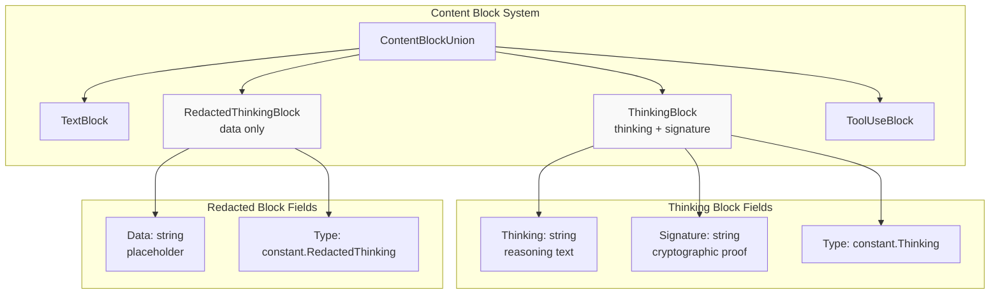
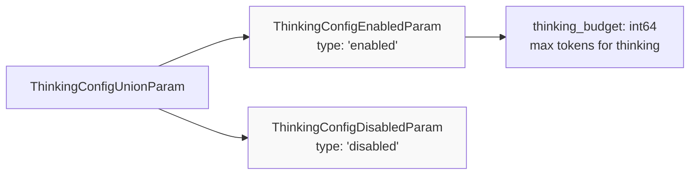
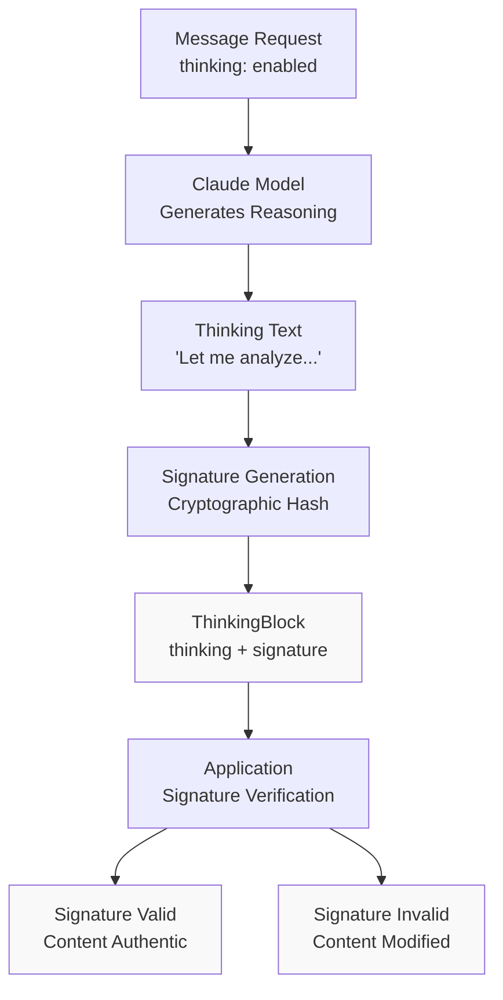
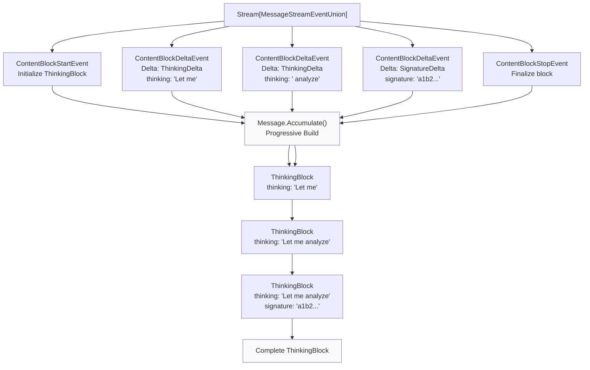
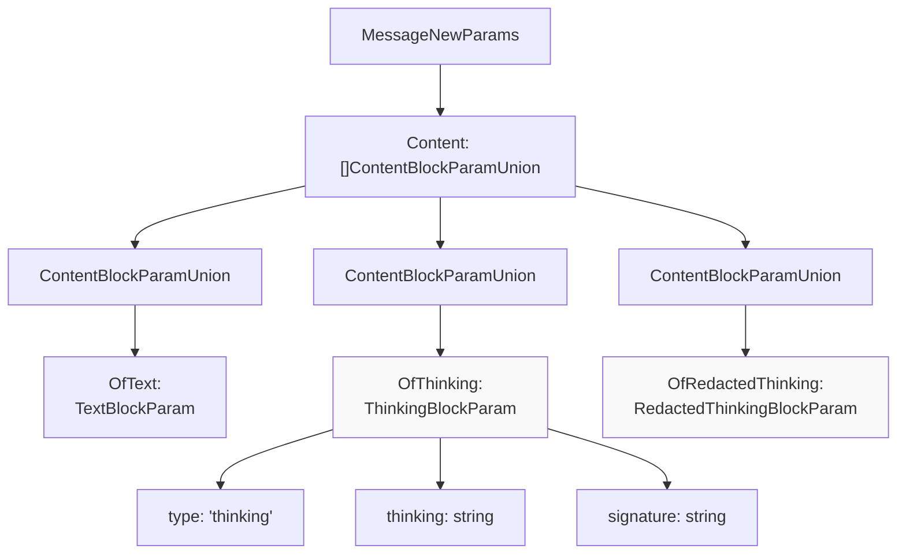
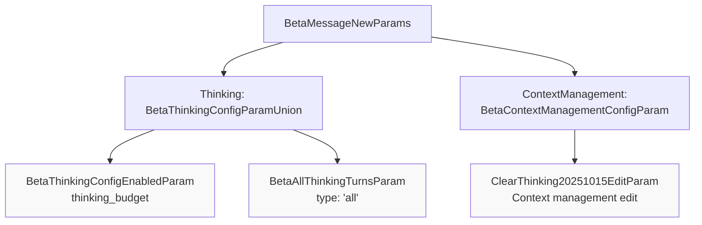

<!-- source: DeepWiki mcp.deepwiki.com · repo anthropics/anthropic-sdk-go · page 7.3 Thinking and Reasoning · fetched 2026-10-26 -->

# Thinking and Reasoning

<details>
<summary>Relevant source files</summary>

The following files were used as context for generating this wiki page:

- [aliases.go](aliases.go)
- [betamessage.go](betamessage.go)
- [betamessageutil.go](betamessageutil.go)
- [message.go](message.go)
- [messageutil.go](messageutil.go)

</details>


This page documents the thinking and reasoning capabilities in the Anthropic Go SDK, which allow Claude models to expose their internal reasoning process. Thinking blocks capture the model's step-by-step thought process before generating a final response, while signatures provide cryptographic verification of thinking content.

For information about citations and source attribution, see [Citations and Sources](#7.2). For beta-specific features and context management, see [Beta Messages Service](#6.1).

---

## Overview

The thinking and reasoning system enables Claude to show its work by exposing the internal reasoning process it uses to arrive at conclusions. This system provides:

- **Thinking blocks**: Content blocks containing the model's reasoning process
- **Signatures**: Cryptographic signatures verifying thinking block authenticity
- **Redacted thinking**: Placeholder blocks indicating that reasoning occurred but was not exposed
- **Streaming support**: Real-time delivery of thinking content as it's generated
- **Configuration controls**: Options to enable, disable, or redact thinking output

Sources: [message.go:1-100](), [betamessage.go:1-100]()

---

## Thinking Block Types

The SDK provides two primary thinking-related content block types that can appear in message responses:

### ThinkingBlock

Standard thinking blocks expose the model's complete reasoning process:

| Field | Type | Description |
|-------|------|-------------|
| `Type` | `constant.Thinking` | Always `"thinking"` |
| `Thinking` | `string` | The model's reasoning text |
| `Signature` | `string` | Cryptographic signature verifying the thinking content |

### RedactedThinkingBlock

Redacted blocks indicate that thinking occurred but was intentionally hidden:

| Field | Type | Description |
|-------|------|-------------|
| `Type` | `constant.RedactedThinking` | Always `"redacted_thinking"` |
| `Data` | `string` | Placeholder data (actual reasoning not exposed) |



**Diagram: Thinking Block Types in Content Block Hierarchy**

Sources: [message.go:8000-8100](), [messageutil.go:127-143]()

---

## Configuring Thinking

Thinking behavior is controlled through configuration parameters when creating messages. The system supports three configuration modes:

### ThinkingConfig Variants



**Diagram: Thinking Configuration Options**

| Configuration | Type Field | Parameters | Behavior |
|---------------|-----------|------------|----------|
| Enabled | `"enabled"` | `thinking_budget` (optional) | Exposes full thinking content with signatures |
| Disabled | `"disabled"` | None | Suppresses all thinking blocks from response |
| Default | (omitted) | N/A | Returns redacted thinking blocks as placeholders |

### Request Parameter Integration

Thinking configuration is specified in the message creation parameters:

- `MessageNewParams.Thinking` - Controls thinking for stable API
- `BetaMessageNewParams.Thinking` - Controls thinking for beta API with additional options

Sources: [message.go:8200-8300](), [betamessage.go:3400-3600]()

---

## Signature Verification

Thinking blocks include a cryptographic signature that verifies the authenticity and integrity of the thinking content. This signature:

- Proves the thinking text was generated by Claude (not modified)
- Links the thinking to the specific request and response
- Enables verification that redacted content matches exposed thinking

The signature field is populated automatically by the API when thinking is enabled. Applications can verify signatures to ensure thinking content has not been tampered with.



**Diagram: Thinking Block Signature Flow**

Sources: [message.go:8000-8100]()

---

## Streaming Thinking Content

Thinking blocks can be delivered incrementally during streaming responses. The SDK provides specialized delta events for accumulating thinking content:

### Delta Event Types

| Event Type | Content | Purpose |
|------------|---------|---------|
| `ThinkingDelta` | `thinking: string` | Incremental thinking text |
| `SignatureDelta` | `signature: string` | Incremental signature data |

### Accumulation Pattern

The `Message.Accumulate` method handles thinking deltas automatically:



**Diagram: Streaming Thinking Content Accumulation**

The accumulation logic for thinking deltas:

```
case ThinkingDelta:
    cb.Thinking += delta.Thinking
case SignatureDelta:
    cb.Signature += delta.Signature
```

Sources: [messageutil.go:54-58](), [betamessageutil.go:56-59]()

---

## Working with Thinking Blocks

### Converting Response to Request Parameters

Thinking blocks from responses can be converted back to request parameters for multi-turn conversations:

**ThinkingBlock to ThinkingBlockParam:**

```
func (r ThinkingBlock) ToParam() ThinkingBlockParam {
    var p ThinkingBlockParam
    p.Type = r.Type
    p.Signature = r.Signature
    p.Thinking = r.Thinking
    return p
}
```

**RedactedThinkingBlock to RedactedThinkingBlockParam:**

```
func (r RedactedThinkingBlock) ToParam() RedactedThinkingBlockParam {
    var p RedactedThinkingBlockParam
    p.Type = r.Type
    p.Data = r.Data
    return p
}
```

These conversions enable thinking blocks to be included in subsequent messages, maintaining context of the model's previous reasoning.

Sources: [messageutil.go:219-225](), [messageutil.go:137-142]()

---

## Content Block Union Integration

Thinking blocks integrate into the polymorphic content block system through discriminated unions:



**Diagram: Thinking Blocks in Request Content Array**

The union system uses the `type` field as a discriminator to determine which variant is active. Helper methods convert between response and request types:

```
func (variant ThinkingBlock) toParamUnion() ContentBlockParamUnion {
    p := variant.ToParam()
    return ContentBlockParamUnion{OfThinking: &p}
}
```

Sources: [messageutil.go:127-135](), [message.go:8000-8200]()

---

## Beta Features

The beta API provides extended thinking capabilities:

### BetaAllThinkingTurnsParam

Controls whether to expose thinking for all conversation turns:

```
BetaAllThinkingTurnsParam{
    Type: "all",
}
```

This configuration enables thinking blocks across multi-turn conversations, providing a complete trace of the model's reasoning throughout the dialogue.

### Beta Thinking Configuration

Beta thinking configuration includes additional options not available in the stable API:

- Extended thinking budget controls
- Per-turn thinking exposure settings
- Integration with context management features (see [Context Management](#6.4))



**Diagram: Beta Thinking Integration with Context Management**

Sources: [betamessage.go:115-134](), [betamessage.go:3400-3600]()

---

## Type Safety and Discriminated Unions

The SDK enforces type safety for thinking blocks through discriminated union patterns:

### Response Union

```
ContentBlockUnion {
    Type: string  // "thinking" | "redacted_thinking" | ...
    Thinking: string
    Signature: string
    Data: string
    ...
}
```

Access variants using type-safe methods:

```
switch block := contentBlock.AsAny().(type) {
case ThinkingBlock:
    // Access block.Thinking, block.Signature
case RedactedThinkingBlock:
    // Access block.Data
}
```

### Request Union

```
ContentBlockParamUnion {
    OfThinking: *ThinkingBlockParam
    OfRedactedThinking: *RedactedThinkingBlockParam
    ...
}
```

Only one variant field is populated, enforced by the `param.IsOmitted` checks.

Sources: [message.go:8000-8200](), [messageutil.go:103-135]()

---

## Usage Examples

### Enabling Thinking in Requests

**Stable API:**
```
params := anthropic.MessageNewParams{
    Model: "claude-3-5-sonnet-20241022",
    MaxTokens: 1024,
    Thinking: anthropic.ThinkingConfigUnionParam{
        OfEnabled: &anthropic.ThinkingConfigEnabledParam{
            Type: "enabled",
        },
    },
    Messages: []anthropic.MessageParam{...},
}
```

**Beta API with Budget:**
```
params := anthropic.BetaMessageNewParams{
    Model: "claude-3-5-sonnet-20241022",
    MaxTokens: 1024,
    Thinking: anthropic.BetaThinkingConfigParamUnion{
        OfEnabled: &anthropic.BetaThinkingConfigEnabledParam{
            Type: "enabled",
            ThinkingBudget: anthropic.F(int64(2000)),
        },
    },
    Messages: []anthropic.BetaMessageParam{...},
}
```

### Extracting Thinking from Responses

```
for _, block := range message.Content {
    switch b := block.AsAny().(type) {
    case anthropic.ThinkingBlock:
        fmt.Printf("Thinking: %s\n", b.Thinking)
        fmt.Printf("Signature: %s\n", b.Signature)
    case anthropic.RedactedThinkingBlock:
        fmt.Printf("Redacted thinking: %s\n", b.Data)
    }
}
```

### Streaming Thinking Content

```
stream := client.Messages.NewStreaming(ctx, params)
message := anthropic.Message{}

for stream.Next() {
    event := stream.Current()
    message.Accumulate(event)
}

// message.Content now contains complete ThinkingBlock with
// accumulated thinking text and signature
```

Sources: [message.go:55-69](), [messageutil.go:20-89]()

---

## Implementation Details

### Accumulation State Machine

The accumulation process for thinking blocks follows a state machine:

1. **ContentBlockStartEvent**: Initialize empty `ThinkingBlock`
2. **ThinkingDelta events**: Append to `Thinking` field
3. **SignatureDelta events**: Append to `Signature` field
4. **ContentBlockStopEvent**: Finalize and re-marshal JSON

The state machine ensures partial thinking content is properly accumulated even if the stream is interrupted.

### JSON Marshaling

Thinking blocks use custom JSON marshaling:

- Response types include `JSON.raw` field for round-trip fidelity
- `ToParam()` methods convert responses to request parameters
- Param types override with `param.Override[T]` for exact JSON preservation

This design allows thinking blocks received in responses to be included verbatim in subsequent requests without data loss.

Sources: [messageutil.go:54-89](), [betamessageutil.go:56-93]()

---

## Related Features

Thinking and reasoning integrates with several other SDK features:

- **[Context Management](#6.4)**: Beta API supports clearing thinking blocks from conversation history
- **[Citations and Sources](#7.2)**: Thinking can reference sources through citation blocks
- **[Streaming Messages](#4.3)**: Thinking content streams incrementally with delta events
- **[Tool Calling](#5)**: Models can show reasoning about tool selection and usage

The thinking system provides transparency into Claude's decision-making process across all these interaction patterns.

Sources: [betamessage.go:3400-3600](), [message.go:1-100]()

---

