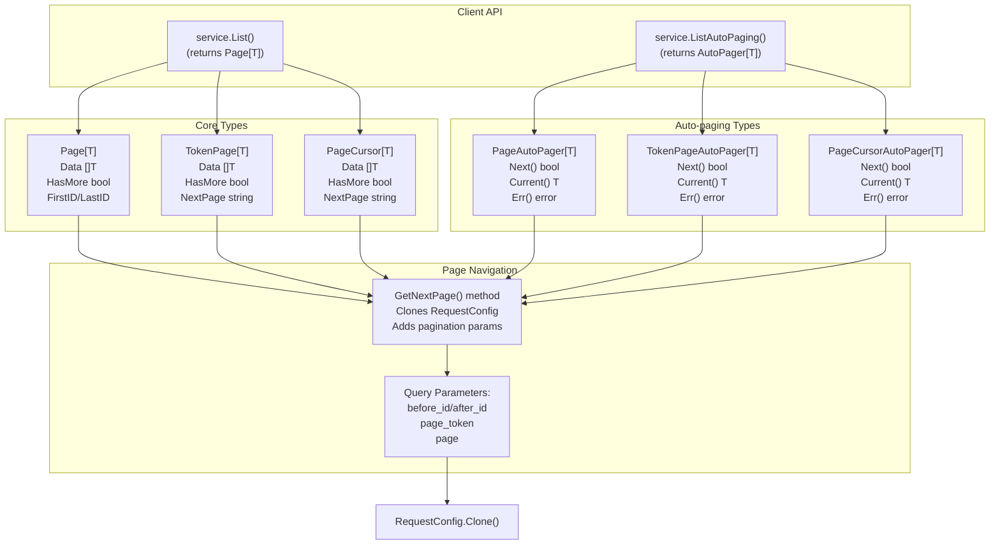
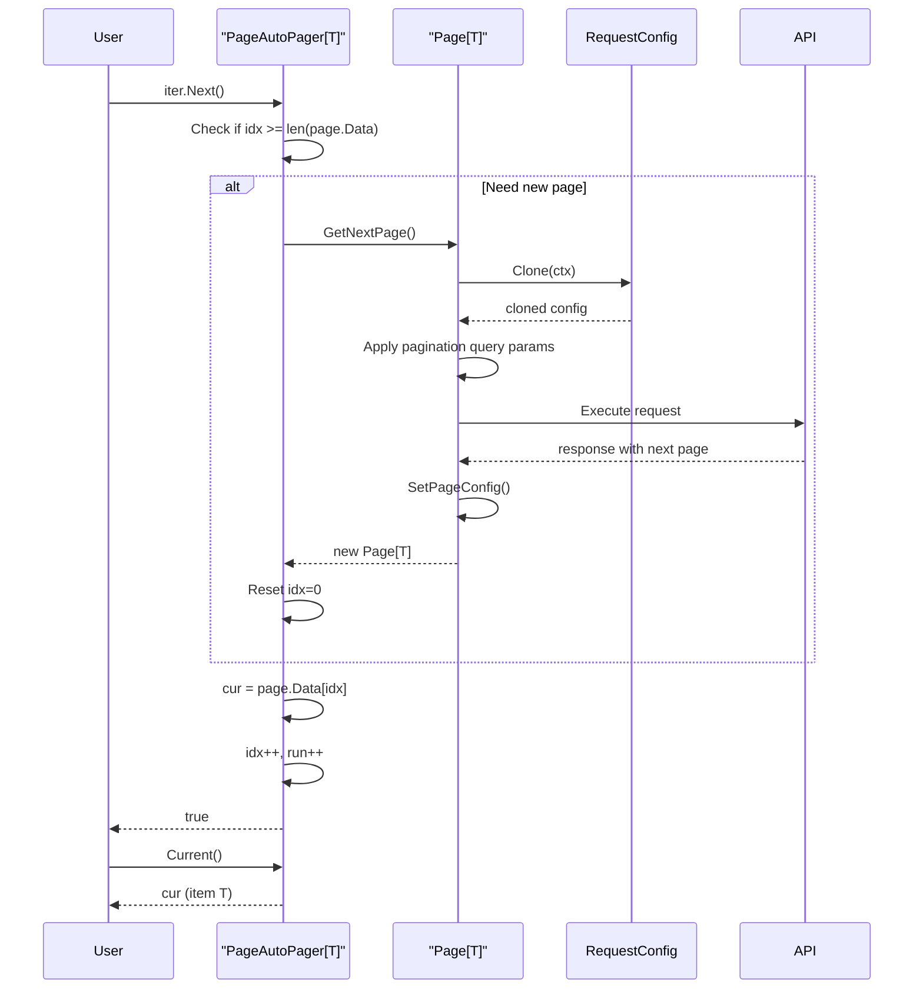
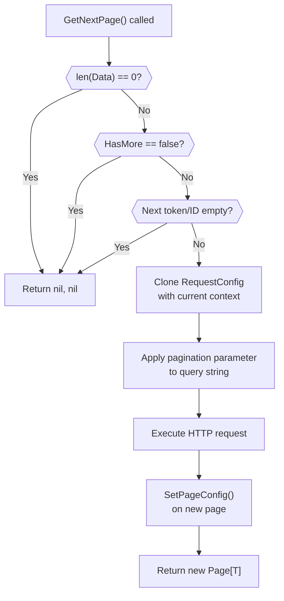
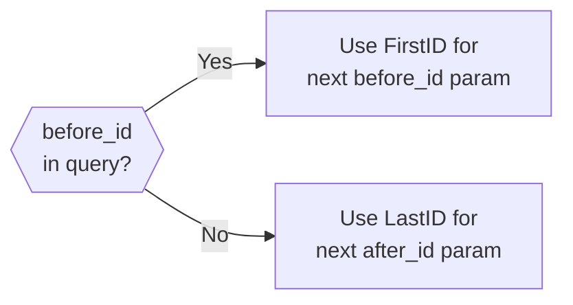
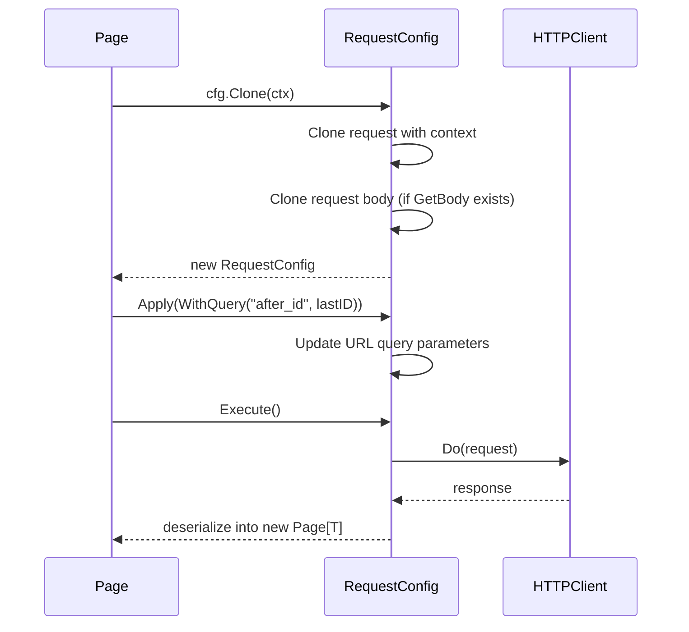

<!-- source: DeepWiki mcp.deepwiki.com · repo anthropics/anthropic-sdk-go · page 7.4 Pagination · fetched 2026-10-26 -->

# Pagination

<details>
<summary>Relevant source files</summary>

The following files were used as context for generating this wiki page:

- [.release-please-manifest.json](.release-please-manifest.json)
- [CHANGELOG.md](CHANGELOG.md)
- [README.md](README.md)
- [client.go](client.go)
- [internal/apierror/apierror.go](internal/apierror/apierror.go)
- [internal/apijson/subfield.go](internal/apijson/subfield.go)
- [internal/requestconfig/requestconfig.go](internal/requestconfig/requestconfig.go)
- [internal/version.go](internal/version.go)
- [option/requestoption.go](option/requestoption.go)
- [packages/pagination/pagination.go](packages/pagination/pagination.go)

</details>


This document describes the pagination system used for list endpoints in the Anthropic Go SDK. Pagination enables efficient retrieval of large result sets by breaking them into manageable pages. The SDK provides both automatic pagination (for iterating through all items) and manual pagination (for explicit page-by-page control).

For information about batch processing of messages, see [Message Batches Service](#4.4).

## Overview

The SDK supports paginated list endpoints through a type-safe generic pagination system. All paginated responses return a page object containing a slice of items plus metadata for fetching subsequent pages. The SDK provides two primary usage patterns:

| Pattern | Method | Use Case |
|---------|--------|----------|
| Auto-pagination | `.ListAutoPaging()` | Iterate through all items automatically |
| Manual pagination | `.List()` + `.GetNextPage()` | Explicit control over page fetching |

The pagination system handles three different pagination strategies based on the API endpoint:

1. **ID-based pagination** - Uses `FirstID`/`LastID` with `before_id`/`after_id` query parameters
2. **Token-based pagination** - Uses `NextPage` token with `page_token` query parameter  
3. **Cursor-based pagination** - Uses `NextPage` cursor with `page` query parameter

**Sources:** [README.md:586-622](), [packages/pagination/pagination.go:1-351]()

## Pagination Architecture



**Diagram: Pagination System Architecture**

The pagination system uses generic types to provide type-safe iteration over different result types. Each page type encapsulates the data slice, pagination metadata, and the request configuration needed to fetch subsequent pages.

**Sources:** [packages/pagination/pagination.go:21-93](), [packages/pagination/pagination.go:95-139](), [packages/pagination/pagination.go:140-200](), [packages/pagination/pagination.go:246-305]()

## Auto-Pagination Pattern

Auto-pagination automatically fetches subsequent pages as needed during iteration, providing a simple iterator-style interface over all results.

### Using ListAutoPaging

```go
// Example from README
iter := client.Messages.Batches.ListAutoPaging(context.TODO(), anthropic.MessageBatchListParams{
    Limit: anthropic.Int(20),
})
// Automatically fetches more pages as needed
for iter.Next() {
    messageBatch := iter.Current()
    fmt.Printf("%+v\n", messageBatch)
}
if err := iter.Err(); err != nil {
    panic(err.Error())
}
```

### AutoPager Interface

All auto-pager types implement a consistent interface:

| Method | Return Type | Description |
|--------|-------------|-------------|
| `Next()` | `bool` | Advances iterator, fetching new page if needed. Returns `false` when done. |
| `Current()` | `T` | Returns the current item in the iteration |
| `Err()` | `error` | Returns any error encountered during pagination |
| `Index()` | `int` | Returns the total number of items iterated (run count) |

### AutoPager Implementation Flow



**Diagram: Auto-Pagination Iteration Flow**

The auto-pager maintains internal state (`idx`, `run`) to track position within the current page and across all pages. When the end of a page is reached, it automatically calls `GetNextPage()` to fetch the next page and continues iteration seamlessly.

**Sources:** [packages/pagination/pagination.go:95-139](), [packages/pagination/pagination.go:111-126]()

## Manual Pagination Pattern

Manual pagination provides explicit control over page fetching, useful when you need to handle pages individually or implement custom pagination logic.

### Using List and GetNextPage

```go
// Example from README
page, err := client.Messages.Batches.List(context.TODO(), anthropic.MessageBatchListParams{
    Limit: anthropic.Int(20),
})
for page != nil {
    for _, batch := range page.Data {
        fmt.Printf("%+v\n", batch)
    }
    page, err = page.GetNextPage()
}
if err != nil {
    panic(err.Error())
}
```

### Page Methods

Each page type provides these methods:

| Method | Return Type | Description |
|--------|-------------|-------------|
| `GetNextPage()` | `*Page[T], error` | Fetches the next page. Returns `nil` when no more pages exist. |
| `RawJSON()` | `string` | Returns the unmodified JSON received from the API |

### GetNextPage Implementation Logic

The `GetNextPage()` method implements the following logic across all page types:



**Diagram: GetNextPage Decision Flow**

The method performs several checks before fetching the next page:
1. Returns `nil` if current page is empty (no data to paginate from)
2. Returns `nil` if `HasMore` is explicitly `false`
3. Returns `nil` if the next page token/ID is empty
4. Otherwise, clones the request config and executes a new request with updated pagination parameters

**Sources:** [packages/pagination/pagination.go:48-85](), [packages/pagination/pagination.go:165-191](), [packages/pagination/pagination.go:271-297]()

## Pagination Types

### Page[T] - ID-Based Pagination

The `Page[T]` type uses first/last ID tracking for pagination. It supports both forward and backward pagination through `after_id` and `before_id` query parameters.

**Structure:**
```go
type Page[T any] struct {
    Data    []T    `json:"data"`
    HasMore bool   `json:"has_more"`
    FirstID string `json:"first_id,nullable"`
    LastID  string `json:"last_id,nullable"`
    JSON    struct { ... } // Metadata fields
    cfg     *requestconfig.RequestConfig
    res     *http.Response
}
```

**Pagination Logic:**



**Diagram: ID-Based Pagination Direction**

The direction of pagination is determined by checking if `before_id` exists in the original request query parameters. If present, subsequent pages use `FirstID` to paginate backward; otherwise, they use `LastID` to paginate forward.

**Sources:** [packages/pagination/pagination.go:21-93](), [packages/pagination/pagination.go:48-85]()

### TokenPage[T] - Token-Based Pagination

The `TokenPage[T]` type uses an opaque `NextPage` token for pagination. This is the simplest pagination pattern where the server provides a token for fetching the next page.

**Structure:**
```go
type TokenPage[T any] struct {
    Data     []T    `json:"data"`
    HasMore  bool   `json:"has_more"`
    NextPage string `json:"next_page,nullable"`
    JSON     struct { ... } // Metadata fields
    cfg      *requestconfig.RequestConfig
    res      *http.Response
}
```

The `GetNextPage()` method adds the token as a `page_token` query parameter: [packages/pagination/pagination.go:178]()

**Sources:** [packages/pagination/pagination.go:140-200]()

### PageCursor[T] - Cursor-Based Pagination

The `PageCursor[T]` type also uses a `NextPage` field but adds it as a `page` query parameter instead of `page_token`. This is semantically similar to token-based pagination but uses different parameter names.

**Structure:**
```go
type PageCursor[T any] struct {
    Data     []T    `json:"data"`
    HasMore  bool   `json:"has_more"`
    NextPage string `json:"next_page,nullable"`
    JSON     struct { ... } // Metadata fields
    cfg      *requestconfig.RequestConfig
    res      *http.Response
}
```

The `GetNextPage()` method adds the cursor as a `page` query parameter: [packages/pagination/pagination.go:284]()

**Sources:** [packages/pagination/pagination.go:246-305]()

## Request Configuration Integration

### Configuration Cloning for Pagination

Each time `GetNextPage()` is called, it clones the original `RequestConfig` to preserve the base request settings (headers, authentication, retries) while adding new pagination parameters.



**Diagram: Request Configuration Cloning for Pagination**

The cloning process ensures that:
1. All original request options (auth, headers, retries) are preserved
2. The context can be updated for the new request
3. Pagination query parameters are added without affecting the original request
4. Each page fetch is independent and can be retried according to the retry policy

**Sources:** [internal/requestconfig/requestconfig.go:568-593](), [packages/pagination/pagination.go:56-75]()

### SetPageConfig Method

After fetching a new page, the `SetPageConfig()` method stores the request configuration and HTTP response on the page object. This enables subsequent calls to `GetNextPage()` to access the configuration for cloning.

```go
// From packages/pagination/pagination.go:87-93
func (r *Page[T]) SetPageConfig(cfg *requestconfig.RequestConfig, res *http.Response) {
    if r == nil {
        r = &Page[T]{}
    }
    r.cfg = cfg
    r.res = res
}
```

This pattern is consistent across all page types: `Page[T]`, `TokenPage[T]`, and `PageCursor[T]`.

**Sources:** [packages/pagination/pagination.go:87-93](), [packages/pagination/pagination.go:193-199](), [packages/pagination/pagination.go:299-305]()

## Response Metadata and JSON Fields

All page types include a `JSON` struct field that provides metadata about the deserialized response fields. This allows checking if optional fields were present in the response.

### Checking Field Presence

```go
// Check if HasMore was explicitly set in the response
if page.JSON.HasMore.Valid() && page.HasMore == false {
    // HasMore was present and false
}

// Check if LastID was present
if page.JSON.LastID.Valid() {
    // LastID was present (may be empty string)
}
```

The pagination implementation uses these checks to determine when to stop fetching pages:
- [packages/pagination/pagination.go:53-55]() - Checks `HasMore.Valid()`
- [packages/pagination/pagination.go:170-172]() - Token page `HasMore` check
- [packages/pagination/pagination.go:276-278]() - Cursor page `HasMore` check

### Accessing Raw JSON

Each page provides a `RawJSON()` method that returns the unmodified JSON received from the API:

```go
rawJSON := page.RawJSON()  // Returns the complete JSON string
```

This is useful for debugging or accessing fields not yet supported by the SDK.

**Sources:** [packages/pagination/pagination.go:39-43](), [packages/respjson/field.go]()

## Error Handling in Pagination

### AutoPager Error Handling

The auto-pager stores any error encountered during pagination and makes it available through the `Err()` method:

```go
iter := client.Messages.Batches.ListAutoPaging(ctx, params)
for iter.Next() {
    // Process item
}
if err := iter.Err(); err != nil {
    // Handle pagination error
}
```

Errors can occur during:
- Initial page fetch (before calling `Next()`)
- Subsequent page fetches (during `GetNextPage()` calls)
- Request execution, retry exhaustion, or response deserialization

When an error occurs, `Next()` returns `false` and the error is stored in the auto-pager's `err` field: [packages/pagination/pagination.go:117]()

**Sources:** [packages/pagination/pagination.go:111-126](), [packages/pagination/pagination.go:132-134]()

### Manual Pagination Error Handling

With manual pagination, errors from `GetNextPage()` must be explicitly checked:

```go
page, err := client.Messages.Batches.List(ctx, params)
if err != nil {
    // Handle initial fetch error
}

for page != nil {
    // Process items in current page
    
    page, err = page.GetNextPage()
    if err != nil {
        // Handle pagination error
        break
    }
}
```

The `GetNextPage()` method returns errors from:
- Request configuration cloning: [internal/requestconfig/requestconfig.go:568-593]()
- Query parameter application: [packages/pagination/pagination.go:62-65]()
- Request execution: [packages/pagination/pagination.go:79]()
- Response deserialization: [internal/requestconfig/requestconfig.go:545-555]()

**Sources:** [packages/pagination/pagination.go:48-85](), [README.md:609-622]()

## Usage Examples

### Example: Processing All Batches with Auto-Pagination

```go
ctx := context.Background()

iter := client.Messages.Batches.ListAutoPaging(ctx, anthropic.MessageBatchListParams{
    Limit: anthropic.Int(20),
})

count := 0
for iter.Next() {
    batch := iter.Current()
    fmt.Printf("Batch %d: %s (status: %s)\n", 
        iter.Index(), batch.ID, batch.ProcessingStatus)
    count++
}

if err := iter.Err(); err != nil {
    log.Fatalf("Pagination error: %v", err)
}

fmt.Printf("Processed %d batches\n", count)
```

### Example: Manual Page-by-Page Processing

```go
ctx := context.Background()
params := anthropic.MessageBatchListParams{
    Limit: anthropic.Int(50),
}

page, err := client.Messages.Batches.List(ctx, params)
if err != nil {
    log.Fatalf("Failed to fetch first page: %v", err)
}

pageNum := 1
for page != nil {
    fmt.Printf("\n=== Page %d ===\n", pageNum)
    fmt.Printf("Items in this page: %d\n", len(page.Data))
    
    for i, batch := range page.Data {
        fmt.Printf("  %d. %s\n", i+1, batch.ID)
    }
    
    fmt.Printf("Has more pages: %v\n", page.HasMore)
    
    page, err = page.GetNextPage()
    if err != nil {
        log.Fatalf("Failed to fetch page %d: %v", pageNum+1, err)
    }
    pageNum++
}
```

**Sources:** [README.md:586-622]()

---

