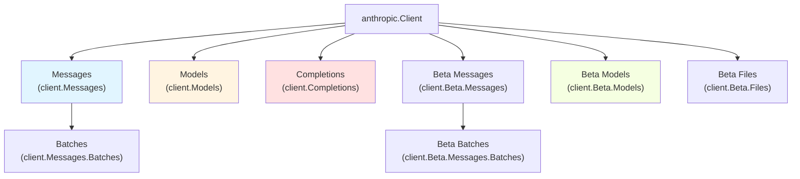
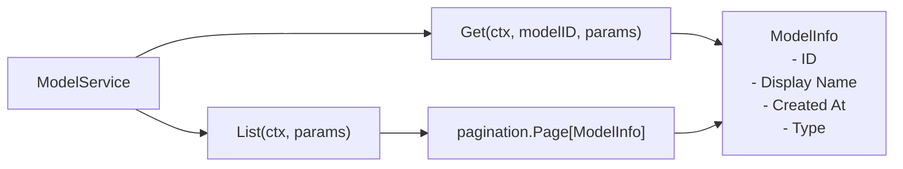
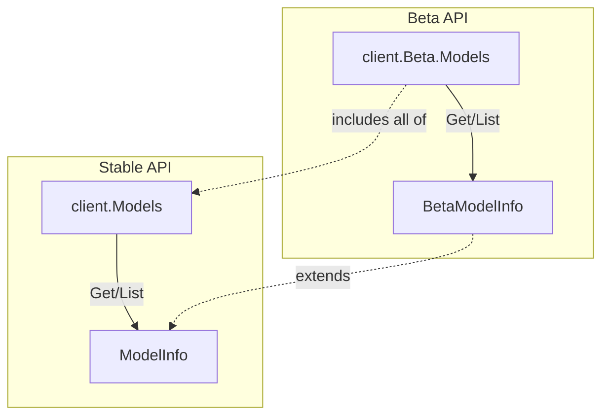
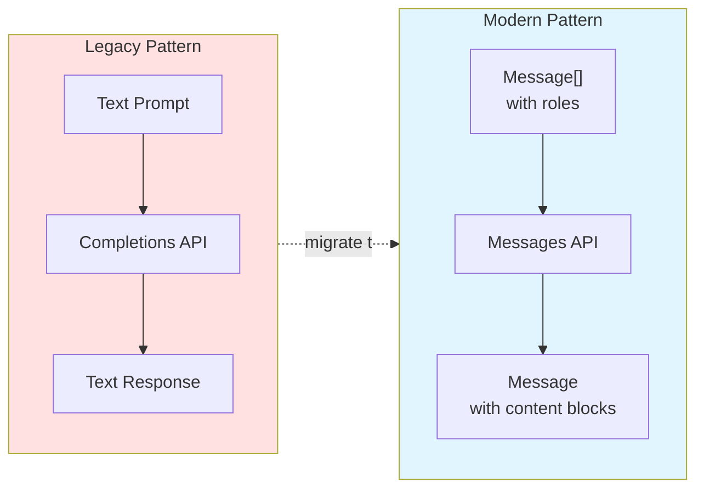
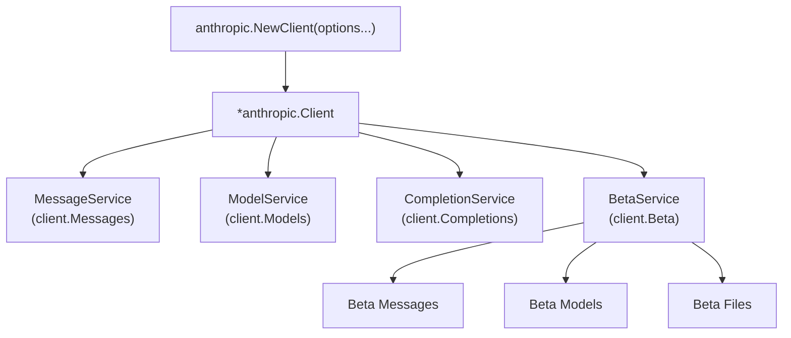

<!-- source: DeepWiki mcp.deepwiki.com · repo anthropics/anthropic-sdk-go · page 8 Other Services · fetched 2026-10-26 -->

# Other Services

<details>
<summary>Relevant source files</summary>

The following files were used as context for generating this wiki page:

- [.release-please-manifest.json](.release-please-manifest.json)
- [CHANGELOG.md](CHANGELOG.md)
- [README.md](README.md)
- [api.md](api.md)
- [internal/version.go](internal/version.go)
- [shared/constant/constants.go](shared/constant/constants.go)

</details>


This page documents API services in the SDK beyond the primary Messages API. These include the Models Service for retrieving model information and metadata, and the legacy Completions Service for backward compatibility.

For information about the Messages API, see [Messages API](#4). For batch processing, see [Message Batches Service](#4.4). For beta-specific models functionality, see [Beta Services](#6).

---

## Overview

The SDK provides access to several service endpoints in addition to the core Messages API. These services are accessed as properties on the main client instance and follow consistent patterns for request handling, error management, and pagination.



**Sources:** [api.md:15-228]()

---

## Models Service

The Models Service provides access to information about available Claude models, including their capabilities, context windows, and supported features. This service is useful for discovering what models are available and their specifications.

### Service Structure

The Models Service is accessed via `client.Models` and provides two primary methods:

| Method | Endpoint | Description |
|--------|----------|-------------|
| `Get()` | `GET /v1/models/{model_id}` | Retrieve information about a specific model |
| `List()` | `GET /v1/models` | List all available models with pagination |

**Sources:** [api.md:218-227]()

### Response Type

Both methods return `anthropic.ModelInfo` objects containing model metadata:



**Sources:** [api.md:220-227]()

### Retrieving a Specific Model

To get information about a specific model by its ID:

```go
modelInfo, err := client.Models.Get(
    context.TODO(),
    "claude-sonnet-4-5-20250929",
    anthropic.ModelGetParams{},
)
if err != nil {
    panic(err)
}

fmt.Printf("Model: %s\n", modelInfo.DisplayName)
fmt.Printf("Created: %s\n", modelInfo.CreatedAt)
```

The `ModelGetParams` supports optional query parameters for additional filtering or configuration.

**Sources:** [api.md:226]()

### Listing Available Models

The `List()` method supports pagination to retrieve all available models:

```go
// Auto-paging iterator
iter := client.Models.ListAutoPaging(
    context.TODO(),
    anthropic.ModelListParams{
        Limit: anthropic.Int(20),
    },
)

for iter.Next() {
    model := iter.Current()
    fmt.Printf("%s: %s\n", model.ID, model.DisplayName)
}

if err := iter.Err(); err != nil {
    panic(err)
}
```

Alternatively, for manual pagination:

```go
page, err := client.Models.List(
    context.TODO(),
    anthropic.ModelListParams{
        Limit: anthropic.Int(20),
    },
)

for page != nil {
    for _, model := range page.Data {
        fmt.Printf("%s\n", model.ID)
    }
    page, err = page.GetNextPage()
}
```

**Sources:** [api.md:227](), [README.md:586-622]()

### Beta Models Service

The Beta Models Service (`client.Beta.Models`) provides access to models that include beta features. It follows the same interface as the stable Models Service but returns `BetaModelInfo` objects that may contain additional fields for experimental features.



**Sources:** [api.md:249-258]()

### Model Constants

The SDK provides type-safe constants for supported models in the `anthropic.Model` type. These constants are defined for use in message creation and other API calls:

```go
// Example model constants
anthropic.ModelClaudeSonnet4_5_20250929
anthropic.ModelClaudeOpus4_20250514
anthropic.ModelClaudeHaiku3_5_20241022
```

The `shared/constant/constants.go` file also maintains configuration for models that have special behavior, such as token limits for non-streaming requests:

**Sources:** [api.md:55](), [shared/constant/constants.go:9-20]()

---

## Completions Service (Legacy)

The Completions Service is the legacy text completion API that predates the Messages API. It is maintained for backward compatibility with existing integrations but is not recommended for new applications.

### When to Use Messages API Instead

The Messages API should be used for all new development because it provides:

- **Multi-turn conversations** with role-based message structure
- **Tool calling** and function execution capabilities
- **Vision support** with image and document inputs
- **Streaming responses** with structured event types
- **System prompts** for better instruction control
- **Stop reasons** indicating why generation stopped

The Completions API only supports simple text-to-text completion without these features.

**Sources:** [README.md:42-103]()

### Legacy Support

While the Completions Service is not prominently documented in the current SDK (as evidenced by its absence from `api.md`), it exists for compatibility with applications that have not yet migrated to the Messages API. If you are using the Completions API, plan to migrate to the Messages API to take advantage of modern features.



### Migration Path

To migrate from Completions to Messages:

1. Convert text prompts to message arrays with appropriate roles
2. Replace completion parameters with message parameters
3. Update response handling to work with structured Message objects
4. Add tool definitions if using function calling
5. Implement streaming using `NewStreaming()` if needed

**Sources:** [README.md:42-158]()

---

## Service Access Pattern

All services in the SDK follow a consistent access pattern through the main client:



All services inherit the client's configuration including:
- API key authentication
- Base URL (Anthropic API, Bedrock, or Vertex)
- Retry settings and timeouts
- Custom middleware
- HTTP client configuration

**Sources:** [README.md:54-56](), [README.md:569-580]()

---

## Summary Table

| Service | Purpose | Primary Use Case | Status |
|---------|---------|------------------|--------|
| **Messages** | Create conversational AI interactions | Modern text/image/tool-based chat | Stable |
| **Models** | Query model information and capabilities | Discovery and validation | Stable |
| **Completions** | Legacy text completion | Backward compatibility only | Legacy |
| **Beta Messages** | Extended message features | Context management, MCP tools | Beta |
| **Beta Models** | Model info with beta features | Beta feature discovery | Beta |
| **Beta Files** | File upload and management | Document processing | Beta |

**Sources:** [api.md:15-260]()

---

