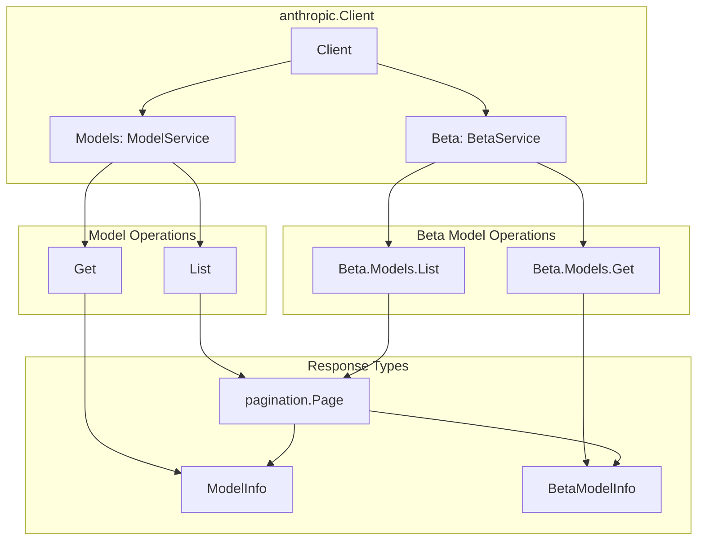
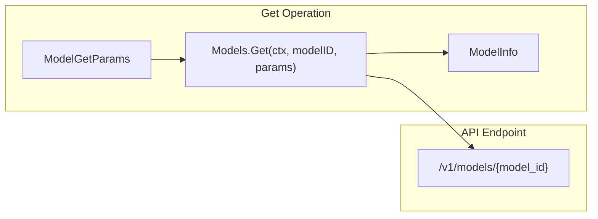
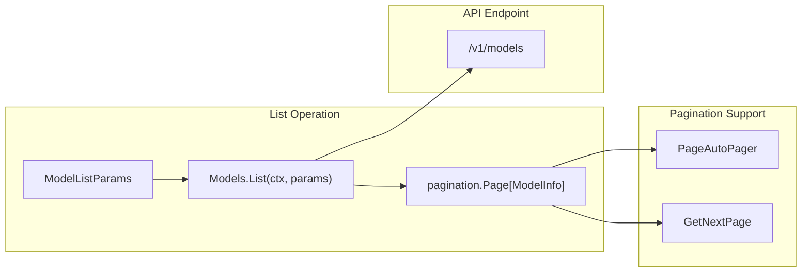
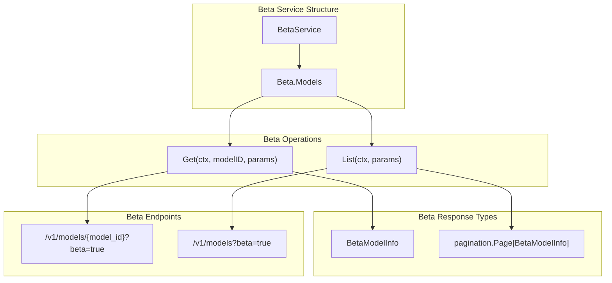
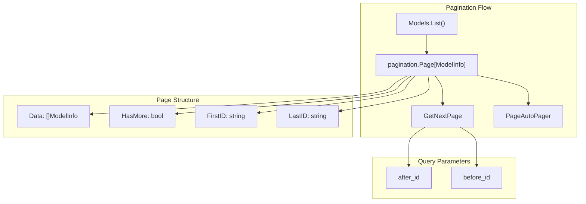
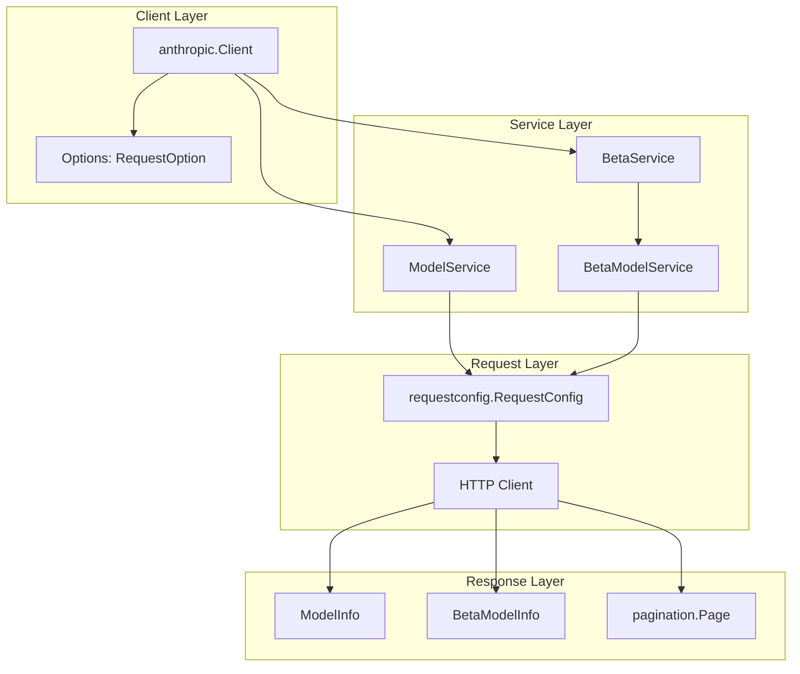

<!-- source: DeepWiki mcp.deepwiki.com · repo anthropics/anthropic-sdk-go · page 8.1 Models Service · fetched 2026-10-26 -->

# Model Service

Relevant source files

The following files were used as context for generating this wiki page:

- [.release-please-manifest.json](.release-please-manifest.json)
- [CHANGELOG.md](CHANGELOG.md)
- [README.md](README.md)
- [api.md](api.md)
- [internal/version.go](internal/version.go)
- [shared/constant/constants.go](shared/constant/constants.go)

The Model Service provides access to information about Anthropic's AI models, including model capabilities, availability, and metadata. This service enables applications to dynamically discover and query available models through both standard and beta API endpoints.

For message generation capabilities using these models, see [Message Service](#4.1). For beta-specific message features, see [Beta Message Service](#5.1).

## Overview

The Model Service is implemented as part of the main `anthropic.Client` and provides two primary operations: retrieving information about individual models and listing all available models. The service supports both stable and beta model endpoints, allowing applications to access experimental model features when available.

*Sources: [api.md:130-140](), [client.go:17-23](), [client.go:53]()*

## Core Functionality

### Model Information Retrieval

The Model Service provides the `Get` method to retrieve detailed information about a specific model using its identifier. This operation returns a `ModelInfo` response containing model metadata and capabilities.

### Model Listing

The `List` method provides paginated access to all available models. This operation returns a `pagination.Page[ModelInfo]` that can be used to iterate through all models or retrieve specific pages of results.

*Sources: [api.md:138-139](), [packages/pagination/pagination.go:21-37]()*

## Beta Models

The Model Service includes beta model support through the `Beta.Models` sub-service. Beta models provide access to experimental features and models that are not yet part of the stable API.

*Sources: [api.md:161-170](), [client.go:22]()*

## Data Structures

The Model Service uses specific data structures for requests and responses:

| Type | Purpose | Usage |
|------|---------|--------|
| `ModelInfo` | Standard model information response | Returned by `Models.Get()` and `Models.List()` |
| `BetaModelInfo` | Beta model information response | Returned by `Beta.Models.Get()` and `Beta.Models.List()` |
| `ModelGetParams` | Parameters for getting specific model | Used with `Models.Get()` |
| `ModelListParams` | Parameters for listing models | Used with `Models.List()` |
| `BetaModelGetParams` | Parameters for getting beta model | Used with `Beta.Models.Get()` |
| `BetaModelListParams` | Parameters for listing beta models | Used with `Beta.Models.List()` |

*Sources: [api.md:134-139](), [api.md:165-170]()*

## Pagination Support

The Model Service integrates with the SDK's pagination system to handle large numbers of models efficiently. List operations return `pagination.Page[T]` objects that support both manual and automatic pagination.

### Pagination Methods

The `Page[T]` type provides several methods for navigating through paginated results:

- `GetNextPage()`: Returns the next page of results
- `PageAutoPager`: Provides automatic iteration through all pages
- `Current()`: Returns the current item during iteration
- `Next()`: Advances to the next item

*Sources: [packages/pagination/pagination.go:48-85](), [packages/pagination/pagination.go:104-138]()*

## Service Architecture

The Model Service follows the SDK's standard service pattern, integrating with the client's configuration and request handling system:

*Sources: [client.go:17-23](), [client.go:46-57]()*

## Error Handling

The Model Service follows the SDK's standard error handling patterns, returning errors that implement the standard Go error interface. API errors are wrapped in structured error types that provide detailed information about the failure.

*Sources: [api.md:1-13]()*

---

