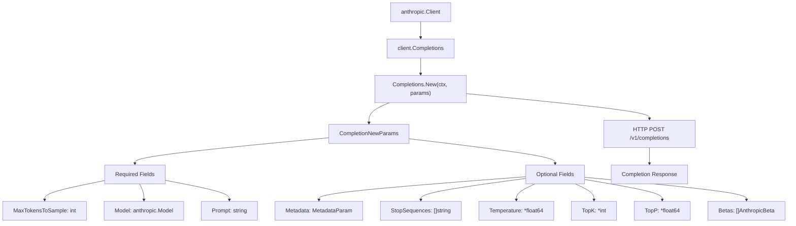
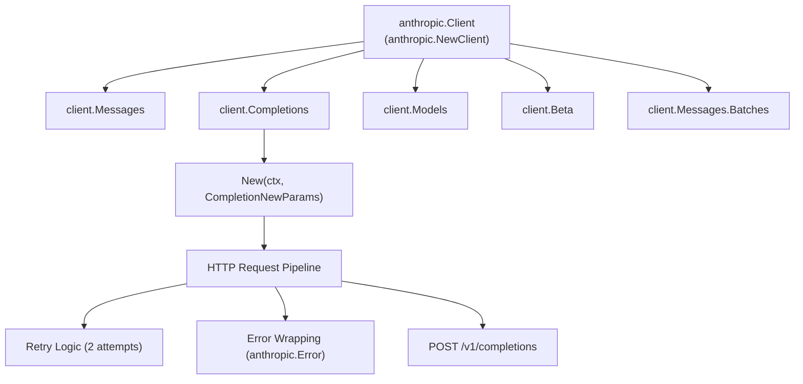
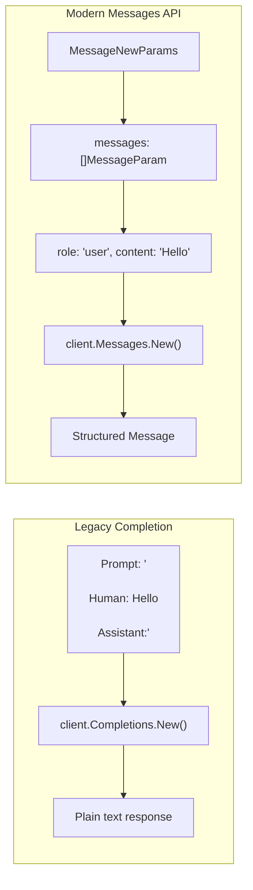

<!-- source: DeepWiki mcp.deepwiki.com · repo anthropics/anthropic-sdk-go · page 8.2 Completions Service (Legacy) · fetched 2026-10-26 -->

# Completions Service (Legacy)

<details>
<summary>Relevant source files</summary>

The following files were used as context for generating this wiki page:

- [.release-please-manifest.json](.release-please-manifest.json)
- [CHANGELOG.md](CHANGELOG.md)
- [README.md](README.md)
- [api.md](api.md)
- [client_test.go](client_test.go)
- [completion_test.go](completion_test.go)
- [internal/version.go](internal/version.go)
- [shared/constant/constants.go](shared/constant/constants.go)
- [usage_test.go](usage_test.go)

</details>


## Purpose and Scope

The Completions Service (`client.Completions`) provides legacy text completion functionality for backward compatibility with existing applications. This service implements the traditional prompt-based completion model where a raw text prompt is provided and the model generates a continuation. Modern applications should use the Messages API (see page 4.1) which provides structured message handling, content blocks, tool calling, and streaming support.

## Overview

The completions service is accessed through `client.Completions.New()` and accepts `anthropic.CompletionNewParams`. Unlike the Messages API, completions work with raw text prompts following the Human/Assistant format: `"\n\nHuman: [input]\n\nAssistant:"`. The service returns unstructured text completions without support for content blocks, tool calling, or structured conversations.

**Completion Request Flow**


Sources: [completion_test.go:16-48]()
</thinking>

## Service Architecture

The completions service is a direct property of the main SDK client, alongside the Messages service. It integrates with the standard HTTP infrastructure including request configuration, retry logic, and error handling.

**Service Location in SDK**


Sources: [completion_test.go:24-28](), [client_test.go:29-42]()

## Creating Completion Requests

The completions service provides a single method: `New()` which creates a text completion synchronously.

### Basic Usage Pattern

```go
client := anthropic.NewClient(
    option.WithAPIKey("my-anthropic-api-key"),
)

completion, err := client.Completions.New(context.TODO(), anthropic.CompletionNewParams{
    MaxTokensToSample: 256,
    Model:             anthropic.ModelClaudeOpus4_6,
    Prompt:            "\n\nHuman: Hello, world!\n\nAssistant:",
})
if err != nil {
    var apierr *anthropic.Error
    if errors.As(err, &apierr) {
        // Handle API error with request/response details
    }
}
```

### Prompt Format Convention

The completions API expects prompts in the Human/Assistant conversation format:
- Begin with `"\n\nHuman: "`
- Include the user's question or statement
- End with `"\n\nAssistant:"`

This format signals where the human input ends and where Claude should begin generating the response.

Sources: [completion_test.go:16-48]()

## CompletionNewParams Structure

The `anthropic.CompletionNewParams` struct defines all available parameters for completion requests.

### Required Parameters

| Field | Type | Description |
|-------|------|-------------|
| `MaxTokensToSample` | `int` | Maximum tokens to generate in the completion |
| `Model` | `anthropic.Model` | Model identifier (e.g., `ModelClaudeOpus4_6`) |
| `Prompt` | `string` | Input prompt text in Human/Assistant format |

### Optional Parameters

| Field | Type | Description |
|-------|------|-------------|
| `Metadata` | `anthropic.MetadataParam` | User ID for tracking and abuse monitoring |
| `StopSequences` | `[]string` | Custom sequences that stop generation when encountered |
| `Temperature` | `*float64` | Sampling temperature (0.0-1.0), controls randomness |
| `TopK` | `*int` | Sample from top K tokens only |
| `TopP` | `*float64` | Nucleus sampling threshold (0.0-1.0) |
| `Betas` | `[]anthropic.AnthropicBeta` | Beta features to enable for request |

### Parameter Construction Example

```go
params := anthropic.CompletionNewParams{
    MaxTokensToSample: 256,
    Model:             anthropic.ModelClaudeOpus4_6,
    Prompt:            "\n\nHuman: Explain quantum computing\n\nAssistant:",
    
    // Optional metadata for tracking
    Metadata: anthropic.MetadataParam{
        UserID: anthropic.String("13803d75-b4b5-4c3e-b2a2-6f21399b021b"),
    },
    
    // Sampling controls
    Temperature:   anthropic.Float(1.0),
    TopK:          anthropic.Int(5),
    TopP:          anthropic.Float(0.7),
    
    // Custom stop sequences
    StopSequences: []string{"\n\nHuman:", "END"},
    
    // Beta features
    Betas: []anthropic.AnthropicBeta{
        anthropic.AnthropicBetaMessageBatches2024_09_24,
    },
}
```

Sources: [completion_test.go:28-40]()

## Response and Error Handling

### Standard Response Pattern

The `Completions.New()` method returns the completion response directly or an error. Successful responses contain the generated text completion.

### Error Handling

Errors follow the standard SDK pattern using `anthropic.Error`. This type includes the HTTP request, response, status code, and request ID for debugging:

```go
completion, err := client.Completions.New(context.TODO(), params)
if err != nil {
    var apierr *anthropic.Error
    if errors.As(err, &apierr) {
        println("Request ID:", apierr.RequestID)
        println(string(apierr.DumpRequest(true)))   // Full HTTP request
        println(string(apierr.DumpResponse(true)))  // Full HTTP response
    }
    // Handle error
}
```

### Retry Behavior

Completions inherit the standard SDK retry logic:
- Default: 2 retry attempts on retryable errors (429, 5xx, network issues)
- Exponential backoff with jitter
- Respects `Retry-After` headers
- Configurable via `option.WithMaxRetries()`

Sources: [completion_test.go:41-47](), [client_test.go:59-102](), [README.md:624-660]()

## SDK Integration Features

### Metadata Tracking

The completions service supports the standard `anthropic.MetadataParam` for user tracking:

```go
Metadata: anthropic.MetadataParam{
    UserID: anthropic.String("13803d75-b4b5-4c3e-b2a2-6f21399b021b"),
}
```

This metadata is included in API requests and can be used for abuse monitoring and usage attribution.

### Beta Feature Support

Completions can enable beta features via the `Betas` parameter:

```go
Betas: []anthropic.AnthropicBeta{
    anthropic.AnthropicBetaMessageBatches2024_09_24,
}
```

Beta features modify API behavior and may change or be promoted to stable over time.

### Request Options

Completions support standard SDK request options:
- `option.WithRequestTimeout()` - Per-request timeout
- `option.WithHeader()` - Custom HTTP headers
- `option.WithMaxRetries()` - Override retry count
- `option.WithResponseInto()` - Access raw HTTP response

```go
completion, err := client.Completions.New(
    context.TODO(),
    params,
    option.WithRequestTimeout(30*time.Second),
    option.WithMaxRetries(5),
)
```

Sources: [completion_test.go:28-40](), [README.md:561-584]()

## Migration Considerations

### Differences from Messages API

| Aspect | Completion Service | Messages API |
|--------|-------------------|--------------|
| Input Format | Raw text prompt | Structured message objects |
| Content Types | Plain text only | Text, images, documents, tools |
| Conversation | Single prompt/response | Multi-turn conversation |
| Tool Support | None | Full tool calling support |
| Streaming | Limited | Full streaming support |
| Response Format | Plain text | Structured content blocks |

### Migration Path

For new applications, use the Messages API ([Message Service](#4.1)) instead of the legacy completion service. The Messages API provides:
- Structured conversation handling
- Rich content type support
- Tool calling capabilities
- Better streaming support
- Future-proof design

**Migration Example**


Sources: [completion_test.go:1-48]()

---

