<!-- source: DeepWiki mcp.deepwiki.com · repo anthropics/anthropic-sdk-go · page 9 SDK Architecture · fetched 2026-10-26 -->

# SDK Architecture

Relevant source files

The following files were used as context for generating this wiki page:

- [aliases.go](aliases.go)
- [betamessageutil.go](betamessageutil.go)
- [client.go](client.go)
- [internal/apierror/apierror.go](internal/apierror/apierror.go)
- [internal/apijson/subfield.go](internal/apijson/subfield.go)
- [internal/requestconfig/requestconfig.go](internal/requestconfig/requestconfig.go)
- [message.go](message.go)
- [messageutil.go](messageutil.go)
- [option/requestoption.go](option/requestoption.go)
- [packages/pagination/pagination.go](packages/pagination/pagination.go)

This document explains the internal design and architecture of the Anthropic Go SDK for advanced users and contributors. It covers the core architectural patterns, code organization, request execution flow, and key design decisions that enable the SDK's functionality.

For detailed information on specific architectural subsystems, see:
- Type system implementation and discriminated unions: [Type System and Unions](#9.1)
- Request middleware and transformation pipeline: [Middleware and Request Pipeline](#9.2)
- Retry mechanism and timeout management: [Retry and Timeout Logic](#9.3)
- OpenAPI-driven code generation process: [Code Generation](#9.4)

## Core Architectural Components

The SDK is structured around several key architectural layers that work together to provide a type-safe, extensible interface to the Anthropic API.

### Client and Service Composition

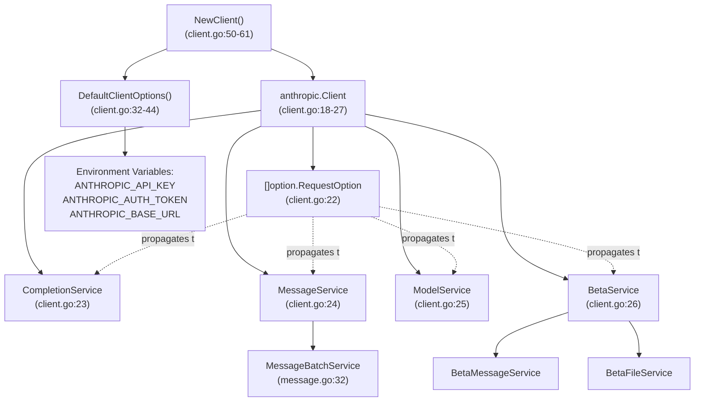

The SDK follows a compositional pattern where the top-level `Client` struct aggregates specialized service structs. Each service encapsulates operations for a specific API domain (Messages, Models, Completions, Beta features). Services are instantiated with a shared set of `RequestOption` values that propagate configuration throughout the request lifecycle.

**Sources:** [client.go:18-61](), [message.go:24-43]()

### Request Configuration Architecture

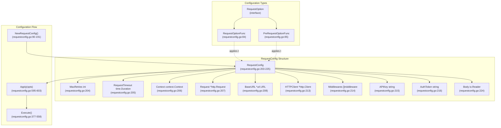

The `RequestConfig` struct ([requestconfig.go:203-225]()) is the central coordination point for all request execution. It accumulates configuration from multiple sources and provides the execution context for HTTP operations. The configuration system uses a functional options pattern where `RequestOption` interfaces ([option/requestoption.go:23]()) can be applied at client, service, or method levels.

**Sources:** [internal/requestconfig/requestconfig.go:90-225](), [option/requestoption.go:18-93]()

### Type System Organization

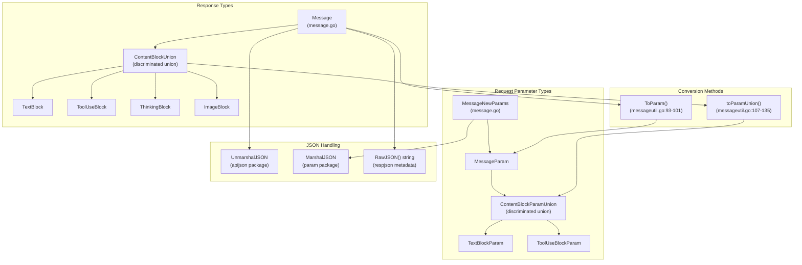

The SDK maintains a strict separation between **response types** (used for API responses) and **request parameter types** (used for API requests). Response types include metadata fields for JSON tracking and provide `ToParam()` conversion methods. Parameter types use the `param.Field` system for optional field handling and support zero-value elision.

**Sources:** [message.go:1-100](), [messageutil.go:91-226]()

## Request Execution Flow

The request execution pipeline transforms high-level API calls into HTTP requests and responses through a series of well-defined stages.

### End-to-End Request Pipeline

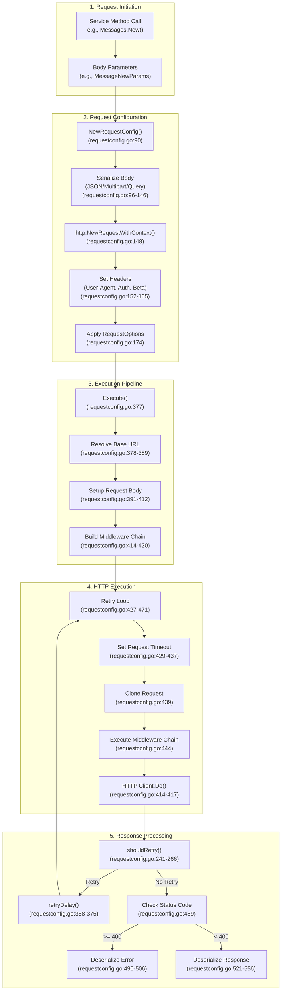

Each request flows through this pipeline, with options applied at multiple stages. The retry loop ([requestconfig.go:427-471]()) handles transient failures, and the middleware chain ([requestconfig.go:418-420]()) enables request/response transformation.

**Sources:** [internal/requestconfig/requestconfig.go:90-558](), [message.go:55-69]()

### Middleware Chain Architecture

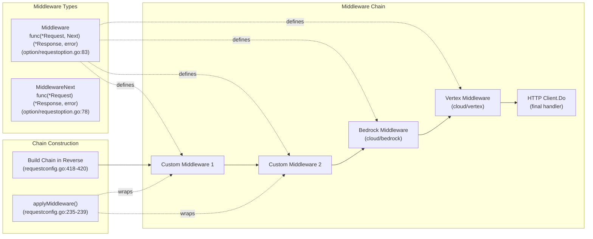

Middleware functions are applied in reverse order during chain construction ([requestconfig.go:418-420]()), so the first middleware registered executes first. This enables request transformation (e.g., for AWS Bedrock or Google Vertex AI) before the HTTP request is sent. Each middleware can inspect, modify, or short-circuit the request/response cycle.

**Sources:** [internal/requestconfig/requestconfig.go:229-239](), [option/requestoption.go:76-92]()

## Code Organization

### File Structure and Responsibilities

The SDK follows a layered architecture with clear separation of concerns:

| Directory/File | Purpose |
|----------------|---------|
| `client.go` | Top-level client initialization and service aggregation |
| `message.go`, `completion.go`, `model.go` | Service implementations for each API domain |
| `betamessage.go`, `betabatch.go`, etc. | Beta feature implementations |
| `messageutil.go`, `betamessageutil.go` | Type conversion utilities (response → request params) |
| `internal/requestconfig/` | Core request execution and configuration logic |
| `internal/apierror/` | Error type definitions and deserialization |
| `internal/apijson/` | JSON unmarshaling with metadata tracking |
| `option/` | Public API for request configuration options |
| `packages/param/` | Parameter encoding and optional field handling |
| `packages/pagination/` | Generic pagination support |
| `packages/ssestream/` | Server-sent events streaming |
| `shared/` | Shared types used across multiple services |
| `cloud/bedrock/`, `cloud/vertex/` | Cloud platform integration middleware |

**Sources:** [client.go:1-158](), [message.go:1-100]()

### Service Pattern Implementation

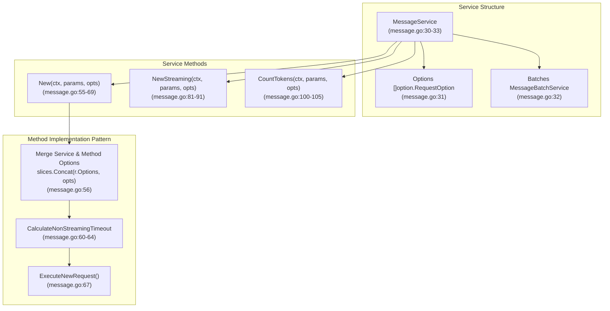

Each service struct ([message.go:30-33]()) holds a slice of `RequestOption` values inherited from the parent client. Service methods merge these with method-specific options using `slices.Concat()` ([message.go:56]()), ensuring that options cascade properly: client → service → method. This pattern is consistent across all services.

**Sources:** [message.go:24-105](), [client.go:50-61]()

### Type Conversion Architecture

The SDK provides bidirectional conversion between response types and request parameter types through a consistent pattern:

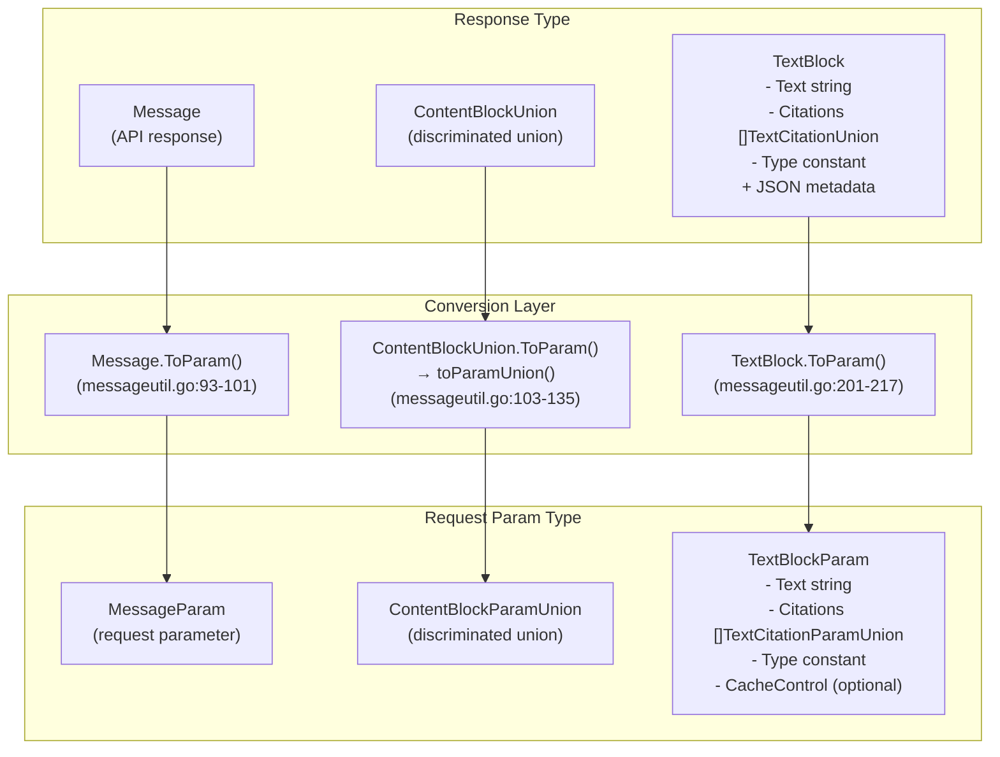

The `ToParam()` methods ([messageutil.go:93-217]()) enable users to easily reuse API responses in subsequent requests, such as in multi-turn conversations. The conversion preserves semantic meaning while transforming from response-oriented types (with JSON metadata) to request-oriented types (with optional field handling).

**Sources:** [messageutil.go:91-226](), [betamessageutil.go:1-460]()

## Design Patterns

### Discriminated Union Pattern

The SDK extensively uses discriminated unions to represent polymorphic types in a type-safe manner:

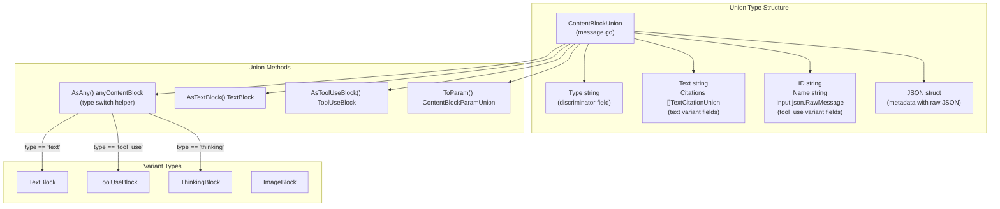

Union types contain all fields from all variants in a flattened structure. The `Type` field acts as the discriminator. The `AsAny()` method uses type switching to safely cast to the correct variant type, returning `nil` for invalid types. This pattern is used throughout: `ContentBlockUnion`, `ToolChoiceUnion`, `MessageStreamEventUnion`, etc.

**Sources:** [message.go:1000-1500]() (ContentBlockUnion definition)

### Optional Field Handling

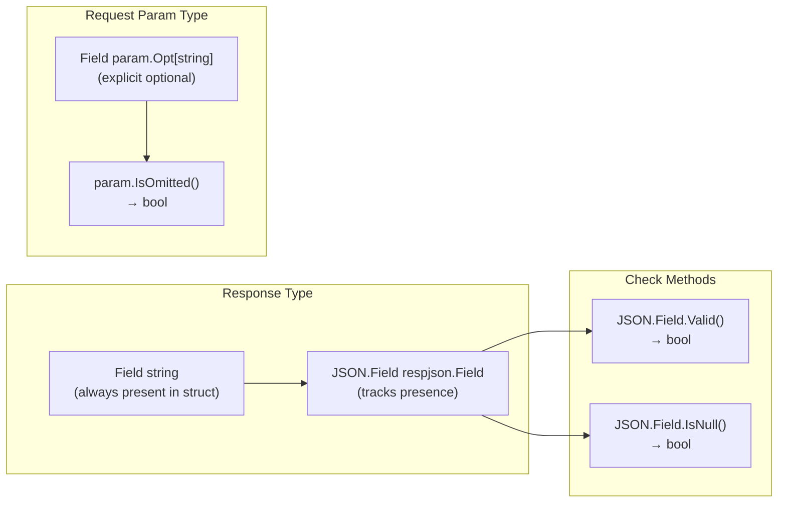

Response types use the `respjson.Field` metadata pattern ([internal/apijson/subfield.go:1-68]()) to track whether a field was present in the API response, enabling distinction between absent, null, and zero-value fields. Request parameter types use `param.Opt[T]` and `param.Field[T]` types to control whether fields are included in the serialized JSON, supporting zero-value elision.

**Sources:** [internal/apijson/subfield.go:1-68](), [messageutil.go:155-199]()

### Streaming Accumulation Pattern

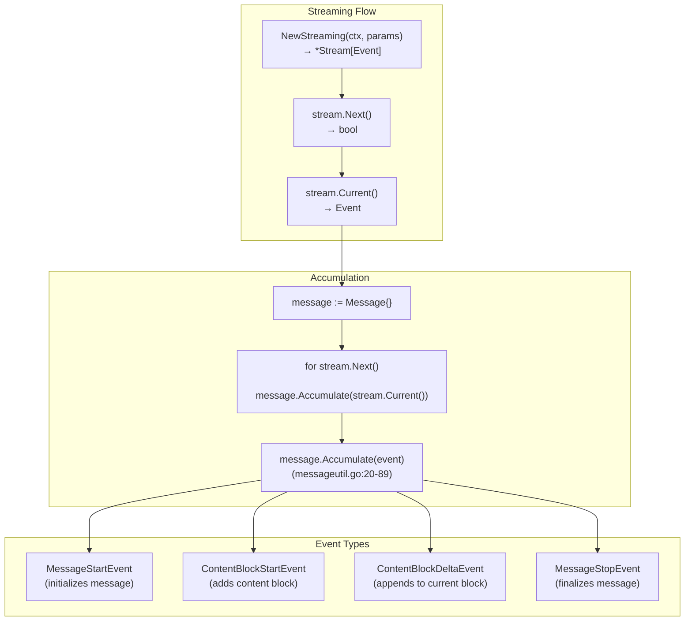

The `Accumulate()` method ([messageutil.go:20-89]()) enables incremental construction of a complete `Message` from streaming events. It handles event-specific logic: `MessageStartEvent` initializes the message, `ContentBlockStartEvent` appends new blocks, `ContentBlockDeltaEvent` updates the current block, and `MessageStopEvent` finalizes JSON metadata. This pattern provides a simple API for consuming streams while maintaining full type safety.

**Sources:** [messageutil.go:20-89](), [betamessageutil.go:20-93](), [message.go:81-91]()

## Extensibility Points

The SDK provides several well-defined extension mechanisms for advanced use cases:

### Custom Middleware

Middleware can be injected using `option.WithMiddleware()` ([option/requestoption.go:87-92]()):

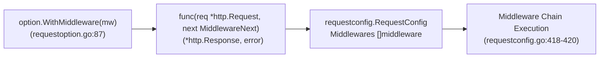

Middleware functions receive the request and a `next` function. They can:
- Inspect or modify the request before calling `next(req)`
- Inspect or modify the response after calling `next(req)`
- Short-circuit execution by not calling `next` and returning directly
- Implement cross-cutting concerns like logging, metrics, or platform-specific transformations (AWS Bedrock, Google Vertex AI)

**Sources:** [option/requestoption.go:76-92](), [internal/requestconfig/requestconfig.go:229-239]()

### Custom HTTP Clients

The SDK accepts custom HTTP clients via `option.WithHTTPClient()` ([option/requestoption.go:58-74]()):

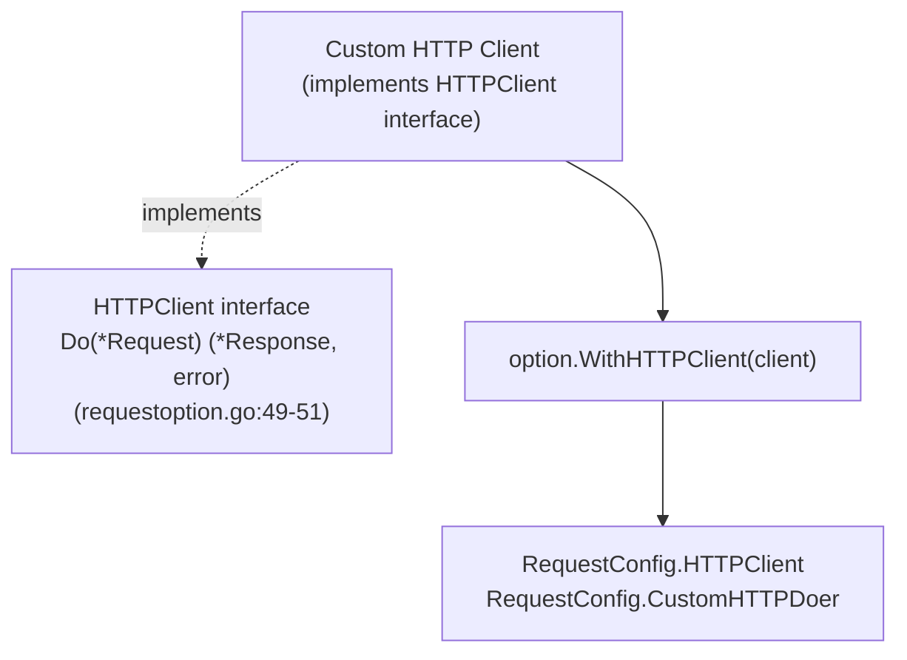

This enables:
- Custom connection pooling or TLS configuration via `http.Transport`
- Request/response logging through custom `http.RoundTripper`
- Circuit breaker patterns
- Custom authentication flows

**Sources:** [option/requestoption.go:44-74](), [internal/requestconfig/requestconfig.go:195-197,413-417]()

### Request-Level Configuration

All service methods accept variadic `option.RequestOption` parameters, enabling per-request customization:

| Option Function | Purpose | Source |
|-----------------|---------|--------|
| `WithHeader(key, value)` | Set request headers | [option/requestoption.go:111-116]() |
| `WithQuery(key, value)` | Add query parameters | [option/requestoption.go:137-144]() |
| `WithJSONSet(key, value)` | Modify request body JSON | [option/requestoption.go:171-193]() |
| `WithRequestTimeout(duration)` | Set per-request timeout | [option/requestoption.go:255-262]() |
| `WithMaxRetries(count)` | Override retry count | [option/requestoption.go:99-107]() |
| `WithBaseURL(url)` | Override base URL | [option/requestoption.go:28-42]() |

**Sources:** [option/requestoption.go:1-286]()

### Pagination Interface

The pagination system ([packages/pagination/pagination.go:1-351]()) is generic and extensible:

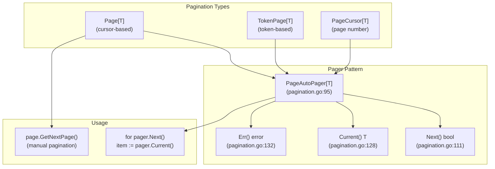

Each page type implements `GetNextPage()` to fetch the next page, and the auto-pager wraps this for iterator-style access. New pagination styles can be added by implementing the same interface pattern.

**Sources:** [packages/pagination/pagination.go:1-351]()

---

This architecture enables the SDK to be both simple for common use cases (through high-level service methods) and flexible for advanced scenarios (through middleware, custom clients, and per-request options). The strict separation between response and request types, combined with the discriminated union pattern, provides type safety while maintaining compatibility with the Anthropic API's polymorphic response structures.

---

