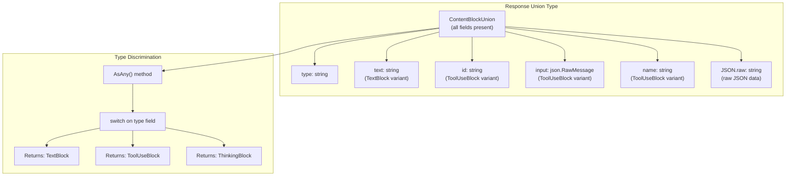
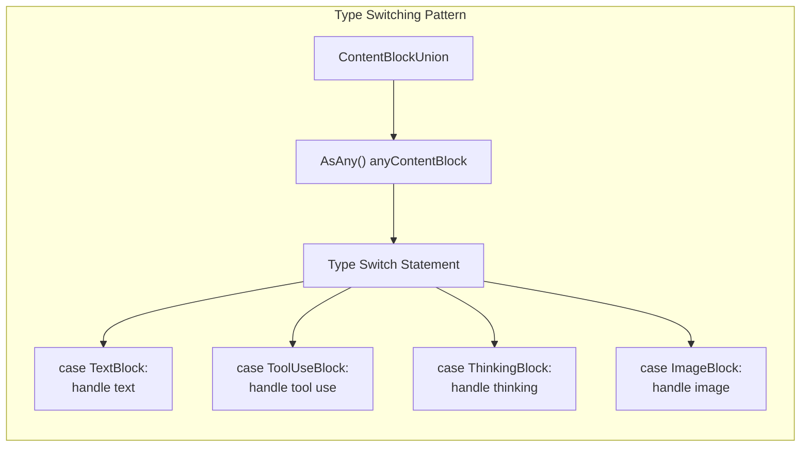
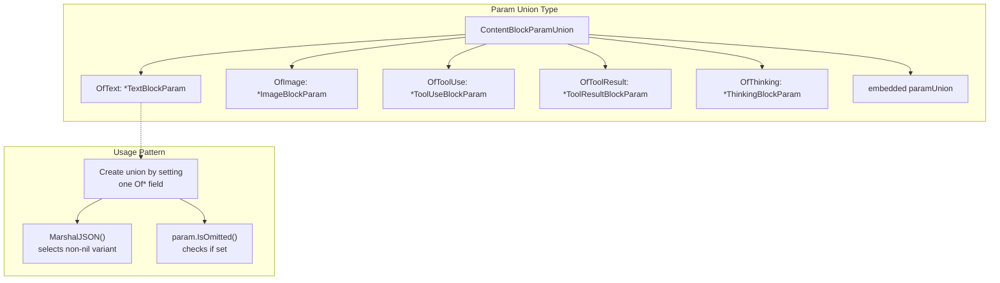
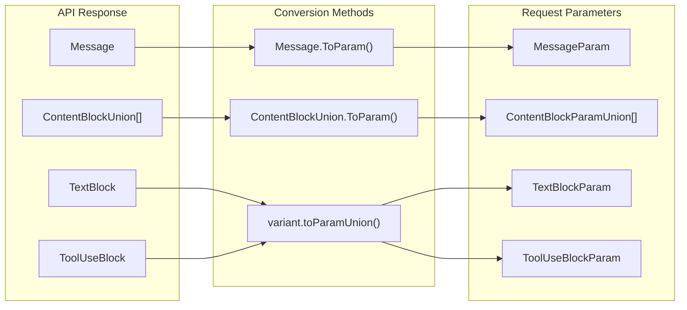
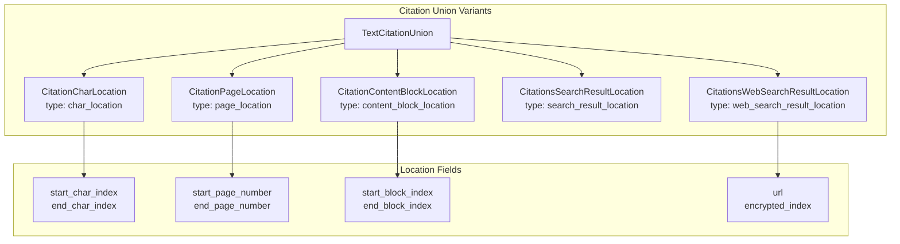
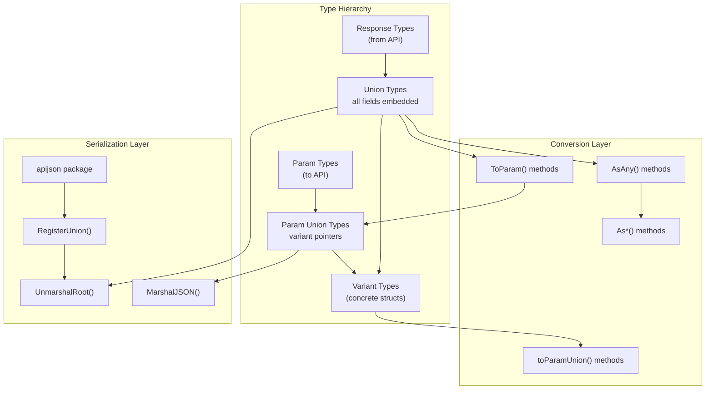

<!-- source: DeepWiki mcp.deepwiki.com · repo anthropics/anthropic-sdk-go · page 9.1 Type System and Unions · fetched 2026-10-26 -->

# Type System and Unions

<details>
<summary>Relevant source files</summary>

The following files were used as context for generating this wiki page:

- [aliases.go](aliases.go)
- [betamessage.go](betamessage.go)
- [betamessageutil.go](betamessageutil.go)
- [message.go](message.go)
- [messageutil.go](messageutil.go)

</details>


This document explains the discriminated union pattern used throughout the Anthropic Go SDK to represent polymorphic API types. The SDK uses a sophisticated type system that provides compile-time type safety while handling heterogeneous data structures like content blocks, tool results, and citations.

For information about how these unions are used in the Messages API, see [Messages Service](#4.1). For details on streaming and union accumulation patterns, see [Streaming Messages](#4.3).

## Purpose and Scope

The type system in this SDK serves several critical functions:

1. **Type Safety**: Provides compile-time guarantees when working with polymorphic API responses
2. **Polymorphism**: Represents heterogeneous collections (e.g., a message containing text, images, and tool use blocks)
3. **Bidirectional Conversion**: Supports converting API responses back into request parameters
4. **JSON Fidelity**: Preserves raw JSON for debugging and re-marshaling

## Discriminated Union Pattern

The SDK implements discriminated unions using a pattern where all possible variant fields are embedded in a single struct, with a `type` field acting as the discriminator.

### Response Union Structure



**Sources:** [message.go:1-100](), [message.go:3000-3200]()

### Example: ContentBlockUnion

The `ContentBlockUnion` type in [message.go:3001-3158]() demonstrates the pattern:

```go
type ContentBlockUnion struct {
    // Common to all variants
    Type string `json:"type"`
    
    // TextBlock variant fields
    Text      string                `json:"text"`
    Citations []TextCitationUnion   `json:"citations"`
    
    // ToolUseBlock variant fields
    ID    string             `json:"id"`
    Name  string             `json:"name"`
    Input json.RawMessage    `json:"input"`
    
    // ThinkingBlock variant fields
    Thinking  string `json:"thinking"`
    Signature string `json:"signature"`
    
    // ... other variant fields
    
    JSON struct {
        // Field metadata for presence checking
        raw string
    } `json:"-"`
}
```

All variant fields are present in the struct, but only those relevant to the actual `type` contain meaningful data.

**Sources:** [message.go:3001-3158]()

## Type Switching with AsAny()

The `AsAny()` method provides type-safe access to union variants:



The `AsAny()` method returns an interface implemented only by valid variants, ensuring type safety:

```go
func (u ContentBlockUnion) AsAny() anyContentBlock {
    switch u.Type {
    case "text":
        return u.AsText()
    case "tool_use":
        return u.AsToolUse()
    case "thinking":
        return u.AsThinking()
    // ... other cases
    }
    return nil
}
```

Usage example from [message.go:3001-3158]():

```go
switch variant := contentBlock.AsAny().(type) {
case TextBlock:
    fmt.Println(variant.Text)
case ToolUseBlock:
    fmt.Println(variant.ID, variant.Name)
case ThinkingBlock:
    fmt.Println(variant.Thinking)
default:
    fmt.Println("unknown variant")
}
```

**Sources:** [message.go:3001-3158]()

## Request/Param Union Pattern

Request (Param) unions use a different structure optimized for construction rather than deconstruction. Instead of embedding all fields, they use variant pointers.

### Param Union Structure



Example from [message.go:3339-3390]():

```go
type ContentBlockParamUnion struct {
    OfText          *TextBlockParam          `json:",omitzero,inline"`
    OfImage         *ImageBlockParam         `json:",omitzero,inline"`
    OfDocument      *DocumentBlockParam      `json:",omitzero,inline"`
    OfToolUse       *ToolUseBlockParam       `json:",omitzero,inline"`
    OfToolResult    *ToolResultBlockParam    `json:",omitzero,inline"`
    // ... other variants
    paramUnion
}
```

Only one `Of*` field should be non-nil at a time. The `MarshalJSON` method selects the non-nil variant for serialization.

**Sources:** [message.go:3339-3390](), [message.go:3391-3450]()

## Discriminator Registration

The SDK registers type discriminators using the `apijson` package to enable correct unmarshaling:

```go
func init() {
    apijson.RegisterUnion[ContentBlockParamUnion](
        "type",  // discriminator field name
        apijson.Discriminator[TextBlockParam]("text"),
        apijson.Discriminator[ImageBlockParam]("image"),
        apijson.Discriminator[DocumentBlockParam]("document"),
        apijson.Discriminator[ToolUseBlockParam]("tool_use"),
        apijson.Discriminator[ToolResultBlockParam]("tool_result"),
        // ... other variants
    )
}
```

This registration occurs in [message.go:3451-3500](), [betamessage.go:283-407]() and enables the SDK to automatically unmarshal JSON with the correct variant based on the `type` field.

**Sources:** [message.go:3451-3500](), [betamessage.go:283-407]()

## Type Conversion System

The SDK provides bidirectional conversion between response types and param types, enabling workflows where API responses are modified and sent back as requests.

### Conversion Flow



### ToParam() Methods

The `ToParam()` method converts response types to param types:

From [messageutil.go:93-101]():

```go
func (r Message) ToParam() MessageParam {
    var p MessageParam
    p.Role = MessageParamRole(r.Role)
    p.Content = make([]ContentBlockParamUnion, len(r.Content))
    for i, c := range r.Content {
        p.Content[i] = c.ToParam()
    }
    return p
}
```

For unions, the conversion delegates to variant-specific implementations. From [messageutil.go:103-105]():

```go
func (r ContentBlockUnion) ToParam() ContentBlockParamUnion {
    return r.AsAny().toParamUnion()
}
```

Each variant implements `toParamUnion()` to construct the appropriate param union. From [messageutil.go:107-115]():

```go
func (variant TextBlock) toParamUnion() ContentBlockParamUnion {
    p := variant.ToParam()
    return ContentBlockParamUnion{OfText: &p}
}

func (variant ToolUseBlock) toParamUnion() ContentBlockParamUnion {
    p := variant.ToParam()
    return ContentBlockParamUnion{OfToolUse: &p}
}
```

**Sources:** [messageutil.go:93-414]()

## Common Union Types

### ContentBlockUnion and ContentBlockParamUnion

The most frequently used union represents message content. It supports 18+ variant types:

| Variant Type | Response Type | Param Type | Type Constant |
|--------------|---------------|------------|---------------|
| Text | `TextBlock` | `TextBlockParam` | `"text"` |
| Image | `ImageBlock` | `ImageBlockParam` | `"image"` |
| Document | `DocumentBlock` | `DocumentBlockParam` | `"document"` |
| Tool Use | `ToolUseBlock` | `ToolUseBlockParam` | `"tool_use"` |
| Tool Result | `ToolResultBlock` | `ToolResultBlockParam` | `"tool_result"` |
| Thinking | `ThinkingBlock` | `ThinkingBlockParam` | `"thinking"` |
| Redacted Thinking | `RedactedThinkingBlock` | `RedactedThinkingBlockParam` | `"redacted_thinking"` |
| Server Tool Use | `ServerToolUseBlock` | `ServerToolUseBlockParam` | `"server_tool_use"` |

**Sources:** [message.go:3001-3158](), [message.go:3339-3500]()

### TextCitationUnion and TextCitationParamUnion

Represents different location strategies for citations:



Each citation variant includes common fields (`cited_text`, `document_title`) plus variant-specific location information.

**Sources:** [message.go:536-932](), [message.go:774-899]()

### ToolChoiceUnion and ToolChoiceUnionParam

Controls how the model selects tools:

| Variant | Type Value | Behavior |
|---------|------------|----------|
| Auto | `"auto"` | Model decides whether to use tools |
| Any | `"any"` | Model must use at least one tool |
| Tool | `"tool"` | Model must use a specific named tool |
| None | `"none"` | Model cannot use tools |

From [message.go:11000-11200]():

```go
type ToolChoiceUnionParam struct {
    OfAuto *ToolChoiceAutoParam `json:",omitzero,inline"`
    OfAny  *ToolChoiceAnyParam  `json:",omitzero,inline"`
    OfTool *ToolChoiceToolParam `json:",omitzero,inline"`
    OfNone *ToolChoiceNoneParam `json:",omitzero,inline"`
    paramUnion
}
```

**Sources:** [message.go:11000-11200]()

## Advanced Patterns

### Nested Unions

Some unions contain other unions as fields. For example, `BashCodeExecutionToolResultBlockContentUnion` can be either an error or a result block:

From [message.go:280-323]():

```go
type BashCodeExecutionToolResultBlockContentUnion struct {
    // Error variant
    ErrorCode BashCodeExecutionToolResultErrorCode `json:"error_code"`
    Type      string                               `json:"type"`
    
    // Result variant
    Content    []BashCodeExecutionOutputBlock `json:"content"`
    ReturnCode int64                          `json:"return_code"`
    Stderr     string                         `json:"stderr"`
    Stdout     string                         `json:"stdout"`
    
    JSON struct {
        // ... field metadata
        raw string
    } `json:"-"`
}
```

This pattern is used for tool results that can succeed or fail.

**Sources:** [message.go:280-323](), [message.go:345-418]()

### GetX() Methods for Param Unions

Param unions provide `GetX()` methods to safely access fields across variants:

From [message.go:370-418]():

```go
// Returns a pointer to the underlying variant's property, if present.
func (u BashCodeExecutionToolResultBlockParamContentUnion) GetErrorCode() *string {
    if vt := u.OfRequestBashCodeExecutionToolResultError; vt != nil {
        return (*string)(&vt.ErrorCode)
    }
    return nil
}

func (u BashCodeExecutionToolResultBlockParamContentUnion) GetReturnCode() *int64 {
    if vt := u.OfRequestBashCodeExecutionResultBlock; vt != nil {
        return &vt.ReturnCode
    }
    return nil
}
```

These methods return `nil` if the field doesn't exist in the current variant, enabling safe field access without type switching.

**Sources:** [message.go:370-418]()

### RawJSON() Preservation

All response types include a `JSON.raw` field that preserves the original JSON from the API:

```go
type TextBlock struct {
    Text      string                `json:"text,required"`
    Citations []TextCitationUnion   `json:"citations,nullable"`
    Type      constant.Text         `json:"type,required"`
    
    JSON struct {
        Text        respjson.Field
        Citations   respjson.Field
        Type        respjson.Field
        ExtraFields map[string]respjson.Field
        raw         string
    } `json:"-"`
}

// Returns the unmodified JSON received from the API
func (r TextBlock) RawJSON() string { return r.JSON.raw }
```

This enables:
1. Debugging by inspecting exact API responses
2. Re-marshaling with `param.Override()` for fields not yet supported by the SDK
3. Field presence checking via `respjson.Field.Valid()`

**Sources:** [message.go:1700-1800]()

### param.Override() Pattern

For unsupported or complex fields, the SDK allows overriding with raw JSON:

From [messageutil.go:383-385]():

```go
p.Content = param.Override[TextEditorCodeExecutionToolResultBlockParamContentUnion](
    r.Content.RawJSON()
)
```

This converts a response directly to a param using the preserved raw JSON, bypassing explicit field mapping.

**Sources:** [messageutil.go:373-386]()

## Beta Union Variants

The beta API ([betamessage.go]()) includes additional union variants not in the stable API:

### BetaContentBlockUnion Extensions

| Variant | Type | Purpose |
|---------|------|---------|
| MCP Tool Use | `BetaMCPToolUseBlock` | Model Context Protocol tool invocation |
| MCP Tool Result | `BetaMCPToolResultBlock` | MCP tool execution results |
| Compaction | `BetaCompactionBlock` | Context compression markers |
| Container Upload | `BetaContainerUploadBlock` | File upload references |

### BetaContextManagementConfigEditUnion

Controls conversation history optimization:

```go
type BetaContextManagementConfigEditUnionParam struct {
    OfClearToolUses   *BetaClearToolUses20250919EditParam   `json:",omitzero,inline"`
    OfClearThinking   *BetaClearThinking20251015EditParam   `json:",omitzero,inline"`
    paramUnion
}
```

Registered at [betamessage.go:375-380]().

**Sources:** [betamessage.go:1-500](), [betamessage.go:375-380]()

## Type System Architecture



**Sources:** [message.go:1-100](), [messageutil.go:1-414](), [betamessageutil.go:1-460]()

## Type Safety Guarantees

The SDK provides several compile-time guarantees:

1. **Exhaustive Variant Handling**: The `anyX` interfaces ensure type switches handle all variants
2. **Single Variant Construction**: Param unions use struct tags to prevent multiple variants
3. **Field Presence**: `respjson.Field` metadata enables checking if optional fields were present
4. **Type Discrimination**: `apijson.RegisterUnion` ensures correct variant unmarshaling

### Interface-Based Variant Constraints

From [message.go:3110-3140]():

```go
// anyContentBlock is implemented by each variant of ContentBlockUnion
type anyContentBlock interface {
    implContentBlockUnion()
}

func (TextBlock) implContentBlockUnion()                {}
func (ImageBlock) implContentBlockUnion()               {}
func (ToolUseBlock) implContentBlockUnion()             {}
func (ThinkingBlock) implContentBlockUnion()            {}
// ... all variants implement this
```

This interface serves as documentation and ensures `AsAny()` returns only valid variant types.

**Sources:** [message.go:3110-3140]()

## Summary

The Anthropic Go SDK's type system implements discriminated unions through:

1. **Response Unions**: All-fields-embedded structs with type discrimination
2. **Param Unions**: Variant-pointer structs for request construction  
3. **Type Safety**: Interface constraints and compile-time guarantees
4. **Bidirectional Conversion**: `ToParam()` methods for response-to-request workflows
5. **JSON Fidelity**: Raw JSON preservation and `param.Override()` support
6. **Discriminator Registration**: `apijson` package integration for unmarshaling

This architecture balances Go's static typing with the dynamic nature of the Anthropic API, providing type safety without sacrificing flexibility.

**Sources:** [message.go:1-15000](), [betamessage.go:1-10000](), [messageutil.go:1-414](), [betamessageutil.go:1-460](), [aliases.go:1-73]()

---

