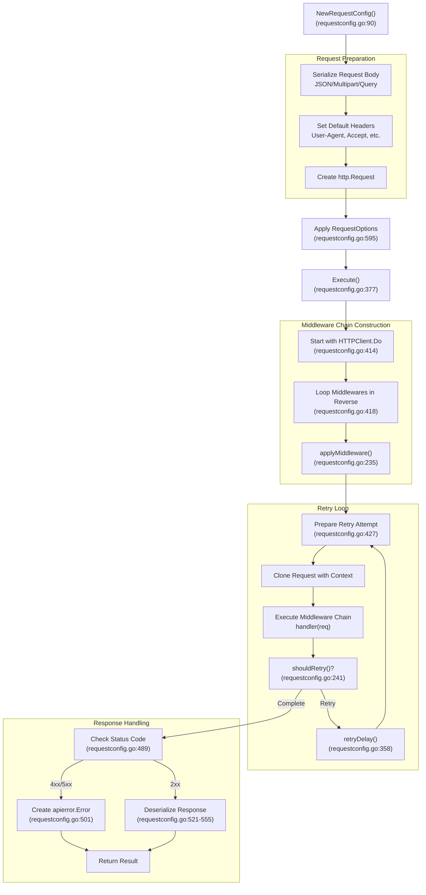
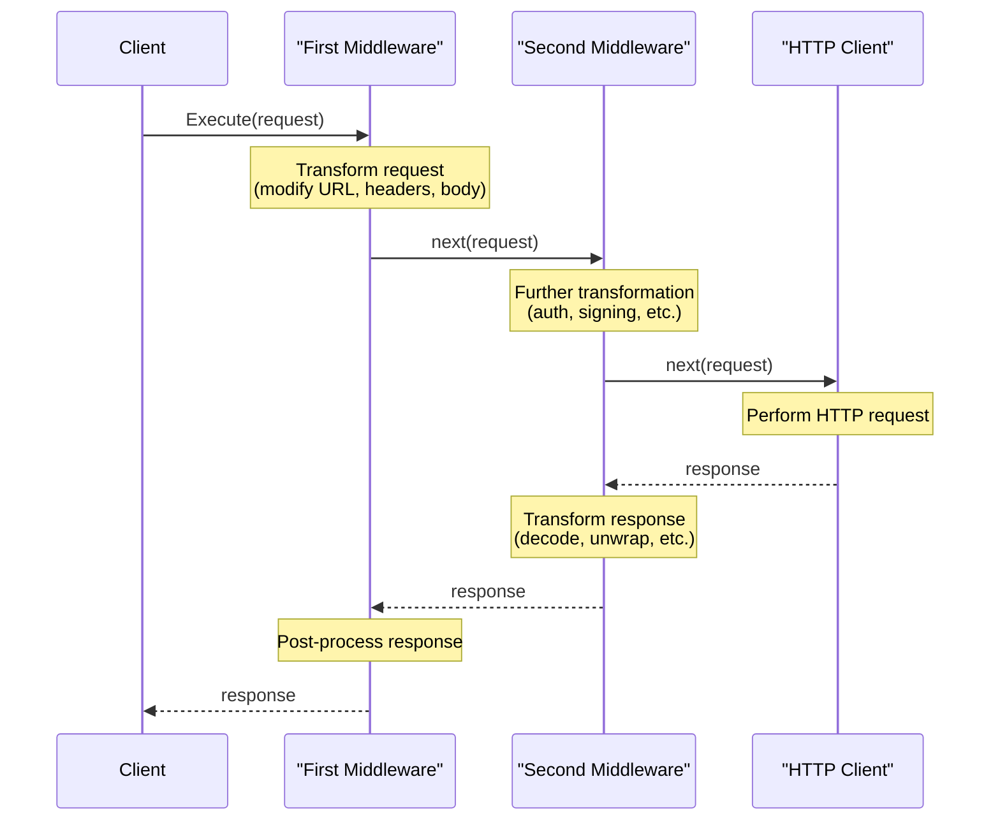

<!-- source: DeepWiki mcp.deepwiki.com · repo anthropics/anthropic-sdk-go · page 9.2 Middleware and Request Pipeline · fetched 2026-10-26 -->

# Middleware and Request Pipeline

<details>
<summary>Relevant source files</summary>

The following files were used as context for generating this wiki page:

- [bedrock/bedrock.go](bedrock/bedrock.go)
- [bedrock/bedrock_test.go](bedrock/bedrock_test.go)
- [client.go](client.go)
- [examples/bedrock-bearer-token/main.go](examples/bedrock-bearer-token/main.go)
- [internal/apierror/apierror.go](internal/apierror/apierror.go)
- [internal/apijson/subfield.go](internal/apijson/subfield.go)
- [internal/requestconfig/requestconfig.go](internal/requestconfig/requestconfig.go)
- [option/requestoption.go](option/requestoption.go)
- [packages/pagination/pagination.go](packages/pagination/pagination.go)
- [vertex/vertex.go](vertex/vertex.go)

</details>


## Purpose and Scope

This document explains the middleware system and request execution pipeline in the Anthropic Go SDK. It covers how requests are prepared, transformed through middleware chains, executed via HTTP, and how responses are processed. The middleware system enables platform-specific request transformations for AWS Bedrock and Google Vertex AI without changing the core API interface.

For information about retry logic and timeout handling within the pipeline, see [Retry and Timeout Logic](#9.3). For details about error handling after request execution, see [Error Handling](#3.4).

## Middleware Architecture

### Type Definitions

The SDK defines middleware as a function that intercepts HTTP requests, processes or modifies them, and passes them to the next stage in the chain. The middleware system uses two key type definitions:

```go
type Middleware = func(*http.Request, MiddlewareNext) (*http.Response, error)
type MiddlewareNext = func(*http.Request) (*http.Response, error)
```

The `Middleware` type represents a function that receives an `*http.Request` and a `MiddlewareNext` function. It can:
- Inspect and modify the request
- Call `next` to continue the chain
- Modify or replace the response
- Short-circuit the chain by returning without calling `next`

The `MiddlewareNext` type represents the continuation of the middleware chain. Each middleware receives this function to pass control to the next stage.

Sources: [option/requestoption.go:78-83]()

### Middleware Storage and Configuration

Middleware functions are stored in the `RequestConfig` struct as a slice that forms the execution chain:

```go
type RequestConfig struct {
    MaxRetries     int
    RequestTimeout time.Duration
    HTTPClient     *http.Client
    Middlewares    []middleware
    // ... other fields
}
```

Middleware is added to a request configuration using the `WithMiddleware` option:

```go
func WithMiddleware(middlewares ...Middleware) RequestOption {
    return requestconfig.RequestOptionFunc(func(r *requestconfig.RequestConfig) error {
        r.Middlewares = append(r.Middlewares, middlewares...)
        return nil
    })
}
```

This allows middleware to be specified at multiple levels: client-level (applied to all requests) or request-level (applied to specific requests).

Sources: [internal/requestconfig/requestconfig.go:203-225](), [option/requestoption.go:85-92]()

### Middleware Chain Construction

The middleware chain is built in reverse order during request execution. The `applyMiddleware` function wraps each middleware around the next handler:

```go
func applyMiddleware(middleware middleware, next middlewareNext) middlewareNext {
    return func(req *http.Request) (res *http.Response, err error) {
        return middleware(req, next)
    }
}
```

In the `Execute` method, middleware are applied from last to first, creating a nested chain where the first middleware in the slice is the outermost layer:

```go
handler := cfg.HTTPClient.Do
if cfg.CustomHTTPDoer != nil {
    handler = cfg.CustomHTTPDoer.Do
}
for i := len(cfg.Middlewares) - 1; i >= 0; i -= 1 {
    handler = applyMiddleware(cfg.Middlewares[i], handler)
}
```

Sources: [internal/requestconfig/requestconfig.go:235-239](), [internal/requestconfig/requestconfig.go:414-420]()

## Request Execution Pipeline

### Pipeline Overview

The following diagram shows the complete request execution flow from configuration through middleware to HTTP execution:



Sources: [internal/requestconfig/requestconfig.go:90-191](), [internal/requestconfig/requestconfig.go:377-558]()

### Request Preparation Phase

Request preparation begins in `NewRequestConfig`, which handles body serialization based on the type of the `body` parameter:

1. **JSON Marshaling**: If the body implements `json.Marshaler`, it's serialized to JSON
2. **Multipart Forms**: If the body implements `apiform.Marshaler`, it's encoded as multipart form data
3. **Query Parameters**: If the body implements `apiquery.Queryer`, it's encoded as URL query parameters
4. **Raw Data**: If the body is `[]byte` or `io.Reader`, it's used directly
5. **Fallback**: Otherwise, standard JSON encoding is applied

The function also sets default headers including `User-Agent`, platform properties (`X-Stainless-*`), and the `anthropic-version` header:

```go
req.Header.Set("Accept", "application/json")
req.Header.Set("X-Stainless-Retry-Count", "0")
req.Header.Set("X-Stainless-Timeout", "0")
for k, v := range getDefaultHeaders() {
    req.Header.Add(k, v)
}
req.Header.Set("anthropic-version", "2023-06-01")
for k, v := range getPlatformProperties() {
    req.Header.Add(k, v)
}
```

Sources: [internal/requestconfig/requestconfig.go:90-191]()

### URL Construction

Before executing the middleware chain, the request URL is constructed by combining the base URL with the request path:

```go
cfg.Request.URL, err = cfg.BaseURL.Parse(strings.TrimLeft(cfg.Request.URL.String(), "/"))
```

This ensures that the base URL (which may be modified by middleware like Bedrock or Vertex) is properly combined with the API endpoint path.

Sources: [internal/requestconfig/requestconfig.go:386-389]()

### Request Body Preparation

The request body is prepared with special handling to support retry logic. The body is converted to a form that supports `GetBody`, which allows the request to be replayed on retries:

```go
switch body := cfg.Body.(type) {
case *bytes.Buffer:
    b := body.Bytes()
    cfg.Request.ContentLength = int64(body.Len())
    cfg.Request.GetBody = func() (io.ReadCloser, error) { 
        return io.NopCloser(bytes.NewReader(b)), nil 
    }
    cfg.Request.Body, _ = cfg.Request.GetBody()
case *bytes.Reader:
    cfg.Request.ContentLength = int64(body.Len())
    cfg.Request.GetBody = func() (io.ReadCloser, error) {
        _, err := body.Seek(0, 0)
        return io.NopCloser(body), err
    }
    cfg.Request.Body, _ = cfg.Request.GetBody()
}
```

Sources: [internal/requestconfig/requestconfig.go:391-412]()

### Middleware Execution Flow

The following diagram shows the detailed flow through the middleware chain:



Sources: [internal/requestconfig/requestconfig.go:414-420]()

## Built-in Middleware Implementations

### AWS Bedrock Middleware

The Bedrock middleware transforms standard Anthropic API requests into AWS Bedrock format. The transformation includes:

#### URL Path Transformation

Standard message API paths are rewritten to include the model identifier:

```
/v1/messages → /model/{model}/invoke
/v1/messages (streaming) → /model/{model}/invoke-with-response-stream
```

The middleware extracts the `model` field from the request body and uses it to construct the Bedrock-specific path. For models identified by ARNs (which contain colons and slashes), the middleware properly URL-encodes the model identifier:

```go
r.URL.Path = fmt.Sprintf("/model/%s/%s", model, method)
r.URL.RawPath = fmt.Sprintf("/model/%s/%s", url.QueryEscape(model), method)
```

Sources: [bedrock/bedrock.go:243-259]()

#### Body Transformation

The middleware modifies the request body to match Bedrock's requirements:

1. Injects `anthropic_version` if not present (defaults to `"bedrock-2023-05-31"`)
2. Moves `anthropic-beta` headers into the request body as an `anthropic_beta` field
3. Removes `model` and `stream` fields from the body (moved to URL path)

```go
if !gjson.GetBytes(body, "anthropic_version").Exists() {
    body, _ = sjson.SetBytes(body, "anthropic_version", DefaultVersion)
}

if betaHeader := r.Header.Values("anthropic-beta"); len(betaHeader) > 0 {
    r.Header.Del("anthropic-beta")
    body, err = sjson.SetBytes(body, "anthropic_beta", betaHeader)
}

body, _ = sjson.DeleteBytes(body, "model")
body, _ = sjson.DeleteBytes(body, "stream")
```

Sources: [bedrock/bedrock.go:230-248]()

#### Authentication

The Bedrock middleware supports two authentication methods:

1. **Bearer Token Authentication**: If `cfg.BearerAuthTokenProvider` is set or `AWS_BEARER_TOKEN_BEDROCK` environment variable is present, uses bearer token:
   ```go
   token, err := cfg.BearerAuthTokenProvider.RetrieveBearerToken(r.Context())
   r.Header.Set("Authorization", "Bearer "+token.Value)
   ```

2. **AWS SigV4 Signing**: Otherwise, uses AWS credentials with SigV4 signing:
   ```go
   credentials, err := cfg.Credentials.Retrieve(ctx)
   hash := sha256.Sum256(body)
   err = signer.SignHTTP(ctx, credentials, r, hex.EncodeToString(hash[:]), 
                         "bedrock", cfg.Region, time.Now())
   ```

Sources: [bedrock/bedrock.go:271-289]()

#### Streaming Response Decoding

The Bedrock middleware registers a custom event stream decoder for handling the `application/vnd.amazon.eventstream` content type. This decoder:

1. Decodes AWS EventStream format messages
2. Extracts base64-encoded chunks from event payloads
3. Converts them to SSE events for consistency with the standard API
4. Handles exception and error events

```go
func init() {
    ssestream.RegisterDecoder("application/vnd.amazon.eventstream", 
        func(rc io.ReadCloser) ssestream.Decoder {
            return &eventstreamDecoder{rc: rc}
        })
}
```

Sources: [bedrock/bedrock.go:46-175]()

### Google Vertex AI Middleware

The Vertex middleware transforms requests for Google's Vertex AI platform:

#### URL Path Transformation

The middleware rewrites message API paths to include project and region information:

```
/v1/messages → /v1/projects/{projectID}/locations/{region}/publishers/anthropic/models/{model}:rawPredict
/v1/messages (streaming) → .../models/{model}:streamRawPredict
/v1/messages/count_tokens → .../models/count-tokens:rawPredict
```

The transformation logic:

```go
if r.URL.Path == "/v1/messages" && r.Method == http.MethodPost {
    specifier := "rawPredict"
    if stream {
        specifier = "streamRawPredict"
    }
    r.URL.Path = fmt.Sprintf("/v1/projects/%s/locations/%s/publishers/anthropic/models/%s:%s", 
                            projectID, region, model, specifier)
}
```

Sources: [vertex/vertex.go:77-93]()

#### Body Transformation

The Vertex middleware:

1. Injects `anthropic_version` if not present (defaults to `"vertex-2023-10-16"`)
2. Removes the `model` field from the body (moved to URL path)
3. Leaves the `stream` field intact (not used in URL for Vertex)

```go
if !gjson.GetBytes(body, "anthropic_version").Exists() {
    body, _ = sjson.SetBytes(body, "anthropic_version", DefaultVersion)
}

body, _ = sjson.DeleteBytes(body, "model")
```

Sources: [vertex/vertex.go:73-85]()

#### Authentication

The Vertex middleware uses Google OAuth2 for authentication. Authentication is configured at the HTTP client level rather than in the middleware itself:

```go
client, _, err := transport.NewHTTPClient(ctx, 
    option.WithTokenSource(creds.TokenSource))
```

The authenticated HTTP client is then passed to the SDK via `WithHTTPClient`. This approach leverages Google's standard authentication libraries.

Sources: [vertex/vertex.go:42-46]()

#### Base URL Selection

The Vertex middleware sets different base URLs based on the region:

```go
var baseURL string
if region == "global" {
    baseURL = "https://aiplatform.googleapis.com/"
} else {
    baseURL = fmt.Sprintf("https://%s-aiplatform.googleapis.com/", region)
}
```

Sources: [vertex/vertex.go:48-53]()

## Creating Custom Middleware

### Middleware Signature

Custom middleware must match the `Middleware` function signature:

```go
func(r *http.Request, next option.MiddlewareNext) (*http.Response, error)
```

A middleware receives:
- `r *http.Request`: The HTTP request to process
- `next option.MiddlewareNext`: Function to call the next middleware or HTTP client

It must return:
- `*http.Response`: The response from downstream handlers
- `error`: Any error that occurred

### Middleware Pattern

The typical middleware pattern follows this structure:

1. **Pre-processing**: Inspect and modify the request
2. **Delegation**: Call `next(r)` to continue the chain
3. **Post-processing**: Inspect and modify the response
4. **Error handling**: Handle errors from downstream

Example structure:

```go
func myMiddleware(r *http.Request, next option.MiddlewareNext) (*http.Response, error) {
    // 1. Pre-processing: modify request
    // Read and modify body, headers, URL, etc.
    
    // 2. Delegation: continue chain
    resp, err := next(r)
    if err != nil {
        // Handle errors from downstream
        return nil, err
    }
    
    // 3. Post-processing: modify response
    // Read and modify response body, headers, etc.
    
    return resp, nil
}
```

### Request Body Modification

When modifying the request body in middleware, ensure the body can be retried:

```go
func transformBodyMiddleware(r *http.Request, next option.MiddlewareNext) (*http.Response, error) {
    if r.Body != nil {
        body, err := io.ReadAll(r.Body)
        if err != nil {
            return nil, err
        }
        r.Body.Close()
        
        // Modify body...
        body = modifyBody(body)
        
        // Create new body with GetBody support for retries
        reader := bytes.NewReader(body)
        r.Body = io.NopCloser(reader)
        r.GetBody = func() (io.ReadCloser, error) {
            _, err := reader.Seek(0, 0)
            return io.NopCloser(reader), err
        }
        r.ContentLength = int64(len(body))
    }
    
    return next(r)
}
```

This pattern is used consistently in both Bedrock and Vertex middleware implementations.

Sources: [bedrock/bedrock.go:222-268](), [vertex/vertex.go:66-110]()

### Applying Custom Middleware

Custom middleware can be applied at different levels:

**Client Level (all requests)**:
```go
client := anthropic.NewClient(
    option.WithMiddleware(myMiddleware),
)
```

**Request Level (specific request)**:
```go
message, err := client.Messages.New(ctx, params, 
    option.WithMiddleware(myMiddleware),
)
```

Multiple middleware can be chained by calling `WithMiddleware` multiple times or passing multiple middleware to a single call:

```go
client := anthropic.NewClient(
    option.WithMiddleware(loggingMiddleware, authMiddleware),
)
```

Sources: [option/requestoption.go:85-92]()

## Response Processing Pipeline

### Status Code Handling

After the middleware chain completes, the response status code determines the processing path:

```go
if res.StatusCode >= 400 {
    contents, err := io.ReadAll(res.Body)
    res.Body.Close()
    
    // Re-populate response body for debugging
    res.Body = io.NopCloser(bytes.NewBuffer(contents))
    
    // Create structured error
    aerr := apierror.Error{
        Request:    cfg.Request, 
        Response:   res, 
        StatusCode: res.StatusCode,
        RequestID:  res.Header.Get("request-id"),
    }
    err = aerr.UnmarshalJSON(contents)
    return &aerr
}
```

For successful responses (2xx status codes), the body is deserialized into the destination type.

Sources: [internal/requestconfig/requestconfig.go:489-507]()

### Content Type Based Deserialization

The SDK deserializes responses differently based on content type:

1. **JSON Content**: If `Content-Type` contains `application/json` or ends with `+json`, standard JSON deserialization is used
2. **Non-JSON Content**: For other content types (text/plain, etc.), the body is copied as-is into `string` or `[]byte` destination types

```go
contentType := res.Header.Get("content-type")
mediaType, _, _ := mime.ParseMediaType(contentType)
isJSON := strings.Contains(mediaType, "application/json") || 
          strings.HasSuffix(mediaType, "+json")

if !isJSON {
    switch dst := cfg.ResponseBodyInto.(type) {
    case *string:
        *dst = string(contents)
    case *[]byte:
        *dst = contents
    }
}
```

Sources: [internal/requestconfig/requestconfig.go:527-543]()

### Timeout Context Handling

For requests that return `*http.Response` directly (like streaming), the response body is wrapped with a timeout cancellation handler:

```go
if cancel != nil {
    res.Body = &bodyWithTimeout{rc: res.Body, stop: cancel}
    cancel = nil
}
```

The `bodyWithTimeout` type ensures that context cancellation is triggered when the response body is closed:

```go
type bodyWithTimeout struct {
    stop func()
    rc   io.ReadCloser
}

func (b *bodyWithTimeout) Close() error {
    err := b.rc.Close()
    b.stop()
    return err
}
```

This ensures timeouts are properly enforced even when streaming responses.

Sources: [internal/requestconfig/requestconfig.go:334-356](), [internal/requestconfig/requestconfig.go:514-518]()

## Middleware Configuration Options

### Configuration Integration

The following table summarizes configuration options that interact with the middleware system:

| Option | Type | Purpose | Middleware Impact |
|--------|------|---------|-------------------|
| `WithBaseURL` | `string` | Sets base URL | Middleware can override (Bedrock, Vertex) |
| `WithHTTPClient` | `HTTPClient` | Custom HTTP client | Used as final handler in chain |
| `WithMiddleware` | `...Middleware` | Adds middleware | Appended to middleware slice |
| `WithAPIKey` | `string` | Sets API key | Added as header before middleware |
| `WithAuthToken` | `string` | Sets auth token | Added as header before middleware |
| `WithHeader` | `string, string` | Sets custom header | Available to middleware |
| `WithRequestBody` | `string, any` | Custom body | Middleware can modify |

Sources: [option/requestoption.go:25-285]()

### Middleware Execution Order

The execution order of middleware is critical. Given middleware added in this order:

```go
client := anthropic.NewClient(
    option.WithMiddleware(middleware1),
    option.WithMiddleware(middleware2),
    option.WithMiddleware(middleware3),
)
```

The execution order is:
1. `middleware1` (first added, outermost)
2. `middleware2`
3. `middleware3` (last added, innermost)
4. HTTP Client

This means `middleware1` processes the request first on the way in, and last on the way out.

Sources: [internal/requestconfig/requestconfig.go:418-420]()

## Platform Integration Summary

The following table compares how Bedrock and Vertex middleware transform requests:

| Aspect | Bedrock | Vertex |
|--------|---------|--------|
| **Base URL** | `https://bedrock-runtime.{region}.amazonaws.com` | `https://{region}-aiplatform.googleapis.com/` |
| **Path Transform** | `/v1/messages` → `/model/{model}/invoke` | `/v1/messages` → `/v1/projects/{project}/locations/{region}/publishers/anthropic/models/{model}:rawPredict` |
| **Model Location** | Moved from body to URL path | Moved from body to URL path |
| **Stream Indicator** | Removed from body, used in URL path | Kept in body (not used in path) |
| **Version Injection** | `bedrock-2023-05-31` | `vertex-2023-10-16` |
| **Beta Headers** | Moved from headers to body | Left in headers |
| **Authentication** | Bearer token or AWS SigV4 | Google OAuth2 (via HTTP client) |
| **Streaming Format** | AWS EventStream → SSE conversion | Standard SSE |

Sources: [bedrock/bedrock.go:220-293](), [vertex/vertex.go:64-114]()

---

