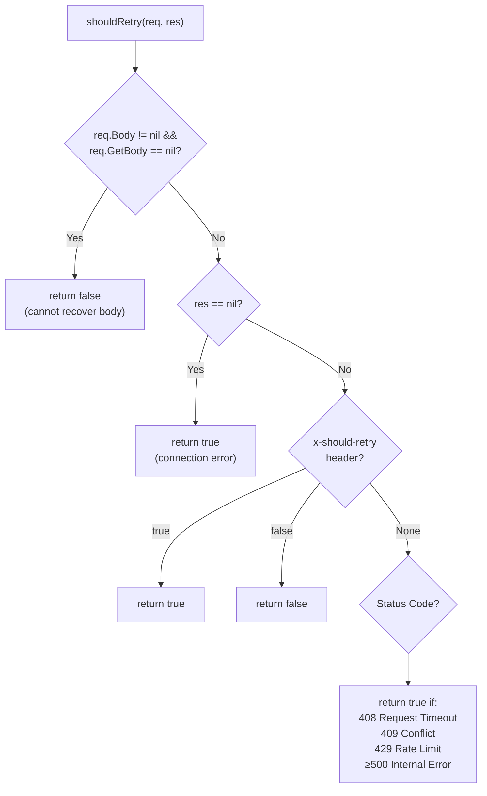
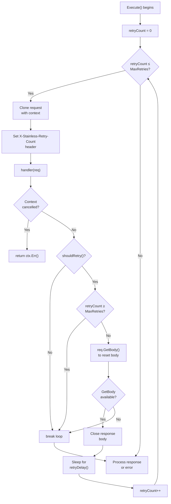
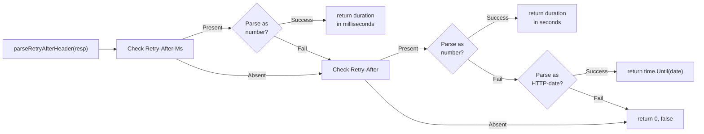
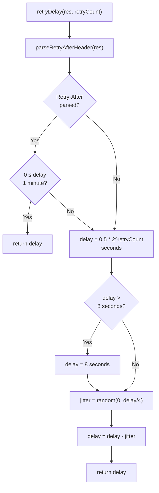
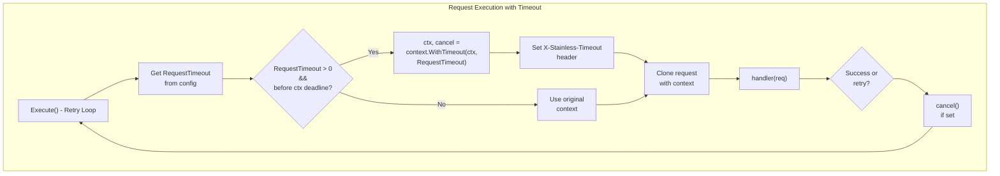
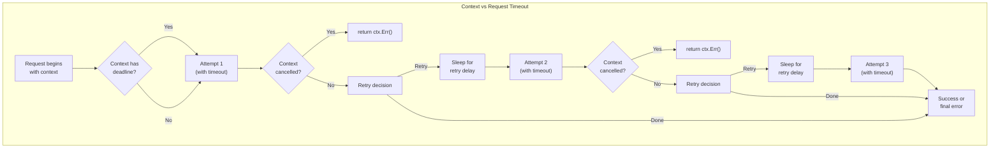
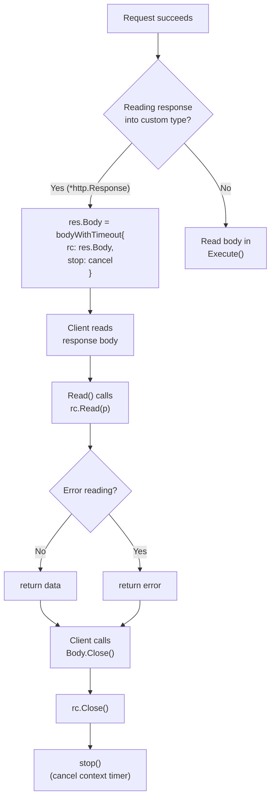
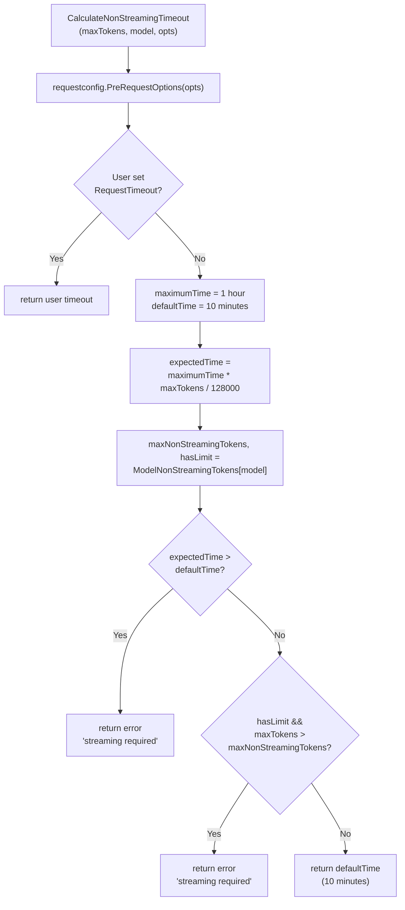
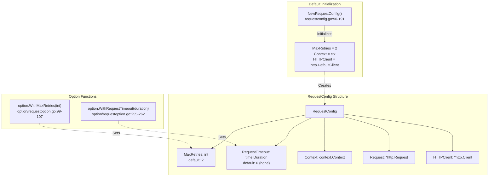
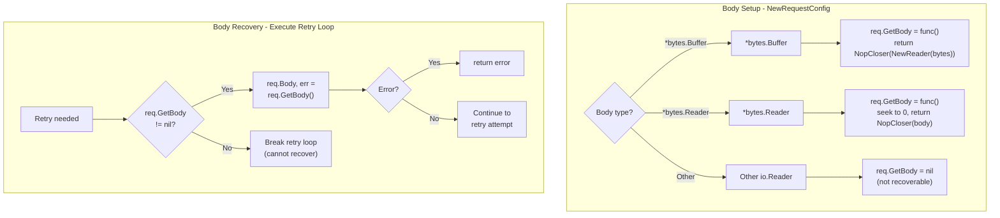

<!-- source: DeepWiki mcp.deepwiki.com · repo anthropics/anthropic-sdk-go · page 9.3 Retry and Timeout Logic · fetched 2026-10-26 -->

# Retry and Timeout Logic

<details>
<summary>Relevant source files</summary>

The following files were used as context for generating this wiki page:

- [.release-please-manifest.json](.release-please-manifest.json)
- [CHANGELOG.md](CHANGELOG.md)
- [README.md](README.md)
- [client.go](client.go)
- [client_test.go](client_test.go)
- [completion_test.go](completion_test.go)
- [internal/apierror/apierror.go](internal/apierror/apierror.go)
- [internal/apijson/subfield.go](internal/apijson/subfield.go)
- [internal/requestconfig/requestconfig.go](internal/requestconfig/requestconfig.go)
- [internal/version.go](internal/version.go)
- [option/requestoption.go](option/requestoption.go)
- [packages/pagination/pagination.go](packages/pagination/pagination.go)
- [usage_test.go](usage_test.go)

</details>


This document details the retry mechanism, exponential backoff algorithm, timeout calculation, and context cancellation handling in the SDK's request execution pipeline. These features ensure reliable API communication by automatically handling transient failures and preventing indefinitely hanging requests.

For information about the broader request execution pipeline and middleware chain, see [Middleware and Request Pipeline](#9.2). For error handling and error types, see [Error Handling](#3.4).

## Overview

The SDK implements automatic retry logic with exponential backoff and configurable timeout management at multiple levels:

- **Automatic retries**: Failed requests are retried up to 2 times by default for specific error types
- **Exponential backoff**: Delays between retries increase exponentially with jitter to avoid thundering herd
- **Retry-After support**: Respects server-provided retry delays via HTTP headers
- **Per-request timeout**: Individual request attempts can timeout independently
- **Context-aware**: Respects context deadlines and cancellation across all retry attempts
- **Body recovery**: Request bodies are preserved and reset between retry attempts

Sources: [internal/requestconfig/requestconfig.go:241-471](), [README.md:729-760]()

## Retry Decision Logic

### Retryable Conditions

The `shouldRetry` function determines whether a failed request should be retried based on several criteria:



**Retry Criteria**:

1. **Body Recovery Check**: If the request has a body but no `GetBody` function, retry is not possible [internal/requestconfig/requestconfig.go:242-245]()
2. **Connection Errors**: Null response indicates connection failure, always retry [internal/requestconfig/requestconfig.go:247-251]()
3. **Explicit Headers**: `x-should-retry` header overrides status-based logic [internal/requestconfig/requestconfig.go:253-260]()
4. **HTTP Status Codes**: Automatically retry on specific status codes [internal/requestconfig/requestconfig.go:262-265]():
   - `408` Request Timeout
   - `409` Conflict  
   - `429` Too Many Requests
   - `≥500` Server errors

Sources: [internal/requestconfig/requestconfig.go:241-266]()

### Retry Loop Implementation

The retry loop is implemented in the `Execute` method with these key behaviors:

| Aspect | Implementation |
|--------|----------------|
| **Retry Count** | 0 to `cfg.MaxRetries` (inclusive), default 2 |
| **Retry Header** | `X-Stainless-Retry-Count` sent with each attempt |
| **Body Reset** | `req.GetBody()` called to restore body before each retry |
| **Response Cleanup** | Previous response body closed before retry |
| **Delay** | Calculated by `retryDelay` function before next attempt |



Sources: [internal/requestconfig/requestconfig.go:427-471]()

## Retry-After Header Support

### Header Priority and Parsing

The SDK respects server-provided retry delays through two headers, checked in priority order:



**Header Specifications**:

| Header | Format | Units | Example |
|--------|--------|-------|---------|
| `Retry-After-Ms` | Numeric | Milliseconds | `100` = 100ms |
| `Retry-After` | Numeric or HTTP-date | Seconds or absolute time | `5` = 5 seconds<br/>`Thu, 01 Jan 2026 00:00:00 GMT` |

The `Retry-After` header supports RFC 1123 date format for absolute retry times, calculated as `time.Until(parsedDate)` [internal/requestconfig/requestconfig.go:297-303]().

Sources: [internal/requestconfig/requestconfig.go:268-321]()

## Exponential Backoff with Jitter

### Delay Calculation Algorithm

The `retryDelay` function implements exponential backoff with jitter when server-provided delays are not available or unreasonable:



**Algorithm Parameters**:

| Parameter | Value | Purpose |
|-----------|-------|---------|
| Base delay | 0.5 seconds | Starting point for exponential growth |
| Exponent base | 2 | Doubles delay each retry |
| Maximum delay | 8 seconds | Prevents excessive wait times |
| Jitter range | 0-25% | Randomizes delay to prevent thundering herd |

**Example Delay Sequence** (without jitter):

| Retry Attempt | Formula | Calculated Delay | Actual Delay |
|---------------|---------|------------------|--------------|
| 1st | 0.5 × 2^0 | 0.5s | 0.5s |
| 2nd | 0.5 × 2^1 | 1.0s | 1.0s |
| 3rd | 0.5 × 2^2 | 2.0s | 2.0s |
| 4th | 0.5 × 2^3 | 4.0s | 4.0s |
| 5th | 0.5 × 2^4 | 8.0s | 8.0s (capped) |
| 6th+ | 0.5 × 2^n | >8.0s | 8.0s (capped) |

Jitter is applied by subtracting a random value between 0 and 25% of the calculated delay [internal/requestconfig/requestconfig.go:372-373]().

Sources: [internal/requestconfig/requestconfig.go:358-375]()

## Timeout Management

### Per-Request Timeout

The `RequestTimeout` setting applies to each individual request attempt, not the entire retry sequence:



**Timeout Behavior**:

1. **Per-Attempt Application**: Timeout applies to each retry attempt independently [internal/requestconfig/requestconfig.go:429-437]()
2. **Context Deadline Check**: Only applies timeout if it fits within context deadline via `isBeforeContextDeadline` [internal/requestconfig/requestconfig.go:323-332]()
3. **Header Propagation**: Timeout duration sent in `X-Stainless-Timeout` header as seconds [internal/requestconfig/requestconfig.go:186-188]()
4. **Cancel Function Management**: Cancel function called after each attempt to prevent goroutine leaks [internal/requestconfig/requestconfig.go:431-436]()

Sources: [internal/requestconfig/requestconfig.go:429-437](), [internal/requestconfig/requestconfig.go:182-189]()

### Context Deadline Handling

Context deadlines span all retry attempts and take precedence over per-request timeouts:



The context is checked after each request execution [internal/requestconfig/requestconfig.go:445-447](), ensuring timely cancellation even during retry attempts.

Sources: [internal/requestconfig/requestconfig.go:445-447]()

### Response Body Timeout Handling

The `bodyWithTimeout` wrapper ensures timeout observance during response body reading:



The wrapper [internal/requestconfig/requestconfig.go:334-356]():
- Implements `io.ReadCloser` interface
- Wraps the actual response body
- Holds reference to timeout cancel function
- Calls `stop()` (the cancel func) when body is closed, preventing goroutine leaks

Sources: [internal/requestconfig/requestconfig.go:334-356](), [internal/requestconfig/requestconfig.go:513-519]()

### Non-Streaming Timeout Calculation

The `CalculateNonStreamingTimeout` function validates and sets timeouts for non-streaming requests:



**Timeout Calculation Rules**:

| Condition | Action |
|-----------|--------|
| User provides timeout | Use user-provided timeout |
| Expected time > 10 min | Require streaming |
| Model has token limit and maxTokens exceeds it | Require streaming |
| Otherwise | Use default 10 minute timeout |

The expected time calculation assumes linear scaling: `expectedTime = 1 hour × (maxTokens / 128000)` where 128000 is the reference token count [client.go:147]().

Sources: [client.go:132-157](), [shared/constant/constant.go]()

## Configuration and Code Entities

### Configuration Structure

The retry and timeout configuration is managed through the `RequestConfig` struct:



Sources: [internal/requestconfig/requestconfig.go:199-225](), [internal/requestconfig/requestconfig.go:166-172]()

### Key Functions and Their Roles

| Function | Location | Purpose |
|----------|----------|---------|
| `shouldRetry` | [internal/requestconfig/requestconfig.go:241-266]() | Determines if request should be retried based on response/error |
| `parseRetryAfterHeader` | [internal/requestconfig/requestconfig.go:268-321]() | Extracts retry delay from response headers |
| `retryDelay` | [internal/requestconfig/requestconfig.go:358-375]() | Calculates delay with exponential backoff and jitter |
| `isBeforeContextDeadline` | [internal/requestconfig/requestconfig.go:323-332]() | Checks if time is before context deadline |
| `Execute` | [internal/requestconfig/requestconfig.go:377-558]() | Main execution loop with retry logic |
| `CalculateNonStreamingTimeout` | [client.go:132-157]() | Validates and calculates timeout for non-streaming requests |
| `WithMaxRetries` | [option/requestoption.go:99-107]() | Option to configure maximum retry attempts |
| `WithRequestTimeout` | [option/requestoption.go:255-262]() | Option to configure per-request timeout |

Sources: [internal/requestconfig/requestconfig.go:241-558](), [client.go:132-157](), [option/requestoption.go:99-262]()

## Request Body Recovery

### Body Preservation Mechanism

Request bodies must be recoverable for retry attempts, managed through the `GetBody` function:



**Body Type Handling** [internal/requestconfig/requestconfig.go:392-411]():

1. **`*bytes.Buffer`**: Most common case
   - Extracts bytes: `b := body.Bytes()`
   - Sets content length: `req.ContentLength = int64(body.Len())`
   - Creates recoverable GetBody: `req.GetBody = func() { return io.NopCloser(bytes.NewReader(b)) }`

2. **`*bytes.Reader`**: For efficient byte slice reading
   - Sets content length: `req.ContentLength = int64(body.Len())`
   - Creates seekable GetBody: `req.GetBody = func() { body.Seek(0, 0); return io.NopCloser(body) }`

3. **Other `io.Reader`**: Streaming or custom readers
   - No GetBody function set
   - Cannot retry if body was consumed
   - Retry loop breaks if retry is needed [internal/requestconfig/requestconfig.go:461-463]()

**Retry Body Reset** [internal/requestconfig/requestconfig.go:453-463]():
- Calls `req.GetBody()` to get fresh body reader
- Returns error if GetBody call fails
- Breaks retry loop if GetBody is nil (body not recoverable)

Sources: [internal/requestconfig/requestconfig.go:392-411](), [internal/requestconfig/requestconfig.go:453-463]()

## Usage Examples

### Basic Retry Configuration

```go
// Configure client with custom retry settings
client := anthropic.NewClient(
    option.WithAPIKey("key"),
    option.WithMaxRetries(5), // Allow up to 5 retries
)

// Override retry count per-request
message, err := client.Messages.New(
    context.Background(),
    anthropic.MessageNewParams{
        MaxTokens: 1024,
        Messages: messages,
        Model: anthropic.ModelClaudeSonnet4_5_20250929,
    },
    option.WithMaxRetries(0), // Disable retries for this request
)
```

Sources: [README.md:736-760](), [option/requestoption.go:99-107]()

### Timeout Configuration

```go
// Set timeout for the entire request lifecycle (including retries)
ctx, cancel := context.WithTimeout(context.Background(), 5*time.Minute)
defer cancel()

// Set per-request timeout (applies to each retry attempt)
message, err := client.Messages.New(
    ctx,
    params,
    option.WithRequestTimeout(20*time.Second), // Each attempt times out after 20s
)
```

Sources: [README.md:668-689](), [option/requestoption.go:255-262]()

### Retry Count Tracking

The SDK sends retry count information in headers that can be observed in tests or logs:

```go
// The SDK automatically sends X-Stainless-Retry-Count header
// Values: "0" (first attempt), "1" (first retry), "2" (second retry), etc.

// Can be disabled by deleting the header
client := anthropic.NewClient(
    option.WithHeaderDel("X-Stainless-Retry-Count"),
)

// Or overwritten with custom value
client := anthropic.NewClient(
    option.WithHeader("X-Stainless-Retry-Count", "custom"),
)
```

Sources: [internal/requestconfig/requestconfig.go:157-158](), [internal/requestconfig/requestconfig.go:423-442](), [client_test.go:104-143]()

## Testing Considerations

### Test Coverage

The SDK includes comprehensive tests for retry and timeout behavior:

| Test | File | Purpose |
|------|------|---------|
| `TestRetryAfter` | [client_test.go:59-102]() | Verifies Retry-After header handling and retry count |
| `TestRetryAfterMs` | [client_test.go:186-222]() | Tests Retry-After-Ms header support |
| `TestContextCancel` | [client_test.go:224-253]() | Ensures context cancellation stops execution |
| `TestContextDeadline` | [client_test.go:286-332]() | Tests deadline enforcement for non-streaming |
| `TestContextDeadlineStreaming` | [client_test.go:334-391]() | Tests deadline enforcement for streaming |
| `TestDeleteRetryCountHeader` | [client_test.go:104-143]() | Verifies retry count header can be removed |
| `TestOverwriteRetryCountHeader` | [client_test.go:145-184]() | Tests custom retry count header values |

Sources: [client_test.go:59-457]()

### Test Patterns

The tests use a `closureTransport` mock to simulate various retry scenarios:

```go
type closureTransport struct {
    fn func(req *http.Request) (*http.Response, error)
}

func (t *closureTransport) RoundTrip(req *http.Request) (*http.Response, error) {
    return t.fn(req)
}

// Example: Simulate 429 responses with Retry-After header
client := anthropic.NewClient(
    option.WithHTTPClient(&http.Client{
        Transport: &closureTransport{
            fn: func(req *http.Request) (*http.Response, error) {
                return &http.Response{
                    StatusCode: http.StatusTooManyRequests,
                    Header: http.Header{
                        "Retry-After": []string{"0.1"},
                    },
                }, nil
            },
        },
    }),
)
```

Sources: [client_test.go:19-25](), [client_test.go:59-102]()

---

