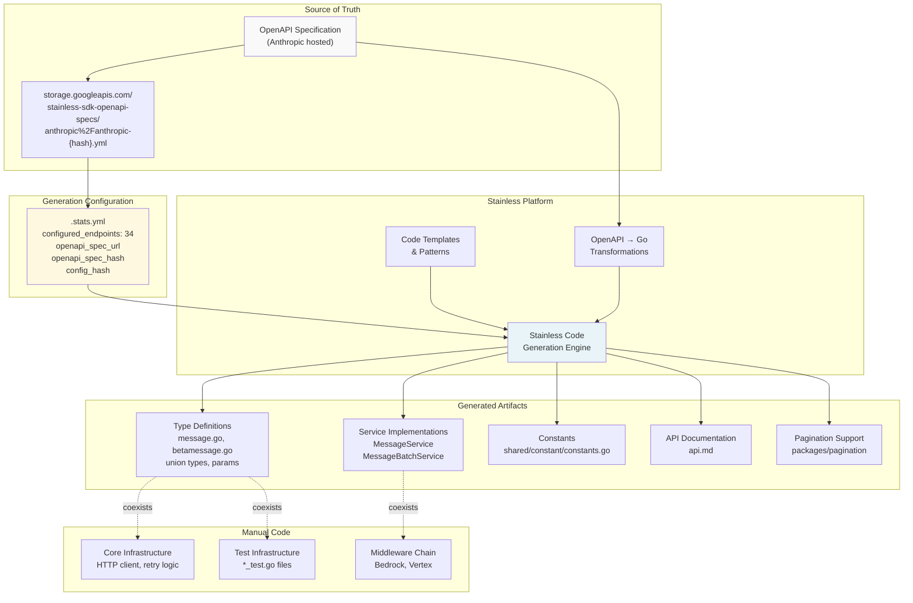
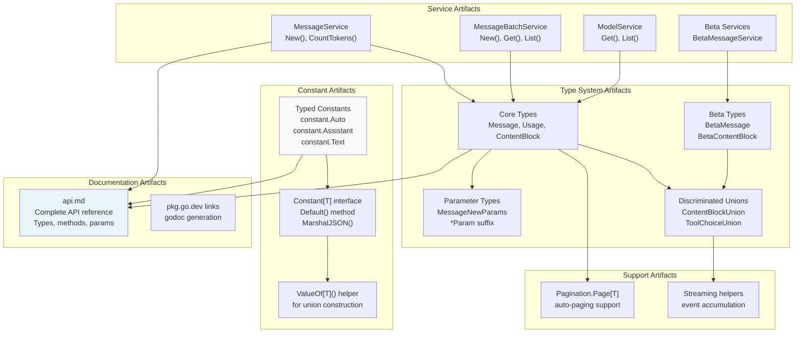
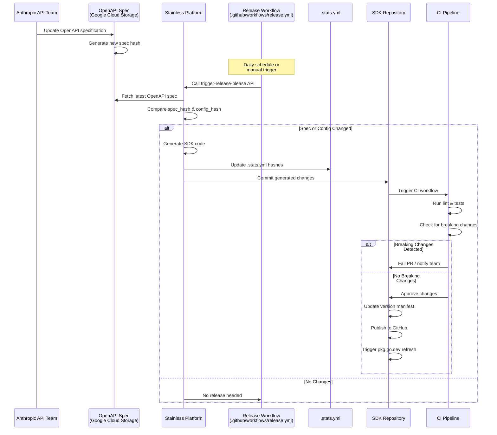
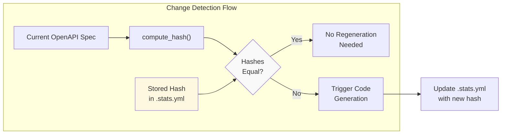

<!-- source: DeepWiki mcp.deepwiki.com · repo anthropics/anthropic-sdk-go · page 9.4 Code Generation · fetched 2026-10-26 -->

# Code Generation

<details>
<summary>Relevant source files</summary>

The following files were used as context for generating this wiki page:

- [.stats.yml](.stats.yml)
- [api.md](api.md)
- [shared/constant/constants.go](shared/constant/constants.go)

</details>


## Purpose and Scope

This document explains the OpenAPI-driven code generation system that produces the Anthropic Go SDK. The SDK is automatically generated from an OpenAPI specification using the Stainless code generation platform, ensuring API consistency and reducing manual maintenance burden. This page covers the generation architecture, workflow, generated artifacts, and synchronization mechanisms.

For information about the type system created through this generation process, see [Type System and Unions](#9.1). For details on the CI/CD processes that trigger generation and releases, see [CI/CD Pipeline](#10.2).

---

## Generation Architecture

The SDK follows an OpenAPI-first approach where the source of truth is an OpenAPI specification maintained by Anthropic. The Stainless platform consumes this specification and generates the complete SDK implementation.



**Sources:** [.stats.yml:1-5](), [shared/constant/constants.go:1-3](), [api.md:1-500]()

---

## OpenAPI Specification Tracking

The `.stats.yml` file serves as the synchronization point between the OpenAPI specification and the generated SDK code. This file tracks critical metadata to ensure consistency.

### Stats File Structure

| Field | Purpose | Example Value |
|-------|---------|---------------|
| `configured_endpoints` | Number of API endpoints in the spec | 34 |
| `openapi_spec_url` | URL to the canonical OpenAPI specification | `https://storage.googleapis.com/stainless-sdk-openapi-specs/anthropic%2Fanthropic-{hash}.yml` |
| `openapi_spec_hash` | Content hash of the OpenAPI spec | `58021ab18daccd5c45a930ffd7d6ab4d` |
| `config_hash` | Hash of the generation configuration | `4e204fead5f0af80eb9effa1d1e34dca` |

The combination of `openapi_spec_hash` and `config_hash` ensures reproducible builds. If either the API specification or generation configuration changes, these hashes update, triggering regeneration.

**Sources:** [.stats.yml:1-5]()

---

## Generated Code Patterns

All generated files contain a standard header comment identifying them as machine-generated. This prevents manual editing and signals to tools like linters that these files should be treated differently.

### Generation Header

```go
// File generated from our OpenAPI spec by Stainless. See CONTRIBUTING.md for details.
```

This header appears at the top of every generated file, including:
- Type definitions (e.g., `message.go`, `betamessage.go`)
- Service implementations (e.g., `messagebatch.go`)
- Constant definitions (e.g., `shared/constant/constants.go`)
- Union types and parameter structures

**Sources:** [shared/constant/constants.go:1-2]()

---

## Generated Artifacts

The code generation process produces several categories of artifacts, each serving a specific purpose in the SDK architecture.



**Sources:** [api.md:1-500](), [shared/constant/constants.go:1-488]()

### Type System Generation

The generator creates a comprehensive type system from OpenAPI schemas:

#### Response Types
Generated response types represent data returned from the API. These include:
- `Message` - Standard message response with content blocks and usage
- `BetaMessage` - Beta message with extended features (iterations, context management)
- `MessageTokensCount` - Token counting response
- Union types like `ContentBlockUnion`, `MessageStreamEventUnion`

#### Parameter Types
Request parameter types use the `*Param` suffix convention:
- `MessageNewParams` - Parameters for creating messages
- `MessageBatchNewParams` - Parameters for batch creation
- `ToolParam`, `ToolChoiceUnionParam` - Tool-related parameters
- `BetaMessageNewParams` - Beta message creation parameters

All parameter types support method chaining through builder patterns generated by Stainless.

**Sources:** [api.md:17-112](), [api.md:113-189]()

### Constant Generation

The constant generation system creates type-safe enumerations for string literals. Each constant type implements the `Constant[T]` interface with marshaling support.

#### Constant Type Pattern

The generator creates a specific pattern for each constant type:

```go
type TypeName string  // Always "value"

func (c TypeName) Default() TypeName { return "value" }
func (c TypeName) MarshalJSON() ([]byte, error) { return marshalString(c) }
```

This pattern ensures:
1. Type safety - constants have distinct types preventing confusion
2. Default values - zero values automatically resolve to correct string
3. JSON marshaling - constants serialize correctly in requests

#### Generated Constants Examples

The constants file contains over 160 constant types, including:
- Message roles: `constant.Assistant`, `constant.User`
- Content types: `constant.Text`, `constant.Image`, `constant.Document`
- Tool types: `constant.CodeExecution`, `constant.WebSearch`, `constant.Bash`
- Event types: `constant.MessageStart`, `constant.ContentBlockDelta`
- Error types: `constant.InvalidRequestError`, `constant.RateLimitError`

Each constant maps to specific values used in the Anthropic API protocol.

**Sources:** [shared/constant/constants.go:34-167](), [shared/constant/constants.go:168-336](), [shared/constant/constants.go:338-474]()

### Service Generation

Service types encapsulate API endpoint groups. Each service is generated with:
- Constructor methods (e.g., `New()` for creating resources)
- Retrieval methods (e.g., `Get()`, `List()`)
- Action methods (e.g., `Cancel()`, `Delete()`)
- Streaming variants (e.g., `NewStreaming()`)

Services maintain references to the HTTP client and configuration from the parent `Client` instance.

**Sources:** [api.md:192-194](), [api.md:209-216]()

### API Documentation Generation

The `api.md` file is automatically generated with comprehensive API reference documentation including:
- All response types with pkg.go.dev links
- All parameter types with pkg.go.dev links  
- All service methods with HTTP method/path annotations
- Shared types used across multiple endpoints
- Beta-specific types and methods

This documentation stays synchronized with the actual implementation through regeneration.

**Sources:** [api.md:1-600]()

---

## Generation Workflow

The code generation process integrates with the SDK's CI/CD pipeline to ensure timely updates when the API changes.



**Sources:** [.stats.yml:1-5]()

### Generation Triggers

1. **Scheduled Generation** - Daily workflow runs check for API updates
2. **Manual Trigger** - Team members can manually trigger regeneration
3. **API Update Detection** - Stainless compares OpenAPI spec hashes
4. **Configuration Changes** - Updates to generation config trigger regeneration

### Quality Gates

Before generated code is merged:
1. **Linting** - Generated code must pass all linters
2. **Type Checking** - All types must compile successfully
3. **Test Execution** - Full test suite must pass
4. **Breaking Change Detection** - Old tests run against new code to detect incompatibilities

**Sources:** Based on Diagram 6 from high-level architecture

---

## Synchronization Mechanisms

The generation system maintains synchronization between the OpenAPI specification and the SDK implementation through several mechanisms.

### Hash-Based Change Detection



The hash comparison ensures:
- Efficient change detection (no need to diff entire specs)
- Idempotent generation (same spec produces same code)
- Clear audit trail (hash changes in git history)

**Sources:** [.stats.yml:3-4]()

### Endpoint Count Tracking

The `configured_endpoints` field tracks the number of API endpoints in the specification. This serves as a high-level sanity check:
- Increasing count indicates new endpoints added
- Decreasing count flags potential deletions (unusual, requires review)
- Stable count suggests internal changes only

**Sources:** [.stats.yml:1]()

### Version Manifest Updates

When generation produces changes, the release workflow updates version manifests to prepare for publishing. This ensures generated changes are properly versioned and released.

**Sources:** Based on Diagram 6 from high-level architecture

---

## Generated vs. Manual Code Boundaries

The SDK carefully separates generated code from manual implementations to enable regeneration without conflicts.

### Generated Code Domains

The following are **fully generated** and should never be manually edited:

| Domain | Files | Purpose |
|--------|-------|---------|
| Type Definitions | `*message*.go`, `*batch*.go`, `*model*.go` | Request/response types |
| Constants | `shared/constant/constants.go` | String literal enumerations |
| Service Methods | `*service*.go` (in method implementations) | API endpoint wrappers |
| API Documentation | `api.md` | Complete API reference |
| Parameter Builders | `*params*.go` | Request parameter types |

### Manual Code Domains

The following are **manually maintained** and coexist with generated code:

| Domain | Files | Purpose |
|--------|-------|---------|
| HTTP Infrastructure | `internal/requestconfig/requestconfig.go` | Request execution pipeline |
| Retry Logic | `internal/apierror/apierror.go` | Error handling and retries |
| Middleware | `bedrock.go`, `vertex.go` | Cloud platform integrations |
| Streaming Support | `packages/ssestream/` | SSE event processing |
| Test Infrastructure | `*_test.go` | Test cases and mocks |
| Examples | `examples/` | Usage examples |

### Integration Points

Manual and generated code integrate through well-defined interfaces:
- Generated services accept `RequestOptions` from manual code
- Generated types implement interfaces expected by manual middleware
- Manual retry logic operates on generated error types
- Manual streaming code processes generated event types

**Sources:** [shared/constant/constants.go:1-3](), [api.md:1-5]()

---

## Special Generation Features

The Stainless generator implements several SDK-specific features to improve the developer experience.

### Model-Specific Token Limits

The generator maintains a map of models requiring special token limit handling for non-streaming requests:

```go
var ModelNonStreamingTokens = map[string]int{
    "claude-opus-4-20250514": 8192,
    "claude-4-opus-20250514": 8192,
    "claude-opus-4-0": 8192,
    // ... additional model variants
}
```

This map is updated during generation when new models are added to the API or token limits change. The runtime uses this map to validate request parameters.

**Sources:** [shared/constant/constants.go:11-20]()

### Constant Helper Functions

The generator creates the `ValueOf[T]()` helper function to simplify union construction:

```go
// ValueOf gives the default value of a constant from its type. It's helpful when
// constructing constants as variants in a one-of.
func ValueOf[T Constant[T]]() T {
    var t T
    return t.Default()
}
```

This uses Go generics to provide type-safe constant instantiation, particularly useful when constructing discriminated union variants.

**Sources:** [shared/constant/constants.go:22-32]()

### Polymorphic Marshaling

Generated constant types implement custom JSON marshaling that automatically uses default values for zero values:

```go
func marshalString[T ~string, PT constant[T]](v T) ([]byte, error) {
    var zero T
    if v == zero {
        v = PT(&v).Default()
    }
    return shimjson.Marshal(string(v))
}
```

This ensures constants serialize correctly even when using Go's zero values, improving ergonomics.

**Sources:** [shared/constant/constants.go:476-487]()

---

## Benefits and Trade-offs

### Benefits of Code Generation

1. **API Consistency** - Generated code exactly matches the OpenAPI specification
2. **Reduced Maintenance** - API changes propagate automatically without manual updates
3. **Type Safety** - Comprehensive type system prevents runtime errors
4. **Documentation Accuracy** - API docs stay synchronized with implementation
5. **Fast Updates** - New features available quickly after API release
6. **Breaking Change Detection** - Automated testing catches incompatibilities

### Trade-offs and Constraints

1. **Limited Customization** - Generated code patterns are standardized
2. **Generation Dependency** - Requires Stainless platform for updates
3. **Merge Complexity** - Large generated diffs can be difficult to review
4. **Build Complexity** - Generation adds another step to the development process
5. **Debugging Challenges** - Generated code may be verbose or indirect

The SDK design mitigates these trade-offs by:
- Providing manual extension points (middleware, custom HTTP clients)
- Using clear naming conventions to distinguish generated code
- Maintaining comprehensive test coverage
- Documenting the generation process thoroughly

---

## Regeneration Process

To regenerate the SDK after API changes:

1. **Trigger Generation** - Use the release workflow or Stainless API
2. **Review Changes** - Examine git diff, focusing on `.stats.yml` and type changes
3. **Run Tests** - Execute full test suite including breaking change detection
4. **Update Examples** - Modify examples if API signatures changed
5. **Version Appropriately** - Use semantic versioning based on change nature
6. **Document Breaking Changes** - Update CHANGELOG for any incompatibilities

The automated pipeline handles most of this process, but manual review remains critical for validating correctness and ensuring smooth upgrades for SDK users.

---

## Summary

The Anthropic Go SDK leverages OpenAPI-driven code generation to maintain a high-quality, type-safe implementation that stays synchronized with the Anthropic API. The Stainless platform consumes the OpenAPI specification and generates comprehensive types, services, constants, and documentation. The `.stats.yml` file tracks specification hashes to enable efficient change detection and reproducible builds. This architecture balances automation with manual control, allowing the SDK to evolve rapidly while maintaining stability and quality for users.

**Sources:** [.stats.yml:1-5](), [shared/constant/constants.go:1-488](), [api.md:1-600]()

---

