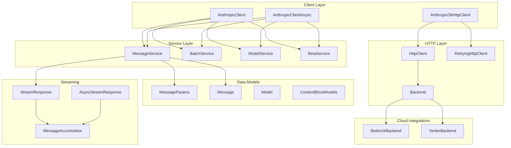
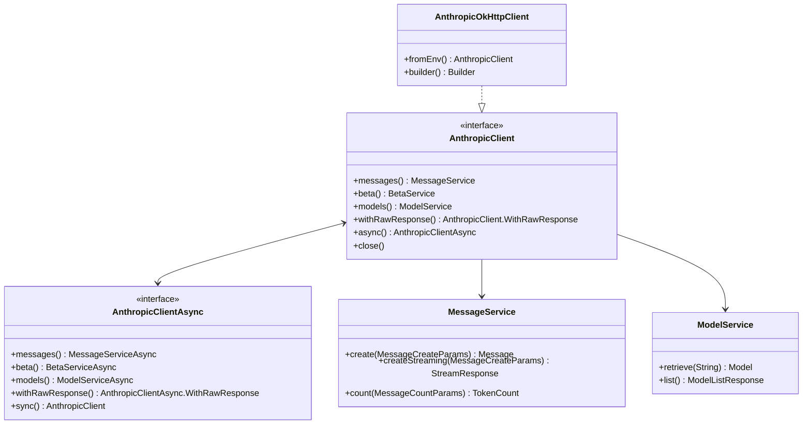

<!-- source: DeepWiki mcp.deepwiki.com · repo anthropics/anthropic-sdk-java · page 1 Introduction to Anthropic Java SDK · fetched 2026-10-26 -->

# Introduction to Anthropic Java SDK

<details>
<summary>Relevant source files</summary>

The following files were used as context for generating this wiki page:

- [.release-please-manifest.json](.release-please-manifest.json)
- [CHANGELOG.md](CHANGELOG.md)
- [README.md](README.md)
- [anthropic-java/build.gradle.kts](anthropic-java/build.gradle.kts)
- [build.gradle.kts](build.gradle.kts)

</details>


The Anthropic Java SDK provides a convenient and type-safe way to interact with the [Anthropic Claude API](https://docs.anthropic.com/claude/reference/) from Java applications. This document introduces the key components, architecture, and basic usage of the SDK.

The SDK allows Java developers to easily integrate Claude's large language model capabilities into their applications, with features for message creation, streaming responses, model information retrieval, and batch operations. For more detailed information about specific component usage, see [SDK Structure and Components](#1.2).

## Key Features

- **Type-safe API client** with comprehensive model classes
- **Synchronous and asynchronous interfaces** for flexible programming styles
- **Streaming support** for efficient handling of long-running requests
- **Cloud provider integrations** with AWS Bedrock and Google Vertex AI
- **Robust error handling** with specialized exception types
- **Pagination support** for listing operations
- **Immutable object model** with builder patterns

Sources: [README.md:9-16](), [README.md:139-158]()

## Architecture Overview



Sources: [README.md:10-11](), [README.md:775-782]()

## Core Client Structure

The SDK provides both synchronous and asynchronous interfaces for interacting with the Anthropic API. The key interface is `AnthropicClient`, which serves as the main entry point to the API.



Sources: [README.md:48-64](), [README.md:139-179]()

## Installation

### Requirements
The SDK requires Java 8 or later.

### Maven
```xml
<dependency>
  <groupId>com.anthropic</groupId>
  <artifactId>anthropic-java</artifactId>
  <version>1.4.0</version>
</dependency>
```

### Gradle
```kotlin
implementation("com.anthropic:anthropic-java:1.4.0")
```

Sources: [README.md:18-38](), [README.md:42](), [build.gradle.kts:9-12]()

## Basic Usage

Creating a client and sending a basic message to Claude:

```java
// Create a client using environment variables
AnthropicClient client = AnthropicOkHttpClient.fromEnv();

// Build message parameters
MessageCreateParams params = MessageCreateParams.builder()
    .maxTokens(1024L)
    .addUserMessage("Hello, Claude")
    .model(Model.CLAUDE_3_7_SONNET_LATEST)
    .build();

// Send the message and get a response
Message message = client.messages().create(params);
```

Sources: [README.md:48-64](), [README.md:66-87]()

## Client Configuration

The client can be configured using environment variables, explicitly through the builder pattern, or a combination of both:

| Setter      | Environment variable   | Required | Default value                 |
| ----------- | ---------------------- | -------- | ----------------------------- |
| `apiKey`    | `ANTHROPIC_API_KEY`    | false    | -                             |
| `authToken` | `ANTHROPIC_AUTH_TOKEN` | false    | -                             |
| `baseUrl`   | `ANTHROPIC_BASE_URL`   | true     | `"https://api.anthropic.com"` |

```java
// Using environment variables
AnthropicClient client = AnthropicOkHttpClient.fromEnv();

// Using builder pattern
AnthropicClient client = AnthropicOkHttpClient.builder()
    .apiKey("my-anthropic-api-key")
    .build();

// Combining approaches
AnthropicClient client = AnthropicOkHttpClient.builder()
    .fromEnv()
    .apiKey("my-anthropic-api-key")
    .build();
```

Sources: [README.md:66-109]()

## Asynchronous API

The SDK provides asynchronous versions of all operations, which return `CompletableFuture` objects:

```java
// Get the async client
AnthropicClientAsync asyncClient = client.async();

// Build message parameters
MessageCreateParams params = MessageCreateParams.builder()
    .maxTokens(1024L)
    .addUserMessage("Hello, Claude")
    .model(Model.CLAUDE_3_7_SONNET_LATEST)
    .build();

// Send the message asynchronously
CompletableFuture<Message> messageFuture = asyncClient.messages().create(params);
```

Sources: [README.md:138-179]()

## Streaming Responses

For long-running requests, the SDK provides streaming capabilities that allow processing response chunks as they arrive:

```java
// Using synchronous streaming
try (StreamResponse<RawMessageStreamEvent> streamResponse = client.messages().createStreaming(params)) {
    streamResponse.stream().forEach(chunk -> {
        System.out.println(chunk);
    });
}

// Using MessageAccumulator to collect the full message
MessageAccumulator messageAccumulator = MessageAccumulator.create();
try (StreamResponse<RawMessageStreamEvent> streamResponse = client.messages().createStreaming(params)) {
    streamResponse.stream()
            .peek(messageAccumulator::accumulate)
            .flatMap(event -> event.contentBlockDelta().stream())
            .flatMap(deltaEvent -> deltaEvent.delta().text().stream())
            .forEach(textDelta -> System.out.print(textDelta.text()));
}
Message message = messageAccumulator.message();
```

Sources: [README.md:185-246](), [README.md:275-329]()

## Error Handling

The SDK uses a hierarchy of exception types for different error scenarios:

| Status | Exception                   |
| ------ | --------------------------- |
| 400    | `BadRequestException`       |
| 401    | `UnauthorizedException`     |
| 403    | `PermissionDeniedException` |
| 404    | `NotFoundException`         |
| 422    | `UnprocessableEntityException` |
| 429    | `RateLimitException`        |
| 5xx    | `InternalServerException`   |

All these exceptions are subclasses of `AnthropicServiceException`, which itself extends the base `AnthropicException` class.

Sources: [README.md:380-402]()

## Cloud Provider Integrations

The SDK supports integration with AWS Bedrock and Google Vertex AI for using Anthropic models through these platforms.

### AWS Bedrock

```java
// Add dependency: com.anthropic:anthropic-java-bedrock:1.4.0

// Create client with Bedrock backend
AnthropicClient client = AnthropicOkHttpClient.builder()
        .backend(BedrockBackend.fromEnv())
        .build();
```

### Google Vertex AI

```java
// Add dependency: com.anthropic:anthropic-java-vertex:1.4.0

// Create client with Vertex backend
AnthropicClient client = AnthropicOkHttpClient.builder()
        .backend(VertexBackend.fromEnv())
        .build();
```

Sources: [README.md:458-645]()

## SDK Structure

The SDK consists of three main artifacts:

1. **anthropic-java-core**: Contains the core logic without OkHttp dependency
2. **anthropic-java-client-okhttp**: Implements the core interfaces using OkHttp
3. **anthropic-java**: Combines both artifacts for convenience

This structure allows for flexibility in replacing the HTTP client implementation if needed.

Sources: [README.md:771-796]()

## Additional Features

- **Raw response access**: Access response headers and status codes with `.withRawResponse()`
- **Pagination**: Handle paginated results with `.autoPager()` or manual pagination
- **Retries**: Automatic retries (default: 2) for certain error types
- **Timeouts**: Configurable request timeouts (default: 10 minutes)
- **Logging**: HTTP logging via the standard OkHttp logging interceptor
- **Proxy support**: Route requests through a proxy

Sources: [README.md:332-379](), [README.md:405-457](), [README.md:649-768]()

For more detailed information about specific components and usage patterns, see [Getting Started](#1.1) and [SDK Structure and Components](#1.2).

---

