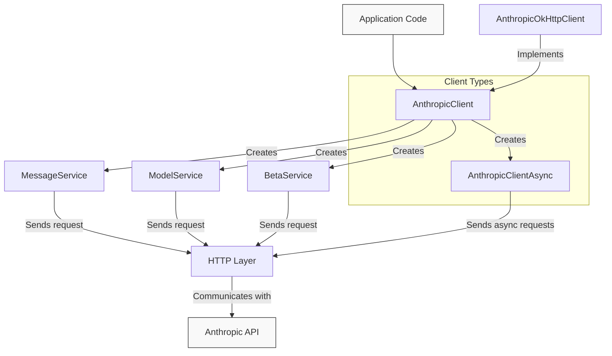
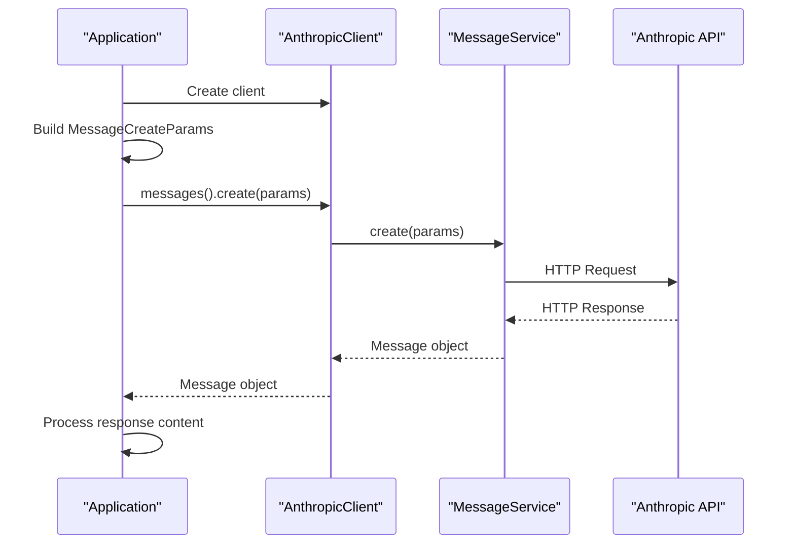
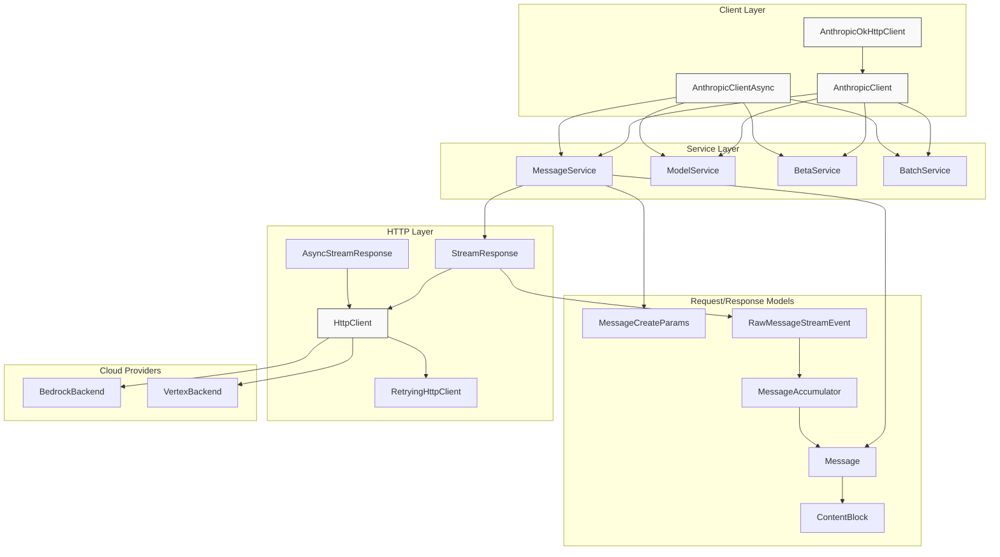

<!-- source: DeepWiki mcp.deepwiki.com · repo anthropics/anthropic-sdk-java · page 1.1 Getting Started · fetched 2026-10-26 -->

# Getting Started

<details>
<summary>Relevant source files</summary>

The following files were used as context for generating this wiki page:

- [.release-please-manifest.json](.release-please-manifest.json)
- [CHANGELOG.md](CHANGELOG.md)
- [README.md](README.md)
- [anthropic-java-example/build.gradle.kts](anthropic-java-example/build.gradle.kts)
- [anthropic-java-example/src/main/java/com/anthropic/example/BatchAsyncExample.java](anthropic-java-example/src/main/java/com/anthropic/example/BatchAsyncExample.java)
- [anthropic-java-example/src/main/java/com/anthropic/example/BatchExample.java](anthropic-java-example/src/main/java/com/anthropic/example/BatchExample.java)
- [anthropic-java-example/src/main/java/com/anthropic/example/Main.java](anthropic-java-example/src/main/java/com/anthropic/example/Main.java)
- [anthropic-java-example/src/main/java/com/anthropic/example/MessagesAsyncExample.java](anthropic-java-example/src/main/java/com/anthropic/example/MessagesAsyncExample.java)
- [anthropic-java-example/src/main/java/com/anthropic/example/MessagesConversationAsyncExample.java](anthropic-java-example/src/main/java/com/anthropic/example/MessagesConversationAsyncExample.java)
- [anthropic-java-example/src/main/java/com/anthropic/example/MessagesConversationExample.java](anthropic-java-example/src/main/java/com/anthropic/example/MessagesConversationExample.java)
- [anthropic-java-example/src/main/java/com/anthropic/example/MessagesExample.java](anthropic-java-example/src/main/java/com/anthropic/example/MessagesExample.java)
- [anthropic-java-example/src/main/java/com/anthropic/example/MessagesStreamingAsyncExample.java](anthropic-java-example/src/main/java/com/anthropic/example/MessagesStreamingAsyncExample.java)
- [anthropic-java-example/src/main/java/com/anthropic/example/MessagesStreamingExample.java](anthropic-java-example/src/main/java/com/anthropic/example/MessagesStreamingExample.java)
- [anthropic-java/build.gradle.kts](anthropic-java/build.gradle.kts)
- [build.gradle.kts](build.gradle.kts)

</details>


This page provides instructions for installing the Anthropic Java SDK, setting up a client, and making your first API calls. It covers the essential steps to integrate Claude AI capabilities into your Java applications.

For information about the SDK's structure and components, see [SDK Structure and Components](#1.2).

## Prerequisites

The Anthropic Java SDK requires Java 8 or later. Before you begin, make sure you have:

1. A Java development environment (JDK 8+)
2. An Anthropic API key (get one from [Anthropic's website](https://www.anthropic.com))
3. Maven or Gradle for dependency management

Sources: [README.md:42-42]()

## Installation

Add the Anthropic Java SDK to your project using one of the following methods:

### Gradle

```kotlin
implementation("com.anthropic:anthropic-java:1.4.0")
```

### Maven

```xml
<dependency>
  <groupId>com.anthropic</groupId>
  <artifactId>anthropic-java</artifactId>
  <version>1.4.0</version>
</dependency>
```

Sources: [README.md:22-36](), [build.gradle.kts:9-12]()

## Client Setup

### Creating a Basic Client

The main entry point to the SDK is the `AnthropicClient` interface. The simplest way to create a client is using environment variables:

```java
import com.anthropic.client.AnthropicClient;
import com.anthropic.client.okhttp.AnthropicOkHttpClient;

// Configures using the `ANTHROPIC_API_KEY` environment variable
AnthropicClient client = AnthropicOkHttpClient.fromEnv();
```

The client will automatically use the `ANTHROPIC_API_KEY` environment variable for authentication.

### Manual Configuration

You can also configure the client manually:

```java
import com.anthropic.client.AnthropicClient;
import com.anthropic.client.okhttp.AnthropicOkHttpClient;

AnthropicClient client = AnthropicOkHttpClient.builder()
    .apiKey("your-anthropic-api-key")
    .build();
```

### Configuration Options

| Setter      | Environment variable   | Required | Default value                 |
| ----------- | ---------------------- | -------- | ----------------------------- |
| `apiKey`    | `ANTHROPIC_API_KEY`    | false    | -                             |
| `authToken` | `ANTHROPIC_AUTH_TOKEN` | false    | -                             |
| `baseUrl`   | `ANTHROPIC_BASE_URL`   | true     | `"https://api.anthropic.com"` |

Sources: [README.md:68-108]()

## Client Architecture

The following diagram illustrates the main components involved in creating and using an Anthropic client:



Sources: [README.md:139-179]()

## Making Your First API Call

The following example demonstrates how to create a simple message with Claude:

```java
import com.anthropic.client.AnthropicClient;
import com.anthropic.client.okhttp.AnthropicOkHttpClient;
import com.anthropic.models.messages.Message;
import com.anthropic.models.messages.MessageCreateParams;
import com.anthropic.models.messages.Model;

// Create client from environment variables
AnthropicClient client = AnthropicOkHttpClient.fromEnv();

// Build message parameters
MessageCreateParams params = MessageCreateParams.builder()
    .maxTokens(1024L)
    .addUserMessage("Hello, Claude")
    .model(Model.CLAUDE_3_7_SONNET_LATEST)
    .build();

// Send the request
Message message = client.messages().create(params);

// Access the response content
message.content().stream()
    .flatMap(contentBlock -> contentBlock.text().stream())
    .forEach(textBlock -> System.out.println(textBlock.text()));
```

Sources: [README.md:48-64](), [anthropic-java-example/src/main/java/com/anthropic/example/MessagesExample.java:11-25]()

## Request-Response Flow

This diagram illustrates the flow from creating a request to processing the response:



Sources: [anthropic-java-example/src/main/java/com/anthropic/example/MessagesExample.java:11-25]()

## Working with Responses

The SDK uses immutable objects for both requests and responses. The `Message` object returned from a successful API call contains content blocks that you can process:

```java
// Get and print all text from the response
message.content().stream()
    .flatMap(contentBlock -> contentBlock.text().stream())
    .forEach(textBlock -> System.out.println(textBlock.text()));
```

Sources: [README.md:130-136](), [anthropic-java-example/src/main/java/com/anthropic/example/MessagesExample.java:21-23]()

## Asynchronous Execution

The SDK supports asynchronous execution for non-blocking operations. You can switch to asynchronous mode from a synchronous client:

```java
import java.util.concurrent.CompletableFuture;

// Get an async client from a sync client
CompletableFuture<Message> futureMessage = client.async().messages().create(params);

// Or create an async client directly
AnthropicClientAsync asyncClient = AnthropicOkHttpClientAsync.fromEnv();
CompletableFuture<Message> futureMessage = asyncClient.messages().create(params);
```

Sources: [README.md:139-179](), [anthropic-java-example/src/main/java/com/anthropic/example/MessagesAsyncExample.java:11-28]()

## Streaming Responses

For longer responses, especially those that take time to generate, you can use streaming to receive content incrementally:

```java
import com.anthropic.core.http.StreamResponse;
import com.anthropic.models.messages.RawMessageStreamEvent;

try (StreamResponse<RawMessageStreamEvent> streamResponse = 
        client.messages().createStreaming(params)) {
    streamResponse.stream()
        .flatMap(event -> event.contentBlockDelta().stream())
        .flatMap(deltaEvent -> deltaEvent.delta().text().stream())
        .forEach(textDelta -> System.out.print(textDelta.text()));
}
```

For asynchronous streaming:

```java
client.async().messages().createStreaming(params)
    .subscribe(event -> event.contentBlockDelta().stream()
        .flatMap(deltaEvent -> deltaEvent.delta().text().stream())
        .forEach(textDelta -> System.out.print(textDelta.text())))
    .onCompleteFuture()
    .join();
```

Sources: [README.md:184-245](), [anthropic-java-example/src/main/java/com/anthropic/example/MessagesStreamingExample.java:11-32](), [anthropic-java-example/src/main/java/com/anthropic/example/MessagesStreamingAsyncExample.java:11-29]()

## Accumulating Streamed Content

When using streaming, you can use `MessageAccumulator` to build a complete `Message` object from the stream of events:

```java
import com.anthropic.helpers.MessageAccumulator;

MessageAccumulator messageAccumulator = MessageAccumulator.create();

try (StreamResponse<RawMessageStreamEvent> streamResponse =
        client.messages().createStreaming(params)) {
    streamResponse.stream()
        .peek(messageAccumulator::accumulate)
        .flatMap(event -> event.contentBlockDelta().stream())
        .flatMap(deltaEvent -> deltaEvent.delta().text().stream())
        .forEach(textDelta -> System.out.print(textDelta.text()));
}

// Get the complete message after streaming is done
Message message = messageAccumulator.message();
```

Sources: [README.md:276-329]()

## Error Handling

The SDK throws custom exception types for different error scenarios:

| Status | Exception                        |
| ------ | -------------------------------- |
| 400    | `BadRequestException`            |
| 401    | `UnauthorizedException`          |
| 403    | `PermissionDeniedException`      |
| 404    | `NotFoundException`              |
| 422    | `UnprocessableEntityException`   |
| 429    | `RateLimitException`             |
| 5xx    | `InternalServerException`        |
| others | `UnexpectedStatusCodeException`  |

All of these exceptions extend from `AnthropicServiceException`. There are also `AnthropicIoException` for I/O networking errors and `AnthropicInvalidDataException` for data interpretation failures.

Sources: [README.md:381-403]()

## Next Steps

Now that you're familiar with the basics, you can explore more advanced features of the SDK:

1. See [Core Client Architecture](#2) for more details on the client structure
2. Learn about [Streaming Response Handling](#4) for working with real-time content generation
3. Explore [Cloud Provider Integration](#6) for using the SDK with AWS Bedrock or Google Vertex AI
4. Check out [Services and Operations](#3) to understand all available API endpoints

## Complete SDK Architecture

This diagram shows the complete architecture of the Anthropic Java SDK:



Sources: [README.md:10-810]()

---

