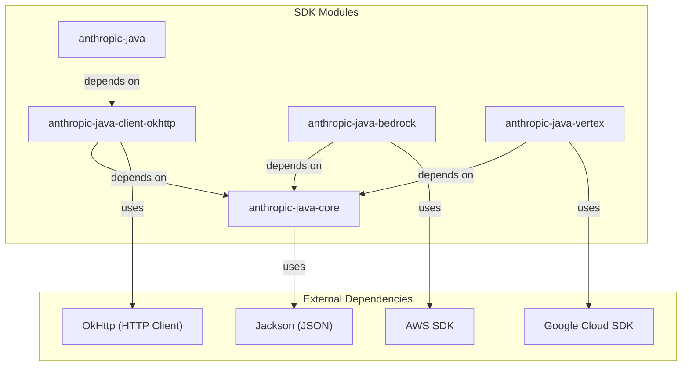
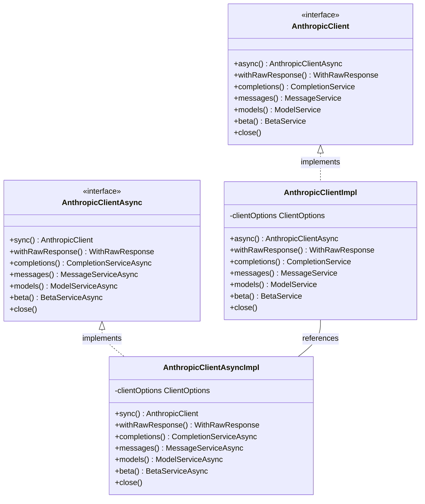
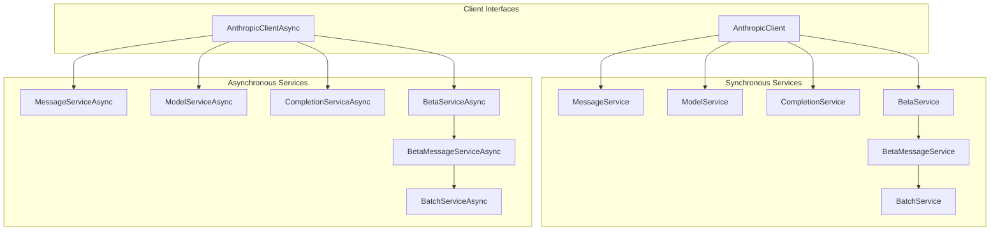
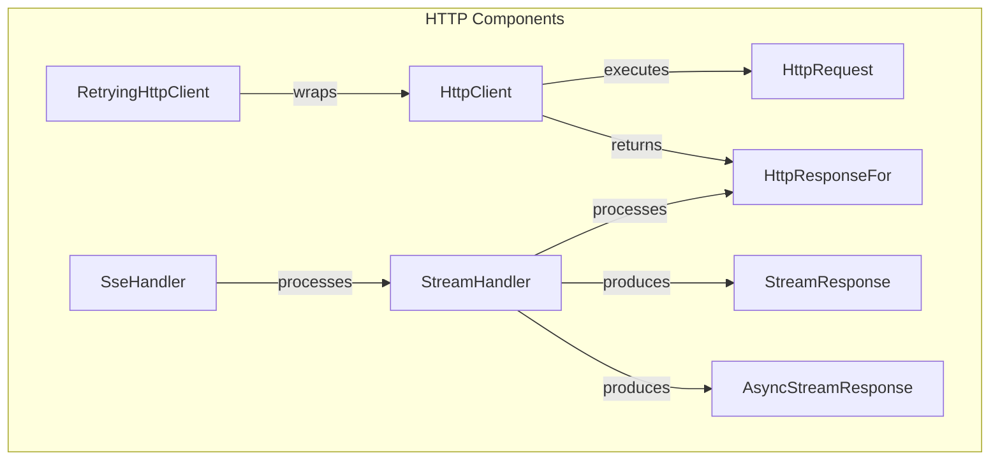
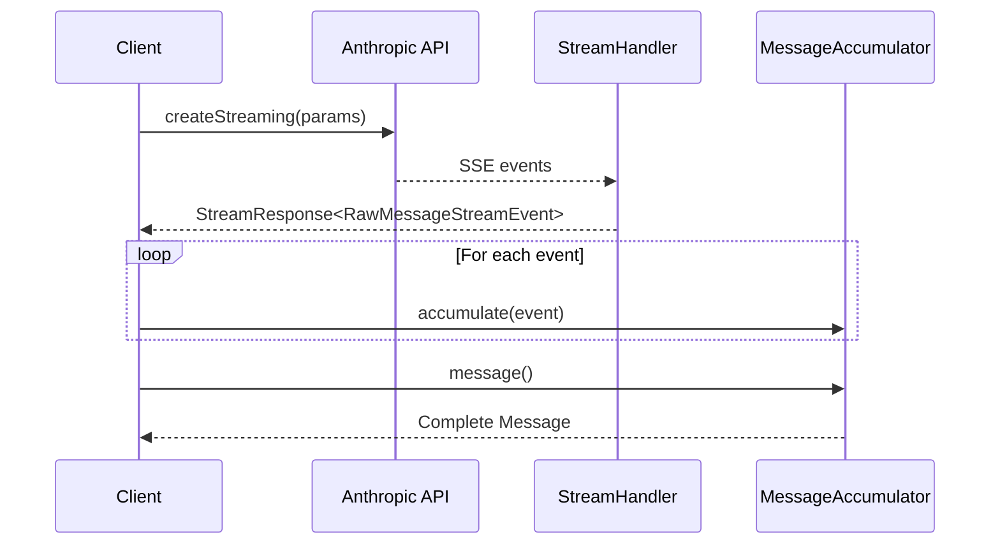
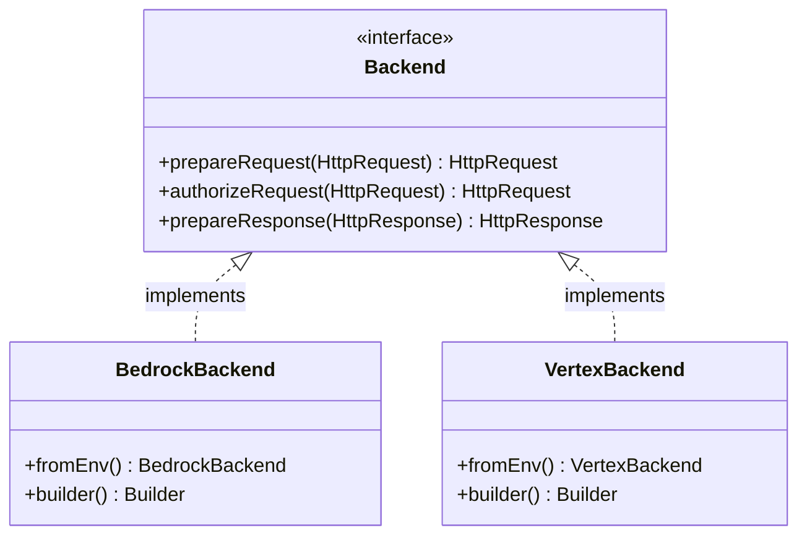
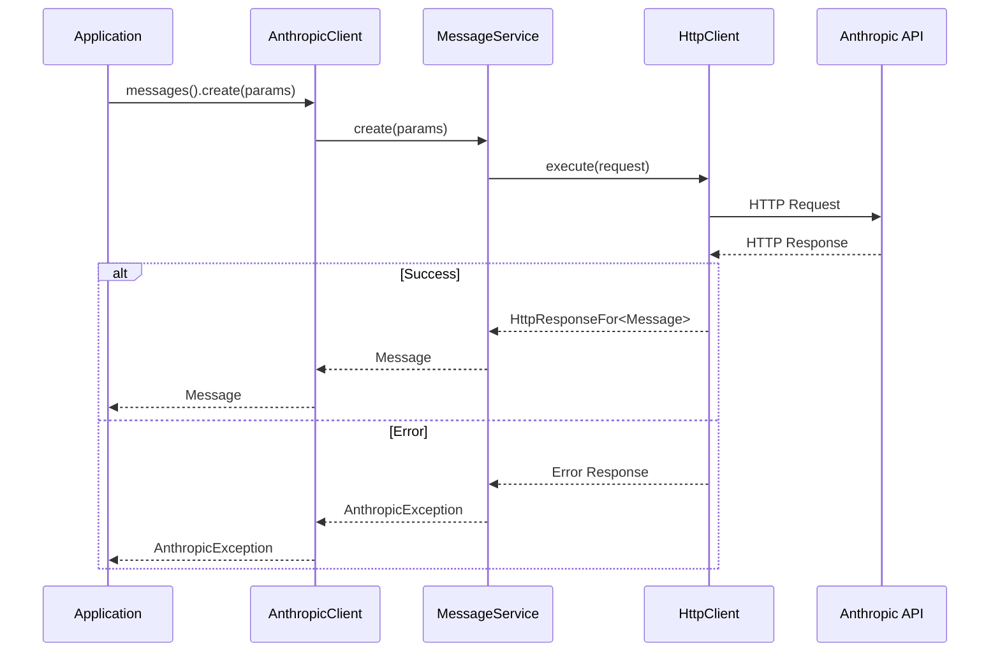
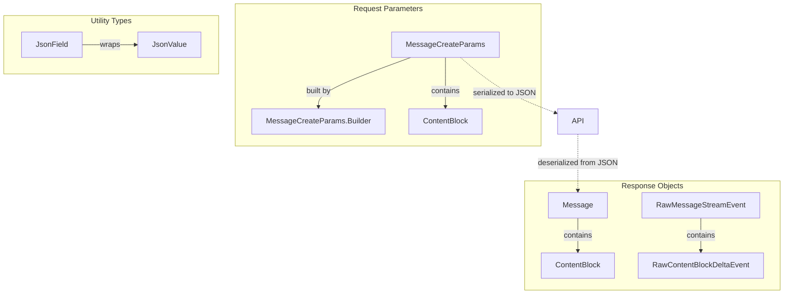

<!-- source: DeepWiki mcp.deepwiki.com · repo anthropics/anthropic-sdk-java · page 1.2 SDK Structure and Components · fetched 2026-10-26 -->

# SDK Structure and Components

Relevant source files

The following files were used as context for generating this wiki page:

- [.release-please-manifest.json](.release-please-manifest.json)
- [CHANGELOG.md](CHANGELOG.md)
- [README.md](README.md)
- [anthropic-java-core/src/main/kotlin/com/anthropic/client/AnthropicClient.kt](anthropic-java-core/src/main/kotlin/com/anthropic/client/AnthropicClient.kt)
- [anthropic-java-core/src/main/kotlin/com/anthropic/client/AnthropicClientAsync.kt](anthropic-java-core/src/main/kotlin/com/anthropic/client/AnthropicClientAsync.kt)
- [anthropic-java-core/src/main/kotlin/com/anthropic/client/AnthropicClientAsyncImpl.kt](anthropic-java-core/src/main/kotlin/com/anthropic/client/AnthropicClientAsyncImpl.kt)
- [anthropic-java-core/src/main/kotlin/com/anthropic/client/AnthropicClientImpl.kt](anthropic-java-core/src/main/kotlin/com/anthropic/client/AnthropicClientImpl.kt)
- [anthropic-java-core/src/main/kotlin/com/anthropic/core/http/HttpResponseFor.kt](anthropic-java-core/src/main/kotlin/com/anthropic/core/http/HttpResponseFor.kt)
- [anthropic-java-core/src/main/kotlin/com/anthropic/services/async/BetaServiceAsync.kt](anthropic-java-core/src/main/kotlin/com/anthropic/services/async/BetaServiceAsync.kt)
- [anthropic-java/build.gradle.kts](anthropic-java/build.gradle.kts)
- [build.gradle.kts](build.gradle.kts)

This page provides an overview of the main components that make up the Anthropic Java SDK and how they relate to each other. It focuses on the core architecture, package organization, and key interfaces that developers will interact with. For information about specific API operations, see [Services and Operations](#3).

## SDK Package Structure

The Anthropic Java SDK is organized into multiple modules, each with a specific purpose. This modular design allows developers to include only the dependencies they need.

### Module Descriptions

| Module | Description | Purpose |
|--------|-------------|---------|
| **anthropic-java** | Main artifact | Brings together core and OkHttp implementation |
| **anthropic-java-core** | Core interfaces and models | Provides the foundation without HTTP client dependency |
| **anthropic-java-client-okhttp** | OkHttp implementation | Implements the core interfaces using OkHttp |
| **anthropic-java-bedrock** | AWS Bedrock support | Integration with AWS Bedrock |
| **anthropic-java-vertex** | Google Vertex AI support | Integration with Google Vertex AI |

Sources: [README.md:762-784](). [build.gradle.kts:1-24](). [anthropic-java/build.gradle.kts:1-30]().

## Core Client Structure

The SDK is designed around a set of interfaces that define the client behavior, with implementations that provide the actual functionality.

The client interfaces provide access to various services that correspond to different parts of the Anthropic API:

- **CompletionService**: Operations for the legacy completion API (deprecated in favor of messages API)
- **MessageService**: Operations for creating messages and streaming responses
- **ModelService**: Operations for retrieving model information
- **BetaService**: Operations for beta features (including batches)

Sources: [anthropic-java-core/src/main/kotlin/com/anthropic/client/AnthropicClient.kt:1-72](). [anthropic-java-core/src/main/kotlin/com/anthropic/client/AnthropicClientAsync.kt:1-74](). [anthropic-java-core/src/main/kotlin/com/anthropic/client/AnthropicClientImpl.kt:1-85](). [anthropic-java-core/src/main/kotlin/com/anthropic/client/AnthropicClientAsyncImpl.kt:1-89]().

## Service Layer Structure

Each service provides methods that correspond to API operations. The SDK offers both synchronous and asynchronous versions of each service.

### Service Methods

Each service interface provides methods corresponding to API operations:

| Service | Key Methods | Description |
|---------|-------------|-------------|
| **MessageService** | `create`, `createStreaming` | Create messages, with optional streaming |
| **ModelService** | `list` | List available models |
| **BetaService.messages().batches()** | `create`, `retrieve`, `list`, `cancel` | Batch message operations |

Sources: [anthropic-java-core/src/main/kotlin/com/anthropic/client/AnthropicClient.kt:24-71](). [anthropic-java-core/src/main/kotlin/com/anthropic/client/AnthropicClientAsync.kt:24-73](). [anthropic-java-core/src/main/kotlin/com/anthropic/services/async/BetaServiceAsync.kt:1-27]().

## HTTP Layer

The SDK's HTTP layer handles communication with the Anthropic API, including authentication, retries, and streaming responses.

The HTTP layer provides several important features:

- **Request Authentication**: Adds API keys or tokens to requests
- **Retries**: Automatically retries failed requests with exponential backoff
- **Response Parsing**: Deserializes JSON responses into Java objects
- **Streaming**: Handles Server-Sent Events (SSE) for streaming responses
- **Raw Response Access**: Provides access to raw HTTP responses via `withRawResponse()`

Sources: [README.md:115-120](). [README.md:332-361](). [anthropic-java-core/src/main/kotlin/com/anthropic/core/http/HttpResponseFor.kt:1-26]().

## Helper Components

The SDK includes several helper components that make it easier to work with the API.

### MessageAccumulator

The `MessageAccumulator` helps accumulate streaming events into a complete message:

### Backend Integration

The SDK provides integrations with cloud providers via the `Backend` interface:

Sources: [README.md:277-329](). [README.md:459-563](). [README.md:564-647]().

## Request-Response Flow

The following sequence diagram illustrates how a request flows through the SDK:

Sources: [README.md:115-129](). [README.md:381-404]().

## Data Models

The SDK defines numerous data models that represent request parameters and response objects:

All data models in the SDK follow a builder pattern and are immutable once constructed.

Sources: [README.md:130-136](). [README.md:806-893]().

## Package Naming Convention

The SDK follows a consistent package naming convention:

| Package | Content Type |
|---------|--------------|
| `com.anthropic.client` | Client interfaces and implementations |
| `com.anthropic.services.blocking` | Synchronous service interfaces |
| `com.anthropic.services.async` | Asynchronous service interfaces |
| `com.anthropic.models` | Data models for API requests and responses |
| `com.anthropic.core` | Core utilities and abstractions |
| `com.anthropic.errors` | Exception classes |
| `com.anthropic.helpers` | Helper classes like MessageAccumulator |

Sources: [README.md:806-893](). [CHANGELOG.md:1-390]().

## Cloud Provider Integration

The SDK provides integrations with cloud providers that offer Anthropic models:

- **AWS Bedrock**: Integration with Amazon's Bedrock service
- **Google Vertex AI**: Integration with Google's Vertex AI platform

These integrations use the same client interfaces but with different underlying backends, allowing consistent API usage regardless of where the models are hosted.

Sources: [README.md:459-563](). [README.md:564-647]().

---

