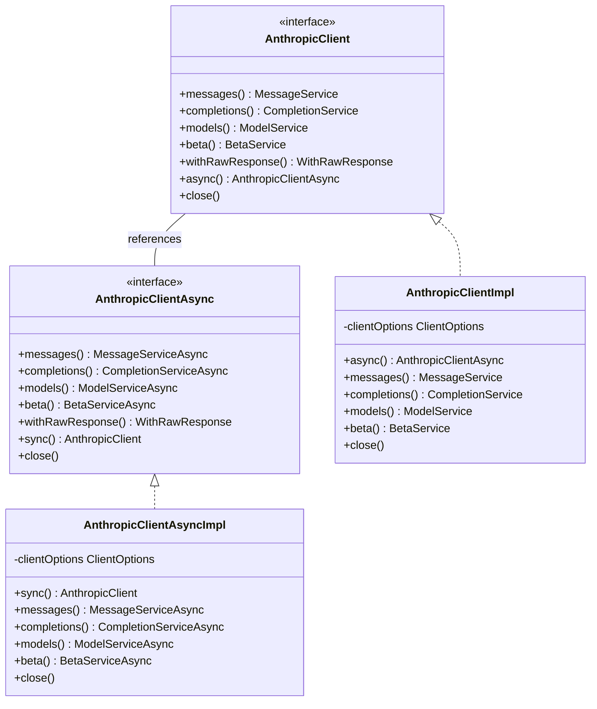
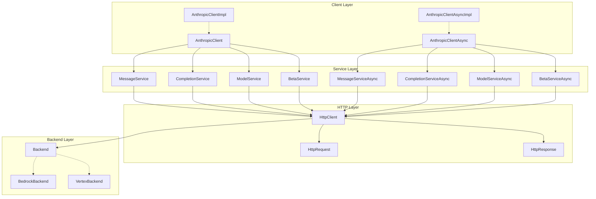
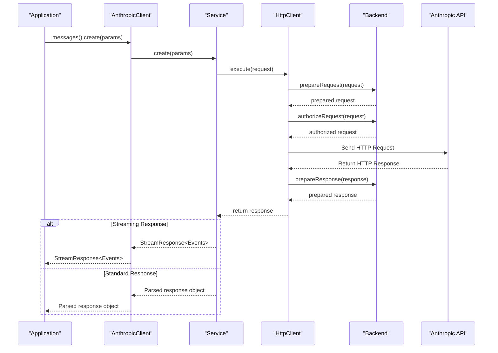
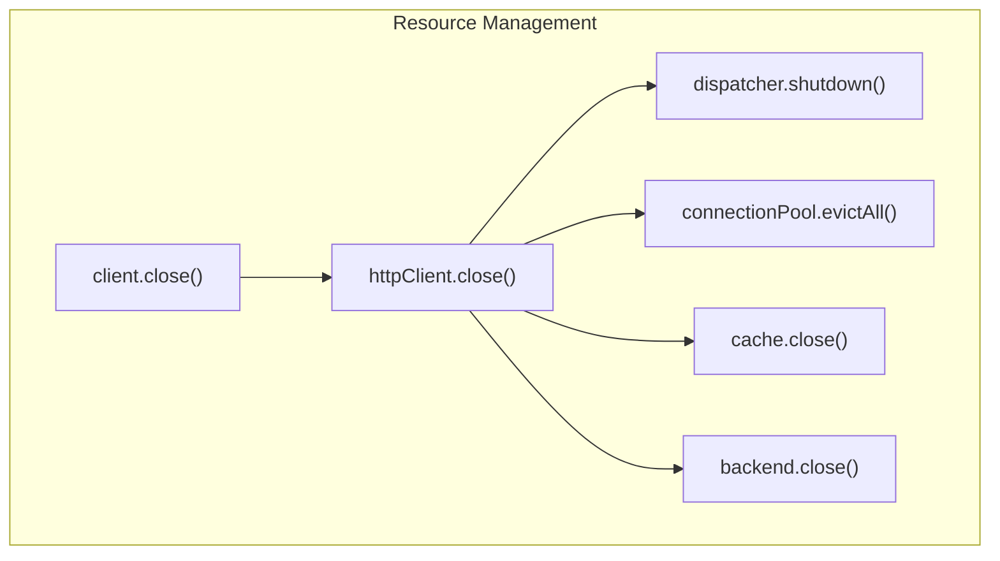
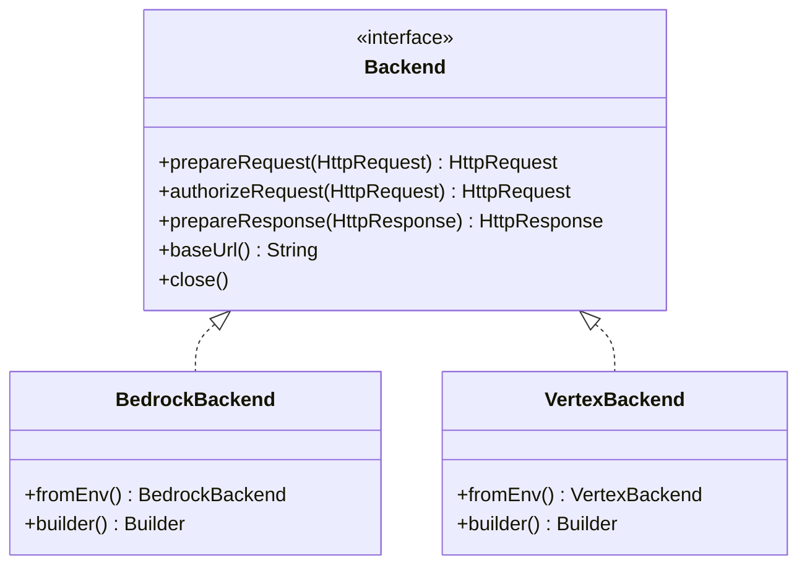
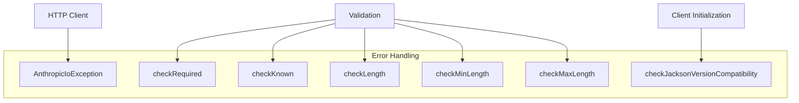

<!-- source: DeepWiki mcp.deepwiki.com · repo anthropics/anthropic-sdk-java · page 2 Core Client Architecture · fetched 2026-10-26 -->

# Core Client Architecture

<details>
<summary>Relevant source files</summary>

The following files were used as context for generating this wiki page:

- [anthropic-java-client-okhttp/src/main/kotlin/com/anthropic/client/okhttp/OkHttpClient.kt](anthropic-java-client-okhttp/src/main/kotlin/com/anthropic/client/okhttp/OkHttpClient.kt)
- [anthropic-java-core/src/main/kotlin/com/anthropic/client/AnthropicClient.kt](anthropic-java-core/src/main/kotlin/com/anthropic/client/AnthropicClient.kt)
- [anthropic-java-core/src/main/kotlin/com/anthropic/client/AnthropicClientAsync.kt](anthropic-java-core/src/main/kotlin/com/anthropic/client/AnthropicClientAsync.kt)
- [anthropic-java-core/src/main/kotlin/com/anthropic/client/AnthropicClientAsyncImpl.kt](anthropic-java-core/src/main/kotlin/com/anthropic/client/AnthropicClientAsyncImpl.kt)
- [anthropic-java-core/src/main/kotlin/com/anthropic/client/AnthropicClientImpl.kt](anthropic-java-core/src/main/kotlin/com/anthropic/client/AnthropicClientImpl.kt)
- [anthropic-java-core/src/main/kotlin/com/anthropic/core/Check.kt](anthropic-java-core/src/main/kotlin/com/anthropic/core/Check.kt)
- [anthropic-java-core/src/main/kotlin/com/anthropic/core/http/HttpClient.kt](anthropic-java-core/src/main/kotlin/com/anthropic/core/http/HttpClient.kt)
- [anthropic-java-core/src/main/kotlin/com/anthropic/core/http/HttpRequest.kt](anthropic-java-core/src/main/kotlin/com/anthropic/core/http/HttpRequest.kt)
- [anthropic-java-core/src/main/kotlin/com/anthropic/core/http/HttpRequestBody.kt](anthropic-java-core/src/main/kotlin/com/anthropic/core/http/HttpRequestBody.kt)
- [anthropic-java-core/src/main/kotlin/com/anthropic/core/http/HttpResponse.kt](anthropic-java-core/src/main/kotlin/com/anthropic/core/http/HttpResponse.kt)
- [anthropic-java-core/src/main/kotlin/com/anthropic/core/http/HttpResponseFor.kt](anthropic-java-core/src/main/kotlin/com/anthropic/core/http/HttpResponseFor.kt)
- [anthropic-java-core/src/main/kotlin/com/anthropic/core/http/StreamResponse.kt](anthropic-java-core/src/main/kotlin/com/anthropic/core/http/StreamResponse.kt)
- [anthropic-java-core/src/main/kotlin/com/anthropic/services/async/BetaServiceAsync.kt](anthropic-java-core/src/main/kotlin/com/anthropic/services/async/BetaServiceAsync.kt)

</details>


This page describes the core client architecture of the Anthropic Java SDK, focusing on the client interfaces, implementations, and the request-response flow. For information about HTTP communication details, see [HTTP Communication Layer](#2.2), and for usage patterns of synchronous versus asynchronous APIs, see [Synchronous vs Asynchronous API](#2.1).

## Overview

The Anthropic Java SDK provides a client-based architecture for interacting with Anthropic's AI services. The SDK is designed around the following principles:

- Clear separation between synchronous and asynchronous APIs
- Resource efficiency through reusable connections and thread pools
- Flexible backend integration for cloud provider support
- Comprehensive error handling
- Consistent request-response patterns

## Client Interfaces

The SDK provides two primary client interfaces:



Sources:
- [anthropic-java-core/src/main/kotlin/com/anthropic/client/AnthropicClient.kt]()
- [anthropic-java-core/src/main/kotlin/com/anthropic/client/AnthropicClientAsync.kt]()
- [anthropic-java-core/src/main/kotlin/com/anthropic/client/AnthropicClientImpl.kt]()
- [anthropic-java-core/src/main/kotlin/com/anthropic/client/AnthropicClientAsyncImpl.kt]()

### AnthropicClient

The `AnthropicClient` interface provides synchronous access to Anthropic's API. It offers methods to access various services and can be converted to an asynchronous client when needed.

Key methods:
- `messages()`: Returns a `MessageService` for message-related operations
- `completions()`: Returns a `CompletionService` for completion-related operations
- `models()`: Returns a `ModelService` for model-related operations
- `beta()`: Returns a `BetaService` for beta features
- `async()`: Converts to an asynchronous client
- `withRawResponse()`: Returns a version that provides access to raw HTTP responses
- `close()`: Releases resources held by the client

### AnthropicClientAsync

The `AnthropicClientAsync` interface provides asynchronous access to Anthropic's API. It mirrors the synchronous interface but returns asynchronous service implementations.

Key methods:
- `messages()`: Returns a `MessageServiceAsync` for asynchronous message operations
- `completions()`: Returns a `CompletionServiceAsync` for asynchronous completion operations
- `models()`: Returns a `ModelServiceAsync` for asynchronous model operations
- `beta()`: Returns a `BetaServiceAsync` for asynchronous beta features
- `sync()`: Converts to a synchronous client
- `withRawResponse()`: Returns a version that provides access to raw HTTP responses
- `close()`: Releases resources held by the client

## Client Implementation

The primary client implementations are `AnthropicClientImpl` and `AnthropicClientAsyncImpl`. These implementations handle resource management, service creation, and communication with Anthropic's API.



Sources:
- [anthropic-java-core/src/main/kotlin/com/anthropic/client/AnthropicClientImpl.kt]()
- [anthropic-java-core/src/main/kotlin/com/anthropic/client/AnthropicClientAsyncImpl.kt]()
- [anthropic-java-client-okhttp/src/main/kotlin/com/anthropic/client/okhttp/OkHttpClient.kt]()

Key aspects of the implementations:

1. **Lazy Initialization**: Services are created lazily when first accessed, improving startup time.
2. **Resource Sharing**: Synchronous and asynchronous clients share resources to reduce overhead.
3. **User-Agent Management**: Clients set appropriate User-Agent headers for API communication.
4. **Thread and Connection Management**: Clients manage thread pools and connections for efficient API communication.

Example from `AnthropicClientImpl`:
```kotlin
private val messages: MessageService by lazy { MessageServiceImpl(clientOptionsWithUserAgent) }
private val async: AnthropicClientAsync by lazy { AnthropicClientAsyncImpl(clientOptions) }
```

Example from `AnthropicClientAsyncImpl`:
```kotlin
private val messages: MessageServiceAsync by lazy { MessageServiceAsyncImpl(clientOptionsWithUserAgent) }
private val sync: AnthropicClient by lazy { AnthropicClientImpl(clientOptions) }
```

## Service Structure

The client provides access to multiple services, each handling a specific area of functionality:

| Service | Purpose | Key Operations |
|---------|---------|----------------|
| MessageService | Handles message-related operations | create, stream |
| CompletionService | Handles completion-related operations | create |
| ModelService | Provides information about available models | list, retrieve |
| BetaService | Provides access to beta features | messages, models |

Each service has both synchronous and asynchronous versions, with identical method signatures but different return types (direct values vs. `CompletableFuture`).

## Request-Response Flow



Sources:
- [anthropic-java-client-okhttp/src/main/kotlin/com/anthropic/client/okhttp/OkHttpClient.kt:35-46]()
- [anthropic-java-client-okhttp/src/main/kotlin/com/anthropic/client/okhttp/OkHttpClient.kt:48-71]()
- [anthropic-java-core/src/main/kotlin/com/anthropic/core/http/HttpClient.kt]()

The request-response flow follows these steps:

1. **Request Preparation**: Requests are prepared by the service and passed to the HTTP client.
2. **Backend Processing**: The Backend prepares and authorizes the request.
3. **HTTP Communication**: The HTTP client sends the request to Anthropic's API.
4. **Response Handling**: Responses are processed by the Backend and returned to the service.
5. **Result Parsing**: Services parse responses into appropriate model objects.

### Request Customization

Requests can be customized using `RequestOptions`, which allow for:
- Timeout configuration
- Custom headers
- Response handling configuration

Example from `OkHttpClient`:
```kotlin
private fun newCall(request: HttpRequest, requestOptions: RequestOptions): Call {
    val clientBuilder = okHttpClient.newBuilder()
    
    // Apply timeout settings if provided
    requestOptions.timeout?.let {
        clientBuilder
            .connectTimeout(it.connect())
            .readTimeout(it.read())
            .writeTimeout(it.write())
            .callTimeout(it.request())
    }
    
    // Create and return the call
    val client = clientBuilder.build()
    return client.newCall(request.toRequest(client))
}
```

## Resource Management

The client architecture includes proper resource management to ensure efficient use of system resources.



Sources:
- [anthropic-java-core/src/main/kotlin/com/anthropic/client/AnthropicClientImpl.kt:55]()
- [anthropic-java-core/src/main/kotlin/com/anthropic/client/AnthropicClientAsyncImpl.kt:59]()
- [anthropic-java-client-okhttp/src/main/kotlin/com/anthropic/client/okhttp/OkHttpClient.kt:73-78]()

When `close()` is called on a client:
1. The underlying HTTP client's resources are released.
2. Thread pools in the dispatcher are shut down.
3. The connection pool is evicted.
4. Any cache is closed.
5. The backend resources are released.

However, the client documentation notes that it's usually not necessary to explicitly close the client, as the default HTTP client automatically releases idle threads and connections.

## Backend Integration

The client architecture supports different backends for flexibility in how it connects to Anthropic's API, including direct access and cloud provider integrations.



Sources:
- [anthropic-java-client-okhttp/src/main/kotlin/com/anthropic/client/okhttp/OkHttpClient.kt:80-86]()

The `Backend` interface defines methods for:
1. Preparing requests before they're sent
2. Authorizing requests with appropriate credentials
3. Processing responses before they're returned to the client
4. Providing the base URL for API requests
5. Releasing resources when closed

For more details on cloud provider integrations, see [Cloud Provider Integration](#6).

## Error Handling and Validation

The client architecture includes robust error handling and validation:



Sources:
- [anthropic-java-core/src/main/kotlin/com/anthropic/core/Check.kt]()
- [anthropic-java-client-okhttp/src/main/kotlin/com/anthropic/client/okhttp/OkHttpClient.kt:42]()
- [anthropic-java-client-okhttp/src/main/kotlin/com/anthropic/client/okhttp/OkHttpClient.kt:65]()

Key error handling aspects:
1. **IO Exceptions**: Network errors are wrapped in `AnthropicIoException` for consistent error handling.
2. **Required Parameters**: The `checkRequired` function ensures required parameters are provided.
3. **Type Checking**: The `checkKnown` functions validate that fields have expected types.
4. **String Validation**: Various check functions validate string lengths.
5. **Version Compatibility**: The `checkJacksonVersionCompatibility` function ensures compatible Jackson library versions.

For more detailed information about error handling, see [Error Handling](#2.3).

## Best Practices

When using the Anthropic Java SDK client:

1. **Reuse Clients**: Create a single client instance and reuse it for all API operations to benefit from connection pooling and rate limiting.
2. **Prefer Asynchronous API**: For non-blocking applications, use the asynchronous API to avoid blocking threads during API calls.
3. **Proper Resource Management**: In applications that need aggressive resource management, call `close()` when the client is no longer needed.
4. **Error Handling**: Implement proper error handling to gracefully handle API errors and network issues.
5. **Timeouts**: Configure appropriate timeouts for different types of operations to prevent hanging requests.

---

