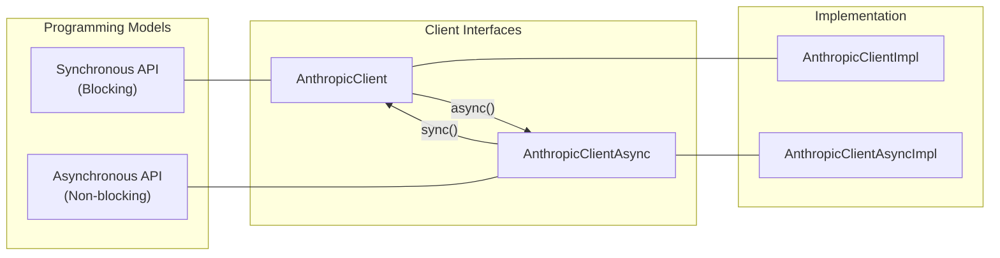
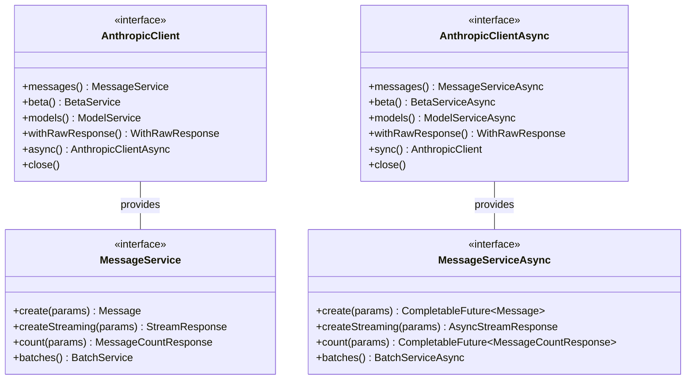
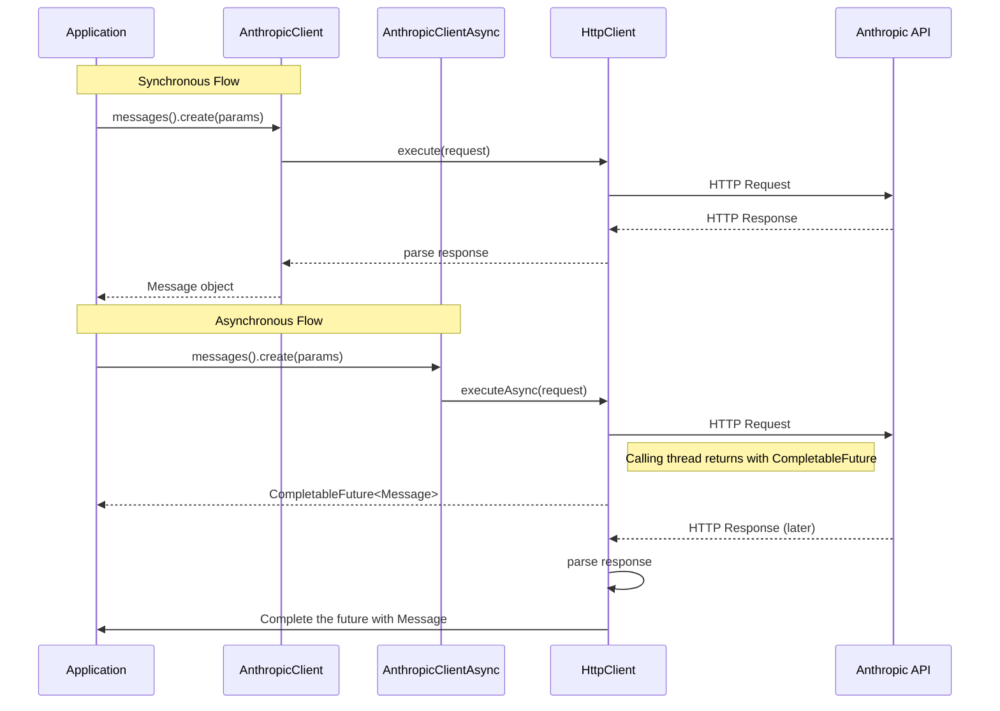

<!-- source: DeepWiki mcp.deepwiki.com · repo anthropics/anthropic-sdk-java · page 2.1 Synchronous vs Asynchronous API · fetched 2026-10-26 -->

# Synchronous vs Asynchronous API

<details>
<summary>Relevant source files</summary>

The following files were used as context for generating this wiki page:

- [.release-please-manifest.json](.release-please-manifest.json)
- [CHANGELOG.md](CHANGELOG.md)
- [README.md](README.md)
- [anthropic-java-core/src/main/kotlin/com/anthropic/client/AnthropicClient.kt](anthropic-java-core/src/main/kotlin/com/anthropic/client/AnthropicClient.kt)
- [anthropic-java-core/src/main/kotlin/com/anthropic/client/AnthropicClientAsync.kt](anthropic-java-core/src/main/kotlin/com/anthropic/client/AnthropicClientAsync.kt)
- [anthropic-java-core/src/main/kotlin/com/anthropic/client/AnthropicClientAsyncImpl.kt](anthropic-java-core/src/main/kotlin/com/anthropic/client/AnthropicClientAsyncImpl.kt)
- [anthropic-java-core/src/main/kotlin/com/anthropic/client/AnthropicClientImpl.kt](anthropic-java-core/src/main/kotlin/com/anthropic/client/AnthropicClientImpl.kt)
- [anthropic-java-core/src/main/kotlin/com/anthropic/core/http/HttpResponseFor.kt](anthropic-java-core/src/main/kotlin/com/anthropic/core/http/HttpResponseFor.kt)
- [anthropic-java-core/src/main/kotlin/com/anthropic/services/async/BetaServiceAsync.kt](anthropic-java-core/src/main/kotlin/com/anthropic/services/async/BetaServiceAsync.kt)
- [anthropic-java-example/src/main/java/com/anthropic/example/BatchAsyncExample.java](anthropic-java-example/src/main/java/com/anthropic/example/BatchAsyncExample.java)
- [anthropic-java-example/src/main/java/com/anthropic/example/BatchExample.java](anthropic-java-example/src/main/java/com/anthropic/example/BatchExample.java)
- [anthropic-java-example/src/main/java/com/anthropic/example/MessagesAsyncExample.java](anthropic-java-example/src/main/java/com/anthropic/example/MessagesAsyncExample.java)
- [anthropic-java-example/src/main/java/com/anthropic/example/MessagesConversationAsyncExample.java](anthropic-java-example/src/main/java/com/anthropic/example/MessagesConversationAsyncExample.java)
- [anthropic-java-example/src/main/java/com/anthropic/example/MessagesConversationExample.java](anthropic-java-example/src/main/java/com/anthropic/example/MessagesConversationExample.java)
- [anthropic-java-example/src/main/java/com/anthropic/example/MessagesExample.java](anthropic-java-example/src/main/java/com/anthropic/example/MessagesExample.java)
- [anthropic-java-example/src/main/java/com/anthropic/example/MessagesStreamingAsyncExample.java](anthropic-java-example/src/main/java/com/anthropic/example/MessagesStreamingAsyncExample.java)
- [anthropic-java-example/src/main/java/com/anthropic/example/MessagesStreamingExample.java](anthropic-java-example/src/main/java/com/anthropic/example/MessagesStreamingExample.java)
- [anthropic-java/build.gradle.kts](anthropic-java/build.gradle.kts)
- [build.gradle.kts](build.gradle.kts)

</details>


This page explains the two programming models offered by the Anthropic Java SDK: synchronous and asynchronous API access. It details how these interfaces are structured, how to create and switch between client types, and provides guidance on when to use each approach in your applications.

## Overview

The Anthropic Java SDK supports both synchronous (blocking) and asynchronous (non-blocking) programming patterns. This allows developers to choose the approach that best fits their application requirements:

- **Synchronous API**: Blocks the calling thread until the operation completes
- **Asynchronous API**: Allows operations to be performed without blocking, using callbacks or futures



Sources: [anthropic-java-core/src/main/kotlin/com/anthropic/client/AnthropicClient.kt](), [anthropic-java-core/src/main/kotlin/com/anthropic/client/AnthropicClientAsync.kt](), [anthropic-java-core/src/main/kotlin/com/anthropic/client/AnthropicClientImpl.kt](), [anthropic-java-core/src/main/kotlin/com/anthropic/client/AnthropicClientAsyncImpl.kt]()

## Client Interfaces

The SDK exposes two primary client interfaces:

### Synchronous Client

The `AnthropicClient` interface provides synchronous access to the Anthropic API. Methods on this interface directly return response objects and block the calling thread until a response is received.

```java
AnthropicClient client = AnthropicOkHttpClient.fromEnv();
Message message = client.messages().create(params); // Blocks until complete
```

### Asynchronous Client

The `AnthropicClientAsync` interface provides asynchronous access to the API. Methods on this interface return `CompletableFuture` objects, which allow non-blocking operation.

```java
AnthropicClientAsync client = AnthropicOkHttpClientAsync.fromEnv();
CompletableFuture<Message> future = client.messages().create(params); // Returns immediately
```

Sources: [anthropic-java-core/src/main/kotlin/com/anthropic/client/AnthropicClient.kt](), [anthropic-java-core/src/main/kotlin/com/anthropic/client/AnthropicClientAsync.kt](), [README.md:139-179]()

## Creating Clients

### Creating a Synchronous Client

```java
// Using environment variables
AnthropicClient client = AnthropicOkHttpClient.fromEnv();

// Or manually configuring
AnthropicClient client = AnthropicOkHttpClient.builder()
    .apiKey("your-api-key")
    .build();
```

### Creating an Asynchronous Client

```java
// Using environment variables
AnthropicClientAsync client = AnthropicOkHttpClientAsync.fromEnv();

// Or manually configuring
AnthropicClientAsync client = AnthropicOkHttpClientAsync.builder()
    .apiKey("your-api-key")
    .build();
```

Sources: [README.md:67-100](), [anthropic-java-example/src/main/java/com/anthropic/example/MessagesExample.java](), [anthropic-java-example/src/main/java/com/anthropic/example/MessagesAsyncExample.java]()

## Switching Between Client Types

The SDK provides convenient methods to switch between synchronous and asynchronous execution:

### From Synchronous to Asynchronous

```java
AnthropicClient syncClient = AnthropicOkHttpClient.fromEnv();
AnthropicClientAsync asyncClient = syncClient.async();
```

### From Asynchronous to Synchronous

```java
AnthropicClientAsync asyncClient = AnthropicOkHttpClientAsync.fromEnv();
AnthropicClient syncClient = asyncClient.sync();
```

When switching between client types, the new client shares resources like connection pools and thread pools with the original client.

Sources: [anthropic-java-core/src/main/kotlin/com/anthropic/client/AnthropicClient.kt:24-32](), [anthropic-java-core/src/main/kotlin/com/anthropic/client/AnthropicClientAsync.kt:24-32](), [README.md:138-179]()

## Method Return Types Comparison

The primary difference between the two client types is in their method return types:

| Operation | Synchronous Client | Asynchronous Client |
|-----------|-------------------|---------------------|
| Create Message | `Message` | `CompletableFuture<Message>` |
| Stream Message | `StreamResponse<RawMessageStreamEvent>` | `AsyncStreamResponse<RawMessageStreamEvent>` |
| List Models | `ModelList` | `CompletableFuture<ModelList>` |
| Create Batch | `MessageBatch` | `CompletableFuture<MessageBatch>` |

Sources: [README.md:139-179](), [anthropic-java-example/src/main/java/com/anthropic/example/MessagesExample.java](), [anthropic-java-example/src/main/java/com/anthropic/example/MessagesAsyncExample.java]()

## Service Interface Architecture



Sources: [anthropic-java-core/src/main/kotlin/com/anthropic/client/AnthropicClient.kt](), [anthropic-java-core/src/main/kotlin/com/anthropic/client/AnthropicClientAsync.kt]()

## Basic Usage Examples

### Synchronous API Example

```java
// Create a synchronous client
AnthropicClient client = AnthropicOkHttpClient.fromEnv();

// Build the message parameters
MessageCreateParams params = MessageCreateParams.builder()
    .model(Model.CLAUDE_3_5_SONNET_LATEST)
    .maxTokens(2048)
    .addUserMessage("Tell me a story about building the best SDK!")
    .build();

// Make a blocking API call
Message message = client.messages().create(params);

// Process the response
message.content().stream()
    .flatMap(contentBlock -> contentBlock.text().stream())
    .forEach(textBlock -> System.out.println(textBlock.text()));
```

### Asynchronous API Example

```java
// Create an asynchronous client
AnthropicClientAsync client = AnthropicOkHttpClientAsync.fromEnv();

// Build the message parameters
MessageCreateParams params = MessageCreateParams.builder()
    .model(Model.CLAUDE_3_5_SONNET_LATEST)
    .maxTokens(2048)
    .addUserMessage("Tell me a story about building the best SDK!")
    .build();

// Make a non-blocking API call
client.messages()
    .create(params)
    .thenAccept(message -> message.content().stream()
        .flatMap(contentBlock -> contentBlock.text().stream())
        .forEach(textBlock -> System.out.println(textBlock.text())))
    .join(); // Optional: block until complete
```

Sources: [anthropic-java-example/src/main/java/com/anthropic/example/MessagesExample.java](), [anthropic-java-example/src/main/java/com/anthropic/example/MessagesAsyncExample.java]()

## Streaming Comparison

Streaming is handled differently in the synchronous and asynchronous APIs:

### Synchronous Streaming

The synchronous API uses `StreamResponse<T>` which implements `AutoCloseable` and exposes a Java `Stream<T>` for processing:

```java
// Using try-with-resources to ensure the stream is closed
try (StreamResponse<RawMessageStreamEvent> streamResponse = 
        client.messages().createStreaming(params)) {
    streamResponse.stream()
        .flatMap(event -> event.contentBlockDelta().stream())
        .flatMap(deltaEvent -> deltaEvent.delta().text().stream())
        .forEach(textDelta -> System.out.print(textDelta.text()));
}
```

### Asynchronous Streaming

The asynchronous API uses `AsyncStreamResponse<T>` which provides subscription methods:

```java
client.messages()
    .createStreaming(params)
    .subscribe(event -> event.contentBlockDelta().stream()
        .flatMap(deltaEvent -> deltaEvent.delta().text().stream())
        .forEach(textDelta -> System.out.print(textDelta.text())))
    .onCompleteFuture()
    .join();
```

The asynchronous streaming interface also offers more comprehensive error handling:

```java
client.messages().createStreaming(params).subscribe(
    new AsyncStreamResponse.Handler<>() {
        @Override
        public void onNext(RawMessageStreamEvent chunk) {
            System.out.println(chunk);
        }

        @Override
        public void onComplete(Optional<Throwable> error) {
            if (error.isPresent()) {
                System.out.println("Error occurred:");
                error.get().printStackTrace();
            } else {
                System.out.println("Stream completed successfully");
            }
        }
    });
```

Sources: [README.md:185-246](), [anthropic-java-example/src/main/java/com/anthropic/example/MessagesStreamingExample.java](), [anthropic-java-example/src/main/java/com/anthropic/example/MessagesStreamingAsyncExample.java]()

## Conversation Flow Comparison

For multi-turn conversations, the approaches differ slightly:

### Synchronous Conversation Flow

```java
MessageCreateParams.Builder paramsBuilder = MessageCreateParams.builder()
    .model(Model.CLAUDE_3_5_SONNET_LATEST)
    .maxTokens(2048)
    .addUserMessage("Initial question");

for (int i = 0; i < 3; i++) {
    // Blocking call
    Message message = client.messages().create(paramsBuilder.build());
    
    // Process response
    // ...
    
    // Prepare for next turn
    paramsBuilder.addMessage(message).addUserMessage("Follow-up question");
}
```

### Asynchronous Conversation Flow

```java
MessageCreateParams.Builder paramsBuilder = MessageCreateParams.builder()
    .model(Model.CLAUDE_3_5_SONNET_LATEST)
    .maxTokens(2048)
    .addUserMessage("Initial question");

CompletableFuture<Void> future = CompletableFuture.completedFuture(null);

for (int i = 0; i < 3; i++) {
    final int index = i;
    future = future
        .thenComposeAsync(unused -> 
            client.messages().create(paramsBuilder.build()))
        .thenAccept(message -> {
            // Process response
            // ...
            
            // Prepare for next turn
            paramsBuilder.addMessage(message)
                .addUserMessage("Follow-up question " + index);
        });
}

// Wait for all turns to complete
future.join();
```

Sources: [anthropic-java-example/src/main/java/com/anthropic/example/MessagesConversationExample.java](), [anthropic-java-example/src/main/java/com/anthropic/example/MessagesConversationAsyncExample.java]()

## Error Handling

Both API styles handle errors but in different ways:

### Synchronous Error Handling

In the synchronous API, errors are thrown as exceptions:

```java
try {
    Message message = client.messages().create(params);
    // Process message
} catch (BadRequestException e) {
    // Handle 400 error
} catch (RateLimitException e) {
    // Handle rate limit
} catch (AnthropicException e) {
    // Handle other API errors
}
```

### Asynchronous Error Handling

In the asynchronous API, errors are delivered through the CompletableFuture exception handling:

```java
client.messages().create(params)
    .thenAccept(message -> {
        // Process message
    })
    .exceptionally(throwable -> {
        if (throwable.getCause() instanceof BadRequestException) {
            // Handle 400 error
        } else if (throwable.getCause() instanceof RateLimitException) {
            // Handle rate limit
        } else {
            // Handle other API errors
        }
        return null;
    });
```

Sources: [README.md:380-404]()

## When to Use Each API Style

### Use Synchronous API When:

1. You have simple, sequential workflows
2. Your application doesn't need to maintain responsiveness during API calls
3. You prefer simpler, more straightforward code structure
4. You're writing scripts or command-line tools

### Use Asynchronous API When:

1. You need to maintain UI responsiveness during API calls
2. You want to execute multiple operations concurrently
3. You're building a server application handling multiple requests
4. You need to perform other tasks while waiting for responses
5. You're implementing a reactive programming model

## Resource Management

Both client types hold their own connection pools and thread pools. Resources are shared when switching between synchronous and asynchronous modes using `async()` or `sync()`.

For efficient resource usage:
- Create a single client instance and reuse it
- Only call `close()` when you're completely done with the client

The clients automatically release idle resources, but you can explicitly close them if needed:

```java
// Synchronous close
client.close();

// Asynchronous close
asyncClient.close();
```

Sources: [anthropic-java-core/src/main/kotlin/com/anthropic/client/AnthropicClient.kt:47-58](), [anthropic-java-core/src/main/kotlin/com/anthropic/client/AnthropicClientAsync.kt:47-58](), [README.md:110-113]()

## Implementation Details



Sources: [anthropic-java-core/src/main/kotlin/com/anthropic/client/AnthropicClientImpl.kt](), [anthropic-java-core/src/main/kotlin/com/anthropic/client/AnthropicClientAsyncImpl.kt](), [README.md:115-401]()

## Conclusion

The Anthropic Java SDK offers flexible API access through both synchronous and asynchronous programming models. By understanding the differences between these approaches, you can choose the most appropriate style for your application's needs.

For more details about other aspects of the SDK, see:
- [Streaming Response Handling](#4)
- [Error Handling](#2.3)
- [HTTP Communication Layer](#2.2)

---

