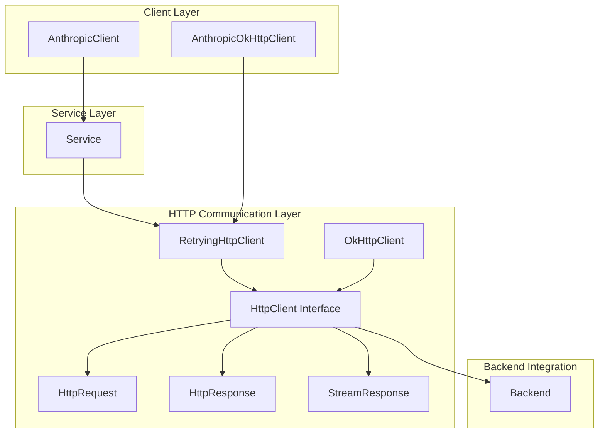
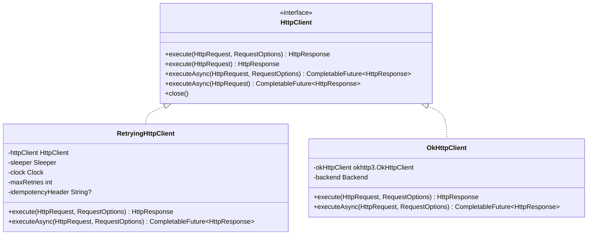
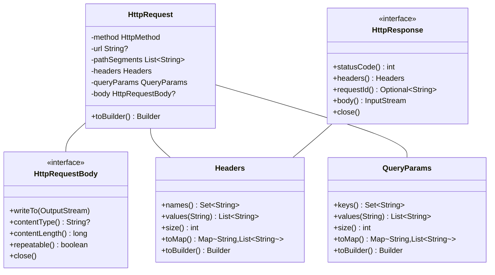
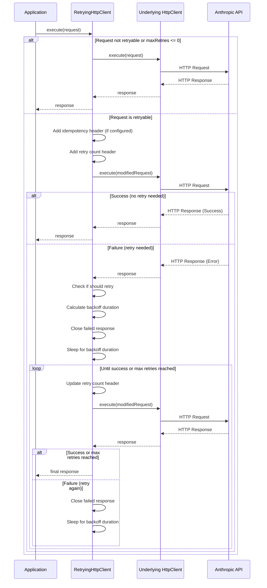
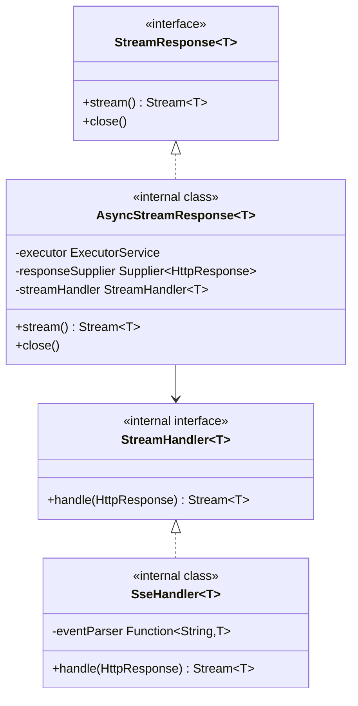
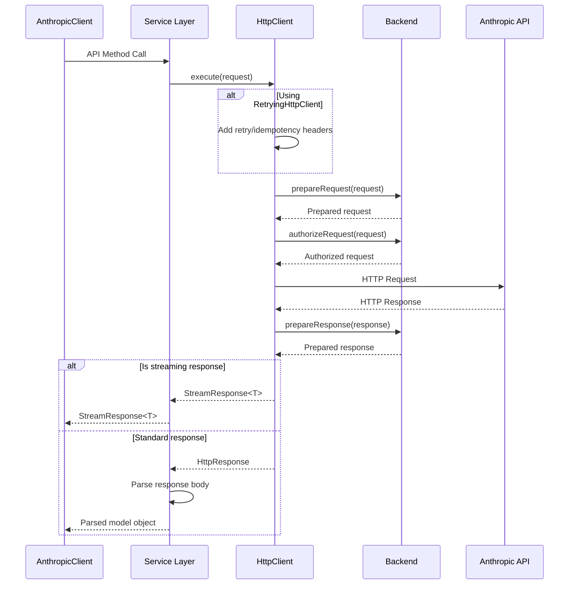
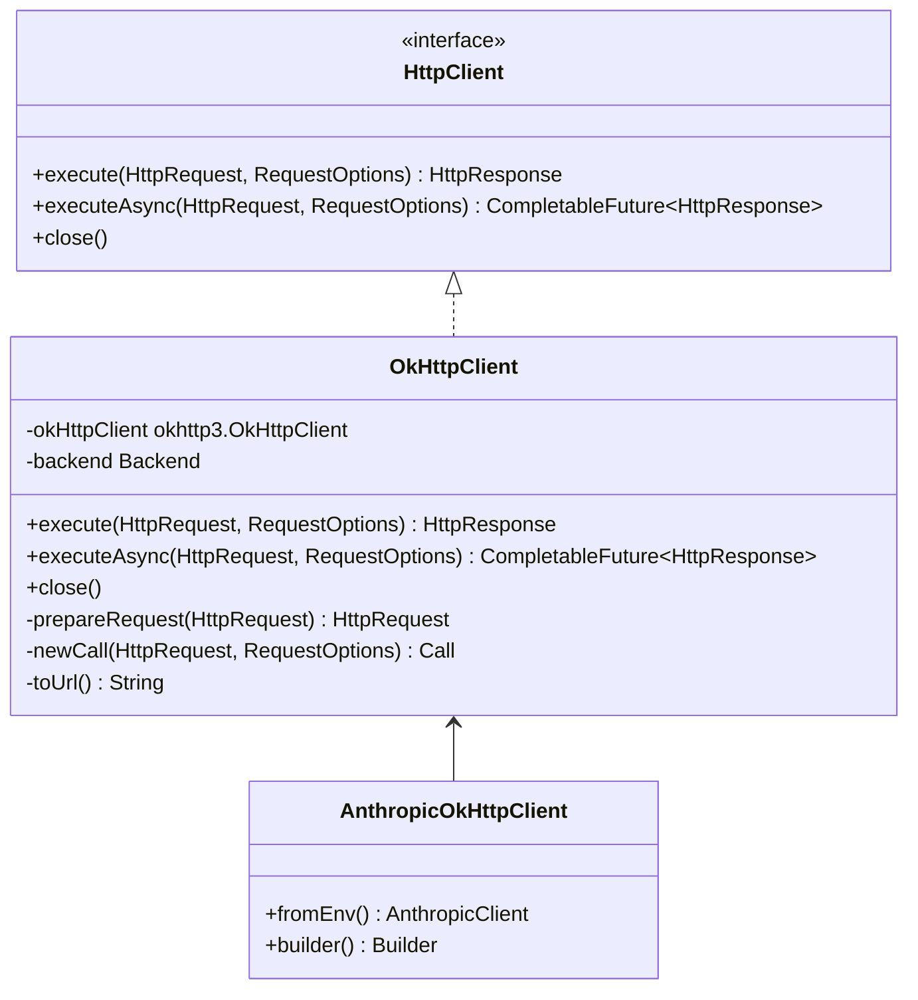

<!-- source: DeepWiki mcp.deepwiki.com · repo anthropics/anthropic-sdk-java · page 2.2 HTTP Communication Layer · fetched 2026-10-26 -->

# HTTP Communication Layer

Relevant source files

The following files were used as context for generating this wiki page:

- [anthropic-java-client-okhttp/src/main/kotlin/com/anthropic/client/okhttp/OkHttpClient.kt](anthropic-java-client-okhttp/src/main/kotlin/com/anthropic/client/okhttp/OkHttpClient.kt)
- [anthropic-java-core/src/main/kotlin/com/anthropic/core/Check.kt](anthropic-java-core/src/main/kotlin/com/anthropic/core/Check.kt)
- [anthropic-java-core/src/main/kotlin/com/anthropic/core/http/HttpClient.kt](anthropic-java-core/src/main/kotlin/com/anthropic/core/http/HttpClient.kt)
- [anthropic-java-core/src/main/kotlin/com/anthropic/core/http/HttpRequest.kt](anthropic-java-core/src/main/kotlin/com/anthropic/core/http/HttpRequest.kt)
- [anthropic-java-core/src/main/kotlin/com/anthropic/core/http/HttpRequestBody.kt](anthropic-java-core/src/main/kotlin/com/anthropic/core/http/HttpRequestBody.kt)
- [anthropic-java-core/src/main/kotlin/com/anthropic/core/http/HttpResponse.kt](anthropic-java-core/src/main/kotlin/com/anthropic/core/http/HttpResponse.kt)
- [anthropic-java-core/src/main/kotlin/com/anthropic/core/http/RetryingHttpClient.kt](anthropic-java-core/src/main/kotlin/com/anthropic/core/http/RetryingHttpClient.kt)
- [anthropic-java-core/src/main/kotlin/com/anthropic/core/http/StreamResponse.kt](anthropic-java-core/src/main/kotlin/com/anthropic/core/http/StreamResponse.kt)
- [anthropic-java-core/src/test/kotlin/com/anthropic/core/PhantomReachableTest.kt](anthropic-java-core/src/test/kotlin/com/anthropic/core/PhantomReachableTest.kt)
- [anthropic-java-core/src/test/kotlin/com/anthropic/core/http/HeadersTest.kt](anthropic-java-core/src/test/kotlin/com/anthropic/core/http/HeadersTest.kt)
- [anthropic-java-core/src/test/kotlin/com/anthropic/core/http/QueryParamsTest.kt](anthropic-java-core/src/test/kotlin/com/anthropic/core/http/QueryParamsTest.kt)
- [anthropic-java-core/src/test/kotlin/com/anthropic/core/http/RetryingHttpClientTest.kt](anthropic-java-core/src/test/kotlin/com/anthropic/core/http/RetryingHttpClientTest.kt)
- [anthropic-java-core/src/test/kotlin/com/anthropic/services/ErrorHandlingTest.kt](anthropic-java-core/src/test/kotlin/com/anthropic/services/ErrorHandlingTest.kt)
- [anthropic-java-core/src/test/kotlin/com/anthropic/services/ServiceParamsTest.kt](anthropic-java-core/src/test/kotlin/com/anthropic/services/ServiceParamsTest.kt)
- [buildSrc/src/main/kotlin/anthropic.kotlin.gradle.kts](buildSrc/src/main/kotlin/anthropic.kotlin.gradle.kts)
- [gradle.properties](gradle.properties)

The HTTP Communication Layer in the Anthropic Java SDK manages all network interactions between client applications and the Anthropic API. This layer abstracts away the complexities of HTTP communication, providing robust mechanisms for request execution, response handling, automatic retries, and streaming responses.

Sources: [anthropic-java-core/src/main/kotlin/com/anthropic/core/http/HttpClient.kt:1-27](), [anthropic-java-core/src/main/kotlin/com/anthropic/core/http/HttpResponse.kt:1-31]()

## Architecture Overview

The HTTP Communication Layer sits between the Service Layer and Backend Integration, providing a uniform interface for making HTTP requests while adding features like automatic retries, error handling, and streaming response management.

Sources: [anthropic-java-core/src/main/kotlin/com/anthropic/core/http/HttpClient.kt:1-27](), [anthropic-java-core/src/main/kotlin/com/anthropic/core/http/RetryingHttpClient.kt:1-287]()

## Core Components

### HttpClient Interface

The `HttpClient` interface is the central component of the HTTP communication layer, defining methods for executing both synchronous and asynchronous HTTP requests.

The `HttpClient` interface provides:
- Synchronous request execution via `execute()` methods
- Asynchronous request execution via `executeAsync()` methods, which return `CompletableFuture<HttpResponse>`
- Resource cleanup through the `close()` method

Key implementations include:
- `RetryingHttpClient`: Adds retry capability to any underlying HTTP client
- `OkHttpClient`: An implementation that uses the OkHttp library for actual HTTP communication

Sources: [anthropic-java-core/src/main/kotlin/com/anthropic/core/http/HttpClient.kt:1-27](), [anthropic-java-core/src/main/kotlin/com/anthropic/core/http/RetryingHttpClient.kt:23-31](), [anthropic-java-client-okhttp/src/main/kotlin/com/anthropic/client/okhttp/OkHttpClient.kt:31-34]()

### HttpRequest and HttpResponse

The `HttpRequest` class represents an outgoing HTTP request, while the `HttpResponse` interface represents the incoming response.

Key features:
- `HttpRequest` provides a builder pattern for easy construction of requests
- `HttpResponse` exposes status code, headers, and body via a consistent interface
- `Headers` and `QueryParams` classes provide case-insensitive, multi-value collections
- `HttpRequestBody` defines an interface for request bodies that can be written to an output stream

Sources: [anthropic-java-core/src/main/kotlin/com/anthropic/core/http/HttpRequest.kt:1-151](), [anthropic-java-core/src/main/kotlin/com/anthropic/core/http/HttpResponse.kt:1-31](), [anthropic-java-core/src/main/kotlin/com/anthropic/core/http/HttpRequestBody.kt:1-26]()

## Retry Mechanism

The `RetryingHttpClient` adds automatic retry capability to any `HttpClient` implementation, using configurable policies.

### Key Features of the Retry Mechanism

1. **Configurable Retry Policies**
   - Maximum number of retries (default: 2)
   - Customizable idempotency header
   - Built-in retry determination based on status codes and exceptions

2. **Smart Backoff Strategy**
   - Exponential backoff with jitter
   - Respects `Retry-After` and `Retry-After-Ms` headers
   - Default maximum backoff of 8 seconds

3. **Retry Decision Logic**
   - Retries on 408 (Request Timeout), 409 (Conflict), 429 (Rate Limit), and 5xx (Server Errors)
   - Retries on network errors (`IOException`) and `AnthropicIoException`
   - Supports explicit control via `X-Should-Retry` header

4. **Resource Management**
   - Ensures proper cleanup of intermediate responses before retrying

Sources: [anthropic-java-core/src/main/kotlin/com/anthropic/core/http/RetryingHttpClient.kt:23-286](), [anthropic-java-core/src/test/kotlin/com/anthropic/core/http/RetryingHttpClientTest.kt:21-263]()

## Streaming Response Handling

The `StreamResponse` interface provides a way to handle streaming responses from the API, particularly important for handling large language model outputs.

Key features:
- `StreamResponse<T>` provides access to a Stream of parsed events
- Streaming responses are automatically closed when the stream is exhausted or the client is closed
- Support for SSE (Server-Sent Events) through `SseHandler`
- Transformation capabilities through the `map` extension function

Sources: [anthropic-java-core/src/main/kotlin/com/anthropic/core/http/StreamResponse.kt:1-20]()

## Request-Response Flow

This diagram illustrates the complete request-response flow through the HTTP Communication Layer, showing how requests are processed, authorized, and executed, and how responses are handled.

Sources: [anthropic-java-client-okhttp/src/main/kotlin/com/anthropic/client/okhttp/OkHttpClient.kt:34-85](), [anthropic-java-core/src/main/kotlin/com/anthropic/core/http/RetryingHttpClient.kt:32-130]()

## Error Handling

The HTTP Communication Layer provides comprehensive error handling for HTTP errors and network issues. For more details about specific error types and handling, see [Error Handling](#2.3).

Key aspects of error handling in the HTTP layer:

1. **Exception Propagation**
   - Network errors are wrapped in `AnthropicIoException`
   - HTTP errors are converted to specific exception types based on status code

2. **Retry Integration**
   - `RetryingHttpClient` automatically retries on transient errors
   - Respects rate limiting through the `Retry-After` header

3. **Resource Cleanup**
   - Error responses are properly closed to avoid resource leaks
   - Uses try-finally blocks and CompletableFuture callbacks to ensure cleanup

Sources: [anthropic-java-core/src/test/kotlin/com/anthropic/services/ErrorHandlingTest.kt:1-768](), [anthropic-java-core/src/main/kotlin/com/anthropic/core/http/RetryingHttpClient.kt:156-181]()

## Implementation Details

### OkHttp Implementation

The SDK provides a concrete implementation of the `HttpClient` interface using the OkHttp library:

Key features of the OkHttp implementation:
- Configurable via builder pattern
- Support for timeout configuration
- Logging through environment variable `ANTHROPIC_LOG`
- Proper resource management

Sources: [anthropic-java-client-okhttp/src/main/kotlin/com/anthropic/client/okhttp/OkHttpClient.kt:31-240]()

### Resource Management

The HTTP Communication Layer carefully manages resources to prevent leaks:

1. **AutoCloseable**
   - All key interfaces implement `AutoCloseable`
   - Overridden to remove checked exceptions from signature

2. **Response Closure**
   - Responses are automatically closed when streams are exhausted
   - Failed responses during retries are explicitly closed
   - CompletableFuture callbacks ensure closure in async scenarios

3. **Phantom Reference Tracking**
   - Uses phantom references to track unreachable objects
   - Ensures resources are cleaned up if clients forget to call `close()`

Sources: [anthropic-java-core/src/main/kotlin/com/anthropic/core/http/HttpResponse.kt:8-25](), [anthropic-java-core/src/main/kotlin/com/anthropic/core/http/StreamResponse.kt:5-11](), [anthropic-java-core/src/test/kotlin/com/anthropic/core/PhantomReachableTest.kt:1-28]()

## Integration with Other Layers

The HTTP Communication Layer integrates with:

1. **Backend Integration Layer**
   - Backends prepare and authorize requests
   - Backends process responses before returning them

2. **Service Layer**
   - Services construct requests and handle responses
   - Services use the HTTP layer for all API communication

3. **Client Layer**
   - Provides configuration of HTTP clients
   - Manages lifecycle of HTTP resources

Sources: [anthropic-java-client-okhttp/src/main/kotlin/com/anthropic/client/okhttp/OkHttpClient.kt:80-86]()

---

