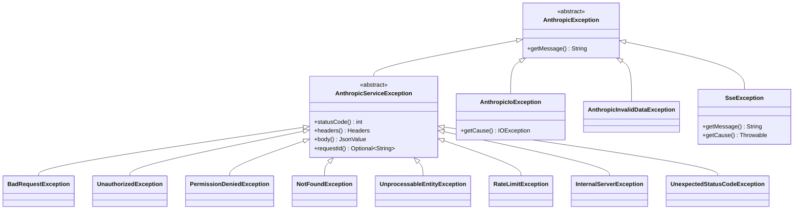
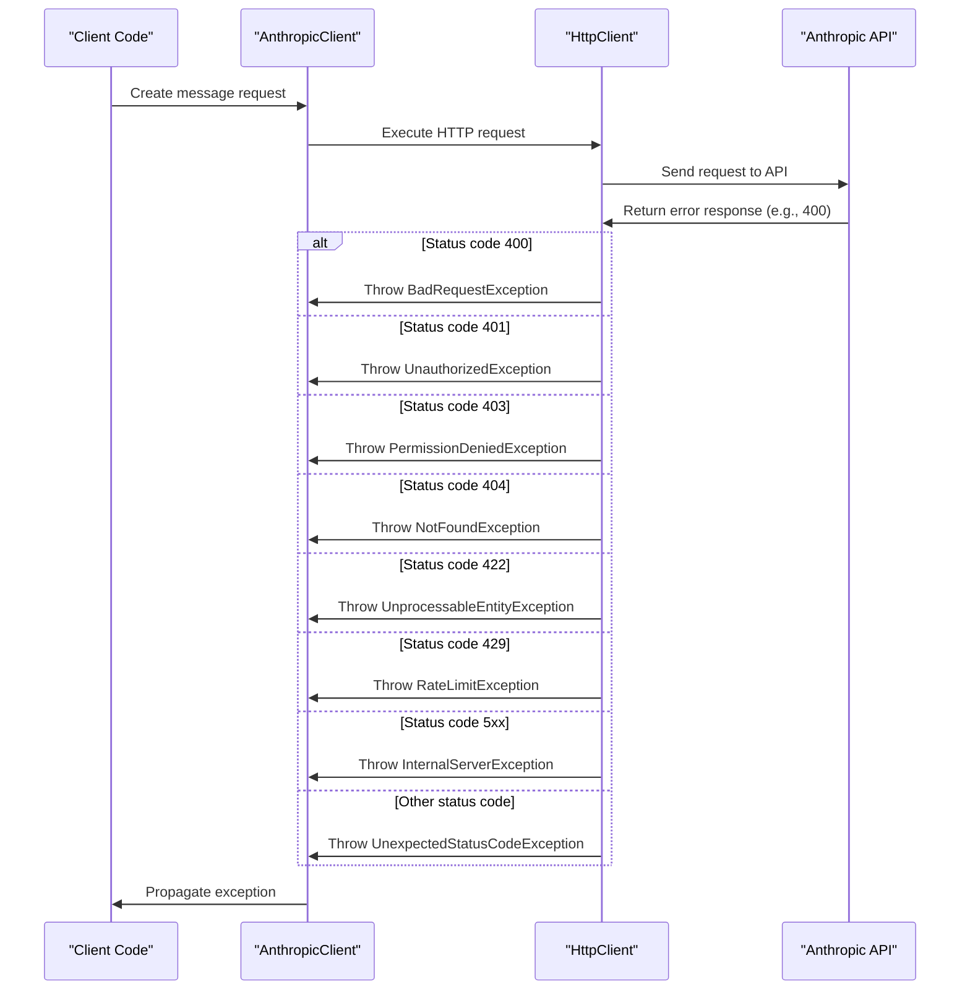
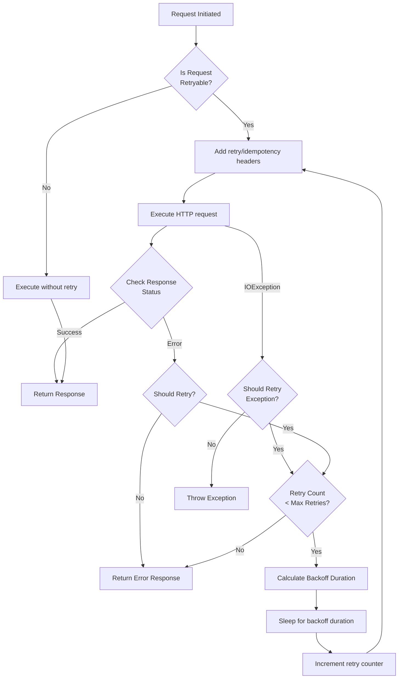
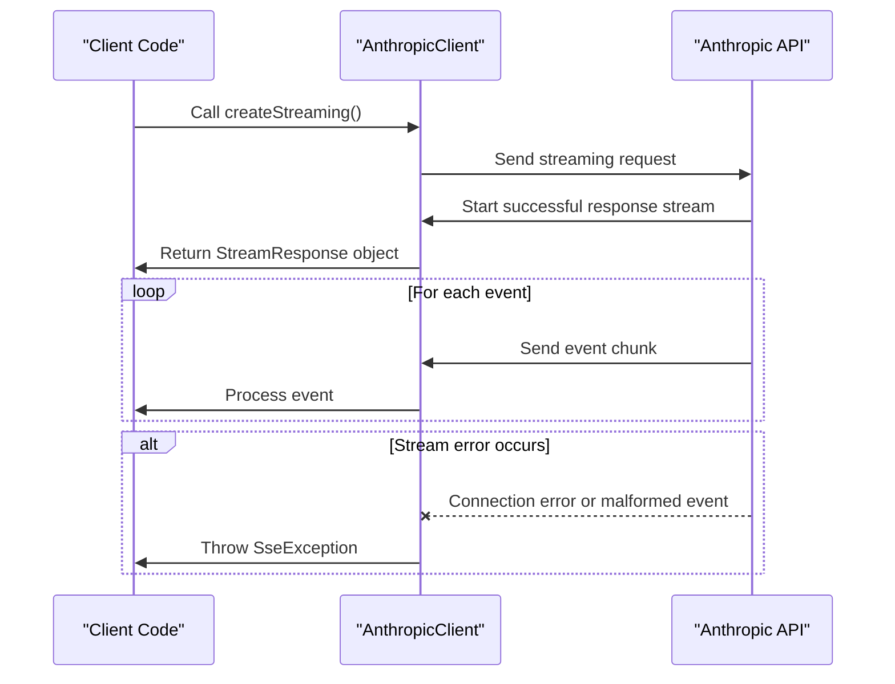

<!-- source: DeepWiki mcp.deepwiki.com · repo anthropics/anthropic-sdk-java · page 2.3 Error Handling · fetched 2026-10-26 -->

# Error Handling

<details>
<summary>Relevant source files</summary>

The following files were used as context for generating this wiki page:

- [.release-please-manifest.json](.release-please-manifest.json)
- [CHANGELOG.md](CHANGELOG.md)
- [README.md](README.md)
- [anthropic-java-core/src/main/kotlin/com/anthropic/core/http/RetryingHttpClient.kt](anthropic-java-core/src/main/kotlin/com/anthropic/core/http/RetryingHttpClient.kt)
- [anthropic-java-core/src/test/kotlin/com/anthropic/core/PhantomReachableTest.kt](anthropic-java-core/src/test/kotlin/com/anthropic/core/PhantomReachableTest.kt)
- [anthropic-java-core/src/test/kotlin/com/anthropic/core/http/HeadersTest.kt](anthropic-java-core/src/test/kotlin/com/anthropic/core/http/HeadersTest.kt)
- [anthropic-java-core/src/test/kotlin/com/anthropic/core/http/QueryParamsTest.kt](anthropic-java-core/src/test/kotlin/com/anthropic/core/http/QueryParamsTest.kt)
- [anthropic-java-core/src/test/kotlin/com/anthropic/core/http/RetryingHttpClientTest.kt](anthropic-java-core/src/test/kotlin/com/anthropic/core/http/RetryingHttpClientTest.kt)
- [anthropic-java-core/src/test/kotlin/com/anthropic/services/ErrorHandlingTest.kt](anthropic-java-core/src/test/kotlin/com/anthropic/services/ErrorHandlingTest.kt)
- [anthropic-java-core/src/test/kotlin/com/anthropic/services/ServiceParamsTest.kt](anthropic-java-core/src/test/kotlin/com/anthropic/services/ServiceParamsTest.kt)
- [anthropic-java/build.gradle.kts](anthropic-java/build.gradle.kts)
- [build.gradle.kts](build.gradle.kts)
- [buildSrc/src/main/kotlin/anthropic.kotlin.gradle.kts](buildSrc/src/main/kotlin/anthropic.kotlin.gradle.kts)
- [gradle.properties](gradle.properties)

</details>


This document describes the error handling mechanisms in the Anthropic Java SDK. It covers the exception hierarchy, how different types of errors are handled, retry mechanisms, and best practices for error handling in your applications using the SDK.

## 1. Exception Hierarchy

The Anthropic Java SDK uses a structured exception hierarchy to represent different types of errors that can occur during API interactions. All exceptions extend from a common base class.



Sources: [README.md:380-404]()

### Exception Types

| Status Code | Exception Class | Description |
|-------------|-----------------|-------------|
| 400 | `BadRequestException` | Malformed request or invalid parameters |
| 401 | `UnauthorizedException` | Invalid or missing API key |
| 403 | `PermissionDeniedException` | Valid API key but lacks permissions |
| 404 | `NotFoundException` | Requested resource not found |
| 422 | `UnprocessableEntityException` | Request validation failed |
| 429 | `RateLimitException` | Rate limit exceeded |
| 5xx | `InternalServerException` | Server-side errors |
| Other | `UnexpectedStatusCodeException` | Any other status code |

Additional Exception Types:
- `SseException`: Errors during Server-Sent Events (SSE) streaming after initial successful response
- `AnthropicIoException`: Network I/O errors
- `AnthropicInvalidDataException`: Data parsing or interpretation failures
- `AnthropicException`: Base class for all SDK exceptions

Sources: [README.md:380-404](), [anthropic-java-core/src/test/kotlin/com/anthropic/services/ErrorHandlingTest.kt:1-550]()

## 2. HTTP Error Handling

When the SDK makes HTTP requests to the Anthropic API, responses with error status codes are automatically converted to the appropriate exception type.



Sources: [README.md:380-404](), [anthropic-java-core/src/test/kotlin/com/anthropic/services/ErrorHandlingTest.kt:1-550]()

### Accessing Error Details

All `AnthropicServiceException` instances provide access to important details about the error:

```java
try {
    // Make API call
    client.messages().create(params);
} catch (AnthropicServiceException e) {
    int statusCode = e.statusCode();          // HTTP status code
    Headers headers = e.headers();            // Response headers
    JsonValue errorBody = e.body();           // Error response body as JsonValue
    Optional<String> requestId = e.requestId(); // Request ID for troubleshooting
    
    // Handle error based on status code or other properties
}
```

The `requestId()` method provides convenient access to the `request-id` header, which is useful for reporting issues to Anthropic support.

Sources: [README.md:364-378]()

## 3. Retry Mechanism

The SDK includes an automatic retry mechanism for certain transient errors. This is implemented in the `RetryingHttpClient` class.



Sources: [anthropic-java-core/src/main/kotlin/com/anthropic/core/http/RetryingHttpClient.kt:1-287](), [anthropic-java-core/src/test/kotlin/com/anthropic/core/http/RetryingHttpClientTest.kt:1-264]()

### Retry Configuration

By default, the SDK retries requests up to 2 times with exponential backoff. You can customize this behavior:

```java
AnthropicClient client = AnthropicOkHttpClient.builder()
    .fromEnv()
    .maxRetries(4)  // Set custom number of retries
    .build();
```

Sources: [README.md:679-702]()

### Conditions for Retry

Only specific error types are retried automatically:

1. Connection errors (network issues)
2. HTTP status codes:
   - 408 Request Timeout
   - 409 Conflict
   - 429 Rate Limit
   - 5xx Internal Server errors
3. Explicit retry instructions via response headers

The SDK will honor the `Retry-After` or `Retry-After-Ms` headers if the server provides them, adjusting the backoff duration accordingly.

Sources: [anthropic-java-core/src/main/kotlin/com/anthropic/core/http/RetryingHttpClient.kt:134-181]()

### Idempotency

For requests that might be retried, the SDK can add an idempotency header to ensure that duplicate requests aren't processed multiple times. This is particularly important for operations that might have side effects.

Sources: [anthropic-java-core/src/main/kotlin/com/anthropic/core/http/RetryingHttpClient.kt:144-154]()

## 4. Streaming Error Handling

The SDK provides special handling for errors that occur during streaming responses. While a normal error before or during the initial response is handled by the regular exception hierarchy, errors that occur after a streaming response has begun are represented by `SseException`.



Source: [README.md:397-398]()

### Error Handling in Streaming Code

In streaming code, you should handle both regular `AnthropicServiceException` exceptions (which can occur before streaming starts) and `SseException` (which can occur during streaming):

```java
try {
    StreamResponse<RawMessageStreamEvent> response = client.messages().createStreaming(params);
    response.stream().forEach(event -> {
        // Process events
    });
} catch (AnthropicServiceException e) {
    // Handle API errors
    System.err.println("API error: " + e.statusCode() + " - " + e.body());
} catch (SseException e) {
    // Handle streaming errors
    System.err.println("Streaming error: " + e.getMessage());
}
```

For asynchronous streaming, errors can be handled using the `onComplete` callback which receives an `Optional<Throwable>`:

```java
client.async().messages().createStreaming(params).subscribe(
    new AsyncStreamResponse.Handler<>() {
        @Override
        public void onNext(RawMessageStreamEvent chunk) {
            // Process chunk
        }

        @Override
        public void onComplete(Optional<Throwable> error) {
            if (error.isPresent()) {
                // Handle error
                Throwable e = error.get();
                // Check exception type and handle appropriately
            } else {
                // Stream completed successfully
            }
        }
    }
);
```

Sources: [README.md:210-246]()

## 5. Best Practices for Error Handling

### Catching Specific Exceptions

Rather than catching the general `AnthropicException`, catch specific exceptions to handle different error cases appropriately:

```java
try {
    client.messages().create(params);
} catch (RateLimitException e) {
    // Implement backoff or retry strategy
} catch (UnauthorizedException e) {
    // Handle authentication issues
} catch (BadRequestException e) {
    // Fix request parameters
} catch (InternalServerException e) {
    // Maybe retry later
} catch (AnthropicIoException e) {
    // Handle network issues
} catch (AnthropicException e) {
    // Catch-all for any other errors
}
```

### Using Request IDs for Troubleshooting

When reporting issues to Anthropic support, always include the request ID:

```java
try {
    client.messages().create(params);
} catch (AnthropicServiceException e) {
    Optional<String> requestId = e.requestId();
    logger.error("Error with request ID {}: {}", requestId.orElse("unknown"), e.getMessage());
}
```

For raw responses, use the `requestId()` helper method:

```java
HttpResponseFor<Message> response = client.messages().withRawResponse().create(params);
Optional<String> requestId = response.requestId();
```

Sources: [README.md:364-378]()

### Accessing Raw Error Data

For complex error handling or logging, you can access the raw error data from the exception:

```java
try {
    client.messages().create(params);
} catch (AnthropicServiceException e) {
    int statusCode = e.statusCode();
    Headers headers = e.headers();
    JsonValue errorBody = e.body();
    
    // Access specific error fields
    String errorMessage = errorBody.get("message").asString().orElse("Unknown error");
    String errorType = errorBody.get("type").asString().orElse("Unknown type");
    
    logger.error("API error {}: {} ({})", statusCode, errorMessage, errorType);
}
```

Sources: [anthropic-java-core/src/test/kotlin/com/anthropic/services/ErrorHandlingTest.kt:146-150]()

## 6. Error Handling Implementation Details

### Error Response Processing

When an HTTP request results in an error status code, the SDK processes the response through a series of steps:

1. The HTTP response is received with an error status code
2. The status code is mapped to the appropriate exception type
3. The response headers and body are extracted
4. A new exception instance is created with the error details
5. The exception is thrown back to the caller

This process ensures that all relevant error information is preserved and accessible to your application code.

### Retry Implementation

The `RetryingHttpClient` implements the retry logic:

```mermaid
classDiagram
    class HttpClient {
        <<interface>>
        +execute(HttpRequest, RequestOptions) HttpResponse
        +executeAsync(HttpRequest, RequestOptions) CompletableFuture~HttpResponse~
        +close() void
    }
    
    class RetryingHttpClient {
        -httpClient: HttpClient
        -sleeper: Sleeper
        -clock: Clock
        -maxRetries: int
        -idempotencyHeader: String?
        +execute(HttpRequest, RequestOptions) HttpResponse
        +executeAsync(HttpRequest, RequestOptions) CompletableFuture~HttpResponse~
        -isRetryable(HttpRequest) boolean
        -shouldRetry(HttpResponse) boolean
        -shouldRetry(Throwable) boolean
        -getRetryBackoffDuration(int, HttpResponse?) Duration
    }
    
    class RetryingHttpClient.Builder {
        +httpClient(HttpClient) Builder
        +clock(Clock) Builder
        +maxRetries(int) Builder
        +idempotencyHeader(String) Builder
        +build() HttpClient
    }
    
    class RetryingHttpClient.Sleeper {
        <<interface>>
        +sleep(Duration) void
        +sleepAsync(Duration) CompletableFuture~Void~
    }
    
    HttpClient <|.. RetryingHttpClient : implements
    RetryingHttpClient +-- RetryingHttpClient.Builder
    RetryingHttpClient +-- RetryingHttpClient.Sleeper
```

Sources: [anthropic-java-core/src/main/kotlin/com/anthropic/core/http/RetryingHttpClient.kt:23-286]()

The `RetryingHttpClient` uses a configurable backoff strategy. When a retryable error occurs:

1. It calculates the appropriate backoff duration
2. If the API provides a `Retry-After` or `Retry-After-Ms` header, it respects that timing
3. Otherwise, it uses exponential backoff with jitter
4. It increments the retry counter and adds it as a header on the next attempt
5. It sleeps for the calculated duration before retrying

Sources: [anthropic-java-core/src/main/kotlin/com/anthropic/core/http/RetryingHttpClient.kt:183-226]()

---

