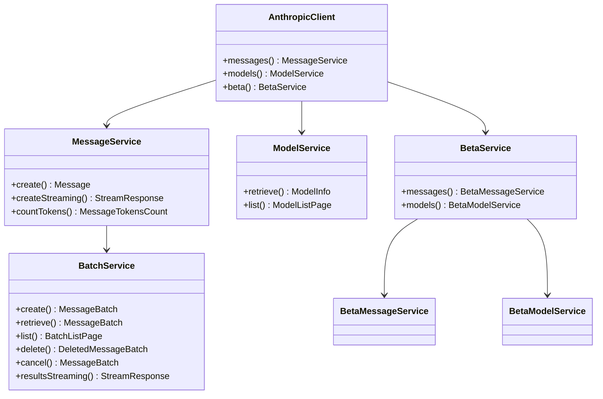
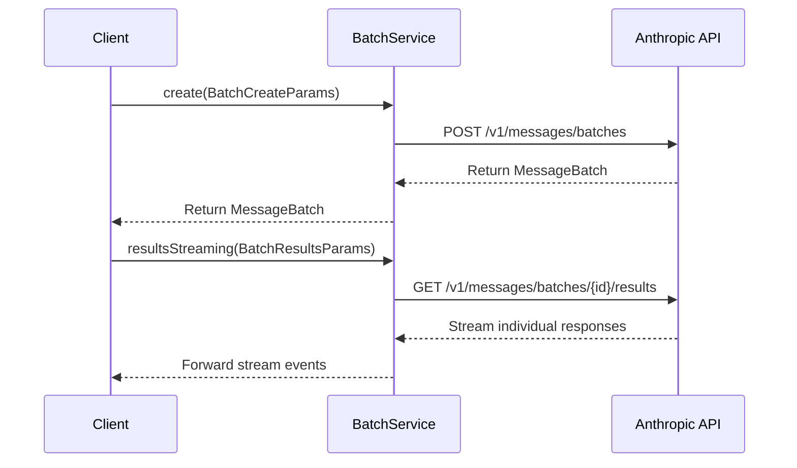
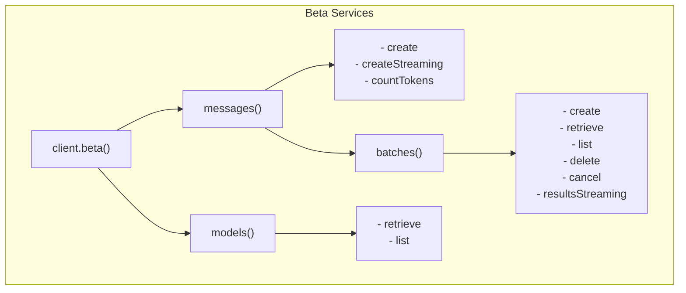
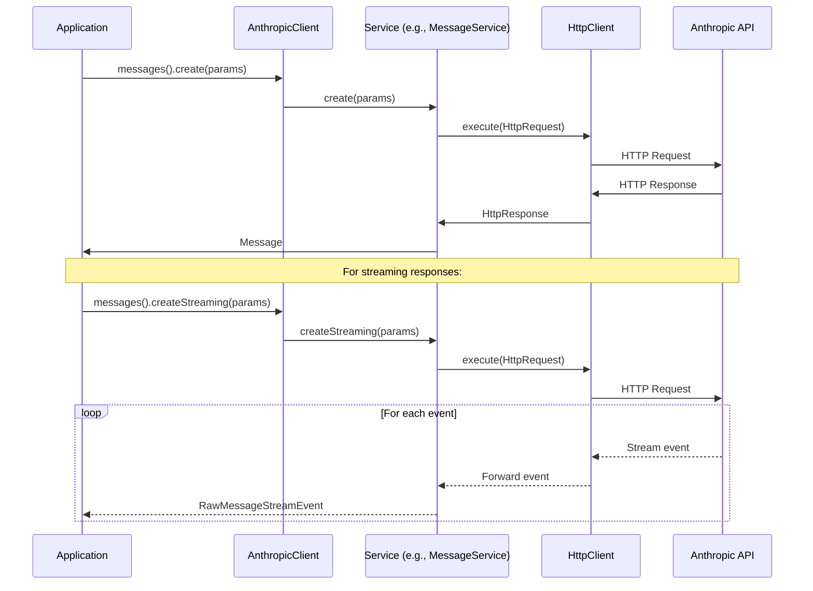

<!-- source: DeepWiki mcp.deepwiki.com · repo anthropics/anthropic-sdk-java · page 3 Services and Operations · fetched 2026-10-26 -->

# Services and Operations

<details>
<summary>Relevant source files</summary>

The following files were used as context for generating this wiki page:

- [.release-please-manifest.json](.release-please-manifest.json)
- [CHANGELOG.md](CHANGELOG.md)
- [README.md](README.md)
- [anthropic-java-core/src/main/kotlin/com/anthropic/services/async/ModelServiceAsyncImpl.kt](anthropic-java-core/src/main/kotlin/com/anthropic/services/async/ModelServiceAsyncImpl.kt)
- [anthropic-java-core/src/main/kotlin/com/anthropic/services/async/beta/ModelServiceAsyncImpl.kt](anthropic-java-core/src/main/kotlin/com/anthropic/services/async/beta/ModelServiceAsyncImpl.kt)
- [anthropic-java-core/src/main/kotlin/com/anthropic/services/async/beta/messages/BatchServiceAsyncImpl.kt](anthropic-java-core/src/main/kotlin/com/anthropic/services/async/beta/messages/BatchServiceAsyncImpl.kt)
- [anthropic-java-core/src/main/kotlin/com/anthropic/services/async/messages/BatchServiceAsyncImpl.kt](anthropic-java-core/src/main/kotlin/com/anthropic/services/async/messages/BatchServiceAsyncImpl.kt)
- [anthropic-java-core/src/main/kotlin/com/anthropic/services/blocking/ModelServiceImpl.kt](anthropic-java-core/src/main/kotlin/com/anthropic/services/blocking/ModelServiceImpl.kt)
- [anthropic-java-core/src/main/kotlin/com/anthropic/services/blocking/beta/ModelServiceImpl.kt](anthropic-java-core/src/main/kotlin/com/anthropic/services/blocking/beta/ModelServiceImpl.kt)
- [anthropic-java-core/src/main/kotlin/com/anthropic/services/blocking/beta/messages/BatchServiceImpl.kt](anthropic-java-core/src/main/kotlin/com/anthropic/services/blocking/beta/messages/BatchServiceImpl.kt)
- [anthropic-java-core/src/main/kotlin/com/anthropic/services/blocking/messages/BatchServiceImpl.kt](anthropic-java-core/src/main/kotlin/com/anthropic/services/blocking/messages/BatchServiceImpl.kt)
- [anthropic-java-core/src/test/kotlin/com/anthropic/services/blocking/MessageServiceTest.kt](anthropic-java-core/src/test/kotlin/com/anthropic/services/blocking/MessageServiceTest.kt)
- [anthropic-java-core/src/test/kotlin/com/anthropic/services/blocking/beta/MessageServiceTest.kt](anthropic-java-core/src/test/kotlin/com/anthropic/services/blocking/beta/MessageServiceTest.kt)
- [anthropic-java-core/src/test/kotlin/com/anthropic/services/blocking/beta/messages/BatchServiceTest.kt](anthropic-java-core/src/test/kotlin/com/anthropic/services/blocking/beta/messages/BatchServiceTest.kt)
- [anthropic-java/build.gradle.kts](anthropic-java/build.gradle.kts)
- [build.gradle.kts](build.gradle.kts)

</details>


This page documents the core services and operations available in the Anthropic Java SDK. It covers the standard services (Message, Batch, Model) and their operations, as well as the Beta versions of these services that contain experimental features. For detailed information on streaming responses and accumulating messages, see [Streaming Response Handling](#4).

## Service Architecture

The Anthropic Java SDK organizes functionality into a hierarchy of services. Each service provides specific operations for interacting with the Anthropic API.



Sources: 
- [README.md:1-248]()
- [anthropic-java-core/src/main/kotlin/com/anthropic/services/blocking/MessageServiceImpl.kt]()
- [anthropic-java-core/src/main/kotlin/com/anthropic/services/blocking/ModelServiceImpl.kt]()

## Message Service

The Message Service provides operations for creating messages and counting tokens. It is the primary interface for interacting with Claude's capabilities.

### Operations

#### 1. Create Message

Creates a new message and returns a response from Claude.

```java
MessageCreateParams params = MessageCreateParams.builder()
    .maxTokens(1024L)
    .addUserMessage("Hello, Claude")
    .model(Model.CLAUDE_3_7_SONNET_LATEST)
    .build();
Message message = client.messages().create(params);
```

#### 2. Create Message (Streaming)

Creates a new message with a streaming response, allowing you to process the response as it is generated.

```java
MessageCreateParams params = MessageCreateParams.builder()
    .maxTokens(1024L)
    .addUserMessage("Hello, Claude")
    .model(Model.CLAUDE_3_7_SONNET_LATEST)
    .build();
StreamResponse<RawMessageStreamEvent> streamResponse = client.messages().createStreaming(params);
```

#### 3. Count Tokens

Counts tokens in a message without generating a response. Useful for checking if a message is within token limits.

```java
MessageCountTokensParams params = MessageCountTokensParams.builder()
    .addUserMessage("Hello, Claude")
    .model(Model.CLAUDE_3_7_SONNET_LATEST)
    .build();
MessageTokensCount tokenCount = client.messages().countTokens(params);
```

Sources:
- [anthropic-java-core/src/test/kotlin/com/anthropic/services/blocking/MessageServiceTest.kt:1-247]()
- [README.md:45-64]()

## Batch Service

The Batch Service provides operations for asynchronous batch processing of multiple message requests. Batch processing is useful for handling many requests efficiently without waiting for immediate responses.



### Operations

#### 1. Create Batch

Creates a new message batch containing multiple requests.

```java
BatchCreateParams params = BatchCreateParams.builder()
    .addRequest(
        BatchCreateParams.Request.builder()
            .customId("request-1")
            .params(
                BatchCreateParams.Request.Params.builder()
                    .maxTokens(1024L)
                    .addUserMessage("Hello, Claude")
                    .model(Model.CLAUDE_3_7_SONNET_LATEST)
                    .build()
            )
            .build()
    )
    .build();
MessageBatch batch = client.messages().batches().create(params);
```

#### 2. Retrieve Batch

Retrieves information about a specific batch by ID.

```java
BatchRetrieveParams params = BatchRetrieveParams.builder()
    .messageBatchId("batch_id")
    .build();
MessageBatch batch = client.messages().batches().retrieve(params);
```

#### 3. List Batches

Lists all message batches, with pagination support.

```java
BatchListPage page = client.messages().batches().list();
for (MessageBatch batch : page.autoPager()) {
    System.out.println(batch.id());
}
```

#### 4. Delete Batch

Deletes a message batch by ID.

```java
BatchDeleteParams params = BatchDeleteParams.builder()
    .messageBatchId("batch_id")
    .build();
DeletedMessageBatch deleted = client.messages().batches().delete(params);
```

#### 5. Cancel Batch

Cancels a running message batch by ID.

```java
BatchCancelParams params = BatchCancelParams.builder()
    .messageBatchId("batch_id")
    .build();
MessageBatch batch = client.messages().batches().cancel(params);
```

#### 6. Stream Batch Results

Streams individual results from a completed batch.

```java
BatchResultsParams params = BatchResultsParams.builder()
    .messageBatchId("batch_id")
    .build();
StreamResponse<MessageBatchIndividualResponse> stream = 
    client.messages().batches().resultsStreaming(params);
```

Sources:
- [anthropic-java-core/src/main/kotlin/com/anthropic/services/blocking/messages/BatchServiceImpl.kt:1-278]()
- [anthropic-java-core/src/main/kotlin/com/anthropic/services/async/messages/BatchServiceAsyncImpl.kt:1-286]()

## Model Service

The Model Service provides operations for retrieving information about available Claude models.

### Operations

#### 1. Retrieve Model

Retrieves information about a specific model by ID.

```java
ModelRetrieveParams params = ModelRetrieveParams.builder()
    .modelId("claude-3-sonnet-20240229")
    .build();
ModelInfo model = client.models().retrieve(params);
```

#### 2. List Models

Lists all available models, with pagination support.

```java
ModelListPage page = client.models().list();
for (ModelInfo model : page.autoPager()) {
    System.out.println(model.id());
}
```

Sources:
- [anthropic-java-core/src/main/kotlin/com/anthropic/services/blocking/ModelServiceImpl.kt:1-106]()
- [anthropic-java-core/src/main/kotlin/com/anthropic/services/async/ModelServiceAsyncImpl.kt:1-119]()

## Beta Services

The Beta namespace contains experimental features that may change in the future. Access beta services through the `beta()` method of the client.



### Beta Message Service

The Beta Message Service is similar to the standard Message Service but includes experimental features like enhanced system messages and new tool options.

```java
// Create a message with beta features
MessageCreateParams params = MessageCreateParams.builder()
    .addBeta(AnthropicBeta.MESSAGE_BATCHES_2024_09_24)
    .maxTokens(1024L)
    .addUserMessage("Hello, Claude")
    .model(Model.CLAUDE_3_7_SONNET_LATEST)
    .systemOfBetaTextBlockParams(
        List.of(
            BetaTextBlockParam.builder()
                .text("Today's date is 2024-06-01.")
                .cacheControl(BetaCacheControlEphemeral.builder().build())
                .build()
        )
    )
    .build();
BetaMessage message = client.beta().messages().create(params);
```

### Beta Batch Service

The Beta Batch Service provides experimental batch processing features.

```java
// Create a batch with beta features
BatchCreateParams params = BatchCreateParams.builder()
    .addBeta(AnthropicBeta.MESSAGE_BATCHES_2024_09_24)
    .addRequest(
        BatchCreateParams.Request.builder()
            .customId("request-1")
            .params(
                BatchCreateParams.Request.Params.builder()
                    .maxTokens(1024L)
                    .addUserMessage("Hello, Claude")
                    .model(Model.CLAUDE_3_7_SONNET_LATEST)
                    .build()
            )
            .build()
    )
    .build();
BetaMessageBatch batch = client.beta().messages().batches().create(params);
```

### Beta Model Service

The Beta Model Service provides access to experimental model information.

```java
// List models with beta features
ModelListPage page = client.beta().models().list();
```

Sources:
- [anthropic-java-core/src/test/kotlin/com/anthropic/services/blocking/beta/MessageServiceTest.kt:1-255]()
- [anthropic-java-core/src/test/kotlin/com/anthropic/services/blocking/beta/messages/BatchServiceTest.kt:1-227]()
- [anthropic-java-core/src/main/kotlin/com/anthropic/services/blocking/beta/ModelServiceImpl.kt:1-111]()

## Request-Response Flow

The following diagram illustrates how requests flow through the SDK to the Anthropic API:



Sources:
- [README.md:115-178]()
- [anthropic-java-core/src/main/kotlin/com/anthropic/services/blocking/MessageServiceImpl.kt]()

## Synchronous vs Asynchronous Operations

All services support both synchronous and asynchronous operations. Use the `async()` method to switch to asynchronous execution:

```java
// Synchronous
Message message = client.messages().create(params);

// Asynchronous
CompletableFuture<Message> messageFuture = client.async().messages().create(params);
```

For asynchronous streaming, the API returns an `AsyncStreamResponse`:

```java
AsyncStreamResponse<RawMessageStreamEvent> streamResponse = 
    client.async().messages().createStreaming(params);
    
streamResponse.subscribe(event -> {
    // Process each event as it arrives
    System.out.println(event);
});
```

Sources:
- [README.md:138-179]()

## Error Handling

All service operations may throw exceptions. Handle them appropriately:

```java
try {
    Message message = client.messages().create(params);
} catch (BadRequestException e) {
    // Handle 400 errors
} catch (RateLimitException e) {
    // Handle 429 errors
} catch (AnthropicServiceException e) {
    // Handle other API errors
} catch (AnthropicException e) {
    // Handle any other Anthropic SDK exception
}
```

For more information on error handling, see [Error Handling](#2.3).

Sources:
- [README.md:380-404]()

## Pagination

Services that return lists of objects (like `models().list()` and `messages().batches().list()`) support pagination. Use the `autoPager()` method to iterate through all results:

```java
// Automatically iterate through all pages
BatchListPage page = client.messages().batches().list();
for (MessageBatch batch : page.autoPager()) {
    System.out.println(batch.id());
}

// Manually control pagination
while (page != null) {
    for (MessageBatch batch : page.data()) {
        System.out.println(batch.id());
    }
    page = page.getNextPage().orElse(null);
}
```

Sources:
- [README.md:405-456]()

---

