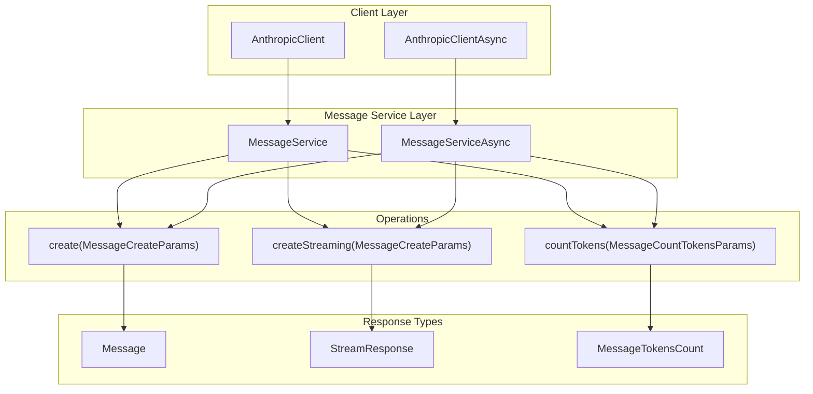
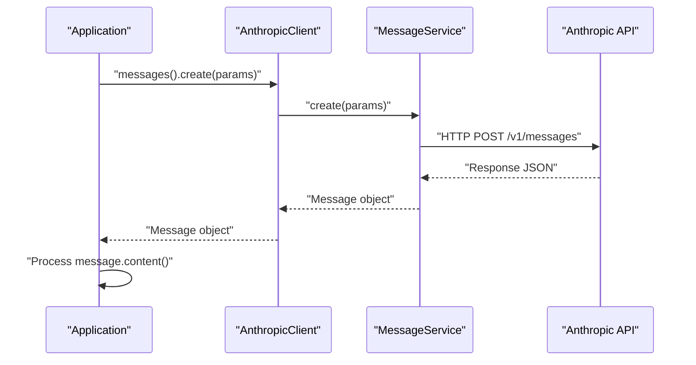
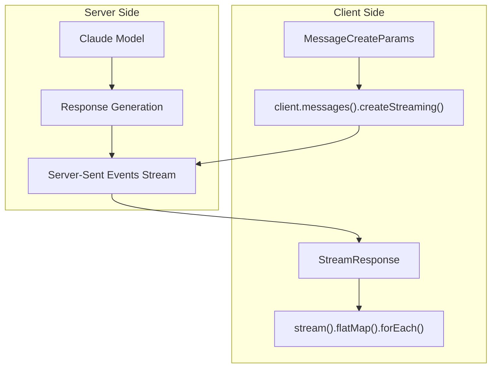
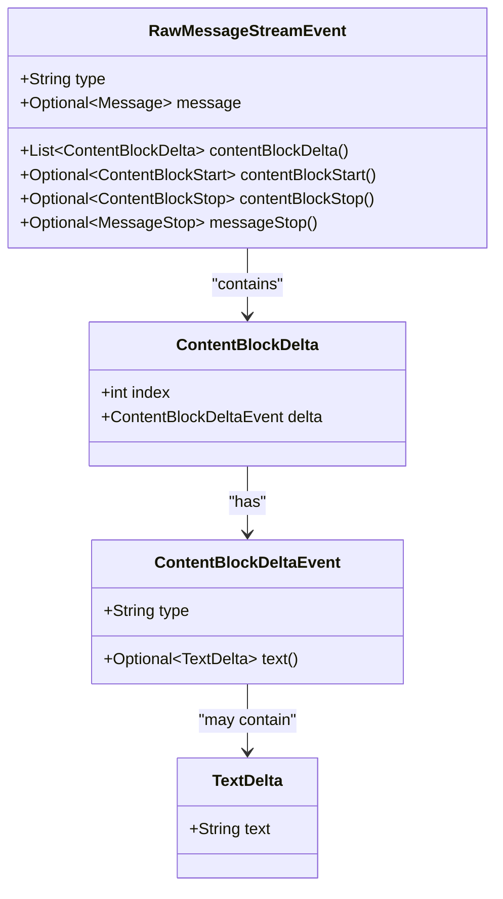
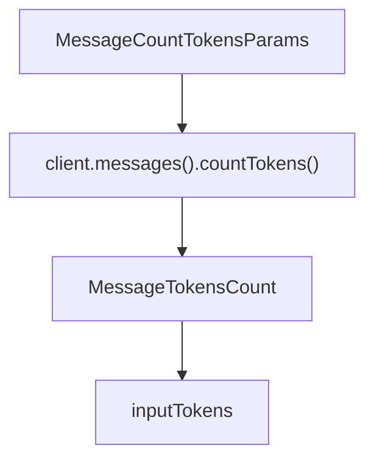

<!-- source: DeepWiki mcp.deepwiki.com · repo anthropics/anthropic-sdk-java · page 3.1 Message Operations · fetched 2026-10-26 -->

# Message Operations

<details>
<summary>Relevant source files</summary>

The following files were used as context for generating this wiki page:

- [anthropic-java-core/src/main/kotlin/com/anthropic/models/beta/messages/MessageCountTokensParams.kt](anthropic-java-core/src/main/kotlin/com/anthropic/models/beta/messages/MessageCountTokensParams.kt)
- [anthropic-java-core/src/main/kotlin/com/anthropic/models/beta/messages/MessageCreateParams.kt](anthropic-java-core/src/main/kotlin/com/anthropic/models/beta/messages/MessageCreateParams.kt)
- [anthropic-java-core/src/main/kotlin/com/anthropic/models/beta/messages/batches/BatchCreateParams.kt](anthropic-java-core/src/main/kotlin/com/anthropic/models/beta/messages/batches/BatchCreateParams.kt)
- [anthropic-java-core/src/main/kotlin/com/anthropic/models/completions/CompletionCreateParams.kt](anthropic-java-core/src/main/kotlin/com/anthropic/models/completions/CompletionCreateParams.kt)
- [anthropic-java-core/src/main/kotlin/com/anthropic/models/messages/MessageCountTokensParams.kt](anthropic-java-core/src/main/kotlin/com/anthropic/models/messages/MessageCountTokensParams.kt)
- [anthropic-java-core/src/main/kotlin/com/anthropic/models/messages/MessageCreateParams.kt](anthropic-java-core/src/main/kotlin/com/anthropic/models/messages/MessageCreateParams.kt)
- [anthropic-java-core/src/main/kotlin/com/anthropic/models/messages/batches/BatchCreateParams.kt](anthropic-java-core/src/main/kotlin/com/anthropic/models/messages/batches/BatchCreateParams.kt)
- [anthropic-java-core/src/test/kotlin/com/anthropic/services/blocking/MessageServiceTest.kt](anthropic-java-core/src/test/kotlin/com/anthropic/services/blocking/MessageServiceTest.kt)
- [anthropic-java-core/src/test/kotlin/com/anthropic/services/blocking/beta/MessageServiceTest.kt](anthropic-java-core/src/test/kotlin/com/anthropic/services/blocking/beta/MessageServiceTest.kt)
- [anthropic-java-core/src/test/kotlin/com/anthropic/services/blocking/beta/messages/BatchServiceTest.kt](anthropic-java-core/src/test/kotlin/com/anthropic/services/blocking/beta/messages/BatchServiceTest.kt)
- [anthropic-java-example/src/main/java/com/anthropic/example/BatchAsyncExample.java](anthropic-java-example/src/main/java/com/anthropic/example/BatchAsyncExample.java)
- [anthropic-java-example/src/main/java/com/anthropic/example/BatchExample.java](anthropic-java-example/src/main/java/com/anthropic/example/BatchExample.java)
- [anthropic-java-example/src/main/java/com/anthropic/example/MessagesAsyncExample.java](anthropic-java-example/src/main/java/com/anthropic/example/MessagesAsyncExample.java)
- [anthropic-java-example/src/main/java/com/anthropic/example/MessagesConversationAsyncExample.java](anthropic-java-example/src/main/java/com/anthropic/example/MessagesConversationAsyncExample.java)
- [anthropic-java-example/src/main/java/com/anthropic/example/MessagesConversationExample.java](anthropic-java-example/src/main/java/com/anthropic/example/MessagesConversationExample.java)
- [anthropic-java-example/src/main/java/com/anthropic/example/MessagesExample.java](anthropic-java-example/src/main/java/com/anthropic/example/MessagesExample.java)
- [anthropic-java-example/src/main/java/com/anthropic/example/MessagesStreamingAsyncExample.java](anthropic-java-example/src/main/java/com/anthropic/example/MessagesStreamingAsyncExample.java)
- [anthropic-java-example/src/main/java/com/anthropic/example/MessagesStreamingExample.java](anthropic-java-example/src/main/java/com/anthropic/example/MessagesStreamingExample.java)

</details>


This document covers the core operations for interacting with Claude AI models through the Anthropic Java SDK's Messages API. You'll learn how to create messages, stream responses, and count tokens, which are the fundamental building blocks for any application using Claude.

For information about batch processing multiple message requests simultaneously, see [Batch Operations](#3.2).

## Message Operations Overview

The Anthropic Java SDK provides three primary message operations:

1. **Message Creation** - Send inputs to Claude and receive a complete response
2. **Message Streaming** - Receive Claude's response in real-time as it's being generated
3. **Token Counting** - Calculate the token usage of a message without generating a response

These operations are available through the `MessageService` interface, accessed via the `messages()` method on the `AnthropicClient`.



Sources:
- [anthropic-java-example/src/main/java/com/anthropic/example/MessagesExample.java]()
- [anthropic-java-example/src/main/java/com/anthropic/example/MessagesStreamingExample.java]()
- [anthropic-java-core/src/test/kotlin/com/anthropic/services/blocking/MessageServiceTest.kt]()

## Message Creation

The basic message creation operation allows you to send inputs to Claude and receive a complete response.

### Synchronous Message Creation

The simplest way to create a message is using the synchronous client:



Sources:
- [anthropic-java-example/src/main/java/com/anthropic/example/MessagesExample.java:11-24]()

Example code:

```java
AnthropicClient client = AnthropicOkHttpClient.fromEnv();

MessageCreateParams createParams = MessageCreateParams.builder()
        .model(Model.CLAUDE_3_5_SONNET_LATEST)
        .maxTokens(2048)
        .addUserMessage("Tell me a story about building the best SDK!")
        .build();

client.messages().create(createParams).content().stream()
        .flatMap(contentBlock -> contentBlock.text().stream())
        .forEach(textBlock -> System.out.println(textBlock.text()));
```

### Asynchronous Message Creation

For non-blocking operations, use the asynchronous client:

```java
AnthropicClientAsync client = AnthropicOkHttpClientAsync.fromEnv();

client.messages()
        .create(createParams)
        .thenAccept(message -> message.content().stream()
                .flatMap(contentBlock -> contentBlock.text().stream())
                .forEach(textBlock -> System.out.println(textBlock.text())))
        .join();
```

Sources:
- [anthropic-java-example/src/main/java/com/anthropic/example/MessagesAsyncExample.java:11-27]()

### Multi-turn Conversations

To create a conversation with multiple turns, add previous messages to the history:

```java
MessageCreateParams.Builder createParamsBuilder = MessageCreateParams.builder()
        .model(Model.CLAUDE_3_5_SONNET_LATEST)
        .maxTokens(2048)
        .addUserMessage("Tell me a story about building the best SDK!");

// First message
Message message = client.messages().create(createParamsBuilder.build());

// Second message, adding the first message to history
createParamsBuilder.addMessage(message).addUserMessage("Make it shorter.");
Message followupMessage = client.messages().create(createParamsBuilder.build());
```

Sources:
- [anthropic-java-example/src/main/java/com/anthropic/example/MessagesConversationExample.java:16-33]()

### Message Creation Parameters

The following table shows the key parameters available when creating a message:

| Parameter | Type | Description | Required |
|-----------|------|-------------|----------|
| `model` | `Model` | The Claude model to use | Yes |
| `maxTokens` | `Long` | Maximum tokens to generate | Yes |
| `messages` | `List<MessageParam>` | Conversation history | Yes |
| `system` | `String` or `System` | System prompt instructions | No |
| `metadata` | `Metadata` | Custom metadata about the request | No |
| `temperature` | `Double` | Controls randomness (0.0-1.0) | No |
| `stopSequences` | `List<String>` | Custom stop sequences | No |
| `tools` | `List<ToolUnion>` | Tool definitions | No |
| `toolChoice` | `ToolChoice` | How to use tools | No |
| `thinking` | `ThinkingConfigParam` | Extended thinking settings | No |
| `topK` | `Long` | Token sampling limitation | No |
| `topP` | `Double` | Nucleus sampling parameter | No |

Sources:
- [anthropic-java-core/src/main/kotlin/com/anthropic/models/messages/MessageCreateParams.kt:44-562]()
- [anthropic-java-core/src/test/kotlin/com/anthropic/services/blocking/MessageServiceTest.kt:22-98]()

## Message Streaming

Streaming allows you to receive Claude's response incrementally as it's being generated, rather than waiting for the complete response.

### Synchronous Streaming



Sources:
- [anthropic-java-example/src/main/java/com/anthropic/example/MessagesStreamingExample.java:14-30]()

Example code:

```java
AnthropicClient client = AnthropicOkHttpClient.fromEnv();

MessageCreateParams createParams = MessageCreateParams.builder()
        .model(Model.CLAUDE_3_5_SONNET_LATEST)
        .maxTokens(2048)
        .addUserMessage("Tell me a story about building the best SDK!")
        .build();

try (StreamResponse<RawMessageStreamEvent> streamResponse =
        client.messages().createStreaming(createParams)) {
    streamResponse.stream()
            .flatMap(event -> event.contentBlockDelta().stream())
            .flatMap(deltaEvent -> deltaEvent.delta().text().stream())
            .forEach(textDelta -> System.out.print(textDelta.text()));
}
```

### Asynchronous Streaming

For non-blocking streaming operations:

```java
AnthropicClientAsync client = AnthropicOkHttpClientAsync.fromEnv();

client.messages()
        .createStreaming(createParams)
        .subscribe(event -> event.contentBlockDelta().stream()
                .flatMap(deltaEvent -> deltaEvent.delta().text().stream())
                .forEach(textDelta -> System.out.print(textDelta.text())))
        .onCompleteFuture()
        .join();
```

Sources:
- [anthropic-java-example/src/main/java/com/anthropic/example/MessagesStreamingAsyncExample.java:11-28]()

### Understanding Stream Events

When streaming, you receive a series of `RawMessageStreamEvent` objects that you need to process:



The most common pattern for extracting text is to:
1. Process each `RawMessageStreamEvent`
2. Extract the `contentBlockDelta` elements
3. Extract the `delta.text()` from each delta event
4. Process the text content

Sources:
- [anthropic-java-example/src/main/java/com/anthropic/example/MessagesStreamingExample.java:26-29]()
- [anthropic-java-example/src/main/java/com/anthropic/example/MessagesStreamingAsyncExample.java:23-25]()

## Token Counting

The token counting API allows you to calculate the number of tokens in a message without actually generating a response. This is useful for estimating costs or ensuring your requests stay within token limits.



Sources:
- [anthropic-java-core/src/main/kotlin/com/anthropic/models/messages/MessageCountTokensParams.kt]()
- [anthropic-java-core/src/test/kotlin/com/anthropic/services/blocking/MessageServiceTest.kt:179-246]()

Example code:

```java
AnthropicClient client = AnthropicOkHttpClient.fromEnv();

MessageCountTokensParams countParams = MessageCountTokensParams.builder()
        .addUserMessage("Hello, world")
        .model(Model.CLAUDE_3_5_SONNET_LATEST)
        .build();

MessageTokensCount tokenCount = client.messages().countTokens(countParams);

// Access token count information
long inputTokens = tokenCount.inputTokens();
```

The `MessageCountTokensParams` accept most of the same parameters as `MessageCreateParams` that affect token counting:

| Parameter | Type | Description | Required |
|-----------|------|-------------|----------|
| `model` | `Model` | The Claude model to use | Yes |
| `messages` | `List<MessageParam>` | Messages to count tokens for | Yes |
| `system` | `String` or `System` | System prompt (if any) | No |
| `tools` | `List<MessageCountTokensTool>` | Tool definitions (if any) | No |
| `thinking` | `ThinkingConfigParam` | Extended thinking settings | No |

Sources:
- [anthropic-java-core/src/main/kotlin/com/anthropic/models/messages/MessageCountTokensParams.kt:44-427]()

## Best Practices

### Resource Management

Always close streaming responses when you're done with them, preferably using try-with-resources:

```java
try (StreamResponse<RawMessageStreamEvent> response = client.messages().createStreaming(params)) {
    // Process stream
}
```

### Error Handling

The SDK throws exceptions for various error conditions. Handle these appropriately:

```java
try {
    Message message = client.messages().create(params);
    // Process message
} catch (AnthropicException e) {
    // Handle error based on e.getStatusCode(), e.getMessage(), etc.
}
```

### Parameter Reuse

Use parameter builders to efficiently create multiple related requests:

```java
MessageCreateParams.Builder paramsBuilder = MessageCreateParams.builder()
        .model(Model.CLAUDE_3_5_SONNET_LATEST)
        .maxTokens(2048);

// Create first message
paramsBuilder.addUserMessage("Hello!");
Message first = client.messages().create(paramsBuilder.build());

// Create follow-up message with conversation history
paramsBuilder.addMessage(first).addUserMessage("Tell me more.");
Message second = client.messages().create(paramsBuilder.build());
```

Sources:
- [anthropic-java-example/src/main/java/com/anthropic/example/MessagesConversationExample.java:16-33]()

## Related Operations

- For batch processing multiple message requests, see [Batch Operations](#3.2)
- For retrieving model information, see [Model Operations](#3.3)

---

