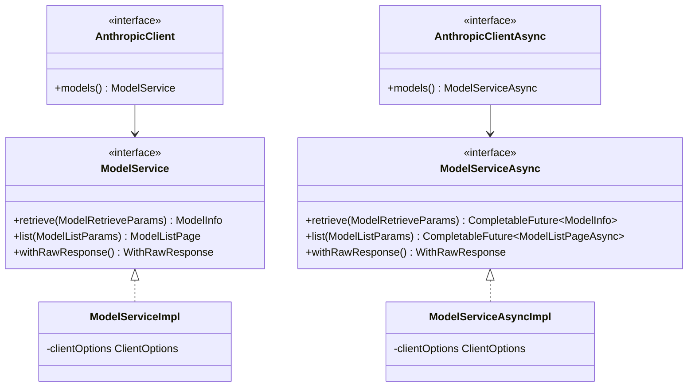
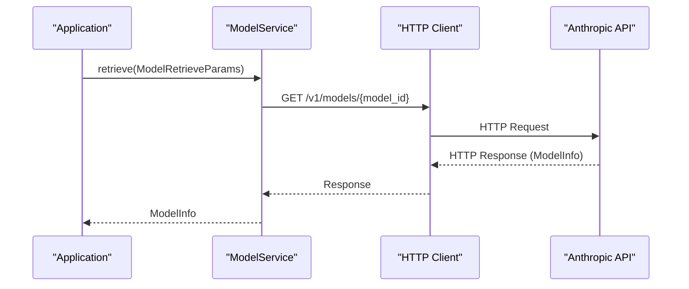
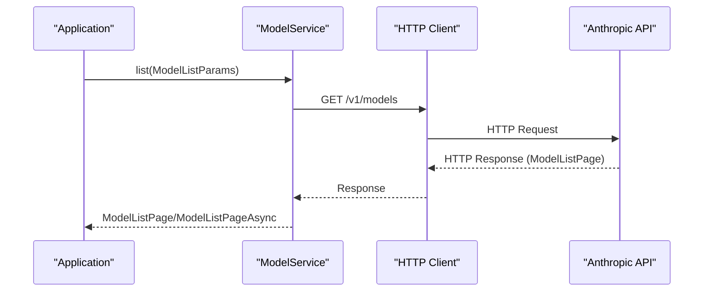
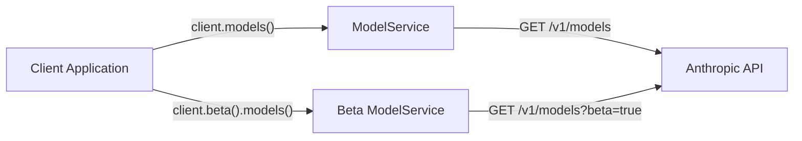

<!-- source: DeepWiki mcp.deepwiki.com · repo anthropics/anthropic-sdk-java · page 3.3 Model Operations · fetched 2026-10-26 -->

# Model Operations

<details>
<summary>Relevant source files</summary>

The following files were used as context for generating this wiki page:

- [.release-please-manifest.json](.release-please-manifest.json)
- [CHANGELOG.md](CHANGELOG.md)
- [README.md](README.md)
- [anthropic-java-core/src/main/kotlin/com/anthropic/services/async/ModelServiceAsyncImpl.kt](anthropic-java-core/src/main/kotlin/com/anthropic/services/async/ModelServiceAsyncImpl.kt)
- [anthropic-java-core/src/main/kotlin/com/anthropic/services/async/beta/ModelServiceAsyncImpl.kt](anthropic-java-core/src/main/kotlin/com/anthropic/services/async/beta/ModelServiceAsyncImpl.kt)
- [anthropic-java-core/src/main/kotlin/com/anthropic/services/async/beta/messages/BatchServiceAsyncImpl.kt](anthropic-java-core/src/main/kotlin/com/anthropic/services/async/beta/messages/BatchServiceAsyncImpl.kt)
- [anthropic-java-core/src/main/kotlin/com/anthropic/services/async/messages/BatchServiceAsyncImpl.kt](anthropic-java-core/src/main/kotlin/com/anthropic/services/async/messages/BatchServiceAsyncImpl.kt)
- [anthropic-java-core/src/main/kotlin/com/anthropic/services/blocking/ModelServiceImpl.kt](anthropic-java-core/src/main/kotlin/com/anthropic/services/blocking/ModelServiceImpl.kt)
- [anthropic-java-core/src/main/kotlin/com/anthropic/services/blocking/beta/ModelServiceImpl.kt](anthropic-java-core/src/main/kotlin/com/anthropic/services/blocking/beta/ModelServiceImpl.kt)
- [anthropic-java-core/src/main/kotlin/com/anthropic/services/blocking/beta/messages/BatchServiceImpl.kt](anthropic-java-core/src/main/kotlin/com/anthropic/services/blocking/beta/messages/BatchServiceImpl.kt)
- [anthropic-java-core/src/main/kotlin/com/anthropic/services/blocking/messages/BatchServiceImpl.kt](anthropic-java-core/src/main/kotlin/com/anthropic/services/blocking/messages/BatchServiceImpl.kt)
- [anthropic-java/build.gradle.kts](anthropic-java/build.gradle.kts)
- [build.gradle.kts](build.gradle.kts)

</details>


This page documents the Model Operations in the Anthropic Java SDK, which provide functionality to retrieve information about Claude models available through the Anthropic API. These operations allow developers to get details about specific models or list all available models, helping applications choose the most appropriate model for their specific tasks.

For information about creating messages with models, see [Message Operations](#3.1). For information about batch processing, see [Batch Operations](#3.2).

## Model Service Architecture

The Model Service follows the same architectural pattern as other services in the SDK, with synchronous and asynchronous variants, plus standard and beta implementations.



Sources:
- [anthropic-java-core/src/main/kotlin/com/anthropic/services/blocking/ModelServiceImpl.kt]()
- [anthropic-java-core/src/main/kotlin/com/anthropic/services/async/ModelServiceAsyncImpl.kt]()

## Core Operations

The Model Service provides two primary operations:

### Model Retrieve Operation

Retrieves detailed information about a specific model by its ID.



Example usage:

```java
ModelRetrieveParams params = ModelRetrieveParams.builder()
    .modelId("claude-3-opus-20240229")
    .build();

// Synchronous usage
ModelInfo modelInfo = client.models().retrieve(params);

// Asynchronous usage
CompletableFuture<ModelInfo> futureModelInfo = client.async().models().retrieve(params);
```

Sources:
- [anthropic-java-core/src/main/kotlin/com/anthropic/services/blocking/ModelServiceImpl.kt:32-34]()
- [anthropic-java-core/src/main/kotlin/com/anthropic/services/async/ModelServiceAsyncImpl.kt:33-38]()

### Model List Operation

Retrieves a paginated list of all available models.



Example usage:

```java
ModelListParams params = ModelListParams.builder().build();

// Synchronous usage
ModelListPage modelListPage = client.models().list(params);

// Asynchronous usage
CompletableFuture<ModelListPageAsync> futureModels = client.async().models().list(params);
```

Sources:
- [anthropic-java-core/src/main/kotlin/com/anthropic/services/blocking/ModelServiceImpl.kt:36-38]()
- [anthropic-java-core/src/main/kotlin/com/anthropic/services/async/ModelServiceAsyncImpl.kt:40-45]()

## Pagination and Model List Processing

The `list()` method returns model information wrapped in a paginated response object that provides utilities for navigating results.

### Manual Pagination

```java
// Get the first page
ModelListPage page = client.models().list(params);

// Process models in the current page
for (ModelInfo model : page.data()) {
    System.out.println(model.id());
}

// Get the next page if available
if (page.hasNextPage()) {
    ModelListPage nextPage = page.getNextPage().orElse(null);
}
```

### Auto-pagination

To iterate through all models across all pages automatically:

```java
// Synchronous iteration through all models
ModelListPage page = client.models().list(params);
for (ModelInfo model : page.autoPager()) {
    System.out.println(model.id());
}

// Using a stream
client.models().list(params).autoPager().stream()
    .forEach(model -> System.out.println(model.id()));

// Asynchronously
client.async().models().list(params)
    .thenAccept(page -> page.autoPager()
        .forEach(model -> System.out.println(model.id())));
```

Sources:
- [anthropic-java-core/src/main/kotlin/com/anthropic/services/blocking/ModelServiceImpl.kt:72-101]()
- [README.md:406-441]()

## Model Information Structure

The `ModelInfo` class contains detailed information about an Anthropic model:

| Property | Type | Description |
|----------|------|-------------|
| `id` | String | Unique identifier for the model (e.g., "claude-3-opus-20240229") |
| `name` | String | Human-readable name of the model |
| `description` | String | Description of the model's capabilities |
| `contextWindow` | Integer | Maximum number of tokens the model can process in a single request |
| `tokenLimits` | Object | Token usage limits for the model |
| `capabilities` | Object | Features and capabilities supported by the model |

Example of working with model information:

```java
ModelInfo model = client.models().retrieve(params);

System.out.println("Model ID: " + model.id());
System.out.println("Name: " + model.name());
System.out.println("Description: " + model.description());
System.out.println("Context Window: " + model.contextWindow());
```

## Beta Model Operations

The SDK provides beta implementations of model operations with potential additional features:



Beta model operations can be accessed through the `beta()` interface:

```java
// Beta model retrieve
ModelRetrieveParams params = ModelRetrieveParams.builder()
    .modelId("claude-3-opus-20240229")
    .build();
BetaModelInfo betaModel = client.beta().models().retrieve(params);

// Beta model list
ModelListParams listParams = ModelListParams.builder().build();
ModelListPage betaModels = client.beta().models().list(listParams);
```

The key differences:
1. Beta operations return `BetaModelInfo` instead of `ModelInfo`
2. API requests include a `beta=true` query parameter
3. Beta operations may include additional properties or capabilities not in the standard API

Sources:
- [anthropic-java-core/src/main/kotlin/com/anthropic/services/blocking/beta/ModelServiceImpl.kt]()
- [anthropic-java-core/src/main/kotlin/com/anthropic/services/async/beta/ModelServiceAsyncImpl.kt]()

## Raw Response Access

To access the raw HTTP response when making model operations:

```java
// Retrieve with raw response
HttpResponseFor<ModelInfo> response = client.models()
    .withRawResponse()
    .retrieve(params);

// Access response metadata
int statusCode = response.statusCode();
Headers headers = response.headers();
Optional<String> requestId = response.requestId();

// Parse the response body
ModelInfo model = response.parse();
```

Sources:
- [README.md:332-361]()

## Error Handling

Model operations may throw exceptions when API requests fail:

```java
try {
    ModelInfo model = client.models().retrieve(params);
    // Process model information
} catch (NotFoundException e) {
    // Model not found - handle 404 error
    System.err.println("Model not found: " + e.getMessage());
} catch (AnthropicServiceException e) {
    // Other API errors (400, 401, 403, 429, 5xx)
    System.err.println("API error: " + e.getMessage());
    System.err.println("Status code: " + e.getStatusCode());
}
```

The SDK throws specific exception types based on HTTP status codes:

| Status | Exception |
|--------|-----------|
| 400 | BadRequestException |
| 401 | UnauthorizedException |
| 403 | PermissionDeniedException |
| 404 | NotFoundException |
| 422 | UnprocessableEntityException |
| 429 | RateLimitException |
| 5xx | InternalServerException |

Sources:
- [README.md:380-396]()

## Implementation Details

The model operations are implemented in the following classes:

1. Standard synchronous implementation: `ModelServiceImpl` in package `com.anthropic.services.blocking`
2. Standard asynchronous implementation: `ModelServiceAsyncImpl` in package `com.anthropic.services.async` 
3. Beta synchronous implementation: `ModelServiceImpl` in package `com.anthropic.services.blocking.beta`
4. Beta asynchronous implementation: `ModelServiceAsyncImpl` in package `com.anthropic.services.async.beta`

Each implementation follows the same pattern:
1. Parse and validate request parameters
2. Build an HTTP request with appropriate path and query parameters
3. Execute the request through the HTTP client
4. Process the response and convert it to appropriate model objects
5. Return the result to the caller

Sources:
- [anthropic-java-core/src/main/kotlin/com/anthropic/services/blocking/ModelServiceImpl.kt]()
- [anthropic-java-core/src/main/kotlin/com/anthropic/services/async/ModelServiceAsyncImpl.kt]()
- [anthropic-java-core/src/main/kotlin/com/anthropic/services/blocking/beta/ModelServiceImpl.kt]()
- [anthropic-java-core/src/main/kotlin/com/anthropic/services/async/beta/ModelServiceAsyncImpl.kt]()

## Best Practices

### Caching Model Information

Model information changes infrequently, so caching it can reduce API calls:

```java
// Simple caching strategy
private final Map<String, ModelInfo> modelCache = new HashMap<>();
private final Object cacheLock = new Object();

public ModelInfo getModelInfo(String modelId) {
    synchronized (cacheLock) {
        if (!modelCache.containsKey(modelId)) {
            ModelRetrieveParams params = ModelRetrieveParams.builder()
                .modelId(modelId)
                .build();
            modelCache.put(modelId, client.models().retrieve(params));
        }
        return modelCache.get(modelId);
    }
}
```

### Initialization Pattern

Fetch and verify available models during application startup:

```java
public void initializeApplication() {
    // Get available models
    ModelListParams params = ModelListParams.builder().build();
    ModelListPage models = client.models().list(params);
    
    // Check if required models are available
    boolean hasRequiredModel = models.data().stream()
        .anyMatch(model -> model.id().equals("claude-3-opus-20240229"));
    
    if (!hasRequiredModel) {
        throw new RuntimeException("Required model not available");
    }
    
    // Continue with initialization...
}
```

### Model Selection

Use model information to select the most appropriate model for a task:

```java
public String selectModelForTask(int inputTokenCount, boolean needsMathCapabilities) {
    ModelListParams params = ModelListParams.builder().build();
    ModelListPage models = client.models().list(params);
    
    // Find a suitable model based on requirements
    return models.data().stream()
        .filter(model -> model.contextWindow() >= inputTokenCount * 2) // Allow space for response
        .filter(model -> !needsMathCapabilities || 
                model.capabilities().get("math") == Boolean.TRUE)
        .sorted((a, b) -> b.contextWindow().compareTo(a.contextWindow())) // Prefer models with larger context
        .map(ModelInfo::id)
        .findFirst()
        .orElse("claude-3-haiku-20240307"); // Default to fastest model if no match
}
```

---

