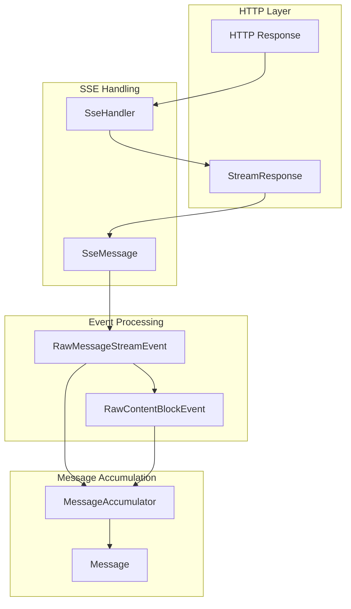
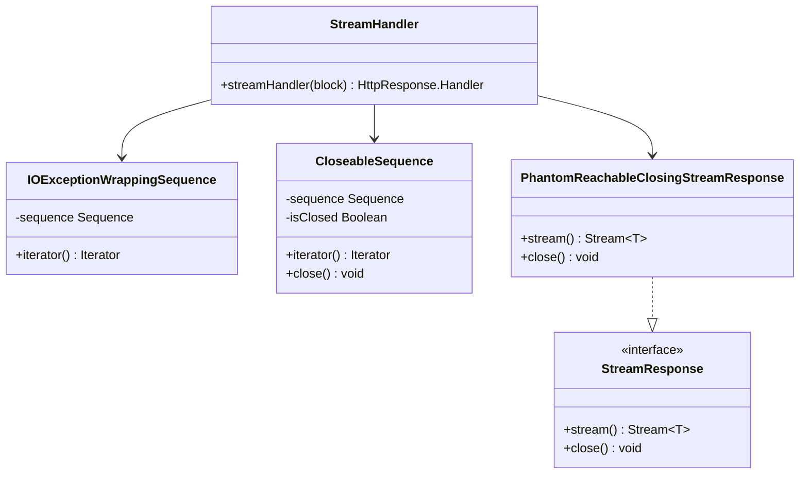
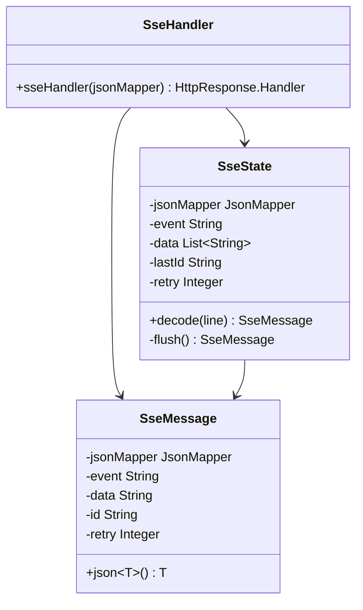
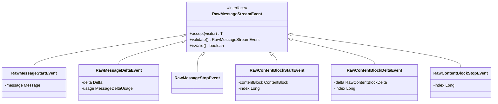
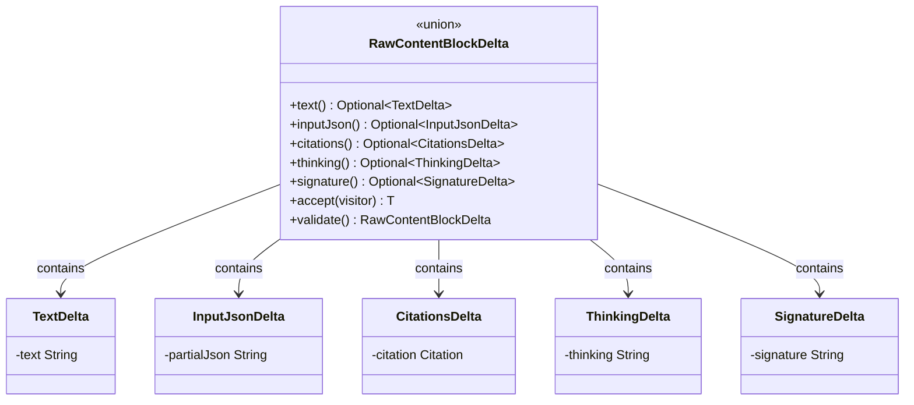
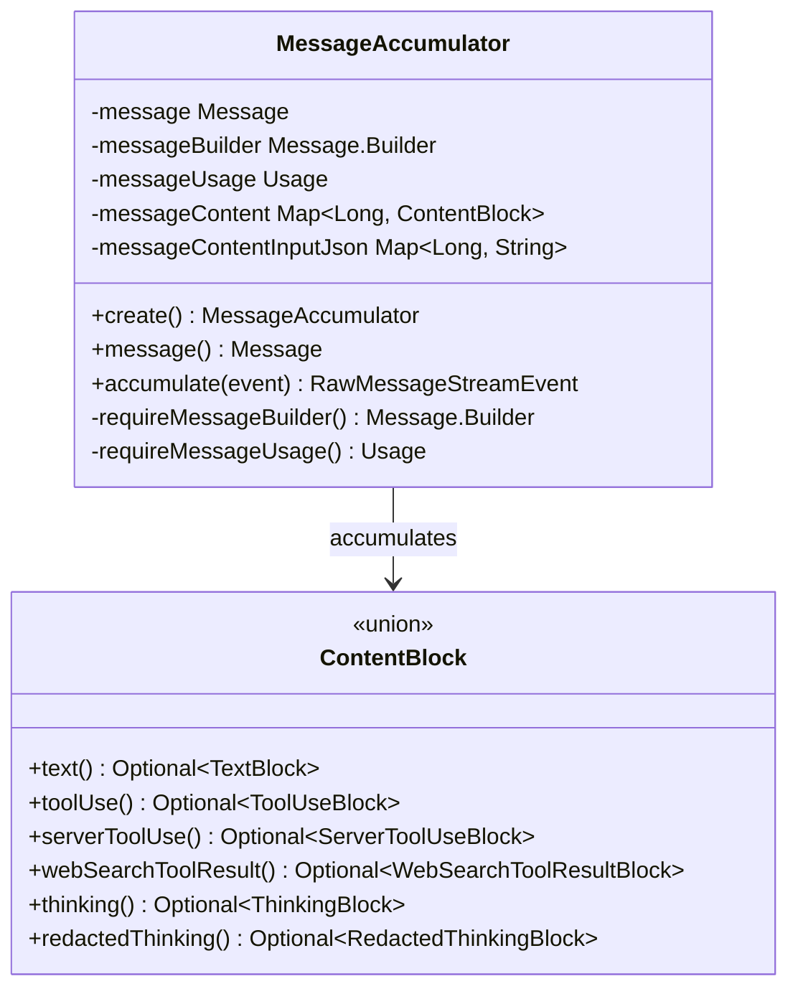
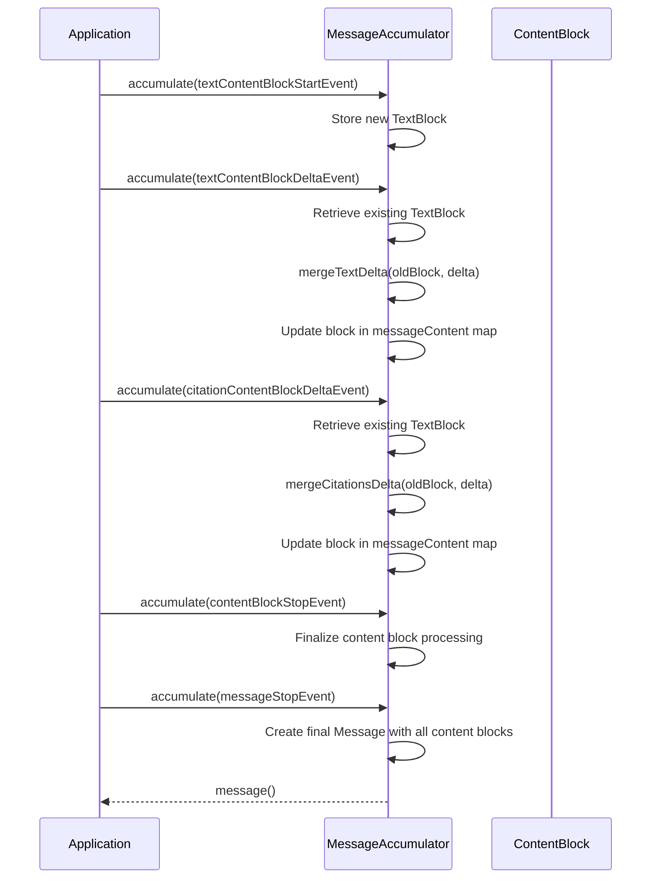
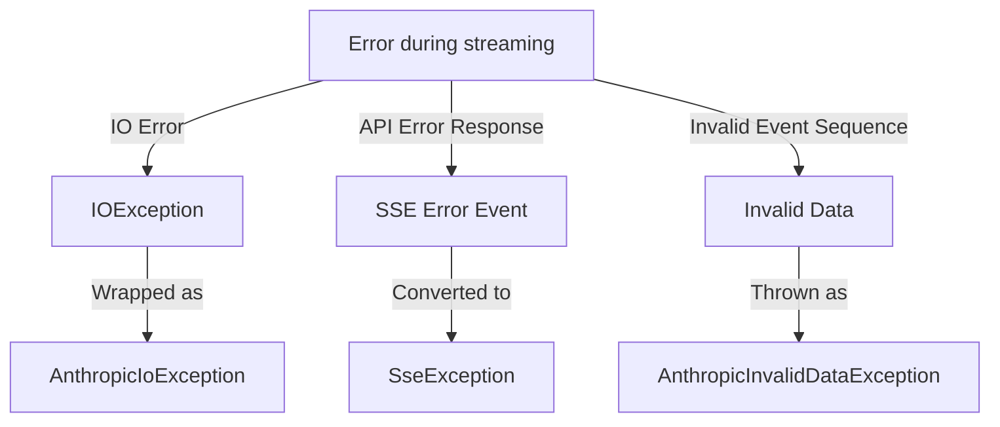

<!-- source: DeepWiki mcp.deepwiki.com · repo anthropics/anthropic-sdk-java · page 4 Streaming Response Handling · fetched 2026-10-26 -->

# Streaming Response Handling

<details>
<summary>Relevant source files</summary>

The following files were used as context for generating this wiki page:

- [.stats.yml](.stats.yml)
- [anthropic-java-core/src/main/kotlin/com/anthropic/core/handlers/JsonHandler.kt](anthropic-java-core/src/main/kotlin/com/anthropic/core/handlers/JsonHandler.kt)
- [anthropic-java-core/src/main/kotlin/com/anthropic/core/handlers/JsonlHandler.kt](anthropic-java-core/src/main/kotlin/com/anthropic/core/handlers/JsonlHandler.kt)
- [anthropic-java-core/src/main/kotlin/com/anthropic/core/handlers/SseHandler.kt](anthropic-java-core/src/main/kotlin/com/anthropic/core/handlers/SseHandler.kt)
- [anthropic-java-core/src/main/kotlin/com/anthropic/core/handlers/StreamHandler.kt](anthropic-java-core/src/main/kotlin/com/anthropic/core/handlers/StreamHandler.kt)
- [anthropic-java-core/src/main/kotlin/com/anthropic/core/http/SseMessage.kt](anthropic-java-core/src/main/kotlin/com/anthropic/core/http/SseMessage.kt)
- [anthropic-java-core/src/main/kotlin/com/anthropic/errors/SseException.kt](anthropic-java-core/src/main/kotlin/com/anthropic/errors/SseException.kt)
- [anthropic-java-core/src/main/kotlin/com/anthropic/helpers/BetaMessageAccumulator.kt](anthropic-java-core/src/main/kotlin/com/anthropic/helpers/BetaMessageAccumulator.kt)
- [anthropic-java-core/src/main/kotlin/com/anthropic/helpers/MessageAccumulator.kt](anthropic-java-core/src/main/kotlin/com/anthropic/helpers/MessageAccumulator.kt)
- [anthropic-java-core/src/main/kotlin/com/anthropic/models/beta/messages/BetaRawContentBlockDelta.kt](anthropic-java-core/src/main/kotlin/com/anthropic/models/beta/messages/BetaRawContentBlockDelta.kt)
- [anthropic-java-core/src/main/kotlin/com/anthropic/models/beta/messages/BetaRawContentBlockDeltaEvent.kt](anthropic-java-core/src/main/kotlin/com/anthropic/models/beta/messages/BetaRawContentBlockDeltaEvent.kt)
- [anthropic-java-core/src/main/kotlin/com/anthropic/models/messages/RawContentBlockDelta.kt](anthropic-java-core/src/main/kotlin/com/anthropic/models/messages/RawContentBlockDelta.kt)
- [anthropic-java-core/src/main/kotlin/com/anthropic/models/messages/RawContentBlockDeltaEvent.kt](anthropic-java-core/src/main/kotlin/com/anthropic/models/messages/RawContentBlockDeltaEvent.kt)
- [anthropic-java-core/src/test/kotlin/com/anthropic/core/handlers/SseHandlerTest.kt](anthropic-java-core/src/test/kotlin/com/anthropic/core/handlers/SseHandlerTest.kt)
- [anthropic-java-core/src/test/kotlin/com/anthropic/core/handlers/StreamHandlerTest.kt](anthropic-java-core/src/test/kotlin/com/anthropic/core/handlers/StreamHandlerTest.kt)
- [anthropic-java-core/src/test/kotlin/com/anthropic/helpers/BetaMessageAccumulatorTest.kt](anthropic-java-core/src/test/kotlin/com/anthropic/helpers/BetaMessageAccumulatorTest.kt)
- [anthropic-java-core/src/test/kotlin/com/anthropic/helpers/MessageAccumulatorTest.kt](anthropic-java-core/src/test/kotlin/com/anthropic/helpers/MessageAccumulatorTest.kt)
- [anthropic-java-core/src/test/kotlin/com/anthropic/models/beta/messages/BetaRawContentBlockDeltaEventTest.kt](anthropic-java-core/src/test/kotlin/com/anthropic/models/beta/messages/BetaRawContentBlockDeltaEventTest.kt)
- [anthropic-java-core/src/test/kotlin/com/anthropic/models/beta/messages/BetaRawContentBlockDeltaTest.kt](anthropic-java-core/src/test/kotlin/com/anthropic/models/beta/messages/BetaRawContentBlockDeltaTest.kt)
- [anthropic-java-core/src/test/kotlin/com/anthropic/models/beta/messages/BetaRawMessageStreamEventTest.kt](anthropic-java-core/src/test/kotlin/com/anthropic/models/beta/messages/BetaRawMessageStreamEventTest.kt)
- [anthropic-java-core/src/test/kotlin/com/anthropic/models/messages/RawContentBlockDeltaEventTest.kt](anthropic-java-core/src/test/kotlin/com/anthropic/models/messages/RawContentBlockDeltaEventTest.kt)
- [anthropic-java-core/src/test/kotlin/com/anthropic/models/messages/RawContentBlockDeltaTest.kt](anthropic-java-core/src/test/kotlin/com/anthropic/models/messages/RawContentBlockDeltaTest.kt)

</details>


This page explains how the Anthropic Java SDK processes streaming responses from the Anthropic API. It covers the architecture of the streaming system, how events are handled and processed, and how complete messages are accumulated from streaming events.

For information about specific content block event types, see [Content Block Events](#4.1). For information on how to accumulate streaming events into complete messages, see [Message Accumulation](#4.2).

## Streaming Architecture Overview

The Anthropic Java SDK provides robust support for processing streaming responses from the Anthropic API, which returns incremental updates as server-sent events (SSE).

### Streaming Response Flow



Sources: [anthropic-java-core/src/main/kotlin/com/anthropic/core/handlers/StreamHandler.kt](anthropic-java-core/src/main/kotlin/com/anthropic/core/handlers/StreamHandler.kt), [anthropic-java-core/src/main/kotlin/com/anthropic/core/handlers/SseHandler.kt](anthropic-java-core/src/main/kotlin/com/anthropic/core/handlers/SseHandler.kt), [anthropic-java-core/src/main/kotlin/com/anthropic/helpers/MessageAccumulator.kt](anthropic-java-core/src/main/kotlin/com/anthropic/helpers/MessageAccumulator.kt)

## Stream Handler Architecture

The `StreamHandler` class forms the foundation of the streaming infrastructure in the SDK, processing HTTP response streams line by line.



The stream handler takes an HTTP response and converts it into a sequence of events. Key components:

- `streamHandler`: Factory function that creates a handler for streaming HTTP responses
- `IOExceptionWrappingSequence`: Wraps IOException thrown during stream processing as AnthropicIoException
- `CloseableSequence`: Provides the ability to stop yielding elements when closed
- `PhantomReachableClosingStreamResponse`: Ensures resources are properly cleaned up

Sources: [anthropic-java-core/src/main/kotlin/com/anthropic/core/handlers/StreamHandler.kt:1-102](anthropic-java-core/src/main/kotlin/com/anthropic/core/handlers/StreamHandler.kt)

## SSE Handling

The Anthropic API uses Server-Sent Events (SSE) for streaming responses. The SDK processes these events using the `SseHandler`.



The SSE handler decodes text lines from a stream and converts them into structured SSE messages:

- Event types processed include: "completion", "message_start", "message_delta", "message_stop", "content_block_start", "content_block_delta", "content_block_stop"
- "ping" events are ignored
- "error" events are converted to `SseException`

Sources: [anthropic-java-core/src/main/kotlin/com/anthropic/core/handlers/SseHandler.kt:1-129](anthropic-java-core/src/main/kotlin/com/anthropic/core/handlers/SseHandler.kt), [anthropic-java-core/src/main/kotlin/com/anthropic/core/http/SseMessage.kt:1-74](anthropic-java-core/src/main/kotlin/com/anthropic/core/http/SseMessage.kt)

## Message Stream Events

The Anthropic API sends a sequence of events that represent incremental updates to a message. These events are mapped to specific event classes in the SDK.



The stream of events follows a specific pattern:

1. A `message_start` event is sent first
2. Multiple `content_block_start` events may follow, indicating the beginning of content blocks
3. `content_block_delta` events provide incremental updates to content blocks
4. `content_block_stop` events indicate the end of content blocks
5. `message_delta` events provide updates to message metadata (like stop_reason)
6. A `message_stop` event indicates the completion of the message

Sources: [anthropic-java-core/src/main/kotlin/com/anthropic/models/messages/RawContentBlockDeltaEvent.kt:1-344](anthropic-java-core/src/main/kotlin/com/anthropic/models/messages/RawContentBlockDeltaEvent.kt), [anthropic-java-core/src/test/kotlin/com/anthropic/models/beta/messages/BetaRawMessageStreamEventTest.kt:1-360](anthropic-java-core/src/test/kotlin/com/anthropic/models/beta/messages/BetaRawMessageStreamEventTest.kt)

## Content Block Delta Types

Content blocks can receive different types of delta updates depending on their type. The `RawContentBlockDelta` class represents these different delta types:



Each delta type corresponds to a specific kind of update:

- `TextDelta`: Text content to append to a text block
- `InputJsonDelta`: Partial JSON content for tool use blocks
- `CitationsDelta`: Citation information to add to a text block
- `ThinkingDelta`: Thinking content to append to a thinking block
- `SignatureDelta`: A signature for verifying a thinking block's integrity

Sources: [anthropic-java-core/src/main/kotlin/com/anthropic/models/messages/RawContentBlockDelta.kt:1-265](anthropic-java-core/src/main/kotlin/com/anthropic/models/messages/RawContentBlockDelta.kt), [anthropic-java-core/src/test/kotlin/com/anthropic/models/messages/RawContentBlockDeltaTest.kt:1-202](anthropic-java-core/src/test/kotlin/com/anthropic/models/messages/RawContentBlockDeltaTest.kt)

## Message Accumulation

The `MessageAccumulator` is a key component that processes streaming events to build a complete `Message`. It handles the different event types and constructs the appropriate content blocks.



The accumulation process follows these steps:

1. When a `message_start` event is received, the accumulator initializes the message builder and usage
2. When `content_block_start` events are received, corresponding content blocks are created and stored by index
3. When `content_block_delta` events are received, the deltas are merged into the corresponding content blocks
4. When `content_block_stop` events are received, any final processing for the content block is performed
5. When `message_delta` events are received, message metadata like stop_reason is updated
6. When a `message_stop` event is received, the final message is constructed from the accumulated content blocks

Sources: [anthropic-java-core/src/main/kotlin/com/anthropic/helpers/MessageAccumulator.kt:1-399](anthropic-java-core/src/main/kotlin/com/anthropic/helpers/MessageAccumulator.kt), [anthropic-java-core/src/test/kotlin/com/anthropic/helpers/MessageAccumulatorTest.kt:1-745](anthropic-java-core/src/test/kotlin/com/anthropic/helpers/MessageAccumulatorTest.kt)

## Delta Merging Logic

The `MessageAccumulator` provides helper methods to merge deltas into content blocks. Each type of delta is handled differently:

| Delta Type | Merge Method | Behavior |
|------------|--------------|----------|
| TextDelta | mergeTextDelta | Appends text to the existing text block |
| InputJsonDelta | accumulate | Accumulates JSON fragments until content_block_stop |
| CitationsDelta | mergeCitationsDelta | Adds citation to the text block's citations list |
| ThinkingDelta | mergeThinkingDelta | Appends thinking content to the thinking block |
| SignatureDelta | mergeSignatureDelta | Sets the signature on the thinking block |

The merge operations ensure that content blocks are updated correctly as streaming events arrive:



Sources: [anthropic-java-core/src/main/kotlin/com/anthropic/helpers/MessageAccumulator.kt:92-181](anthropic-java-core/src/main/kotlin/com/anthropic/helpers/MessageAccumulator.kt), [anthropic-java-core/src/test/kotlin/com/anthropic/helpers/MessageAccumulatorTest.kt:58-216](anthropic-java-core/src/test/kotlin/com/anthropic/helpers/MessageAccumulatorTest.kt)

## Beta Message Accumulation

The SDK also provides a `BetaMessageAccumulator` class that works similarly to `MessageAccumulator` but is used for features in the beta API. The accumulation process is identical but works with beta message types.

Sources: [anthropic-java-core/src/main/kotlin/com/anthropic/helpers/BetaMessageAccumulator.kt:1-379](anthropic-java-core/src/main/kotlin/com/anthropic/helpers/BetaMessageAccumulator.kt), [anthropic-java-core/src/test/kotlin/com/anthropic/helpers/BetaMessageAccumulatorTest.kt:1-745](anthropic-java-core/src/test/kotlin/com/anthropic/helpers/BetaMessageAccumulatorTest.kt)

## Error Handling

Streaming responses include robust error handling at multiple levels:

1. **HTTP-level errors**: The `StreamHandler` wraps IOExceptions as `AnthropicIoException`
2. **SSE parsing errors**: Invalid SSE messages trigger appropriate exceptions
3. **SSE error events**: An "error" event is converted to an `SseException`
4. **Accumulation errors**: The `MessageAccumulator` validates event sequencing and throws `AnthropicInvalidDataException` for invalid event sequences

The `SseException` preserves important context such as status code, headers, and error details to help diagnose API errors.



Sources: [anthropic-java-core/src/main/kotlin/com/anthropic/core/handlers/StreamHandler.kt:55-77](anthropic-java-core/src/main/kotlin/com/anthropic/core/handlers/StreamHandler.kt), [anthropic-java-core/src/main/kotlin/com/anthropic/core/handlers/SseHandler.kt:33-45](anthropic-java-core/src/main/kotlin/com/anthropic/core/handlers/SseHandler.kt), [anthropic-java-core/src/main/kotlin/com/anthropic/errors/SseException.kt:1-92](anthropic-java-core/src/main/kotlin/com/anthropic/errors/SseException.kt)

## Usage Example

A typical pattern for using the streaming API involves:

1. Creating a streaming request to Anthropic API
2. Receiving a `StreamResponse<RawMessageStreamEvent>`
3. Using a `MessageAccumulator` to build a complete message
4. Processing the final message

```java
// Create a streaming request
StreamResponse<RawMessageStreamEvent> streamResponse = client.messages()
    .create()
    .modelId("claude-3-opus-20240229")
    .maxTokens(1024)
    .system("You are a helpful AI assistant.")
    .addMessage("user", "Tell me about streaming responses.")
    .stream();

// Create message accumulator
MessageAccumulator accumulator = MessageAccumulator.create();

// Process all events
try (streamResponse) {
    streamResponse.stream().forEach(event -> {
        // Optional: process events in real-time for UI updates
        
        // Accumulate the event
        accumulator.accumulate(event);
    });
}

// Get the final message
Message message = accumulator.message();

// Use the complete message
System.out.println(message.content().get(0).asText().text());
```

Sources: [anthropic-java-core/src/main/kotlin/com/anthropic/helpers/MessageAccumulator.kt:36-44](anthropic-java-core/src/main/kotlin/com/anthropic/helpers/MessageAccumulator.kt), [anthropic-java-core/src/test/kotlin/com/anthropic/helpers/MessageAccumulatorTest.kt:301-326](anthropic-java-core/src/test/kotlin/com/anthropic/helpers/MessageAccumulatorTest.kt)

## Resource Cleanup

The streaming infrastructure properly manages resources:

- `StreamResponse` implements `AutoCloseable` to ensure resources are released when the stream is no longer needed
- `PhantomReachableClosingStreamResponse` provides additional protection against resource leaks
- Closing a `StreamResponse` properly cascades to close the underlying HTTP response and reader

It's important to use streams with try-with-resources blocks or explicitly close them to prevent resource leaks.

Sources: [anthropic-java-core/src/main/kotlin/com/anthropic/core/handlers/StreamHandler.kt:40-51](anthropic-java-core/src/main/kotlin/com/anthropic/core/handlers/StreamHandler.kt), [anthropic-java-core/src/test/kotlin/com/anthropic/core/handlers/StreamHandlerTest.kt:26-42](anthropic-java-core/src/test/kotlin/com/anthropic/core/handlers/StreamHandlerTest.kt)

---

