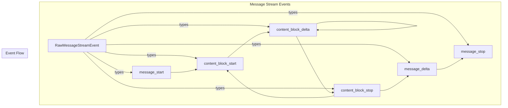
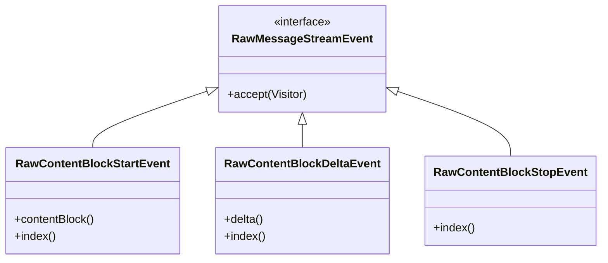
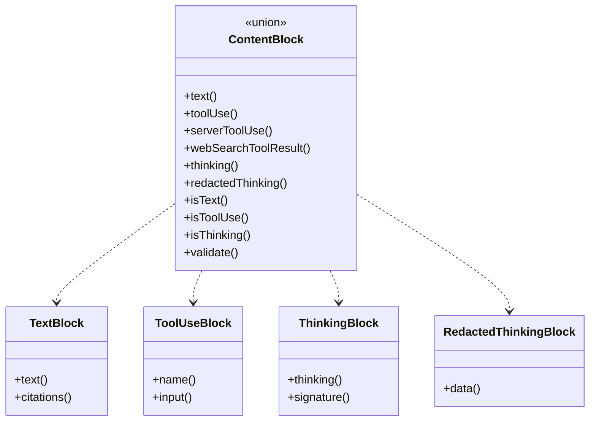
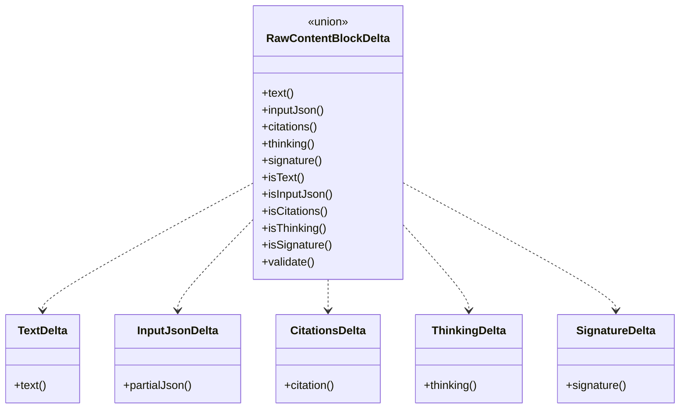
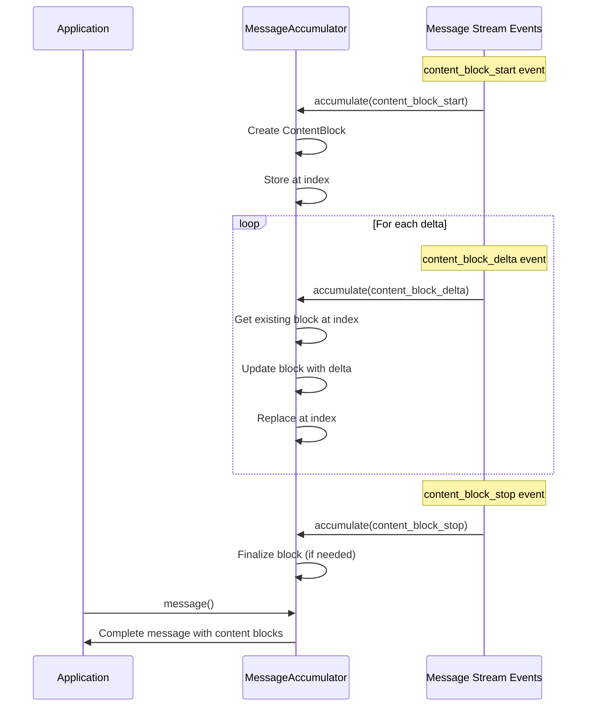
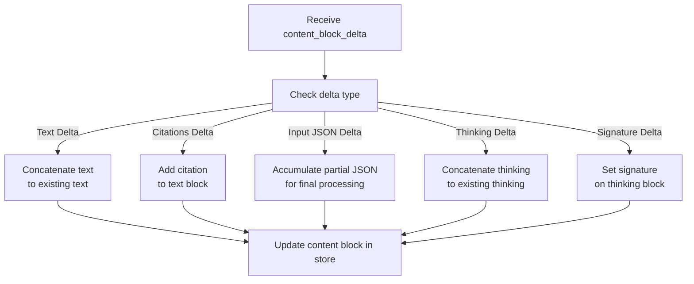
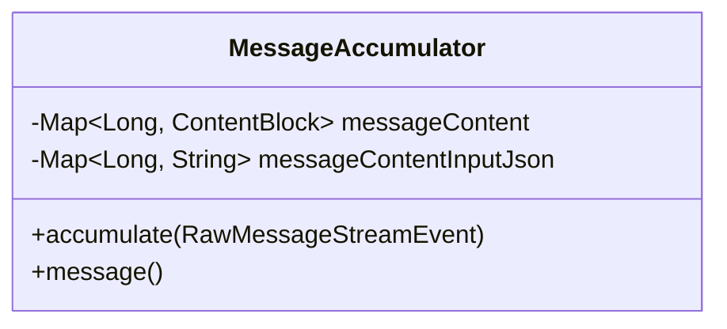
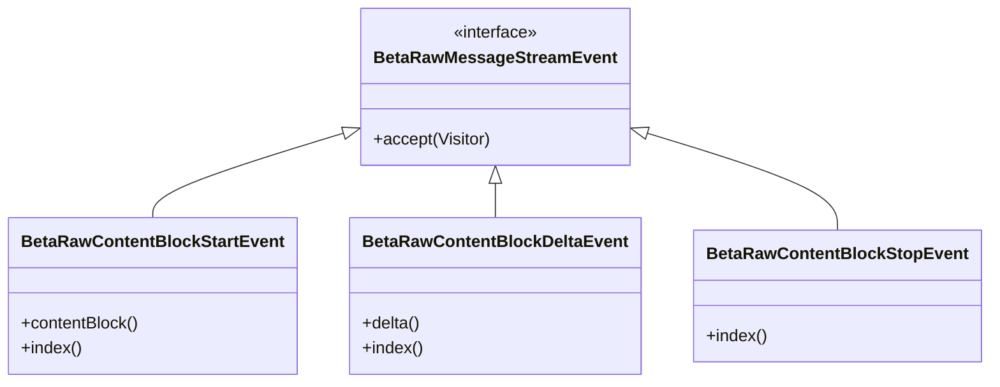
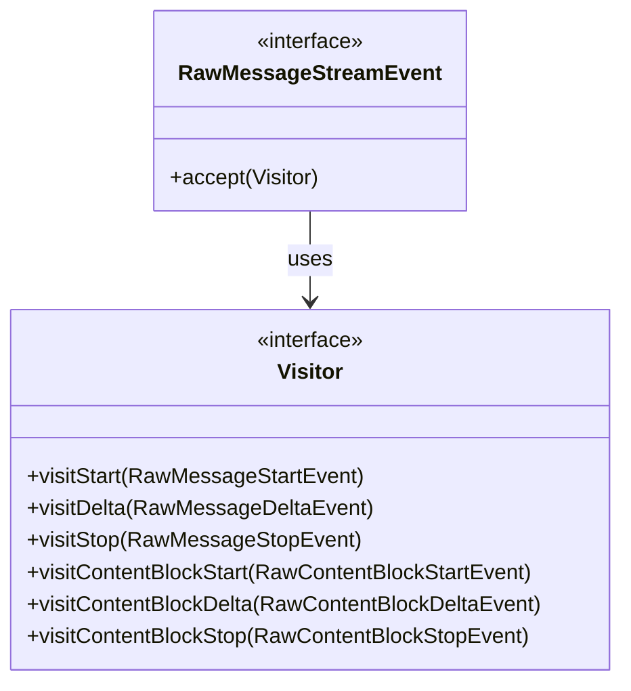

<!-- source: DeepWiki mcp.deepwiki.com · repo anthropics/anthropic-sdk-java · page 4.1 Content Block Events · fetched 2026-10-26 -->

# Content Block Events

<details>
<summary>Relevant source files</summary>

The following files were used as context for generating this wiki page:

- [.stats.yml](.stats.yml)
- [anthropic-java-core/src/main/kotlin/com/anthropic/helpers/BetaMessageAccumulator.kt](anthropic-java-core/src/main/kotlin/com/anthropic/helpers/BetaMessageAccumulator.kt)
- [anthropic-java-core/src/main/kotlin/com/anthropic/helpers/MessageAccumulator.kt](anthropic-java-core/src/main/kotlin/com/anthropic/helpers/MessageAccumulator.kt)
- [anthropic-java-core/src/main/kotlin/com/anthropic/models/beta/messages/BetaRawContentBlockDelta.kt](anthropic-java-core/src/main/kotlin/com/anthropic/models/beta/messages/BetaRawContentBlockDelta.kt)
- [anthropic-java-core/src/main/kotlin/com/anthropic/models/beta/messages/BetaRawContentBlockDeltaEvent.kt](anthropic-java-core/src/main/kotlin/com/anthropic/models/beta/messages/BetaRawContentBlockDeltaEvent.kt)
- [anthropic-java-core/src/main/kotlin/com/anthropic/models/messages/RawContentBlockDelta.kt](anthropic-java-core/src/main/kotlin/com/anthropic/models/messages/RawContentBlockDelta.kt)
- [anthropic-java-core/src/main/kotlin/com/anthropic/models/messages/RawContentBlockDeltaEvent.kt](anthropic-java-core/src/main/kotlin/com/anthropic/models/messages/RawContentBlockDeltaEvent.kt)
- [anthropic-java-core/src/test/kotlin/com/anthropic/helpers/BetaMessageAccumulatorTest.kt](anthropic-java-core/src/test/kotlin/com/anthropic/helpers/BetaMessageAccumulatorTest.kt)
- [anthropic-java-core/src/test/kotlin/com/anthropic/helpers/MessageAccumulatorTest.kt](anthropic-java-core/src/test/kotlin/com/anthropic/helpers/MessageAccumulatorTest.kt)
- [anthropic-java-core/src/test/kotlin/com/anthropic/models/beta/messages/BetaRawContentBlockDeltaEventTest.kt](anthropic-java-core/src/test/kotlin/com/anthropic/models/beta/messages/BetaRawContentBlockDeltaEventTest.kt)
- [anthropic-java-core/src/test/kotlin/com/anthropic/models/beta/messages/BetaRawContentBlockDeltaTest.kt](anthropic-java-core/src/test/kotlin/com/anthropic/models/beta/messages/BetaRawContentBlockDeltaTest.kt)
- [anthropic-java-core/src/test/kotlin/com/anthropic/models/beta/messages/BetaRawMessageStreamEventTest.kt](anthropic-java-core/src/test/kotlin/com/anthropic/models/beta/messages/BetaRawMessageStreamEventTest.kt)
- [anthropic-java-core/src/test/kotlin/com/anthropic/models/messages/RawContentBlockDeltaEventTest.kt](anthropic-java-core/src/test/kotlin/com/anthropic/models/messages/RawContentBlockDeltaEventTest.kt)
- [anthropic-java-core/src/test/kotlin/com/anthropic/models/messages/RawContentBlockDeltaTest.kt](anthropic-java-core/src/test/kotlin/com/anthropic/models/messages/RawContentBlockDeltaTest.kt)

</details>


This page documents the structure and handling of content block events in the Anthropic Java SDK. Content block events are a core part of the streaming API, representing incremental updates to content blocks within messages. For information about accumulating these events into complete messages, see [Message Accumulation](#4.2).

## Overview of Content Block Events

Content block events are part of the streaming response from Anthropic's API when requesting messages. They allow for incremental delivery of message content, providing a more responsive user experience. The content is streamed as a series of events that clients can process to build up the complete message.



Sources: [anthropic-java-core/src/main/kotlin/com/anthropic/helpers/MessageAccumulator.kt:18-35](), [anthropic-java-core/src/test/kotlin/com/anthropic/models/messages/RawMessageStreamEventTest.kt]()

## Content Block Event Types

There are three main types of content block events:

1. **Content Block Start Event** (`content_block_start`): Indicates the beginning of a new content block
2. **Content Block Delta Event** (`content_block_delta`): Contains updates/changes to an existing content block
3. **Content Block Stop Event** (`content_block_stop`): Indicates the end of a content block



Sources: [anthropic-java-core/src/main/kotlin/com/anthropic/models/messages/RawContentBlockDeltaEvent.kt:19-344](), [anthropic-java-core/src/test/kotlin/com/anthropic/models/messages/RawContentBlockDeltaEventTest.kt]()

## Content Block Structure

Content blocks represent different types of content in a message. Each content block has an index that identifies it within the message stream.



Sources: [anthropic-java-core/src/main/kotlin/com/anthropic/helpers/MessageAccumulator.kt:274-301]()

## Delta Types

Content block delta events contain specific delta types that update different aspects of a content block:



Sources: [anthropic-java-core/src/main/kotlin/com/anthropic/models/messages/RawContentBlockDelta.kt:23-265](), [anthropic-java-core/src/test/kotlin/com/anthropic/models/messages/RawContentBlockDeltaTest.kt]()

### Delta Type Descriptions

| Delta Type | Description | Applicable To |
|------------|-------------|--------------|
| `TextDelta` | Contains text to be appended to a text block | `TextBlock` |
| `InputJsonDelta` | Contains partial JSON for building tool use input | `ToolUseBlock` |
| `CitationsDelta` | Contains citation information to be added to a text block | `TextBlock` |
| `ThinkingDelta` | Contains thinking text to be appended to a thinking block | `ThinkingBlock` |
| `SignatureDelta` | Contains a signature for a thinking block's integrity validation | `ThinkingBlock` |

Sources: [anthropic-java-core/src/main/kotlin/com/anthropic/helpers/MessageAccumulator.kt:316-338]()

## Processing Content Block Events

Content block events are processed sequentially to build complete content blocks. The typical flow involves:



Sources: [anthropic-java-core/src/main/kotlin/com/anthropic/helpers/MessageAccumulator.kt:202-392]()

## Delta Merging Logic

When processing delta events, the specific merging logic depends on the type of content block and delta:



Sources: [anthropic-java-core/src/main/kotlin/com/anthropic/helpers/MessageAccumulator.kt:92-155]()

### Text Delta Merging

For text blocks, the text delta's content is appended to the existing text:

```
oldText + delta.text() -> newText
```

Sources: [anthropic-java-core/src/main/kotlin/com/anthropic/helpers/MessageAccumulator.kt:92-102]()

### Input JSON Delta Handling

For tool use blocks, the partial JSON strings are concatenated and only processed into a complete JSON object when the content block stop event is received:

```
oldPartialJson + delta.partialJson() -> accumulatedPartialJson
```

Sources: [anthropic-java-core/src/main/kotlin/com/anthropic/helpers/MessageAccumulator.kt:320-326](), [anthropic-java-core/src/main/kotlin/com/anthropic/helpers/MessageAccumulator.kt:370-385]()

### Thinking Delta Merging

For thinking blocks, the thinking delta's content is appended to the existing thinking text:

```
oldThinking + delta.thinking() -> newThinking
```

Sources: [anthropic-java-core/src/main/kotlin/com/anthropic/helpers/MessageAccumulator.kt:122-135]()

### Signature Delta Handling

For thinking blocks, the signature delta replaces any existing signature (not concatenated):

```
delta.signature() -> newSignature
```

Sources: [anthropic-java-core/src/main/kotlin/com/anthropic/helpers/MessageAccumulator.kt:138-155]()

## Content Block Indexes

Content blocks are identified by an index in the stream. The `MessageAccumulator` maintains a map of content blocks indexed by these indexes:



Sources: [anthropic-java-core/src/main/kotlin/com/anthropic/helpers/MessageAccumulator.kt:70-81]()

The indexes are used to:
1. Identify which content block is being started, updated, or stopped
2. Preserve the order of content blocks in the final message
3. Match deltas with their corresponding content blocks

Sources: [anthropic-java-core/src/main/kotlin/com/anthropic/helpers/MessageAccumulator.kt:245-257]()

## Special Case: Tool Use Blocks

Tool use blocks have special handling because their `input` field is built from accumulated JSON fragments:

```mermaid
flowchart TD
    Start["ToolUse content_block_start"] --> InitToolUse["Initialize ToolUseBlock\nwithout input"]
    
    loop["For each input_json_delta"]
        InitToolUse --> AccumulateJson["Accumulate JSON string\nmessageContentInputJson[index] += partialJson"]
    end
    
    AccumulateJson --> StopEvent["content_block_stop received"]
    StopEvent --> ParseJson["Parse accumulated JSON\ninto JsonObject"]
    ParseJson --> UpdateBlock["Update ToolUseBlock\nwith parsed input"]
```

Sources: [anthropic-java-core/src/main/kotlin/com/anthropic/helpers/MessageAccumulator.kt:360-386](), [anthropic-java-core/src/test/kotlin/com/anthropic/helpers/MessageAccumulatorTest.kt:558-608]()

## Error Handling

The SDK implements several error checks when processing content block events:

1. Verifying that a content block start event exists before processing deltas or stops for that index
2. Checking for duplicate content block start events with the same index
3. Validating that tool use blocks have at least one input JSON delta before the stop event
4. Ensuring deltas are applied to the appropriate block type (e.g., text deltas to text blocks)

Sources: [anthropic-java-core/src/main/kotlin/com/anthropic/helpers/MessageAccumulator.kt:263-268](), [anthropic-java-core/src/main/kotlin/com/anthropic/helpers/MessageAccumulator.kt:304-318](), [anthropic-java-core/src/main/kotlin/com/anthropic/helpers/MessageAccumulator.kt:365-368]()

## Beta Content Block Events

The SDK also provides a beta version of content block events with equivalent functionality:



The beta versions follow the same patterns and logic as their non-beta counterparts but provide early access to new features or changes.

Sources: [anthropic-java-core/src/main/kotlin/com/anthropic/models/beta/messages/BetaRawContentBlockDeltaEvent.kt:19-359](), [anthropic-java-core/src/main/kotlin/com/anthropic/helpers/BetaMessageAccumulator.kt]()

## Visitor Pattern for Event Processing

The SDK uses the Visitor pattern for processing different event types:



The `MessageAccumulator` implements its event handling logic using an anonymous implementation of this visitor pattern:

Sources: [anthropic-java-core/src/main/kotlin/com/anthropic/helpers/MessageAccumulator.kt:208-389]()

---

