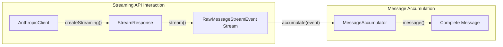
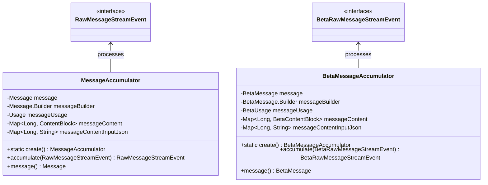
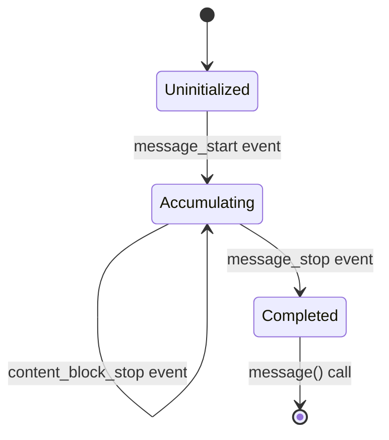
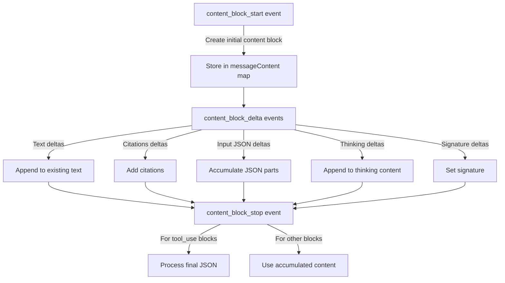
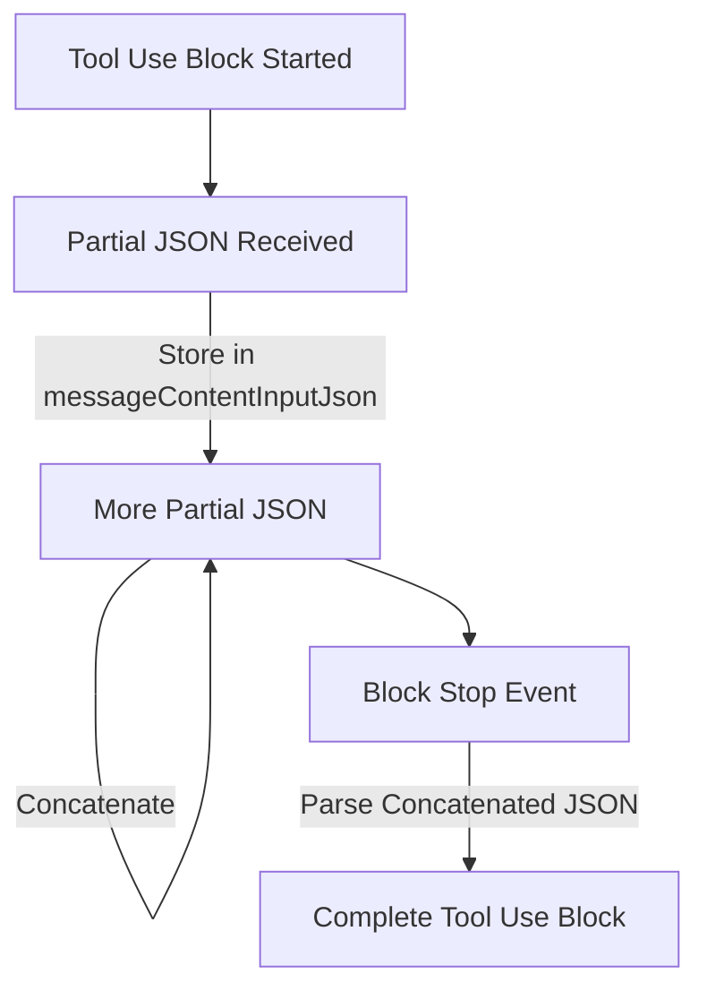
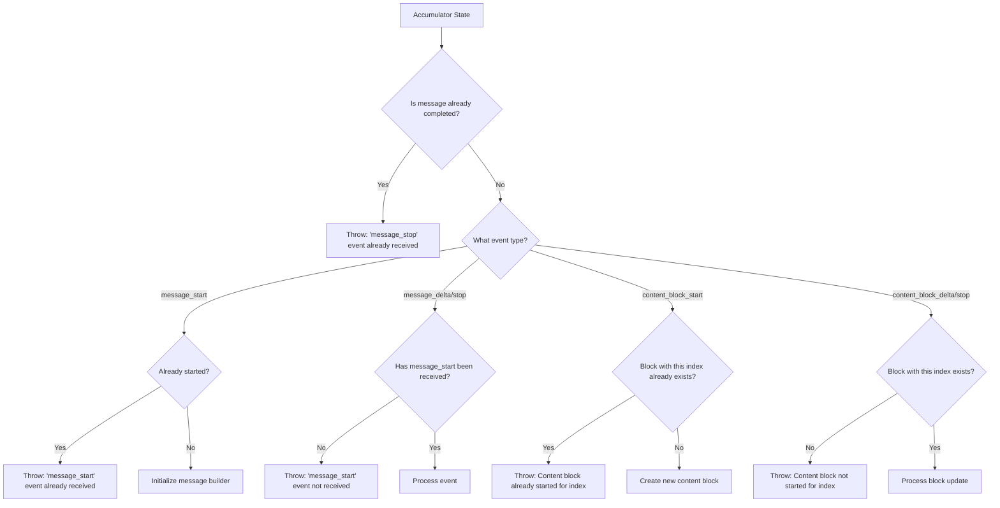
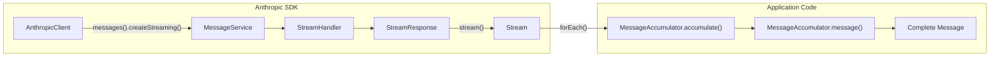

<!-- source: DeepWiki mcp.deepwiki.com · repo anthropics/anthropic-sdk-java · page 4.2 Message Accumulation · fetched 2026-10-26 -->

# Message Accumulation

<details>
<summary>Relevant source files</summary>

The following files were used as context for generating this wiki page:

- [anthropic-java-core/src/main/kotlin/com/anthropic/helpers/BetaMessageAccumulator.kt](anthropic-java-core/src/main/kotlin/com/anthropic/helpers/BetaMessageAccumulator.kt)
- [anthropic-java-core/src/main/kotlin/com/anthropic/helpers/MessageAccumulator.kt](anthropic-java-core/src/main/kotlin/com/anthropic/helpers/MessageAccumulator.kt)
- [anthropic-java-core/src/test/kotlin/com/anthropic/helpers/BetaMessageAccumulatorTest.kt](anthropic-java-core/src/test/kotlin/com/anthropic/helpers/BetaMessageAccumulatorTest.kt)
- [anthropic-java-core/src/test/kotlin/com/anthropic/helpers/MessageAccumulatorTest.kt](anthropic-java-core/src/test/kotlin/com/anthropic/helpers/MessageAccumulatorTest.kt)
- [anthropic-java-example/src/main/java/com/anthropic/example/BatchAsyncExample.java](anthropic-java-example/src/main/java/com/anthropic/example/BatchAsyncExample.java)
- [anthropic-java-example/src/main/java/com/anthropic/example/BatchExample.java](anthropic-java-example/src/main/java/com/anthropic/example/BatchExample.java)
- [anthropic-java-example/src/main/java/com/anthropic/example/MessagesAsyncExample.java](anthropic-java-example/src/main/java/com/anthropic/example/MessagesAsyncExample.java)
- [anthropic-java-example/src/main/java/com/anthropic/example/MessagesConversationAsyncExample.java](anthropic-java-example/src/main/java/com/anthropic/example/MessagesConversationAsyncExample.java)
- [anthropic-java-example/src/main/java/com/anthropic/example/MessagesConversationExample.java](anthropic-java-example/src/main/java/com/anthropic/example/MessagesConversationExample.java)
- [anthropic-java-example/src/main/java/com/anthropic/example/MessagesExample.java](anthropic-java-example/src/main/java/com/anthropic/example/MessagesExample.java)
- [anthropic-java-example/src/main/java/com/anthropic/example/MessagesStreamingAsyncExample.java](anthropic-java-example/src/main/java/com/anthropic/example/MessagesStreamingAsyncExample.java)
- [anthropic-java-example/src/main/java/com/anthropic/example/MessagesStreamingExample.java](anthropic-java-example/src/main/java/com/anthropic/example/MessagesStreamingExample.java)

</details>


This page explains how the Anthropic Java SDK processes streaming API responses into complete message objects. The message accumulation system assembles streams of partial content into a cohesive, final message that matches what you would receive from a non-streaming API call.

For information about the structure of content block events and how to process them directly, see [Content Block Events](#4.1).

## Overview of Message Accumulation

When using streaming APIs with Anthropic's Claude models, responses are delivered as a series of events. The `MessageAccumulator` and `BetaMessageAccumulator` classes provide a mechanism to collect these events and assemble them into a complete `Message` or `BetaMessage` object.



Sources:
- [anthropic-java-core/src/main/kotlin/com/anthropic/helpers/MessageAccumulator.kt:36-44](https://github.com/anthropics/anthropic-sdk-java/blob/main/anthropic-java-core/src/main/kotlin/com/anthropic/helpers/MessageAccumulator.kt:36-44)
- [anthropic-java-example/src/main/java/com/anthropic/example/MessagesStreamingExample.java:10-32](https://github.com/anthropics/anthropic-sdk-java/blob/main/anthropic-java-example/src/main/java/com/anthropic/example/MessagesStreamingExample.java:10-32)

## Accumulator Architecture

The message accumulation system uses dedicated accumulator classes to track and combine streaming events into a final message.

### Key Components



Sources:
- [anthropic-java-core/src/main/kotlin/com/anthropic/helpers/MessageAccumulator.kt:45-70](https://github.com/anthropics/anthropic-sdk-java/blob/main/anthropic-java-core/src/main/kotlin/com/anthropic/helpers/MessageAccumulator.kt:45-70)
- [anthropic-java-core/src/main/kotlin/com/anthropic/helpers/BetaMessageAccumulator.kt:17-52](https://github.com/anthropics/anthropic-sdk-java/blob/main/anthropic-java-core/src/main/kotlin/com/anthropic/helpers/BetaMessageAccumulator.kt:17-52)

### Internal Data Structures

Each accumulator maintains several internal data structures:

1. **`message`**: The final accumulated message (initially null)
2. **`messageBuilder`**: A message builder for constructing the final message
3. **`messageUsage`**: Tracks token usage statistics
4. **`messageContent`**: A map of content blocks indexed by their position
5. **`messageContentInputJson`**: A map for accumulating partial JSON strings for tool use blocks

These structures enable the accumulator to track the state of the message being built and ensure all content is properly combined.

Sources:
- [anthropic-java-core/src/main/kotlin/com/anthropic/helpers/MessageAccumulator.kt:45-81](https://github.com/anthropics/anthropic-sdk-java/blob/main/anthropic-java-core/src/main/kotlin/com/anthropic/helpers/MessageAccumulator.kt:45-81)
- [anthropic-java-core/src/main/kotlin/com/anthropic/helpers/BetaMessageAccumulator.kt:17-53](https://github.com/anthropics/anthropic-sdk-java/blob/main/anthropic-java-core/src/main/kotlin/com/anthropic/helpers/BetaMessageAccumulator.kt:17-53)

## Event Processing Flow

The message accumulation process follows a specific lifecycle:



Sources:
- [anthropic-java-core/src/main/kotlin/com/anthropic/helpers/MessageAccumulator.kt:183-392](https://github.com/anthropics/anthropic-sdk-java/blob/main/anthropic-java-core/src/main/kotlin/com/anthropic/helpers/MessageAccumulator.kt:183-392)

### Content Block Lifecycle

Content blocks are processed with their own sub-lifecycle:



Sources:
- [anthropic-java-core/src/main/kotlin/com/anthropic/helpers/MessageAccumulator.kt:256-386](https://github.com/anthropics/anthropic-sdk-java/blob/main/anthropic-java-core/src/main/kotlin/com/anthropic/helpers/MessageAccumulator.kt:256-386)

## Event Types and Handling

The accumulator processes several types of events that arrive during streaming:

### Message Events

1. **`message_start`**: Initializes accumulation with basic message details
   - Creates a new message builder
   - Sets initial usage statistics

2. **`message_delta`**: Updates message metadata
   - Updates stop reason and sequence if provided
   - Accumulates token usage counts

3. **`message_stop`**: Finalizes the message
   - Combines all content blocks in their proper order
   - Completes the message with final usage statistics

Sources:
- [anthropic-java-core/src/main/kotlin/com/anthropic/helpers/MessageAccumulator.kt:209-259](https://github.com/anthropics/anthropic-sdk-java/blob/main/anthropic-java-core/src/main/kotlin/com/anthropic/helpers/MessageAccumulator.kt:209-259)

### Content Block Events

1. **`content_block_start`**: Begins a new content block
   - Creates the appropriate type of content block
   - Stores it in the `messageContent` map indexed by position

2. **`content_block_delta`**: Updates a content block
   - Different delta types (text, citations, etc.) are handled differently
   - Updates are merged with existing content

3. **`content_block_stop`**: Finalizes a content block
   - For tool use blocks, finishes processing JSON input
   - For other blocks, ensures all content is properly accumulated

Sources:
- [anthropic-java-core/src/main/kotlin/com/anthropic/helpers/MessageAccumulator.kt:260-387](https://github.com/anthropics/anthropic-sdk-java/blob/main/anthropic-java-core/src/main/kotlin/com/anthropic/helpers/MessageAccumulator.kt:260-387)

## Content Block Accumulation Types

Each type of content block requires specific handling during accumulation:

| Block Type | Start Event Handling | Delta Event Handling | Stop Event Handling |
|------------|----------------------|----------------------|---------------------|
| Text | Create TextBlock | Concatenate text deltas<br>Add citations | No special handling |
| Tool Use | Create ToolUseBlock | Accumulate JSON string parts | Parse final JSON input |
| Thinking | Create ThinkingBlock | Concatenate thinking content<br>Set signature | No special handling |
| Redacted Thinking | Create RedactedThinkingBlock | No deltas (single event only) | No special handling |

Sources:
- [anthropic-java-core/src/main/kotlin/com/anthropic/helpers/MessageAccumulator.kt:93-155](https://github.com/anthropics/anthropic-sdk-java/blob/main/anthropic-java-core/src/main/kotlin/com/anthropic/helpers/MessageAccumulator.kt:93-155)
- [anthropic-java-core/src/main/kotlin/com/anthropic/helpers/MessageAccumulator.kt:270-387](https://github.com/anthropics/anthropic-sdk-java/blob/main/anthropic-java-core/src/main/kotlin/com/anthropic/helpers/MessageAccumulator.kt:270-387)

### Special Handling for Tool Use Blocks

Tool use blocks require special handling because their `input` field contains JSON data that might be streamed in fragments:



Sources:
- [anthropic-java-core/src/main/kotlin/com/anthropic/helpers/MessageAccumulator.kt:323-327](https://github.com/anthropics/anthropic-sdk-java/blob/main/anthropic-java-core/src/main/kotlin/com/anthropic/helpers/MessageAccumulator.kt:323-327)
- [anthropic-java-core/src/main/kotlin/com/anthropic/helpers/MessageAccumulator.kt:360-386](https://github.com/anthropics/anthropic-sdk-java/blob/main/anthropic-java-core/src/main/kotlin/com/anthropic/helpers/MessageAccumulator.kt:360-386)

## Using the Accumulator

To use the message accumulator, you follow these steps:

1. Create a new accumulator instance
2. Process each streaming event through the accumulator
3. Retrieve the final message after all events are processed

### Basic Example

```java
// Create a new accumulator
MessageAccumulator accumulator = MessageAccumulator.create();

// Process streaming events
streamResponse.stream().forEach(event -> {
    accumulator.accumulate(event);
});

// Get the final message
Message message = accumulator.message();
```

Sources:
- [anthropic-java-core/src/main/kotlin/com/anthropic/helpers/MessageAccumulator.kt:86](https://github.com/anthropics/anthropic-sdk-java/blob/main/anthropic-java-core/src/main/kotlin/com/anthropic/helpers/MessageAccumulator.kt:86)
- [anthropic-java-core/src/main/kotlin/com/anthropic/helpers/MessageAccumulator.kt:183-191](https://github.com/anthropics/anthropic-sdk-java/blob/main/anthropic-java-core/src/main/kotlin/com/anthropic/helpers/MessageAccumulator.kt:183-191)
- [anthropic-java-core/src/main/kotlin/com/anthropic/helpers/MessageAccumulator.kt:203-392](https://github.com/anthropics/anthropic-sdk-java/blob/main/anthropic-java-core/src/main/kotlin/com/anthropic/helpers/MessageAccumulator.kt:203-392)

### Complete Working Example

```java
AnthropicClient client = AnthropicOkHttpClient.fromEnv();

MessageCreateParams createParams = MessageCreateParams.builder()
        .model(Model.CLAUDE_3_5_SONNET_LATEST)
        .maxTokens(2048)
        .addUserMessage("Tell me a story about building the best SDK!")
        .build();

MessageAccumulator accumulator = MessageAccumulator.create();

try (StreamResponse<RawMessageStreamEvent> streamResponse =
        client.messages().createStreaming(createParams)) {
    streamResponse.stream().forEach(accumulator::accumulate);
}

Message message = accumulator.message();

// Now you can work with the complete message
message.content().stream()
        .flatMap(contentBlock -> contentBlock.text().stream())
        .forEach(textBlock -> System.out.println(textBlock.text()));
```

Sources:
- [anthropic-java-example/src/main/java/com/anthropic/example/MessagesStreamingExample.java:10-32](https://github.com/anthropics/anthropic-sdk-java/blob/main/anthropic-java-example/src/main/java/com/anthropic/example/MessagesStreamingExample.java:10-32)

## Error Handling

The `MessageAccumulator` implements several validation checks to ensure proper usage:

1. Prevents starting a new message if one is already in progress
2. Prevents using deltas before the message has started
3. Prevents accessing the message before it's completely accumulated
4. Validates content block indexes for deltas and stop events

These validations throw `AnthropicInvalidDataException` when misused:



Sources:
- [anthropic-java-core/src/main/kotlin/com/anthropic/helpers/MessageAccumulator.kt:204-391](https://github.com/anthropics/anthropic-sdk-java/blob/main/anthropic-java-core/src/main/kotlin/com/anthropic/helpers/MessageAccumulator.kt:204-391)
- [anthropic-java-core/src/test/kotlin/com/anthropic/helpers/MessageAccumulatorTest.kt:215-298](https://github.com/anthropics/anthropic-sdk-java/blob/main/anthropic-java-core/src/test/kotlin/com/anthropic/helpers/MessageAccumulatorTest.kt:215-298)

## Integration with the SDK

The message accumulator is designed to work with the streaming response system of the SDK. When a streaming API call is made, it returns a `StreamResponse<RawMessageStreamEvent>` that can be processed by the accumulator.



Sources:
- [anthropic-java-example/src/main/java/com/anthropic/example/MessagesStreamingExample.java:16-31](https://github.com/anthropics/anthropic-sdk-java/blob/main/anthropic-java-example/src/main/java/com/anthropic/example/MessagesStreamingExample.java:16-31)
- [anthropic-java-example/src/main/java/com/anthropic/example/MessagesStreamingAsyncExample.java:21-27](https://github.com/anthropics/anthropic-sdk-java/blob/main/anthropic-java-example/src/main/java/com/anthropic/example/MessagesStreamingAsyncExample.java:21-27)

## Key Implementation Details

The MessageAccumulator implementation has some important details:

1. **Single-use design**: Each accumulator instance can only accumulate one message.
2. **Content block ordering**: Blocks are stored by index and sorted when building the final message.
3. **Delta merging**: Different content block types have specialized merge functions.
4. **Token counting**: Accumulates output tokens from each delta event.
5. **Special cases**:
   - Tool use blocks collect partial JSON until complete
   - Thinking blocks have special signature handling
   - Redacted thinking blocks have no deltas

Sources:
- [anthropic-java-core/src/main/kotlin/com/anthropic/helpers/MessageAccumulator.kt:45-399](https://github.com/anthropics/anthropic-sdk-java/blob/main/anthropic-java-core/src/main/kotlin/com/anthropic/helpers/MessageAccumulator.kt:45-399)
- [anthropic-java-core/src/main/kotlin/com/anthropic/helpers/BetaMessageAccumulator.kt:17-379](https://github.com/anthropics/anthropic-sdk-java/blob/main/anthropic-java-core/src/main/kotlin/com/anthropic/helpers/BetaMessageAccumulator.kt:17-379)

## Beta vs Standard Accumulator

The `MessageAccumulator` and `BetaMessageAccumulator` classes are nearly identical in structure and function, with the main difference being the types they work with:

- `MessageAccumulator` processes `RawMessageStreamEvent` to build a `Message`
- `BetaMessageAccumulator` processes `BetaRawMessageStreamEvent` to build a `BetaMessage`

This parallel implementation allows the SDK to handle both standard and beta API features.

Sources:
- [anthropic-java-core/src/main/kotlin/com/anthropic/helpers/MessageAccumulator.kt:36-44](https://github.com/anthropics/anthropic-sdk-java/blob/main/anthropic-java-core/src/main/kotlin/com/anthropic/helpers/MessageAccumulator.kt:36-44)
- [anthropic-java-core/src/main/kotlin/com/anthropic/helpers/BetaMessageAccumulator.kt:9-15](https://github.com/anthropics/anthropic-sdk-java/blob/main/anthropic-java-core/src/main/kotlin/com/anthropic/helpers/BetaMessageAccumulator.kt:9-15)

---

