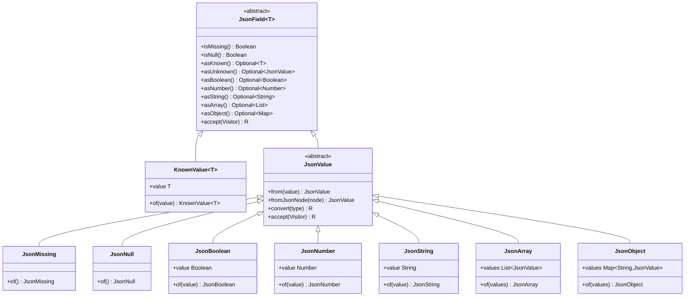
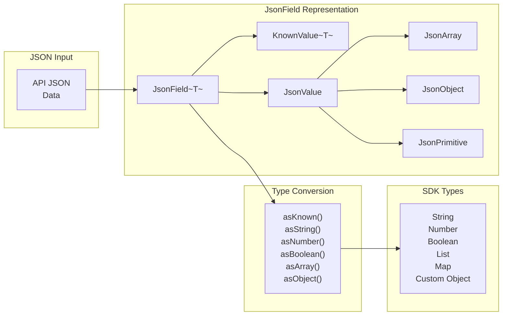
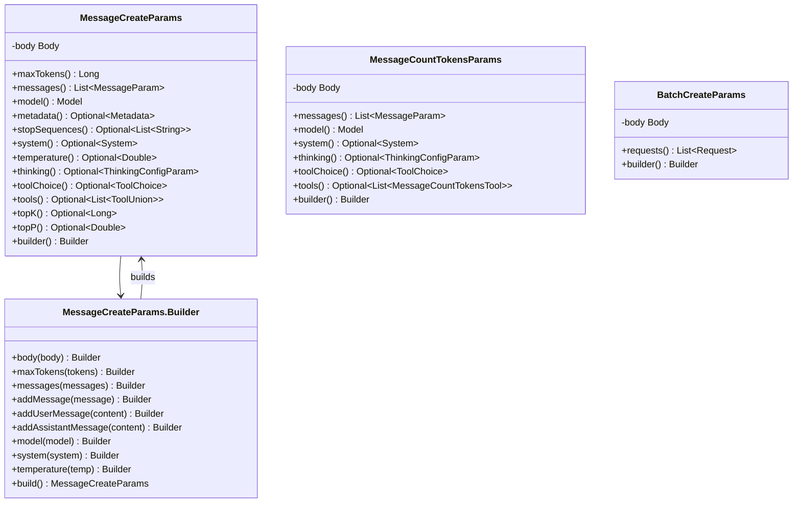
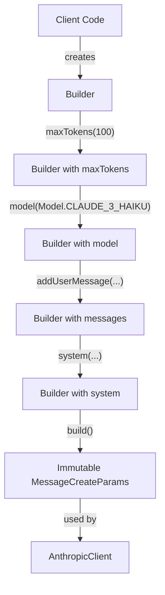
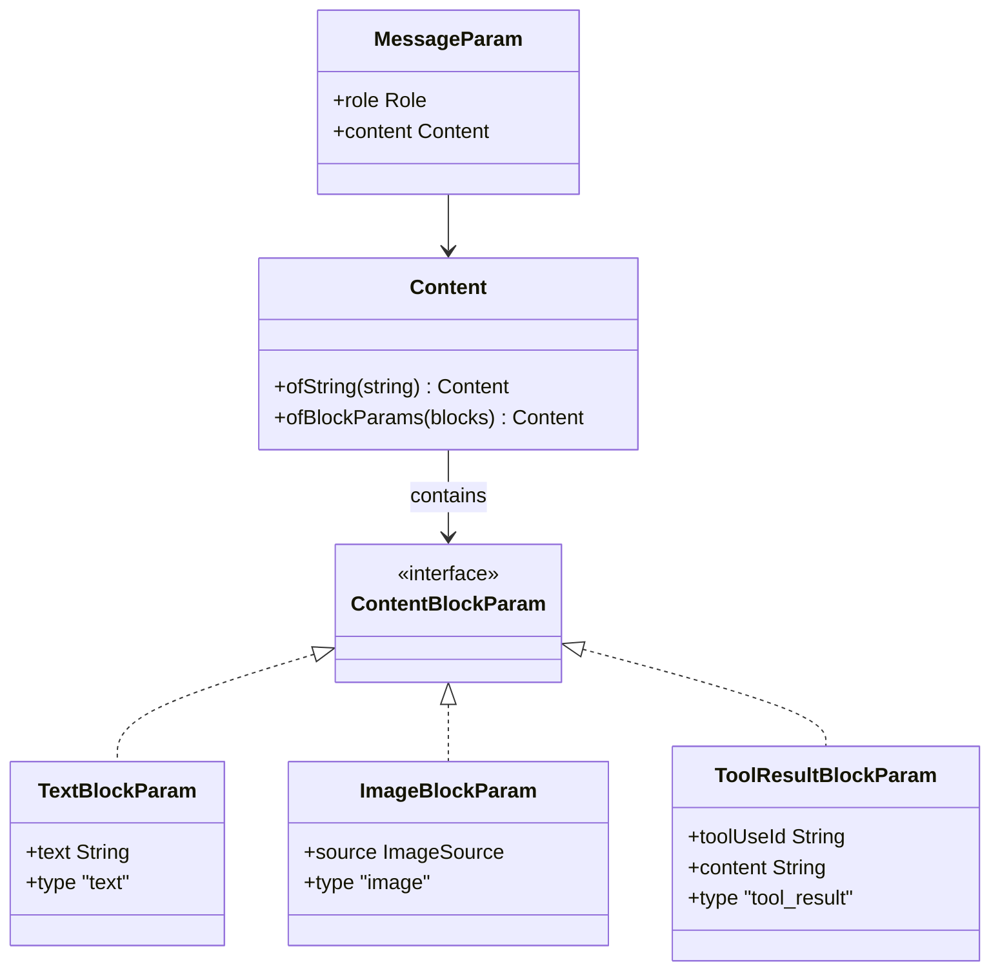
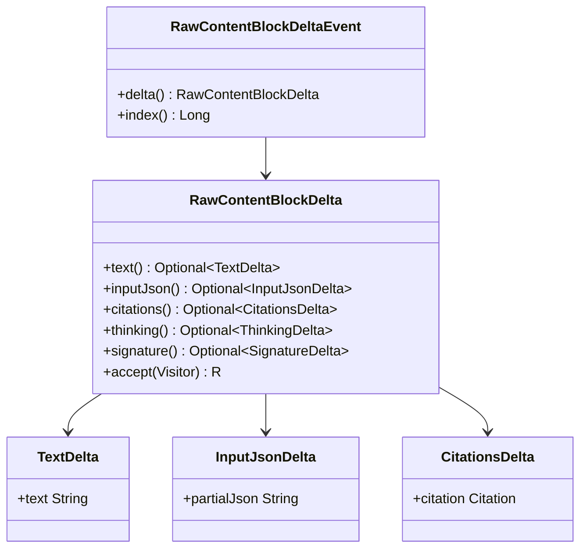
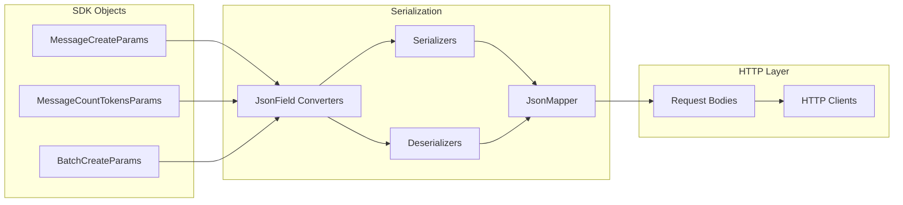
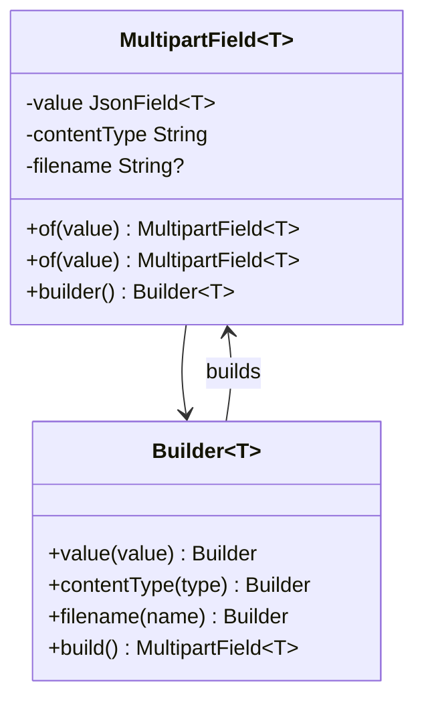
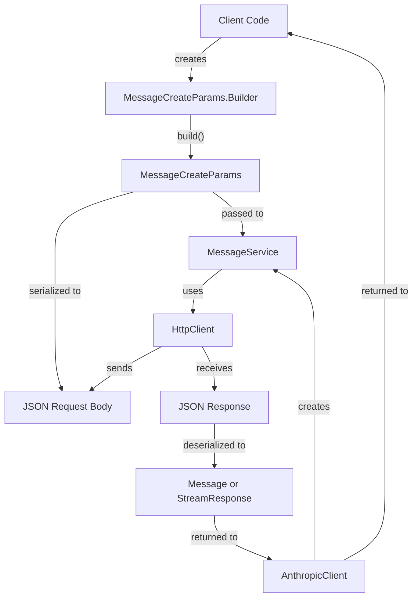
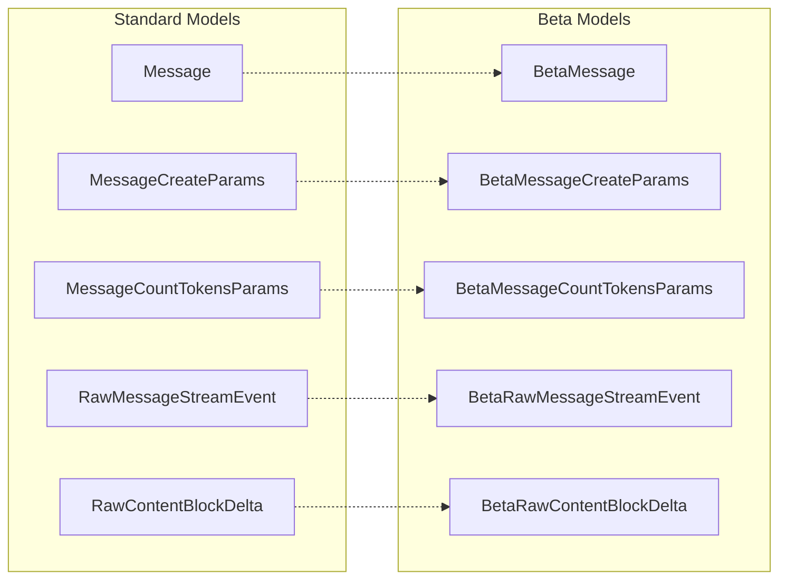

<!-- source: DeepWiki mcp.deepwiki.com · repo anthropics/anthropic-sdk-java · page 5 Data Models · fetched 2026-10-26 -->

# Data Models

<details>
<summary>Relevant source files</summary>

The following files were used as context for generating this wiki page:

- [.stats.yml](.stats.yml)
- [anthropic-java-core/src/main/kotlin/com/anthropic/core/Utils.kt](anthropic-java-core/src/main/kotlin/com/anthropic/core/Utils.kt)
- [anthropic-java-core/src/main/kotlin/com/anthropic/core/Values.kt](anthropic-java-core/src/main/kotlin/com/anthropic/core/Values.kt)
- [anthropic-java-core/src/main/kotlin/com/anthropic/core/http/HttpRequestBodies.kt](anthropic-java-core/src/main/kotlin/com/anthropic/core/http/HttpRequestBodies.kt)
- [anthropic-java-core/src/main/kotlin/com/anthropic/models/beta/messages/BetaRawContentBlockDelta.kt](anthropic-java-core/src/main/kotlin/com/anthropic/models/beta/messages/BetaRawContentBlockDelta.kt)
- [anthropic-java-core/src/main/kotlin/com/anthropic/models/beta/messages/BetaRawContentBlockDeltaEvent.kt](anthropic-java-core/src/main/kotlin/com/anthropic/models/beta/messages/BetaRawContentBlockDeltaEvent.kt)
- [anthropic-java-core/src/main/kotlin/com/anthropic/models/beta/messages/MessageCountTokensParams.kt](anthropic-java-core/src/main/kotlin/com/anthropic/models/beta/messages/MessageCountTokensParams.kt)
- [anthropic-java-core/src/main/kotlin/com/anthropic/models/beta/messages/MessageCreateParams.kt](anthropic-java-core/src/main/kotlin/com/anthropic/models/beta/messages/MessageCreateParams.kt)
- [anthropic-java-core/src/main/kotlin/com/anthropic/models/beta/messages/batches/BatchCreateParams.kt](anthropic-java-core/src/main/kotlin/com/anthropic/models/beta/messages/batches/BatchCreateParams.kt)
- [anthropic-java-core/src/main/kotlin/com/anthropic/models/completions/CompletionCreateParams.kt](anthropic-java-core/src/main/kotlin/com/anthropic/models/completions/CompletionCreateParams.kt)
- [anthropic-java-core/src/main/kotlin/com/anthropic/models/messages/MessageCountTokensParams.kt](anthropic-java-core/src/main/kotlin/com/anthropic/models/messages/MessageCountTokensParams.kt)
- [anthropic-java-core/src/main/kotlin/com/anthropic/models/messages/MessageCreateParams.kt](anthropic-java-core/src/main/kotlin/com/anthropic/models/messages/MessageCreateParams.kt)
- [anthropic-java-core/src/main/kotlin/com/anthropic/models/messages/RawContentBlockDelta.kt](anthropic-java-core/src/main/kotlin/com/anthropic/models/messages/RawContentBlockDelta.kt)
- [anthropic-java-core/src/main/kotlin/com/anthropic/models/messages/RawContentBlockDeltaEvent.kt](anthropic-java-core/src/main/kotlin/com/anthropic/models/messages/RawContentBlockDeltaEvent.kt)
- [anthropic-java-core/src/main/kotlin/com/anthropic/models/messages/batches/BatchCreateParams.kt](anthropic-java-core/src/main/kotlin/com/anthropic/models/messages/batches/BatchCreateParams.kt)
- [anthropic-java-core/src/test/kotlin/com/anthropic/core/UtilsTest.kt](anthropic-java-core/src/test/kotlin/com/anthropic/core/UtilsTest.kt)
- [anthropic-java-core/src/test/kotlin/com/anthropic/core/ValuesTest.kt](anthropic-java-core/src/test/kotlin/com/anthropic/core/ValuesTest.kt)
- [anthropic-java-core/src/test/kotlin/com/anthropic/models/beta/messages/BetaRawContentBlockDeltaEventTest.kt](anthropic-java-core/src/test/kotlin/com/anthropic/models/beta/messages/BetaRawContentBlockDeltaEventTest.kt)
- [anthropic-java-core/src/test/kotlin/com/anthropic/models/beta/messages/BetaRawContentBlockDeltaTest.kt](anthropic-java-core/src/test/kotlin/com/anthropic/models/beta/messages/BetaRawContentBlockDeltaTest.kt)
- [anthropic-java-core/src/test/kotlin/com/anthropic/models/beta/messages/BetaRawMessageStreamEventTest.kt](anthropic-java-core/src/test/kotlin/com/anthropic/models/beta/messages/BetaRawMessageStreamEventTest.kt)
- [anthropic-java-core/src/test/kotlin/com/anthropic/models/messages/RawContentBlockDeltaEventTest.kt](anthropic-java-core/src/test/kotlin/com/anthropic/models/messages/RawContentBlockDeltaEventTest.kt)
- [anthropic-java-core/src/test/kotlin/com/anthropic/models/messages/RawContentBlockDeltaTest.kt](anthropic-java-core/src/test/kotlin/com/anthropic/models/messages/RawContentBlockDeltaTest.kt)

</details>


This document provides a comprehensive overview of the data models used in the Anthropic Java SDK. It covers the core JSON field handling system, message parameter models, content blocks, and serialization mechanisms. For information about streaming response handling and message accumulation, see [Streaming Response Handling](#4).

## Core JSON Field Representation

The Anthropic Java SDK uses a sophisticated JSON field representation system designed to handle both strongly-typed data and flexible JSON structures. This approach allows the SDK to work with both known types expected by the API and arbitrary JSON values.

### JsonField and JsonValue Hierarchy



Sources: [anthropic-java-core/src/main/kotlin/com/anthropic/core/Values.kt:38-262](), [anthropic-java-core/src/main/kotlin/com/anthropic/core/Values.kt:270-394](), [anthropic-java-core/src/main/kotlin/com/anthropic/core/Values.kt:397-424]()

The core structure consists of:

- **JsonField<T>**: An abstract class that represents a field in a JSON structure. It can either be a `KnownValue<T>` (strongly-typed) or a `JsonValue` (flexible).
- **KnownValue<T>**: Contains a value of type `T` that matches what the SDK expects.
- **JsonValue**: Represents arbitrary JSON data that may not match the expected type.
- **Concrete JsonValue classes**: Implementations for different JSON data types (null, boolean, number, string, array, object).

This design allows for both type safety and flexibility when handling JSON data in the SDK.

### Type Handling and Conversion

The `JsonField` class provides methods to safely convert between different representations:

- `asKnown()`: Returns the value as type `T` if it's a `KnownValue<T>`
- `asBoolean()`, `asNumber()`, `asString()`: Type-specific accessors
- `asArray()`, `asObject()`: Methods for accessing complex structures
- `getRequired()`: Used internally to throw appropriate exceptions when required values are missing



Sources: [anthropic-java-core/src/main/kotlin/com/anthropic/core/Values.kt:45-168]()

## Request Parameter Models

The SDK uses a structured approach for building API request parameters with builder patterns. The main parameter classes follow a consistent design:



Sources: [anthropic-java-core/src/main/kotlin/com/anthropic/models/messages/MessageCreateParams.kt:44-343](), [anthropic-java-core/src/main/kotlin/com/anthropic/models/messages/MessageCountTokensParams.kt:44-168](), [anthropic-java-core/src/main/kotlin/com/anthropic/models/messages/batches/BatchCreateParams.kt:70-104]()

Key features of these parameter models:

1. **Immutable Objects**: All parameter objects are immutable once built
2. **Builder Pattern**: Each parameter class has a builder for constructing instances
3. **Fluent API**: Builders support chaining methods for a clean API
4. **Required vs Optional**: Clear distinction between required and optional parameters
5. **Type Safety**: Strong typing for all parameters

### Parameter Building Process



Sources: [anthropic-java-core/src/main/kotlin/com/anthropic/models/messages/MessageCreateParams.kt:317-443]()

## Message Content Structure

Messages in the Anthropic API can contain various types of content blocks. The SDK provides models to represent these content blocks both for requests and responses:



Sources: [anthropic-java-core/src/main/kotlin/com/anthropic/models/messages/MessageCreateParams.kt:96-141](), [anthropic-java-core/src/main/kotlin/com/anthropic/models/beta/messages/MessageCountTokensParams.kt:97-141]()

### Content Block Deltas (for Streaming)

For streaming responses, the SDK provides models to represent deltas (incremental updates) to content blocks:



Sources: [anthropic-java-core/src/main/kotlin/com/anthropic/models/messages/RawContentBlockDeltaEvent.kt:19-54](), [anthropic-java-core/src/main/kotlin/com/anthropic/models/messages/RawContentBlockDelta.kt:23-73]()

## JSON Serialization and Handling

The SDK provides utilities for serializing and deserializing JSON data, including handling multipart form data:



Sources: [anthropic-java-core/src/main/kotlin/com/anthropic/core/Values.kt:247-262](), [anthropic-java-core/src/main/kotlin/com/anthropic/core/http/HttpRequestBodies.kt:33-47]()

### MultipartField Handling

For handling file uploads and multipart form data, the SDK provides the `MultipartField` class:



Sources: [anthropic-java-core/src/main/kotlin/com/anthropic/core/Values.kt:608-723](), [anthropic-java-core/src/main/kotlin/com/anthropic/core/http/HttpRequestBodies.kt:66-160]()

## Relationship to API Requests

The data models fit into the overall SDK architecture to build and send API requests:



Sources: [anthropic-java-core/src/main/kotlin/com/anthropic/models/messages/MessageCreateParams.kt:44-731]()

## Utility Functions

The SDK provides various utility functions for working with data models:

1. **Field Validation**: Functions to check for required fields and validate data
2. **Type Conversion**: Methods for converting between different representations
3. **Content Handling**: Utilities for working with content hashes and equality
4. **Immutability**: Functions to convert mutable structures to immutable ones

Sources: [anthropic-java-core/src/main/kotlin/com/anthropic/core/Utils.kt:10-90]()

## Beta Models

The SDK provides beta versions of models for experimental features. These follow the same patterns as the standard models but have a `Beta` prefix and may contain additional fields or different behavior:



Sources: [anthropic-java-core/src/main/kotlin/com/anthropic/models/beta/messages/MessageCreateParams.kt:46-340](), [anthropic-java-core/src/main/kotlin/com/anthropic/models/beta/messages/MessageCountTokensParams.kt:46-187](), [anthropic-java-core/src/main/kotlin/com/anthropic/models/beta/messages/BetaRawContentBlockDeltaEvent.kt:19-54]()

## Best Practices for Working with Data Models

1. **Use Builders**: Always use builder methods to create parameter objects
2. **Check Required Fields**: Ensure all required fields are set before building
3. **Type Safety**: Use the strongly-typed methods when possible
4. **Error Handling**: Handle potential exceptions from field access methods
5. **Immutability**: Treat all data model objects as immutable

Example usage pattern:

```java
// Create message parameters
MessageCreateParams params = MessageCreateParams.builder()
    .maxTokens(1024)
    .model(Model.CLAUDE_3_HAIKU_LATEST)
    .addUserMessage("Hello, Claude!")
    .system("You are a helpful AI assistant.")
    .temperature(0.7)
    .build();

// Use the parameters to create a message
Message message = client.messages().create(params);
```

Sources: [anthropic-java-core/src/main/kotlin/com/anthropic/models/messages/MessageCreateParams.kt:215-311]()

---

