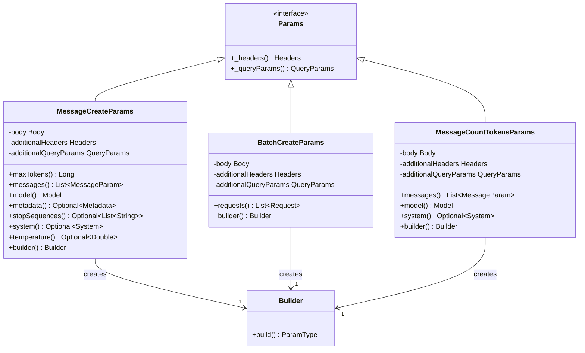
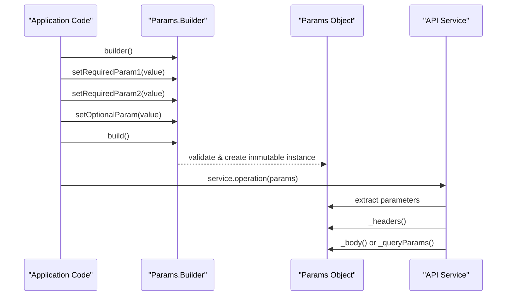
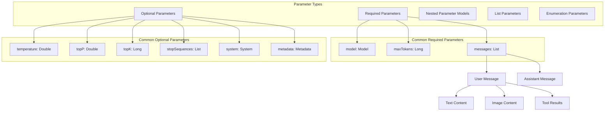

<!-- source: DeepWiki mcp.deepwiki.com · repo anthropics/anthropic-sdk-java · page 5.1 Request Parameter Models · fetched 2026-10-26 -->

# Request Parameter Models

<details>
<summary>Relevant source files</summary>

The following files were used as context for generating this wiki page:

- [anthropic-java-core/src/main/kotlin/com/anthropic/models/beta/messages/MessageCountTokensParams.kt](anthropic-java-core/src/main/kotlin/com/anthropic/models/beta/messages/MessageCountTokensParams.kt)
- [anthropic-java-core/src/main/kotlin/com/anthropic/models/beta/messages/MessageCreateParams.kt](anthropic-java-core/src/main/kotlin/com/anthropic/models/beta/messages/MessageCreateParams.kt)
- [anthropic-java-core/src/main/kotlin/com/anthropic/models/beta/messages/batches/BatchCancelParams.kt](anthropic-java-core/src/main/kotlin/com/anthropic/models/beta/messages/batches/BatchCancelParams.kt)
- [anthropic-java-core/src/main/kotlin/com/anthropic/models/beta/messages/batches/BatchCreateParams.kt](anthropic-java-core/src/main/kotlin/com/anthropic/models/beta/messages/batches/BatchCreateParams.kt)
- [anthropic-java-core/src/main/kotlin/com/anthropic/models/beta/messages/batches/BatchDeleteParams.kt](anthropic-java-core/src/main/kotlin/com/anthropic/models/beta/messages/batches/BatchDeleteParams.kt)
- [anthropic-java-core/src/main/kotlin/com/anthropic/models/completions/CompletionCreateParams.kt](anthropic-java-core/src/main/kotlin/com/anthropic/models/completions/CompletionCreateParams.kt)
- [anthropic-java-core/src/main/kotlin/com/anthropic/models/messages/MessageCountTokensParams.kt](anthropic-java-core/src/main/kotlin/com/anthropic/models/messages/MessageCountTokensParams.kt)
- [anthropic-java-core/src/main/kotlin/com/anthropic/models/messages/MessageCreateParams.kt](anthropic-java-core/src/main/kotlin/com/anthropic/models/messages/MessageCreateParams.kt)
- [anthropic-java-core/src/main/kotlin/com/anthropic/models/messages/batches/BatchCancelParams.kt](anthropic-java-core/src/main/kotlin/com/anthropic/models/messages/batches/BatchCancelParams.kt)
- [anthropic-java-core/src/main/kotlin/com/anthropic/models/messages/batches/BatchCreateParams.kt](anthropic-java-core/src/main/kotlin/com/anthropic/models/messages/batches/BatchCreateParams.kt)
- [anthropic-java-core/src/main/kotlin/com/anthropic/models/messages/batches/BatchDeleteParams.kt](anthropic-java-core/src/main/kotlin/com/anthropic/models/messages/batches/BatchDeleteParams.kt)

</details>


This document details the parameter model classes in the Anthropic Java SDK that are used to construct API requests. These models follow a consistent pattern and provide a type-safe way to specify parameters for various API operations, including message creation, token counting, and batch operations.

For information about response models, see [Data Models](#5).

## Overview

Request parameter models in the Anthropic Java SDK are designed using the Builder pattern to create immutable, well-structured request objects. These models handle all aspects of request construction, including required and optional fields, parameter validation, header management, and serialization.



Sources: [anthropic-java-core/src/main/kotlin/com/anthropic/models/messages/MessageCreateParams.kt:44-844](). [anthropic-java-core/src/main/kotlin/com/anthropic/models/beta/messages/batches/BatchCreateParams.kt:70-518](). [anthropic-java-core/src/main/kotlin/com/anthropic/models/messages/MessageCountTokensParams.kt:44-582]().

## Common Structure and Patterns

All request parameter models in the SDK follow a consistent structure:

1. They implement the `Params` interface
2. They use private constructors to ensure instances are created only through Builders
3. They include a nested Builder class for constructing parameter instances
4. They provide getter methods for accessing parameter values
5. They include methods for handling headers, query parameters, and body properties



Sources: [anthropic-java-core/src/main/kotlin/com/anthropic/models/messages/MessageCreateParams.kt:425-442](). [anthropic-java-core/src/main/kotlin/com/anthropic/models/beta/messages/batches/BatchCreateParams.kt:95-115](). [anthropic-java-core/src/main/kotlin/com/anthropic/models/messages/MessageCountTokensParams.kt:302-323]().

### Builder Pattern Implementation

All parameter models use the Builder pattern with a fluent interface. This allows for clear, readable code when constructing parameter objects:

1. Each parameter model has a static `builder()` method
2. The Builder includes methods for setting each parameter
3. Parameter setting methods return the Builder instance for method chaining
4. The `build()` method validates required parameters and creates an immutable instance

Example of required parameter validation:

```
fun build(): MessageCreateParams =
    MessageCreateParams(
        body.build(),
        additionalHeaders.build(),
        additionalQueryParams.build(),
    )
```

The `build()` method internally calls `checkRequired()` on all required parameters.

Sources: [anthropic-java-core/src/main/kotlin/com/anthropic/models/messages/MessageCreateParams.kt:437-442](). [anthropic-java-core/src/main/kotlin/com/anthropic/models/beta/messages/batches/BatchCreateParams.kt:305-324](). [anthropic-java-core/src/main/kotlin/com/anthropic/models/beta/messages/MessageCountTokensParams.kt:312-318]().

## Major Parameter Models

The SDK includes parameter models for different API operations, grouped by functionality:

### Message Operations

#### MessageCreateParams

Used to create new messages with Claude. Supports:
- Setting message content (text and images)
- Specifying the model
- Setting the maximum number of tokens to generate
- Providing system prompts
- Configuring temperature and other sampling parameters
- Enabling tool usage

```
MessageCreateParams.builder()
    .maxTokens(1024)
    .model(Model.CLAUDE_3_OPUS)
    .addUserMessage("Hello, Claude!")
    .build()
```

Sources: [anthropic-java-core/src/main/kotlin/com/anthropic/models/messages/MessageCreateParams.kt:44-844](). [anthropic-java-core/src/main/kotlin/com/anthropic/models/beta/messages/MessageCreateParams.kt:46-449]().

#### MessageCountTokensParams

Used to count tokens without generating a response. Supports:
- Counting tokens for message content
- Calculating token usage for multi-turn conversations
- Analyzing token usage for tools and system prompts

```
MessageCountTokensParams.builder()
    .model(Model.CLAUDE_3_HAIKU)
    .addUserMessage("Count my tokens, please!")
    .build()
```

Sources: [anthropic-java-core/src/main/kotlin/com/anthropic/models/messages/MessageCountTokensParams.kt:44-582](). [anthropic-java-core/src/main/kotlin/com/anthropic/models/beta/messages/MessageCountTokensParams.kt:46-649]().

### Batch Operations

#### BatchCreateParams

Used to submit multiple message creation requests in a single batch:
- Accepts a list of message requests
- Each request includes an ID and message creation parameters
- Enables efficient processing of multiple prompts

```
BatchCreateParams.builder()
    .addRequest(
        Request.builder()
            .customId("request-1")
            .params(/* MessageCreateParams */)
            .build()
    )
    .build()
```

Sources: [anthropic-java-core/src/main/kotlin/com/anthropic/models/messages/batches/BatchCreateParams.kt:65-642](). [anthropic-java-core/src/main/kotlin/com/anthropic/models/beta/messages/batches/BatchCreateParams.kt:70-518]().

#### BatchCancelParams and BatchDeleteParams

Used to manage existing batches:
- `BatchCancelParams`: Cancels an in-progress batch
- `BatchDeleteParams`: Deletes a completed batch

Both require only the batch ID:

```
BatchCancelParams.builder()
    .messageBatchId("batch_id")
    .build()
```

Sources: [anthropic-java-core/src/main/kotlin/com/anthropic/models/messages/batches/BatchCancelParams.kt:26-243](). [anthropic-java-core/src/main/kotlin/com/anthropic/models/messages/batches/BatchDeleteParams.kt:23-241](). [anthropic-java-core/src/main/kotlin/com/anthropic/models/beta/messages/batches/BatchCancelParams.kt:28-282](). [anthropic-java-core/src/main/kotlin/com/anthropic/models/beta/messages/batches/BatchDeleteParams.kt:25-279]().

### Legacy Operations

#### CompletionCreateParams

Used for the legacy Text Completions API:
- Similar to MessageCreateParams but uses a different format
- Requires formatted prompts with `\n\nHuman:` and `\n\nAssistant:` markers
- Future models will not support this API

```
CompletionCreateParams.builder()
    .maxTokensToSample(1024)
    .model(Model.CLAUDE_2)
    .prompt("\n\nHuman: Hello\n\nAssistant:")
    .build()
```

Sources: [anthropic-java-core/src/main/kotlin/com/anthropic/models/completions/CompletionCreateParams.kt:38-802]().

## Parameter Types and Structures

The parameter models use a variety of parameter types for different purposes:



Sources: [anthropic-java-core/src/main/kotlin/com/anthropic/models/messages/MessageCreateParams.kt:63-237](). [anthropic-java-core/src/main/kotlin/com/anthropic/models/beta/messages/MessageCreateParams.kt:67-336]().

### Content Structure

Message content can be structured in several ways:
1. Simple text strings
2. Content blocks for different media types (text, images)
3. Tool input and results for function calling

The parameter models provide helper methods for creating these structures easily:

```
// Adding a simple text message
.addUserMessage("Hello, Claude")

// Adding a message with content blocks
.addUserMessageOfBlockParams(List.of(
    TextBlockParam.builder().text("Hello").build(),
    ImageBlockParam.builder()
        .source(ImageBlockParam.Source.builder()
            .type(ImageBlockParam.Source.Type.BASE64)
            .mediaType("image/jpeg")
            .data("...")
            .build())
        .build()
))
```

Sources: [anthropic-java-core/src/main/kotlin/com/anthropic/models/messages/MessageCreateParams.kt:598-634](). [anthropic-java-core/src/main/kotlin/com/anthropic/models/beta/messages/MessageCreateParams.kt:632-672]().

## Beta Parameter Handling

The SDK supports beta features through specialized parameter models in the `beta` package, with additional functionality:

- Beta parameters include the `betas` field to specify which beta features to enable
- The models handle setting the `anthropic-beta` header automatically

```
MessageCreateParams.builder()
    .addBeta(AnthropicBeta.MESSAGES_THINKING)
    // Other parameters...
    .build()
```

In the beta models, this sets the appropriate header:

```
override fun _headers(): Headers =
    Headers.builder()
        .apply {
            betas?.forEach { put("anthropic-beta", it.toString()) }
            putAll(additionalHeaders)
        }
        .build()
```

Sources: [anthropic-java-core/src/main/kotlin/com/anthropic/models/beta/messages/MessageCreateParams.kt:245-266](). [anthropic-java-core/src/main/kotlin/com/anthropic/models/beta/messages/batches/BatchCreateParams.kt:327-335]().

## Parameter Validation

Parameter models include validation to ensure requests are properly formed:

1. Required parameters are checked at build time using `checkRequired()`
2. Optional parameters are wrapped in `Optional<>` to safely handle null values
3. Type validation is performed by the serialization/deserialization system

The `build()` method throws `IllegalStateException` if required parameters are missing:

```
fun build(): MessageCreateParams =
    MessageCreateParams(
        checkRequired("maxTokens", maxTokens),
        checkRequired("messages", messages).map { it.toImmutable() },
        checkRequired("model", model),
        // Other parameters...
    )
```

Sources: [anthropic-java-core/src/main/kotlin/com/anthropic/models/messages/MessageCreateParams.kt:583-587](). [anthropic-java-core/src/main/kotlin/com/anthropic/models/beta/messages/MessageCreateParams.kt:441-443]().

## Usage Examples

Here are examples of how to use the parameter models for common operations:

### Creating a Simple Message

```
// Create a message with Claude
MessageCreateParams params = MessageCreateParams.builder()
    .maxTokens(1024)
    .model(Model.CLAUDE_3_HAIKU)
    .addUserMessage("Tell me about Java programming")
    .build();

// Send the request
Message response = client.messages().create(params);
```

### Creating a Message with Multiple Turns

```
// Multi-turn conversation
MessageCreateParams params = MessageCreateParams.builder()
    .maxTokens(1024)
    .model(Model.CLAUDE_3_SONNET)
    .addUserMessage("What's the capital of France?")
    .addAssistantMessage("The capital of France is Paris.")
    .addUserMessage("And what's the capital of Italy?")
    .build();
```

### Counting Tokens

```
// Count tokens for a message
MessageCountTokensParams params = MessageCountTokensParams.builder()
    .model(Model.CLAUDE_3_OPUS)
    .addUserMessage("Count these tokens for me")
    .build();

MessageCountTokensResponse response = client.messages().countTokens(params);
```

### Creating a Batch

```
// Create a batch of message requests
BatchCreateParams params = BatchCreateParams.builder()
    .addRequest(Request.builder()
        .customId("request-1")
        .params(MessageCreateParams.builder()
            .maxTokens(1024)
            .model(Model.CLAUDE_3_HAIKU)
            .addUserMessage("Question 1")
            .build())
        .build())
    .addRequest(Request.builder()
        .customId("request-2")
        .params(MessageCreateParams.builder()
            .maxTokens(1024)
            .model(Model.CLAUDE_3_HAIKU)
            .addUserMessage("Question 2")
            .build())
        .build())
    .build();
```

## Summary

Request parameter models in the Anthropic Java SDK provide a structured, type-safe way to create API requests. They use the Builder pattern to create immutable parameter objects, handle validation of required fields, and provide a clean interface for setting all supported parameters. The models are divided into categories based on functionality (messages, batches, etc.) and include both standard and beta versions to support evolving features.

---

