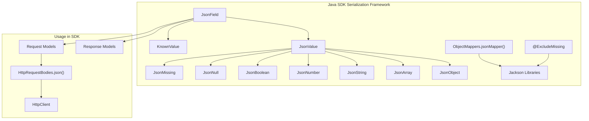
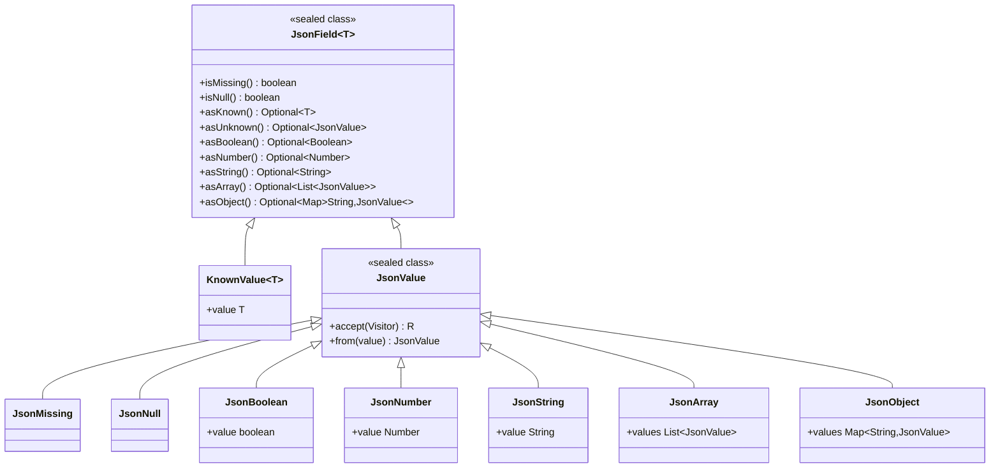
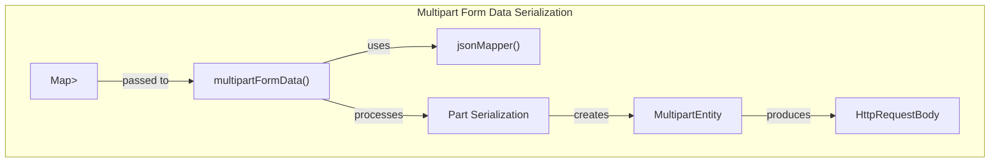

<!-- source: DeepWiki mcp.deepwiki.com · repo anthropics/anthropic-sdk-java · page 5.2 JSON Serialization · fetched 2026-10-26 -->

# JSON Serialization

<details>
<summary>Relevant source files</summary>

The following files were used as context for generating this wiki page:

- [anthropic-java-core/build.gradle.kts](anthropic-java-core/build.gradle.kts)
- [anthropic-java-core/src/main/kotlin/com/anthropic/core/ObjectMappers.kt](anthropic-java-core/src/main/kotlin/com/anthropic/core/ObjectMappers.kt)
- [anthropic-java-core/src/main/kotlin/com/anthropic/core/Utils.kt](anthropic-java-core/src/main/kotlin/com/anthropic/core/Utils.kt)
- [anthropic-java-core/src/main/kotlin/com/anthropic/core/Values.kt](anthropic-java-core/src/main/kotlin/com/anthropic/core/Values.kt)
- [anthropic-java-core/src/main/kotlin/com/anthropic/core/http/HttpRequestBodies.kt](anthropic-java-core/src/main/kotlin/com/anthropic/core/http/HttpRequestBodies.kt)
- [anthropic-java-core/src/test/kotlin/com/anthropic/core/ObjectMappersTest.kt](anthropic-java-core/src/test/kotlin/com/anthropic/core/ObjectMappersTest.kt)
- [anthropic-java-core/src/test/kotlin/com/anthropic/core/UtilsTest.kt](anthropic-java-core/src/test/kotlin/com/anthropic/core/UtilsTest.kt)
- [anthropic-java-core/src/test/kotlin/com/anthropic/core/ValuesTest.kt](anthropic-java-core/src/test/kotlin/com/anthropic/core/ValuesTest.kt)

</details>


This page documents the JSON serialization system in the Anthropic Java SDK, which enables conversion between Java objects and JSON for API communication. It covers the core serialization components, the object mapper configuration, and the JSON field representation hierarchy.

For information about the data models being serialized, see [Request Parameter Models](#5.1).

## Overview

The Anthropic Java SDK uses Jackson for JSON serialization and deserialization, with specialized classes that provide flexible handling of both strongly-typed and arbitrary JSON data. This system powers all communication with the Anthropic API, ensuring proper encoding of requests and parsing of responses.



Sources: [anthropic-java-core/src/main/kotlin/com/anthropic/core/Values.kt:32-723](), [anthropic-java-core/src/main/kotlin/com/anthropic/core/ObjectMappers.kt:1-167]()

## Object Mapper Configuration

The SDK's JSON serialization is powered by a carefully configured Jackson `ObjectMapper`, defined in the `jsonMapper()` function. This function creates a `JsonMapper` with specific modules and settings to ensure proper serialization and deserialization behavior.

```kotlin
// ObjectMappers.kt
fun jsonMapper(): JsonMapper =
    JsonMapper.builder()
        .addModule(kotlinModule())
        .addModule(Jdk8Module())
        .addModule(JavaTimeModule())
        .addModule(
            SimpleModule()
                .addSerializer(InputStreamSerializer)
                .addDeserializer(LocalDateTime::class.java, LenientLocalDateTimeDeserializer())
        )
        // Type coercion configuration
        .serializationInclusion(JsonInclude.Include.NON_ABSENT)
        .disable(DeserializationFeature.ADJUST_DATES_TO_CONTEXT_TIME_ZONE)
        .disable(SerializationFeature.WRITE_DATES_AS_TIMESTAMPS)
        // ...
        .build()
```

The key aspects of this configuration include:

| Feature | Description |
|---------|-------------|
| **Jackson Modules** | Adds support for Kotlin, Java 8 features (like Optional), and Java Time |
| **Custom Components** | Includes custom serializers (e.g., for InputStream) and deserializers (e.g., for LocalDateTime) |
| **Type Coercion Rules** | Configures strict type checking to prevent unexpected conversions (e.g., strings to numbers) |
| **Serialization Settings** | Excludes null/missing fields and configures date/time formatting |

Sources: [anthropic-java-core/src/main/kotlin/com/anthropic/core/ObjectMappers.kt:31-106]()

## JsonField Hierarchy

The core of the JSON serialization system is the `JsonField<T>` class hierarchy, which provides a type-safe way to represent JSON fields. It allows the SDK to handle both known (strongly-typed) values and arbitrary JSON values.



Sources: [anthropic-java-core/src/main/kotlin/com/anthropic/core/Values.kt:32-601]()

### JsonField Class

`JsonField<T>` is a sealed class representing a serializable JSON field with a generic type parameter `T`. It can either be a strongly-typed value (via `KnownValue<T>`) or an arbitrary JSON value (via `JsonValue` hierarchy).

Key methods in `JsonField`:

```kotlin
// From Values.kt
sealed class JsonField<out T : Any> {
    fun isMissing(): Boolean = this is JsonMissing
    fun isNull(): Boolean = this is JsonNull
    fun asKnown(): Optional<T> = Optional.ofNullable((this as? KnownValue)?.value)
    fun asUnknown(): Optional<JsonValue> = Optional.ofNullable(this as? JsonValue)
    fun asBoolean(): Optional<Boolean> = /* ... */
    fun asNumber(): Optional<Number> = /* ... */
    fun asString(): Optional<String> = /* ... */
    fun asArray(): Optional<List<JsonValue>> = /* ... */
    fun asObject(): Optional<Map<String, JsonValue>> = /* ... */
    // ...
}
```

The class provides methods for:
- Checking field state (missing or null)
- Getting the value as the expected type (`asKnown()`)
- Getting the value as a `JsonValue` (`asUnknown()`)
- Type-specific getters (`asBoolean()`, `asNumber()`, etc.)

Sources: [anthropic-java-core/src/main/kotlin/com/anthropic/core/Values.kt:38-202]()

### JsonValue Hierarchy

The `JsonValue` class hierarchy represents arbitrary JSON values:

| Class | Description |
|-------|-------------|
| **JsonMissing** | Represents an omitted field (not included in serialized JSON) |
| **JsonNull** | Represents a JSON `null` value |
| **JsonBoolean** | Represents a JSON boolean value |
| **JsonNumber** | Represents a JSON number value |
| **JsonString** | Represents a JSON string value |
| **JsonArray** | Represents a JSON array value |
| **JsonObject** | Represents a JSON object value |

The `JsonValue` class also provides a static `from()` method to convert arbitrary Java objects to the appropriate `JsonValue` type:

```kotlin
// From Values.kt
@JvmStatic
fun from(value: Any?): JsonValue =
    when (value) {
        null -> JsonNull.of()
        is JsonValue -> value
        else -> JSON_MAPPER.convertValue(value, JsonValue::class.java)
    }
```

Sources: [anthropic-java-core/src/main/kotlin/com/anthropic/core/Values.kt:269-393]()

## Serialization Process Flow

The diagram below illustrates how JSON serialization and deserialization flow through the SDK components:

```mermaid
flowchart TD
    subgraph "JSON Serialization Process"
        ClientCode["Client Code"] -->|"creates"| RequestObject["Request Object with JsonFields"]
        RequestObject -->|"passed to"| HttpRequest["HttpRequestBodies.json()"]
        HttpRequest -->|"uses"| ObjectMapper["jsonMapper()"]
        ObjectMapper -->|"produces"| JsonBytes["JSON Bytes"]
        JsonBytes -->|"sent via"| HttpClient["HttpClient"]
        HttpClient -->|"transmits to"| API["Anthropic API"]
        
        API -->|"returns"| ResponseJson["JSON Response"]
        ResponseJson -->|"parsed by"| ObjectMapper2["jsonMapper()"]
        ObjectMapper2 -->|"creates"| ResponseObject["Response Object with JsonFields"]
        ResponseObject -->|"returned to"| ClientCode2["Client Code"]
    end
```



Sources: [anthropic-java-core/src/main/kotlin/com/anthropic/core/http/HttpRequestBodies.kt:31-47]()

## Working with JsonFields

### Creating JsonFields

The SDK provides static factory methods for creating `JsonField` instances:

```java
// Create a JsonField with a String value
JsonField<String> field = JsonField.of("Hello, World!");

// Create a JsonField with a nullable value
JsonField<Integer> nullableField = JsonField.ofNullable(null); // Creates JsonNull

// Create a JsonField for arbitrary JSON
JsonField<Object> jsonField = JsonValue.from(Map.of("key", "value")); 
```

### Accessing JsonField Values

To access values stored in a `JsonField`, you can use various getter methods:

```java
// Get as the expected type
Optional<String> value = field.asKnown();

// Get as a specific type
Optional<Boolean> boolValue = field.asBoolean();
Optional<Number> numValue = field.asNumber();
Optional<String> strValue = field.asString();

// Get as an array or object
Optional<List<JsonValue>> arrayValue = field.asArray();
Optional<Map<String, JsonValue>> objectValue = field.asObject();
```

Sources: [anthropic-java-core/src/main/kotlin/com/anthropic/core/Values.kt:219-233](), [anthropic-java-core/src/main/kotlin/com/anthropic/core/Values.kt:355-361]()

## Custom Annotations

### @ExcludeMissing

The `@ExcludeMissing` annotation is used to exclude fields set to `JsonMissing` from the serialized JSON:

```kotlin
// From Values.kt
@JacksonAnnotationsInside
@JsonInclude(JsonInclude.Include.CUSTOM, valueFilter = JsonField.IsMissing::class)
annotation class ExcludeMissing
```

When applied to a field or getter method, it causes fields with `JsonMissing` values to be omitted from the serialized output, providing control over which fields are included in the final JSON.

Sources: [anthropic-java-core/src/main/kotlin/com/anthropic/core/Values.kt:604-606]()

## HTTP Request Serialization

The SDK serializes HTTP request bodies to JSON using the `json()` function in `HttpRequestBodies.kt`:

```kotlin
// From HttpRequestBodies.kt
@JvmSynthetic
inline fun <reified T> json(jsonMapper: JsonMapper, value: T): HttpRequestBody =
    object : HttpRequestBody {
        private val bytes: ByteArray by lazy { jsonMapper.writeValueAsBytes(value) }

        override fun writeTo(outputStream: OutputStream) = outputStream.write(bytes)
        override fun contentType(): String = "application/json"
        override fun contentLength(): Long = bytes.size.toLong()
        override fun repeatable(): Boolean = true
        override fun close() {}
    }
```

This function creates an `HttpRequestBody` that contains the JSON serialized representation of the input value.

Sources: [anthropic-java-core/src/main/kotlin/com/anthropic/core/http/HttpRequestBodies.kt:31-47]()

## Integration with Jackson

The JSON serialization system integrates with Jackson through custom serializers and deserializers. For example, the `JsonField` class has a custom deserializer:

```kotlin
// From Values.kt
class Deserializer(private val type: JavaType? = null) :
    BaseDeserializer<JsonField<*>>(JsonField::class) {

    override fun createContextual(
        context: DeserializationContext,
        property: BeanProperty?,
    ): JsonDeserializer<JsonField<*>> = Deserializer(context.contextualType?.containedType(0))

    override fun ObjectCodec.deserialize(node: JsonNode): JsonField<*> =
        type?.let { tryDeserialize<Any>(node, type) }?.let { of(it) }
            ?: JsonValue.fromJsonNode(node)

    override fun getNullValue(context: DeserializationContext): JsonField<*> = JsonNull.of()
}
```

This deserializer attempts to deserialize values as the expected type, falling back to `JsonValue` when needed.

Sources: [anthropic-java-core/src/main/kotlin/com/anthropic/core/Values.kt:248-261]()

## Multipart Form Data Support

The SDK also supports `multipart/form-data` requests through the `MultipartField` class and the `multipartFormData()` function:



The `MultipartField` class represents a field in a multipart form, with support for both text and binary data:

```kotlin
// From Values.kt
class MultipartField<T : Any> {
    val value: JsonField<T>
    val contentType: String
    private val filename: String?
    // ...
}
```

This allows for uploading files and other binary data alongside regular form fields.

Sources: [anthropic-java-core/src/main/kotlin/com/anthropic/core/Values.kt:609-723](), [anthropic-java-core/src/main/kotlin/com/anthropic/core/http/HttpRequestBodies.kt:66-160]()

## Utility Functions

The SDK includes utility functions for working with collections and content equality:

```kotlin
// From Utils.kt
@JvmSynthetic internal fun <T> List<T>.toImmutable(): List<T> = /* ... */
@JvmSynthetic internal fun <K, V> Map<K, V>.toImmutable(): Map<K, V> = /* ... */
@JvmSynthetic internal infix fun Any?.contentEquals(other: Any?): Boolean = /* ... */
@JvmSynthetic internal fun contentHash(vararg values: Any?): Int = /* ... */
@JvmSynthetic internal fun Any?.contentToString(): String = /* ... */
```

These functions help ensure that collections are immutable and that equality and hashing work correctly for complex objects, including arrays.

Sources: [anthropic-java-core/src/main/kotlin/com/anthropic/core/Utils.kt:14-90]()

## Version Compatibility

The SDK is built and tested against Jackson 2.13.4 to ensure backward compatibility, but depends on Jackson 2.18.2 to ensure users get secure versions by default:

```kotlin
// From build.gradle.kts
configurations.all {
    resolutionStrategy {
        // Compile and test against a lower Jackson version to ensure we're compatible with it.
        force("com.fasterxml.jackson.core:jackson-core:2.13.4")
        // ...
    }
}

dependencies {
    api("com.fasterxml.jackson.core:jackson-core:2.18.2")
    api("com.fasterxml.jackson.core:jackson-databind:2.18.2")
    // ...
}
```

Sources: [anthropic-java-core/build.gradle.kts:6-27]()

## Practical Usage Example

This example shows how the JSON serialization system is used in practice:

```java
// Create a message with parameters
MessageParams params = MessageParams.builder()
    .model("claude-3-opus-20240229")
    .maxTokens(1024)
    .system("You are a helpful assistant.")
    .messages(List.of(
        MessageParam.builder()
            .role("user")
            .content("Hello, Claude!")
            .build()
    ))
    .build();

// The SDK converts this to JSON using the serialization system
Message response = client.messages().create(params);

// Response fields are also JsonField instances
String content = response.content().get(0).text().asStringOrThrow();
```

The underlying code converts the request to JSON, sends it to the API, and parses the JSON response back into objects with `JsonField` values.

---

