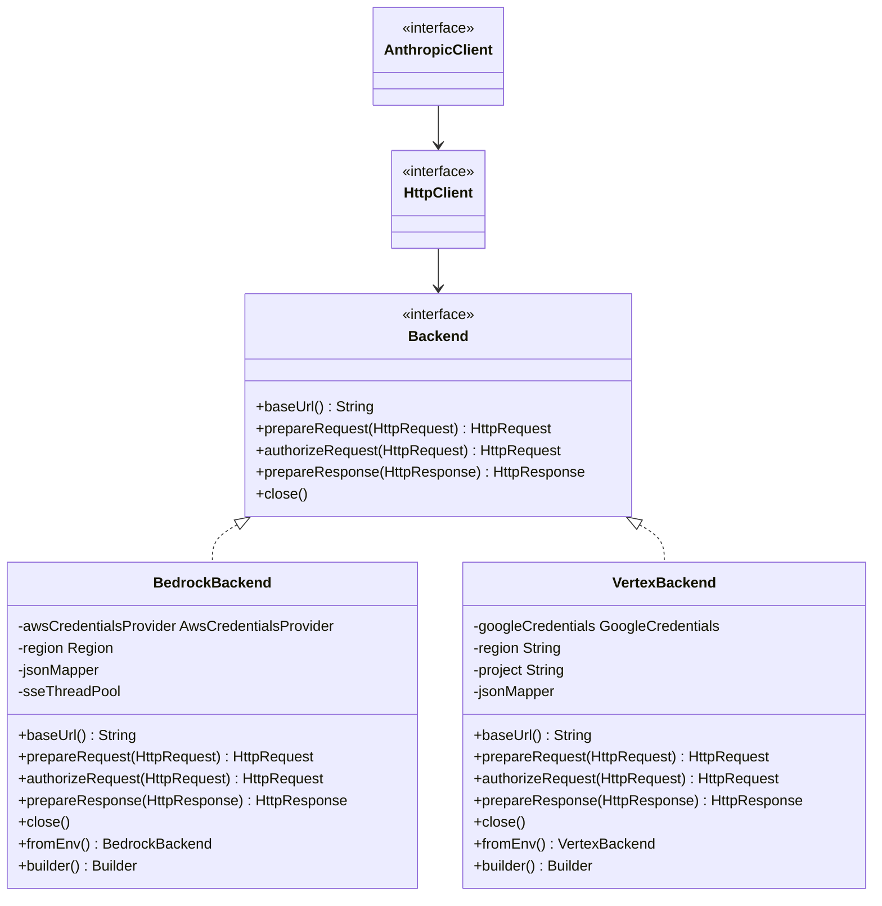
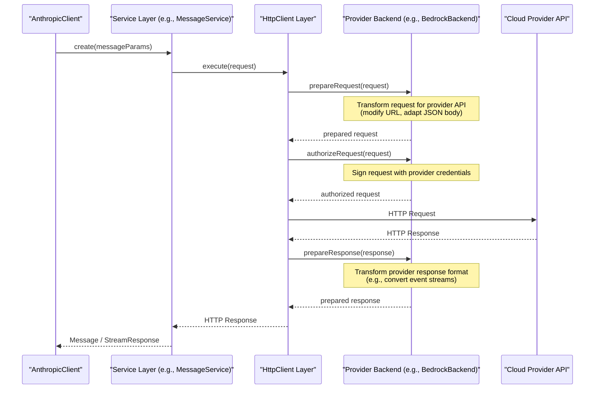
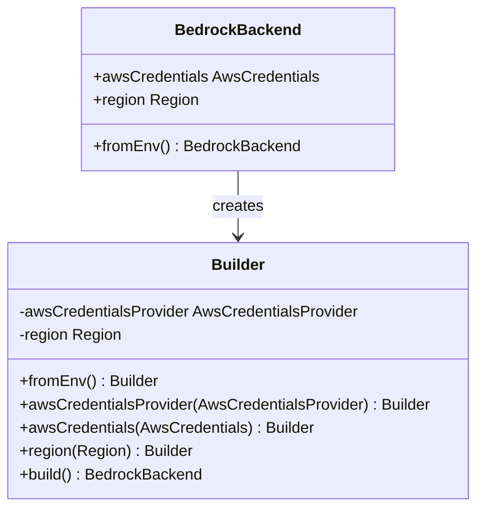
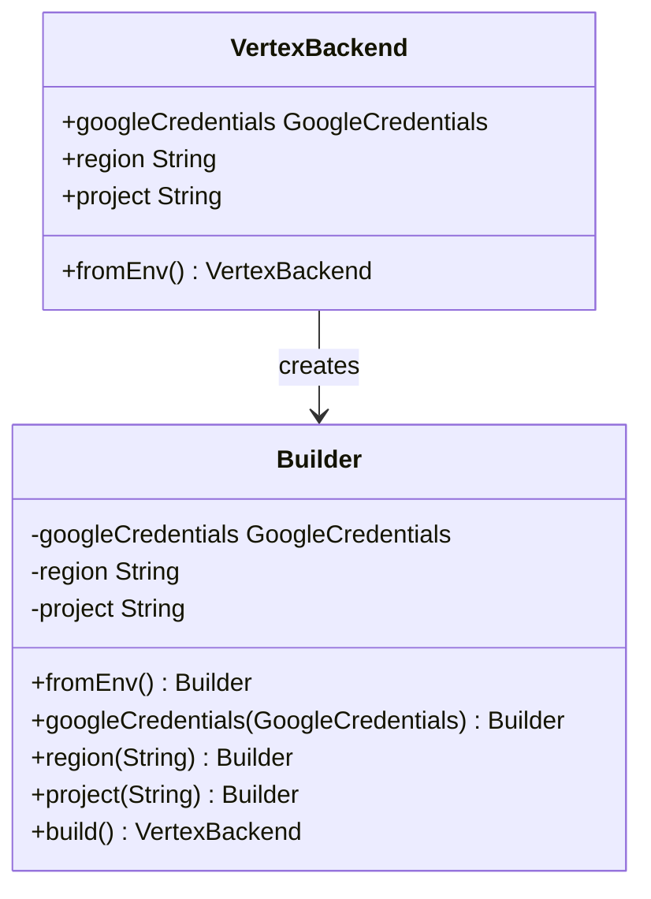
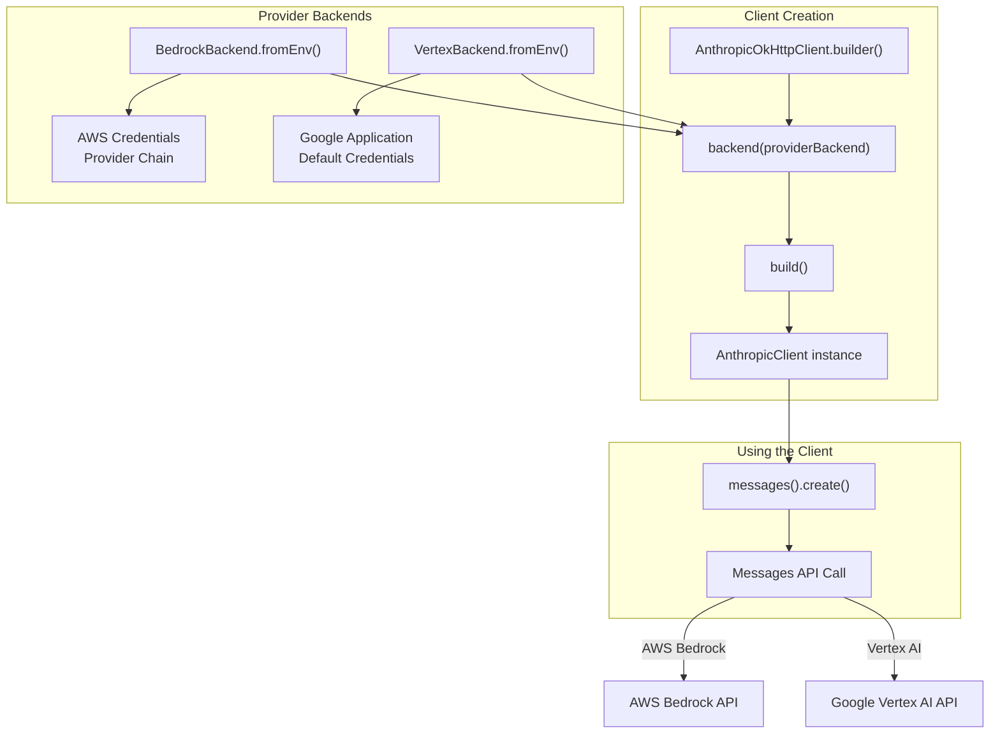
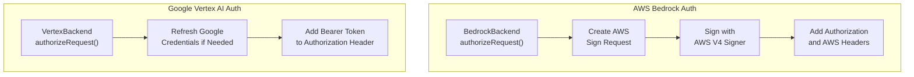

<!-- source: DeepWiki mcp.deepwiki.com · repo anthropics/anthropic-sdk-java · page 6 Cloud Provider Integration · fetched 2026-10-26 -->

# Cloud Provider Integration

Relevant source files

The following files were used as context for generating this wiki page:

- [.release-please-manifest.json](.release-please-manifest.json)
- [CHANGELOG.md](CHANGELOG.md)
- [README.md](README.md)
- [anthropic-java-bedrock/src/main/kotlin/com/anthropic/bedrock/backends/BedrockBackend.kt](anthropic-java-bedrock/src/main/kotlin/com/anthropic/bedrock/backends/BedrockBackend.kt)
- [anthropic-java-bedrock/src/test/kotlin/com/anthropic/bedrock/backends/BedrockBackendTest.kt](anthropic-java-bedrock/src/test/kotlin/com/anthropic/bedrock/backends/BedrockBackendTest.kt)
- [anthropic-java-vertex/src/main/kotlin/com/anthropic/vertex/backends/VertexBackend.kt](anthropic-java-vertex/src/main/kotlin/com/anthropic/vertex/backends/VertexBackend.kt)
- [anthropic-java-vertex/src/test/kotlin/com/anthropic/vertex/backends/VertexBackendTest.kt](anthropic-java-vertex/src/test/kotlin/com/anthropic/vertex/backends/VertexBackendTest.kt)
- [anthropic-java/build.gradle.kts](anthropic-java/build.gradle.kts)
- [build.gradle.kts](build.gradle.kts)

This page documents the Anthropic Java SDK's integration with cloud providers like AWS Bedrock and Google Cloud Vertex AI. These integrations allow you to use Claude models hosted on these platforms through a unified API interface.

The SDK utilizes a pluggable backend architecture that handles authentication, request transformation, and response handling for different providers. For detailed information about specific providers, see:
- [AWS Bedrock Integration](#6.1)
- [Google Vertex AI Integration](#6.2)

## Architecture Overview

The cloud integration architecture is built around the `Backend` interface, which defines how the SDK connects to different model providers. Each provider implementation handles the specific requirements of authenticating with that provider and transforming requests and responses.

Sources:
- [anthropic-java-bedrock/src/main/kotlin/com/anthropic/bedrock/backends/BedrockBackend.kt]()
- [anthropic-java-vertex/src/main/kotlin/com/anthropic/vertex/backends/VertexBackend.kt]()
- [README.md:400-600]()

## Integration Flow

The diagram below illustrates how requests flow through the system when using a cloud provider backend:

Sources:
- [anthropic-java-bedrock/src/main/kotlin/com/anthropic/bedrock/backends/BedrockBackend.kt:120-190]()
- [anthropic-java-bedrock/src/main/kotlin/com/anthropic/bedrock/backends/BedrockBackend.kt:190-245]()
- [anthropic-java-bedrock/src/main/kotlin/com/anthropic/bedrock/backends/BedrockBackend.kt:245-335]()
- [anthropic-java-vertex/src/main/kotlin/com/anthropic/vertex/backends/VertexBackend.kt:45-140]()

## Backend Interface

The `Backend` interface defines five key methods that all provider implementations must implement:

| Method | Purpose |
|--------|---------|
| `baseUrl()` | Returns the base URL for API requests to the provider |
| `prepareRequest(HttpRequest)` | Transforms the original Anthropic API request into the provider's format |
| `authorizeRequest(HttpRequest)` | Signs the request with provider-specific authentication |
| `prepareResponse(HttpResponse)` | Transforms responses from provider format to Anthropic API format |
| `close()` | Releases any resources held by the backend |

Sources:
- [anthropic-java-bedrock/src/main/kotlin/com/anthropic/bedrock/backends/BedrockBackend.kt:50-140]()
- [anthropic-java-vertex/src/main/kotlin/com/anthropic/vertex/backends/VertexBackend.kt:27-140]()

## Provider Configuration

Each provider backend has its own configuration requirements. The SDK provides convenience methods and builder patterns for each backend.

### AWS Bedrock

The `BedrockBackend` requires AWS credentials and region to access Claude models on AWS Bedrock:

Key configuration options:
- AWS credentials (access key ID and secret)
- AWS session token (optional)
- AWS region (required)

Sources:
- [anthropic-java-bedrock/src/main/kotlin/com/anthropic/bedrock/backends/BedrockBackend.kt:339-425]()
- [README.md:460-495]()

### Google Vertex AI

The `VertexBackend` requires Google credentials, region, and project ID to access Claude models on Vertex AI:

Key configuration options:
- Google OAuth2 credentials
- Google Cloud region
- Google Cloud project ID

Sources:
- [anthropic-java-vertex/src/main/kotlin/com/anthropic/vertex/backends/VertexBackend.kt:140-192]()
- [README.md:570-612]()

## Using Cloud Provider Backends

To use the SDK with a cloud provider, you create an `AnthropicClient` with the appropriate backend. Here's how the system components interact:

Sources:
- [README.md:485-495]()
- [README.md:600-612]()

## Provider-Specific Adaptations

Each backend implementation transforms requests and responses to work with the provider's API:

### Request Transformation

Provider backends modify requests in several ways:
- URL paths are rewritten according to the provider's API structure
- Request bodies are transformed to match the provider's expected format
- Authentication information is added
- Provider-specific parameters are added (like version identifiers)

For example, Bedrock transforms a request to `/v1/messages` with Claude model into a request to `/model/{modelId}/invoke` or `/model/{modelId}/invoke-with-response-stream` for streaming.

Sources:
- [anthropic-java-bedrock/src/main/kotlin/com/anthropic/bedrock/backends/BedrockBackend.kt:120-190]()
- [anthropic-java-vertex/src/main/kotlin/com/anthropic/vertex/backends/VertexBackend.kt:49-125]()

### Response Handling

Providers may return responses in different formats than the standard Anthropic API. Backends handle these differences by:
- Converting provider-specific event stream formats to SSE
- Adjusting content type headers
- Transforming response body structures

The Bedrock backend, for example, converts AWS EventStream format to Server-Sent Events (SSE) format that the SDK's streaming infrastructure can process.

Sources:
- [anthropic-java-bedrock/src/main/kotlin/com/anthropic/bedrock/backends/BedrockBackend.kt:245-335]()

## Limitations

Each provider has specific limitations compared to the direct Anthropic API:

| Feature | Bedrock | Vertex AI |
|---------|---------|-----------|
| Batch API | Not supported | Not supported |
| Token Counting | Not supported | Supported |
| All Claude models | Varies by AWS region | Varies by GCP region |

Sources:
- [README.md:560-563]()
- [README.md:645-648]()
- [anthropic-java-bedrock/src/test/kotlin/com/anthropic/bedrock/backends/BedrockBackendTest.kt:147-151]()
- [anthropic-java-vertex/src/test/kotlin/com/anthropic/vertex/backends/VertexBackendTest.kt:158-165]()

## Authentication Flow

The authentication flows for each provider differ significantly:

Sources:
- [anthropic-java-bedrock/src/main/kotlin/com/anthropic/bedrock/backends/BedrockBackend.kt:190-245]()
- [anthropic-java-vertex/src/main/kotlin/com/anthropic/vertex/backends/VertexBackend.kt:126-137]()

## Best Practices

When using cloud provider integrations:

1. Reuse the client instance to take advantage of connection pooling
2. Use environment variables for credentials when possible
3. For production applications, consider using provider-specific credential providers with automatic rotation:
   - AWS: `DefaultCredentialsProvider.builder().asyncCredentialUpdateEnabled(true).build()`
   - GCP: Application Default Credentials from service accounts

4. Be aware of region-specific model availability 
5. Handle provider-specific error messages appropriately

Sources:
- [README.md:520-530]()
- [README.md:630-640]()

---

