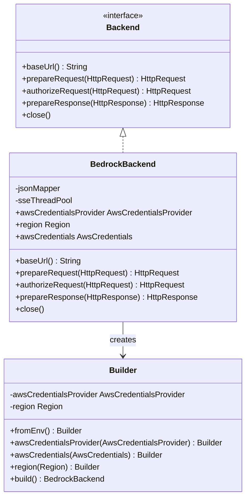
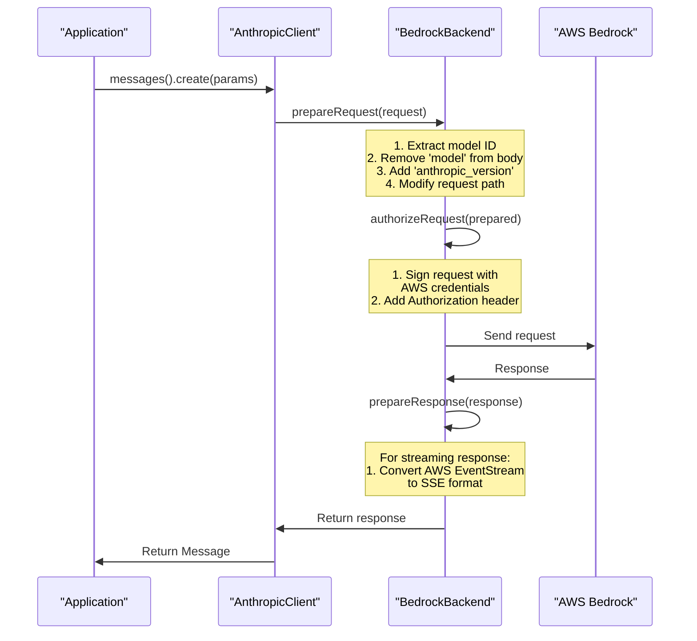
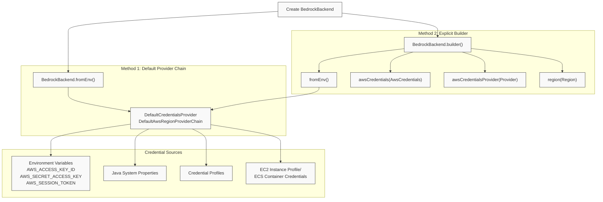

<!-- source: DeepWiki mcp.deepwiki.com · repo anthropics/anthropic-sdk-java · page 6.1 AWS Bedrock Integration · fetched 2026-10-26 -->

# AWS Bedrock Integration

<details>
<summary>Relevant source files</summary>

The following files were used as context for generating this wiki page:

- [.release-please-manifest.json](.release-please-manifest.json)
- [CHANGELOG.md](CHANGELOG.md)
- [README.md](README.md)
- [anthropic-java-bedrock/src/main/kotlin/com/anthropic/bedrock/backends/BedrockBackend.kt](anthropic-java-bedrock/src/main/kotlin/com/anthropic/bedrock/backends/BedrockBackend.kt)
- [anthropic-java-bedrock/src/test/kotlin/com/anthropic/bedrock/backends/BedrockBackendTest.kt](anthropic-java-bedrock/src/test/kotlin/com/anthropic/bedrock/backends/BedrockBackendTest.kt)
- [anthropic-java-vertex/src/main/kotlin/com/anthropic/vertex/backends/VertexBackend.kt](anthropic-java-vertex/src/main/kotlin/com/anthropic/vertex/backends/VertexBackend.kt)
- [anthropic-java-vertex/src/test/kotlin/com/anthropic/vertex/backends/VertexBackendTest.kt](anthropic-java-vertex/src/test/kotlin/com/anthropic/vertex/backends/VertexBackendTest.kt)
- [anthropic-java/build.gradle.kts](anthropic-java/build.gradle.kts)
- [build.gradle.kts](build.gradle.kts)

</details>


This page documents how to use the Anthropic Java SDK with AWS Bedrock. AWS Bedrock is an Amazon Web Services offering that provides access to Anthropic's Claude models through AWS infrastructure. This integration allows you to use the same Anthropic SDK interface while leveraging your existing AWS setup and billing relationship.

For information about Google Vertex AI integration, see [Google Vertex AI Integration](#6.2).

## Overview

The AWS Bedrock integration in the SDK enables applications to send requests to Claude models via AWS Bedrock instead of connecting directly to Anthropic's API. This integration is particularly useful for organizations that:

- Are already using AWS services
- Want to keep their AI workloads within the AWS ecosystem
- Prefer to use their existing AWS billing and governance

The integration handles all the necessary transformations between the Anthropic API format and AWS Bedrock's requirements, including authentication, request preparation, and response processing.

```mermaid
flowchart TD
    subgraph "Client Application"
        App["Java Application"]
    end

    subgraph "Anthropic Java SDK"
        Client["AnthropicClient"]
        Backend["Backend Interface"]
        BedrockBackend["BedrockBackend"]
    end

    subgraph "Cloud Services"
        AWS["AWS Bedrock"]
        AnthropicAPI["Anthropic API"]
    end

    App --> Client
    Client --> Backend
    Backend --> BedrockBackend
    Backend -.-> "Other backends"
    BedrockBackend --> AWS
    "Other backends" -.-> AnthropicAPI

    classDef default fill:#f9f9f9,stroke:#333,stroke-width:1px;
```

Sources: [README.md:458-464](), [anthropic-java-bedrock/src/main/kotlin/com/anthropic/bedrock/backends/BedrockBackend.kt:36-49]()

## Installation

To use the AWS Bedrock integration, you need to add the `anthropic-java-bedrock` dependency to your project:

### Gradle

```kotlin
implementation("com.anthropic:anthropic-java-bedrock:1.4.0")
```

### Maven

```xml
<dependency>
    <groupId>com.anthropic</groupId>
    <artifactId>anthropic-java-bedrock</artifactId>
    <version>1.4.0</version>
</dependency>
```

Sources: [README.md:467-479]()

## Setup and Configuration

### Creating a Client with BedrockBackend

To use the AWS Bedrock integration, you need to create an Anthropic client with a `BedrockBackend`:

```java
import com.anthropic.bedrock.backends.BedrockBackend;
import com.anthropic.client.AnthropicClient;
import com.anthropic.client.okhttp.AnthropicOkHttpClient;

AnthropicClient client = AnthropicOkHttpClient.builder()
        .backend(BedrockBackend.fromEnv())
        .build();
```

The `BedrockBackend.fromEnv()` method automatically resolves AWS credentials and region using the standard AWS provider chains.

Sources: [README.md:492-497]()

### AWS Credentials Configuration

The BedrockBackend requires AWS credentials and a region to function. There are several ways to configure these:

#### 1. Using Default Provider Chains

The `fromEnv()` method uses:
- [AWS default credentials provider chain](https://docs.aws.amazon.com/sdk-for-java/latest/developer-guide/credentials-chain.html) for authentication
- [AWS default region provider chain](https://docs.aws.amazon.com/sdk-for-java/latest/developer-guide/region-selection.html) for region selection

This will automatically use credentials from:
- Environment variables (`AWS_ACCESS_KEY_ID`, `AWS_SECRET_ACCESS_KEY`, `AWS_SESSION_TOKEN`)
- Java system properties
- Credential profiles
- EC2 Instance profiles or ECS container credentials
- Web identity token credentials

#### 2. Explicit Credentials

You can explicitly provide AWS credentials:

```java
import com.anthropic.bedrock.backends.BedrockBackend;
import com.anthropic.client.AnthropicClient;
import com.anthropic.client.okhttp.AnthropicOkHttpClient;
import software.amazon.awssdk.auth.credentials.AwsBasicCredentials;
import software.amazon.awssdk.regions.Region;

AnthropicClient client = AnthropicOkHttpClient.builder()
        .backend(BedrockBackend.builder()
                .awsCredentials(AwsBasicCredentials.create(
                        "AWS_ACCESS_KEY_ID",
                        "AWS_SECRET_ACCESS_KEY"))
                .region(Region.US_EAST_1)
                .build())
        .build();
```

#### 3. Custom Credentials Provider

For more complex scenarios, such as automatic credential refreshing, you can configure a custom AWS credentials provider:

```java
import com.anthropic.bedrock.backends.BedrockBackend;
import com.anthropic.client.AnthropicClient;
import com.anthropic.client.okhttp.AnthropicOkHttpClient;
import software.amazon.awssdk.auth.credentials.DefaultCredentialsProvider;

AnthropicClient client = AnthropicOkHttpClient.builder()
        .backend(BedrockBackend.builder()
                .fromEnv(DefaultCredentialsProvider.builder()
                        .asyncCredentialUpdateEnabled(true)
                        .build())
                .build())
        .build();
```

Sources: [README.md:498-557](), [anthropic-java-bedrock/src/main/kotlin/com/anthropic/bedrock/backends/BedrockBackend.kt:348-424]()

## Architecture

### BedrockBackend Component

The `BedrockBackend` class implements the `Backend` interface, serving as a bridge between the Anthropic Java SDK and AWS Bedrock service.



Sources: [anthropic-java-bedrock/src/main/kotlin/com/anthropic/bedrock/backends/BedrockBackend.kt:50-425]()

### Request-Response Flow

The BedrockBackend transforms requests and responses between the Anthropic API format and AWS Bedrock's requirements:



Sources: [anthropic-java-bedrock/src/main/kotlin/com/anthropic/bedrock/backends/BedrockBackend.kt:120-333]()

## Key Transformations

### Request Preparation

The `prepareRequest` method performs several transformations:

1. Validates the request and extracts service name (messages or complete)
2. Adds the Anthropic version for Bedrock: `"bedrock-2023-05-31"`
3. Processes beta version headers if present
4. Extracts the model ID from the request body
5. Determines if streaming is requested
6. Constructs a new request path in the format required by Bedrock:
   - For non-streaming: `/model/{modelId}/invoke`
   - For streaming: `/model/{modelId}/invoke-with-response-stream`

Sources: [anthropic-java-bedrock/src/main/kotlin/com/anthropic/bedrock/backends/BedrockBackend.kt:126-190]()

### Request Authorization

The `authorizeRequest` method signs the request using AWS Signature Version 4:

1. Ensures the request isn't already authorized
2. Constructs an AWS SDK HttpRequest from the Anthropic SDK HttpRequest
3. Signs the request using `AwsV4HttpSigner` with the configured AWS credentials
4. Copies the signed headers back to the original request

Sources: [anthropic-java-bedrock/src/main/kotlin/com/anthropic/bedrock/backends/BedrockBackend.kt:192-242]()

### Response Preparation

The `prepareResponse` method handles response transformation, particularly for streaming responses:

1. If the response isn't an AWS EventStream, it's returned as-is
2. For EventStream responses:
   - Creates a piped stream to transform the data
   - Decodes the AWS EventStream messages
   - Extracts the base64-encoded JSON payload
   - Converts to Server-Sent Events (SSE) format
   - Returns a modified HttpResponse with the transformed stream

Sources: [anthropic-java-bedrock/src/main/kotlin/com/anthropic/bedrock/backends/BedrockBackend.kt:244-333]()

## AWS Credentials Resolution

The BedrockBackend provides flexible options for resolving AWS credentials:



Sources: [anthropic-java-bedrock/src/main/kotlin/com/anthropic/bedrock/backends/BedrockBackend.kt:348-424](), [README.md:500-530]()

## Limitations

When using the AWS Bedrock integration, be aware of these limitations:

1. **Batch API**: The Bedrock integration does not support the Anthropic Batch API
2. **Token Counting API**: The Bedrock integration does not support the Anthropic Token Counting API

These limitations exist because AWS Bedrock doesn't provide these functionalities in their service.

Sources: [README.md:560-563]()

## Usage Example

Here's a complete example of using the AWS Bedrock integration:

```java
import com.anthropic.bedrock.backends.BedrockBackend;
import com.anthropic.client.AnthropicClient;
import com.anthropic.client.okhttp.AnthropicOkHttpClient;
import com.anthropic.models.messages.Message;
import com.anthropic.models.messages.MessageCreateParams;
import com.anthropic.models.messages.Model;

// Create client with BedrockBackend
AnthropicClient client = AnthropicOkHttpClient.builder()
        .backend(BedrockBackend.fromEnv())
        .build();

// Use the client in the same way as with direct Anthropic API
MessageCreateParams params = MessageCreateParams.builder()
        .maxTokens(1024L)
        .addUserMessage("Hello, Claude")
        .model(Model.CLAUDE_3_7_SONNET_LATEST)
        .build();

// Send request to Claude via AWS Bedrock
Message message = client.messages().create(params);
System.out.println(message.content());
```

Sources: [README.md:486-497]()

## Streaming with AWS Bedrock

Streaming is fully supported with the AWS Bedrock integration. The BedrockBackend automatically transforms streaming responses from AWS Bedrock's format to the standard SSE format used by the Anthropic SDK.

```java
import com.anthropic.bedrock.backends.BedrockBackend;
import com.anthropic.client.AnthropicClient;
import com.anthropic.client.okhttp.AnthropicOkHttpClient;
import com.anthropic.core.http.StreamResponse;
import com.anthropic.helpers.MessageAccumulator;
import com.anthropic.models.messages.MessageCreateParams;
import com.anthropic.models.messages.Model;
import com.anthropic.models.messages.RawMessageStreamEvent;

AnthropicClient client = AnthropicOkHttpClient.builder()
        .backend(BedrockBackend.fromEnv())
        .build();

MessageCreateParams params = MessageCreateParams.builder()
        .maxTokens(1024L)
        .addUserMessage("Write a short story about a robot")
        .model(Model.CLAUDE_3_7_SONNET_LATEST)
        .stream(true)
        .build();

MessageAccumulator accumulator = MessageAccumulator.create();

try (StreamResponse<RawMessageStreamEvent> response = client.messages().createStreaming(params)) {
    response.stream()
            .peek(accumulator::accumulate)
            .flatMap(event -> event.contentBlockDelta().stream())
            .flatMap(delta -> delta.delta().text().stream())
            .forEach(text -> System.out.print(text.text()));
}
```

Sources: [README.md:244-329](), [anthropic-java-bedrock/src/main/kotlin/com/anthropic/bedrock/backends/BedrockBackend.kt:244-333]()

## Troubleshooting

### Common Issues

1. **Missing AWS Credentials**
   - Ensure AWS credentials are properly configured through one of the methods described
   - Check environment variables, AWS credentials file, or AWS CLI configuration
   
2. **Missing AWS Region**
   - Make sure AWS region is configured either through environment variables, AWS config file, or explicitly in code
   
3. **Permission Issues**
   - Ensure the AWS credentials have appropriate permissions to access the Bedrock service
   - Check IAM policies to ensure they allow `bedrock:InvokeModel` and related actions

4. **Model Access**
   - Verify you have access to the Claude models in AWS Bedrock
   - Check if the model needs to be enabled in your AWS account

Sources: [anthropic-java-bedrock/src/main/kotlin/com/anthropic/bedrock/backends/BedrockBackend.kt:370-390](), [anthropic-java-bedrock/src/test/kotlin/com/anthropic/bedrock/backends/BedrockBackendTest.kt:117-145]()

## Summary

The AWS Bedrock integration for the Anthropic Java SDK provides a seamless way to access Claude models through AWS infrastructure. The integration:

1. Handles all necessary request and response transformations
2. Supports multiple methods for AWS credential configuration
3. Provides full streaming capability
4. Maintains the same client interface as direct API access

While some features (Batch API and Token Counting) are not supported, the core functionality for generating AI responses with Claude is fully available through AWS Bedrock.

---

